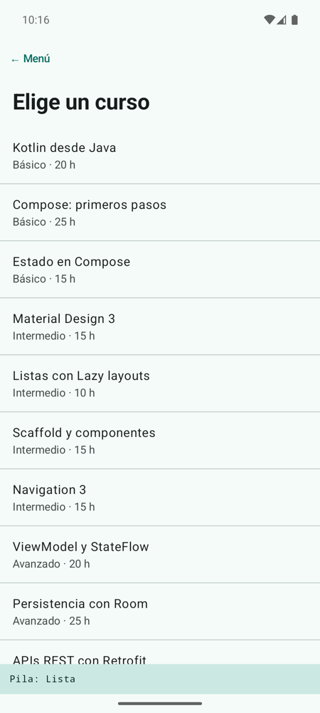
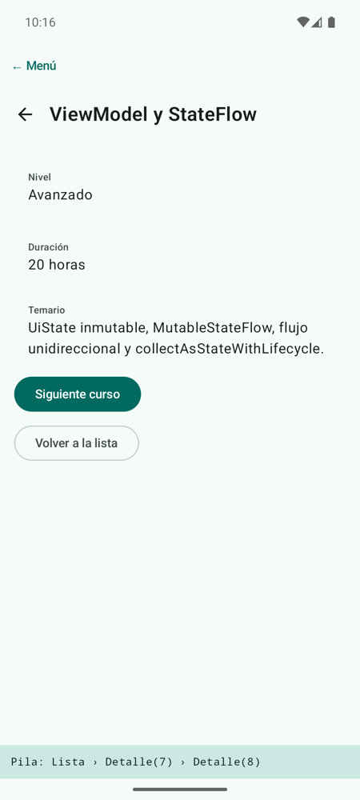

# **Codelab 3.05: Navegar entre Pantallas con Navigation 3**

Hasta ahora cada codelab era una sola pantalla. Las apps reales tienen varias: una lista y, al pulsar un elemento, su detalle. En este codelab convertirás el catálogo de cursos en una pequeña app con **dos pantallas** usando **Navigation 3**, la librería de navegación de Compose en la que la navegación es una **lista de claves** que controlas tú.

!!! info "Punto de partida: tag `c3.05-inicio`"
    Sigue en el repositorio del laboratorio, [pmdm2627-lab-ut3](https://github.com/jssdocente/pmdm2627-lab-ut3). Si terminaste el [Codelab 3.04](./04-propinas-formulario.md), continúa en tu rama. Si no, parte del tag:

    ```bash
    git checkout c3.05-inicio
    git switch -c mi-lab-3.05
    ```

    `c3.05-inicio` es `c3.04-fin`. Este codelab reutiliza el modelo `Curso` y la lista `catalogoCursos` del [Codelab 3.02](./02-catalogo-lazycolumn.md).

---

## 1. ¿Qué vas a construir?

Una lista de cursos. Al pulsar uno se abre su **detalle**, con una flecha para volver. Desde el detalle puedes saltar al **siguiente curso** o volver directamente a la lista. Una franja inferior muestra en todo momento cómo está la **pila de navegación**.

<div style="display: flex; flex-direction: row; justify-content: center; align-items: flex-start; gap: 1.5rem; flex-wrap: wrap; margin: 1.8rem 0;" markdown="1">

<figure style="margin: 0; text-align: center; max-width: 260px;" markdown="1">

{ style="border-radius: 8px; box-shadow: 0 4px 10px rgba(0,0,0,0.15); width: 100%; max-width: 250px;" }

<figcaption style="font-size: 0.85rem; margin-top: 0.5rem; color: var(--md-default-fg-color--light);"><strong>Figura 1:</strong> La lista, con una sola clave en la pila.</figcaption>
</figure>

<figure style="margin: 0; text-align: center; max-width: 260px;" markdown="1">

{ style="border-radius: 8px; box-shadow: 0 4px 10px rgba(0,0,0,0.15); width: 100%; max-width: 250px;" }

<figcaption style="font-size: 0.85rem; margin-top: 0.5rem; color: var(--md-default-fg-color--light);"><strong>Figura 2:</strong> Dos detalles apilados sobre la lista.</figcaption>
</figure>

</div>

Al terminar, serás capaz de:

- Añadir Navigation 3 y el plugin de serialización a un proyecto.
- Definir cada pantalla como una **clave** (`NavKey`), con o sin argumentos.
- Crear la pila con `rememberNavBackStack` y mostrarla con `NavDisplay`.
- Navegar añadiendo claves a la pila y volver quitándolas.
- Escribir pantallas que no conocen la navegación: reciben datos y avisan con lambdas.

---

## 2. La Navegación es una Lista

En Navigation 3, la navegación es una **pila** (*back stack*): una lista de claves, una por pantalla. La pantalla visible es la **última**. Navegar es añadir una clave; volver es quitar la última:

<figure class="arq-fig">
--8<-- "docs/temas/03/codelabs/images/c3.05-pila.svg"
<figcaption>Cada acción del usuario cambia la lista; <code>NavDisplay</code> pinta siempre la última clave.</figcaption>
</figure>

Es la misma idea que el menú del laboratorio, donde `LabApp` guarda qué pantalla se ve en un estado. La diferencia es que ahora guardamos **el camino completo**, y por eso el botón «atrás» sabe adónde volver.

La teoría completa está en [3B.1 Navegación con Navigation 3](../b-navegacion/3b.1-navigation3.md). En clase la aplicas a FichaJuego en las sesiones [3.03](../sesiones/s03-navigation3-i.md) y [3.04](../sesiones/s04-navigation3-ii-edge-to-edge.md).

---

## 3. Paso 1: Las Dependencias

Navigation 3 necesita dos librerías y la serialización de Kotlin, que permite **guardar la pila** al girar la pantalla. Añádelas al catálogo de versiones:

```toml
[versions]
nav3Core = "1.2.0"
kotlinxSerializationCore = "1.9.0"

[libraries]
androidx-navigation3-runtime = { module = "androidx.navigation3:navigation3-runtime", version.ref = "nav3Core" }
androidx-navigation3-ui = { module = "androidx.navigation3:navigation3-ui", version.ref = "nav3Core" }
kotlinx-serialization-core = { module = "org.jetbrains.kotlinx:kotlinx-serialization-core", version.ref = "kotlinxSerializationCore" }

[plugins]
jetbrains-kotlin-serialization = { id = "org.jetbrains.kotlin.plugin.serialization", version.ref = "kotlin" }
```

Declara el plugin en el `build.gradle.kts` raíz con `apply false`, y aplícalo y añade las librerías en `app/build.gradle.kts`:

```kotlin
plugins {
    alias(libs.plugins.android.application)
    alias(libs.plugins.kotlin.compose)
    alias(libs.plugins.jetbrains.kotlin.serialization)
}

dependencies {
    // …
    implementation(libs.androidx.navigation3.runtime)
    implementation(libs.androidx.navigation3.ui)
    implementation(libs.kotlinx.serialization.core)
}
```

Sincroniza Gradle (el icono del elefante) antes de seguir.

---

## 4. Paso 2: Las Claves de cada Pantalla

Crea el paquete `codelabs/codelab05_navegacion` y, dentro, `Destinos.kt`. Cada pantalla es una clave que implementa `NavKey` y lleva `@Serializable`:

```kotlin
// Cada pantalla es una clave: NavKey + @Serializable para que la pila se pueda guardar.

// Sin argumentos: data object
@Serializable
data object ListaCursos : NavKey

// Con argumentos: data class. Pasamos solo el id, no el Curso entero
@Serializable
data class DetalleCurso(val cursoId: Int) : NavKey
```

- La lista no necesita datos: es un **`data object`**.
- El detalle necesita saber qué curso mostrar: es una **`data class`** con el id. Pasa **solo el id**, no el `Curso` entero: la clave se guarda al girar la pantalla, y cuanto más pequeña, mejor.

---

## 5. Paso 3: Las Dos Pantallas

Las pantallas **no saben nada de la pila**: reciben datos y avisan con lambdas. Así se pueden previsualizar y reutilizar.

`ListaCursosScreen` muestra los cursos con `ListItem`, un componente de Material 3 para filas de lista, y avisa con el id del curso pulsado:

```kotlin
// No sabe nada de la pila: avisa con el id del curso pulsado
@Composable
fun ListaCursosScreen(
    cursos: List<Curso>,
    onCursoClick: (Int) -> Unit,
    modifier: Modifier = Modifier
) {
    LazyColumn(modifier = modifier.fillMaxSize()) {
        item {
            Text(
                text = "Elige un curso",
                style = MaterialTheme.typography.headlineMedium,
                modifier = Modifier.padding(16.dp)
            )
        }
        items(cursos, key = { it.id }) { curso ->
            ListItem(
                headlineContent = { Text(curso.titulo) },
                supportingContent = { Text("${curso.nivel} · ${curso.horas} h") },
                modifier = Modifier.clickable { onCursoClick(curso.id) }
            )
            HorizontalDivider()
        }
    }
}
```

`DetalleCursoScreen` recibe el curso **ya buscado**, que puede ser `null` porque el id de la clave podría no existir. Su `TopAppBar` tiene una flecha en `navigationIcon` que llama a `onVolver`:

??? example "Ver código: `DetalleCursoScreen.kt`"

    ```kotlin
    package com.pmdm.lab.ut3.codelabs.codelab05_navegacion

    import androidx.compose.foundation.layout.Arrangement
    import androidx.compose.foundation.layout.Column
    import androidx.compose.foundation.layout.fillMaxSize
    import androidx.compose.foundation.layout.padding
    import androidx.compose.material3.Button
    import androidx.compose.material3.ExperimentalMaterial3Api
    import androidx.compose.material3.Icon
    import androidx.compose.material3.IconButton
    import androidx.compose.material3.ListItem
    import androidx.compose.material3.MaterialTheme
    import androidx.compose.material3.OutlinedButton
    import androidx.compose.material3.Scaffold
    import androidx.compose.material3.Text
    import androidx.compose.material3.TopAppBar
    import androidx.compose.runtime.Composable
    import androidx.compose.ui.Modifier
    import androidx.compose.ui.res.painterResource
    import androidx.compose.ui.tooling.preview.Preview
    import androidx.compose.ui.unit.dp
    import com.pmdm.lab.ut3.R
    import com.pmdm.lab.ut3.codelabs.codelab02_catalogo.Curso
    import com.pmdm.lab.ut3.codelabs.codelab02_catalogo.catalogoCursos
    import com.pmdm.lab.ut3.ui.theme.LabUt3Theme

    /**
     * Detalle de un curso. Recibe el curso ya buscado (puede no existir: el id
     * de la clave podría no estar en el catálogo) y avisa con lambdas.
     */
    @OptIn(ExperimentalMaterial3Api::class)
    @Composable
    fun DetalleCursoScreen(
        curso: Curso?,
        onSiguiente: () -> Unit,
        onVolver: () -> Unit,
        onVolverAlInicio: () -> Unit,
        modifier: Modifier = Modifier
    ) {
        Scaffold(
            modifier = modifier,
            topBar = {
                TopAppBar(
                    title = { Text(curso?.titulo ?: "Curso no encontrado") },
                    navigationIcon = {
                        IconButton(onClick = onVolver) {
                            Icon(painterResource(R.drawable.ic_arrow_back), contentDescription = "Volver")
                        }
                    }
                )
            }
        ) { innerPadding ->
            Column(
                modifier = Modifier
                    .fillMaxSize()
                    .padding(innerPadding)
                    .padding(16.dp),
                verticalArrangement = Arrangement.spacedBy(8.dp)
            ) {
                if (curso == null) {
                    Text("Ese curso no está en el catálogo.", style = MaterialTheme.typography.bodyLarge)
                } else {
                    ListItem(
                        overlineContent = { Text("Nivel") },
                        headlineContent = { Text(curso.nivel) }
                    )
                    ListItem(
                        overlineContent = { Text("Duración") },
                        headlineContent = { Text("${curso.horas} horas") }
                    )
                    ListItem(
                        overlineContent = { Text("Temario") },
                        headlineContent = { Text(curso.temario) }
                    )
                    Button(onClick = onSiguiente) {
                        Text("Siguiente curso")
                    }
                }
                OutlinedButton(onClick = onVolverAlInicio) {
                    Text("Volver a la lista")
                }
            }
        }
    }

    @Preview(showBackground = true)
    @Composable
    private fun DetalleCursoPreview() {
        LabUt3Theme {
            DetalleCursoScreen(curso = catalogoCursos[6], onSiguiente = {}, onVolver = {}, onVolverAlInicio = {})
        }
    }

    @Preview(showBackground = true)
    @Composable
    private fun DetalleCursoNoEncontradoPreview() {
        LabUt3Theme {
            DetalleCursoScreen(curso = null, onSiguiente = {}, onVolver = {}, onVolverAlInicio = {})
        }
    }
    ```

Prueba a pulsar **Siguiente curso** en el último curso: el id 13 no existe y la pantalla muestra «Curso no encontrado» en lugar de cerrarse la app.

---

## 6. Paso 4: La Pila y `NavDisplay`

Crea `CursosApp.kt`. Es el **único** sitio que toca la pila:

```kotlin
fun CursosApp(modifier: Modifier = Modifier) {
    // La pila empieza con una sola pantalla. rememberNavBackStack la conserva al girar
    val pila = rememberNavBackStack(ListaCursos)

    Column(modifier = modifier) {
        NavDisplay(
            backStack = pila,
            // Atrás (gesto, botón del sistema o flecha): quitar la pantalla de arriba
            onBack = { pila.removeLastOrNull() },
            entryProvider = entryProvider {
                entry<ListaCursos> {
                    ListaCursosScreen(
                        cursos = catalogoCursos,
                        onCursoClick = { id -> pila.add(DetalleCurso(cursoId = id)) }
                    )
                }
                // La clave trae los argumentos: clave.cursoId
                entry<DetalleCurso> { clave ->
                    DetalleCursoScreen(
                        curso = catalogoCursos.find { it.id == clave.cursoId },
                        onSiguiente = { pila.add(DetalleCurso(cursoId = clave.cursoId + 1)) },
                        onVolver = { pila.removeLastOrNull() },
                        onVolverAlInicio = {
                            // Quitamos todo lo que hay encima de la primera pantalla
                            while (pila.size > 1) pila.removeLastOrNull()
                        }
                    )
                }
            },
            modifier = Modifier.weight(1f)
        )

        // Solo para el codelab: así ves cómo crece y decrece la pila
        Surface(color = MaterialTheme.colorScheme.secondaryContainer) {
            Text(
                text = "Pila: " + pila.joinToString(" › ") { describir(it) },
                style = MaterialTheme.typography.labelMedium,
                modifier = Modifier
                    .fillMaxWidth()
                    .padding(12.dp)
            )
        }
    }
}
```

1. **`rememberNavBackStack(ListaCursos)`** crea la pila con la primera pantalla y la conserva al girar el móvil (por eso las claves son `@Serializable`).

2. **`entryProvider { entry<Clave> { … } }`** dice qué composable corresponde a cada tipo de clave. En `entry<DetalleCurso> { clave -> … }`, la clave trae los argumentos: `clave.cursoId`.

3. **`NavDisplay`** pinta la última clave de la pila. Su `onBack` se llama con el gesto o el botón atrás del sistema.

4. Las lambdas navegan cambiando la lista: `pila.add(...)` para ir, `pila.removeLastOrNull()` para volver, y un bucle para volver a la lista quitando todo lo que hay encima de la primera clave.

??? example "Ver código completo: `CursosApp.kt` (con los imports y `describir`)"

    ```kotlin
    package com.pmdm.lab.ut3.codelabs.codelab05_navegacion

    import androidx.compose.foundation.layout.Column
    import androidx.compose.foundation.layout.fillMaxWidth
    import androidx.compose.foundation.layout.padding
    import androidx.compose.material3.MaterialTheme
    import androidx.compose.material3.Surface
    import androidx.compose.material3.Text
    import androidx.compose.runtime.Composable
    import androidx.compose.ui.Modifier
    import androidx.compose.ui.unit.dp
    import androidx.navigation3.runtime.NavKey
    import androidx.navigation3.runtime.entryProvider
    import androidx.navigation3.runtime.rememberNavBackStack
    import androidx.navigation3.ui.NavDisplay
    import com.pmdm.lab.ut3.codelabs.codelab02_catalogo.catalogoCursos

    /**
     * Raíz de la navegación del codelab: la pila y qué pantalla corresponde a cada clave.
     * Es el único sitio que toca la pila: las pantallas solo reciben lambdas.
     */
    @Composable
    fun CursosApp(modifier: Modifier = Modifier) {
        // La pila empieza con una sola pantalla. rememberNavBackStack la conserva al girar
        val pila = rememberNavBackStack(ListaCursos)

        Column(modifier = modifier) {
            NavDisplay(
                backStack = pila,
                // Atrás (gesto, botón del sistema o flecha): quitar la pantalla de arriba
                onBack = { pila.removeLastOrNull() },
                entryProvider = entryProvider {
                    entry<ListaCursos> {
                        ListaCursosScreen(
                            cursos = catalogoCursos,
                            onCursoClick = { id -> pila.add(DetalleCurso(cursoId = id)) }
                        )
                    }
                    // La clave trae los argumentos: clave.cursoId
                    entry<DetalleCurso> { clave ->
                        DetalleCursoScreen(
                            curso = catalogoCursos.find { it.id == clave.cursoId },
                            onSiguiente = { pila.add(DetalleCurso(cursoId = clave.cursoId + 1)) },
                            onVolver = { pila.removeLastOrNull() },
                            onVolverAlInicio = {
                                // Quitamos todo lo que hay encima de la primera pantalla
                                while (pila.size > 1) pila.removeLastOrNull()
                            }
                        )
                    }
                },
                modifier = Modifier.weight(1f)
            )

            // Solo para el codelab: así ves cómo crece y decrece la pila
            Surface(color = MaterialTheme.colorScheme.secondaryContainer) {
                Text(
                    text = "Pila: " + pila.joinToString(" › ") { describir(it) },
                    style = MaterialTheme.typography.labelMedium,
                    modifier = Modifier
                        .fillMaxWidth()
                        .padding(12.dp)
                )
            }
        }
    }

    private fun describir(clave: NavKey): String = when (clave) {
        is ListaCursos -> "Lista"
        is DetalleCurso -> "Detalle(${clave.cursoId})"
        else -> "?"
    }
    ```

Añade la pantalla al menú: la entrada `NAVEGACION` en `PantallaLab` y su rama en el `when`, que llama a `CursosApp()`.

!!! info "Dos niveles de «atrás»"
    Con la pila en el detalle, el botón atrás lo atiende `NavDisplay` y vuelve a la pantalla anterior. Cuando la pila solo tiene la lista, `NavDisplay` ya no puede volver y el «atrás» llega al `BackHandler` de `LabApp`, que te devuelve al menú del laboratorio.

---

## 7. Experimenta

1. Abre tres detalles seguidos con **Siguiente curso** y vuelve con el gesto atrás, mirando la franja de la pila.

2. Gira el emulador con dos detalles abiertos. ¿Se conserva la pila? Cambia `rememberNavBackStack` por `remember { mutableStateListOf<NavKey>(ListaCursos) }` y vuelve a girar.

3. Añade una tercera pantalla, `AcercaDe` (un `data object`), con un botón en la lista que la abra.

4. Haz que **Volver a la lista** use `pila.subList(1, pila.size).clear()` en lugar del bucle.

!!! success "Solución: tag `c3.05-fin`"
    Compara tu código con el tag [`c3.05-fin`](https://github.com/jssdocente/pmdm2627-lab-ut3/tree/c3.05-fin) (`git diff c3.05-fin`). Es también el punto de partida del [Codelab 3.06](./06-quiz-viewmodel.md).

---

## 8. Resumen y Checklist

- [ ] El proyecto tiene Navigation 3, `kotlinx-serialization-core` y el plugin de serialización.
- [ ] Cada pantalla es una clave `@Serializable` que implementa `NavKey`; el detalle lleva solo el id.
- [ ] `CursosApp` crea la pila con `rememberNavBackStack` y es el único que la modifica.
- [ ] Las pantallas reciben datos y lambdas; ninguna conoce la pila.
- [ ] Volver funciona con la flecha, con el gesto atrás y con **Volver a la lista**, y la pila sobrevive al giro.
