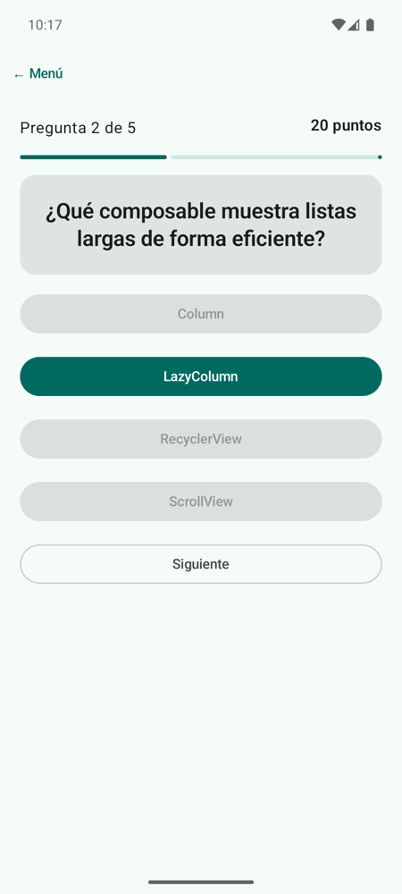
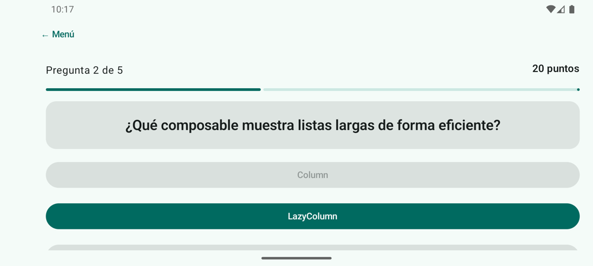

# **Codelab 3.06: Quiz con ViewModel y `StateFlow`**

Hasta ahora el estado de cada pantalla vivía en la propia pantalla, con `remember` o `rememberSaveable`. Funciona para un contador, pero no para una pantalla con reglas: quién decide si una respuesta es correcta, cuántos puntos suma, cuándo termina la partida. En este codelab sacarás todo eso a un **ViewModel**, que publica el estado en un **`StateFlow`** y sobrevive al giro de pantalla. Construirás un **quiz** de cinco preguntas sobre la propia unidad.

!!! info "Punto de partida: tag `c3.06-inicio`"
    Sigue en el repositorio del laboratorio, [pmdm2627-lab-ut3](https://github.com/jssdocente/pmdm2627-lab-ut3). Si terminaste el [Codelab 3.05](./05-navegacion-navigation3.md), continúa en tu rama. Si no, parte del tag:

    ```bash
    git checkout c3.06-inicio
    git switch -c mi-lab-3.06
    ```

    `c3.06-inicio` es `c3.05-fin`: el laboratorio con cinco codelabs, el último con Navigation 3.

---

## 1. ¿Qué vas a construir?

Un quiz de cinco preguntas. Al elegir una opción, se pinta en verde si aciertas y en rojo si fallas, y las demás se desactivan. **Siguiente** pasa a la pregunta siguiente y, al final, un diálogo muestra la puntuación. Si giras el móvil a mitad de partida, la pregunta y los puntos siguen ahí.

<div style="display: flex; flex-direction: row; justify-content: center; align-items: flex-start; gap: 1.5rem; flex-wrap: wrap; margin: 1.8rem 0;" markdown="1">

<figure style="margin: 0; text-align: center; max-width: 260px;" markdown="1">

{ style="border-radius: 8px; box-shadow: 0 4px 10px rgba(0,0,0,0.15); width: 100%; max-width: 250px;" }

<figcaption style="font-size: 0.85rem; margin-top: 0.5rem; color: var(--md-default-fg-color--light);"><strong>Figura 1:</strong> La segunda pregunta, acertada.</figcaption>
</figure>

<figure style="margin: 0; text-align: center; max-width: 440px;" markdown="1">

{ style="border-radius: 8px; box-shadow: 0 4px 10px rgba(0,0,0,0.15); width: 100%; max-width: 430px;" }

<figcaption style="font-size: 0.85rem; margin-top: 0.5rem; color: var(--md-default-fg-color--light);"><strong>Figura 2:</strong> Tras girar: la pregunta, la respuesta y los puntos se conservan.</figcaption>
</figure>

</div>

Al terminar, serás capaz de:

- Explicar por qué el estado de una pantalla con reglas va en un `ViewModel`.
- Modelar todo lo que muestra la pantalla en una `data class` **`UiState`** inmutable.
- Publicar el estado con `MutableStateFlow` privado y `StateFlow` público, y cambiarlo con `update` y `copy`.
- Observarlo desde Compose con `collectAsStateWithLifecycle()`.
- Probar el ViewModel con tests unitarios, sin emulador.

---

## 2. El Flujo Unidireccional

La pantalla y el ViewModel se reparten el trabajo:

<figure class="arq-fig">
--8<-- "docs/temas/03/codelabs/images/c3.06-udf.svg"
<figcaption>El ViewModel es el único que cambia el estado; la pantalla lo pinta y le avisa de lo que hace el usuario.</figcaption>
</figure>

- El **estado baja**: el ViewModel publica un `QuizUiState` y la pantalla lo pinta tal cual, sin calcular nada.
- Los **eventos suben**: la pantalla no cambia nada por su cuenta, solo llama a funciones del ViewModel (`elegirOpcion`, `siguiente`, `reiniciar`).

Este patrón se llama **flujo unidireccional de datos** (*UDF*), y es el mismo state hoisting de la UT2, llevado un nivel más arriba. La teoría completa está en [3C.1 Capa de UI: ViewModel y StateFlow](../c-arquitectura/3c.1-capa-ui-viewmodel.md), y en clase lo aplicas a FichaJuego en la [sesión 3.05](../sesiones/s05-viewmodel-uistate-i.md).

---

## 3. Paso 1: Las Dependencias

Añade dos librerías de *lifecycle* al catálogo, con la misma versión que `lifecycle-runtime-ktx`, y a `app/build.gradle.kts`:

```toml
androidx-lifecycle-viewmodel-compose = { group = "androidx.lifecycle", name = "lifecycle-viewmodel-compose", version.ref = "lifecycleRuntimeKtx" }
androidx-lifecycle-runtime-compose = { group = "androidx.lifecycle", name = "lifecycle-runtime-compose", version.ref = "lifecycleRuntimeKtx" }
```

```kotlin
implementation(libs.androidx.lifecycle.viewmodel.compose)   // viewModel()
implementation(libs.androidx.lifecycle.runtime.compose)     // collectAsStateWithLifecycle()
```

---

## 4. Paso 2: El Estado de la Pantalla

Crea el paquete `codelabs/codelab06_quiz` y, dentro, `QuizUiState.kt`. Es una «foto» de todo lo que se ve: la pregunta, las opciones, el número de pregunta, los puntos, la opción elegida y si ha terminado:

```kotlin
/**
 * Todo lo que la pantalla necesita para dibujarse, en un único objeto inmutable.
 * La pantalla no calcula nada: solo lee estos valores.
 */
data class QuizUiState(
    val enunciado: String = "",
    val opciones: List<String> = emptyList(),
    val numeroPregunta: Int = 1,
    val totalPreguntas: Int = 0,
    val puntos: Int = 0,
    val opcionElegida: String? = null,
    val esCorrecta: Boolean? = null,
    val terminado: Boolean = false
) {
    // Propiedad derivada: se calcula a partir de las demás
    val progreso: Float
        get() = if (totalPreguntas > 0) numeroPregunta.toFloat() / totalPreguntas else 0f
}
```

- Todo es **`val`**: el estado no se modifica, se sustituye por otro con `copy`.
- `opcionElegida` y `esCorrecta` son **nullables**: `null` significa «todavía no ha respondido».
- `progreso` es una **propiedad derivada**: se calcula a partir de las demás, como el total de la calculadora de propinas.

---

## 5. Paso 3: El ViewModel

Crea `QuizViewModel.kt`. Contiene las preguntas, el estado y las reglas:

```kotlin
/**
 * Guarda el estado del quiz y las reglas del juego. Sobrevive al giro:
 * la Activity se recrea, pero el ViewModel sigue siendo el mismo.
 */
class QuizViewModel(
    private val preguntas: List<Pregunta> = preguntasQuiz
) : ViewModel() {

    // Privado y mutable: solo el ViewModel lo cambia
    private val _uiState = MutableStateFlow(estadoDePregunta(0, puntos = 0))
    // Público y de solo lectura: la pantalla lo observa
    val uiState: StateFlow<QuizUiState> = _uiState.asStateFlow()

    private var indice = 0
```

El estado se expone dos veces, con el mismo patrón que verás en todas las apps Android:

- **`_uiState`** es un `MutableStateFlow` **privado**: solo el ViewModel puede cambiarlo.
- **`uiState`** es un `StateFlow` **público** y de solo lectura: la pantalla lo observa, pero no puede escribir en él.

Las funciones públicas son los eventos. Cada una calcula el estado nuevo a partir del actual con `update { it.copy(…) }`:

```kotlin
fun elegirOpcion(opcion: String) {
    // Si ya se ha respondido, no se puede cambiar la respuesta
    if (_uiState.value.opcionElegida != null) return

    val acierto = opcion == preguntas[indice].correcta
    _uiState.update { estado ->
        estado.copy(
            opcionElegida = opcion,
            esCorrecta = acierto,
            puntos = if (acierto) estado.puntos + 10 else estado.puntos
        )
    }
}
```

La primera línea es una **regla del juego**: una vez respondida, la pregunta no admite otra respuesta. Está en el ViewModel, no en la pantalla, y por eso se puede probar con un test.

??? example "Ver código completo: `QuizViewModel.kt` (con las cinco preguntas)"

    ```kotlin
    package com.pmdm.lab.ut3.codelabs.codelab06_quiz

    import androidx.lifecycle.ViewModel
    import kotlinx.coroutines.flow.MutableStateFlow
    import kotlinx.coroutines.flow.StateFlow
    import kotlinx.coroutines.flow.asStateFlow
    import kotlinx.coroutines.flow.update

    data class Pregunta(
        val enunciado: String,
        val opciones: List<String>,
        val correcta: String
    )

    val preguntasQuiz = listOf(
        Pregunta(
            "¿Qué función recuerda un valor entre recomposiciones?",
            listOf("remember", "saveState", "keep", "retain"), "remember"
        ),
        Pregunta(
            "¿Qué composable muestra listas largas de forma eficiente?",
            listOf("Column", "LazyColumn", "RecyclerView", "ScrollView"), "LazyColumn"
        ),
        Pregunta(
            "¿Qué parámetro de Scaffold hay que aplicar al contenido?",
            listOf("innerPadding", "contentColor", "topBar", "modifier"), "innerPadding"
        ),
        Pregunta(
            "¿Dónde sobrevive el estado al girar la pantalla?",
            listOf("remember", "Una variable local", "ViewModel", "@Preview"), "ViewModel"
        ),
        Pregunta(
            "En Navigation 3, ¿qué es la pila de navegación?",
            listOf("Un XML", "Una lista de claves", "Un Fragment", "Un Intent"), "Una lista de claves"
        )
    )

    /**
     * Guarda el estado del quiz y las reglas del juego. Sobrevive al giro:
     * la Activity se recrea, pero el ViewModel sigue siendo el mismo.
     */
    class QuizViewModel(
        private val preguntas: List<Pregunta> = preguntasQuiz
    ) : ViewModel() {

        // Privado y mutable: solo el ViewModel lo cambia
        private val _uiState = MutableStateFlow(estadoDePregunta(0, puntos = 0))
        // Público y de solo lectura: la pantalla lo observa
        val uiState: StateFlow<QuizUiState> = _uiState.asStateFlow()

        private var indice = 0

        fun elegirOpcion(opcion: String) {
            // Si ya se ha respondido, no se puede cambiar la respuesta
            if (_uiState.value.opcionElegida != null) return

            val acierto = opcion == preguntas[indice].correcta
            _uiState.update { estado ->
                estado.copy(
                    opcionElegida = opcion,
                    esCorrecta = acierto,
                    puntos = if (acierto) estado.puntos + 10 else estado.puntos
                )
            }
        }

        fun siguiente() {
            if (indice + 1 < preguntas.size) {
                indice++
                _uiState.update { estadoDePregunta(indice, puntos = it.puntos) }
            } else {
                _uiState.update { it.copy(terminado = true) }
            }
        }

        fun reiniciar() {
            indice = 0
            _uiState.value = estadoDePregunta(0, puntos = 0)
        }

        private fun estadoDePregunta(i: Int, puntos: Int): QuizUiState {
            val pregunta = preguntas[i]
            return QuizUiState(
                enunciado = pregunta.enunciado,
                opciones = pregunta.opciones,
                numeroPregunta = i + 1,
                totalPreguntas = preguntas.size,
                puntos = puntos
            )
        }
    }
    ```

!!! tip "Las preguntas, por el constructor"
    `QuizViewModel(preguntas: List<Pregunta> = preguntasQuiz)` recibe las preguntas con un valor por defecto. La app usa las cinco del quiz, y los tests le pasan dos preguntas sencillas cuya respuesta conocen.

---

## 6. Paso 4: La Pantalla

Crea `QuizScreen.kt` con las dos partes de siempre:

```kotlin
// Con estado: obtiene el ViewModel y observa su uiState
@Composable
fun QuizScreen(
    modifier: Modifier = Modifier,
    viewModel: QuizViewModel = viewModel()
) {
    // Cada vez que el StateFlow emite un estado nuevo, la pantalla se recompone
    val uiState by viewModel.uiState.collectAsStateWithLifecycle()

    QuizContent(
        uiState = uiState,
        onOpcionClick = viewModel::elegirOpcion,
        onSiguiente = viewModel::siguiente,
        onReiniciar = viewModel::reiniciar,
        modifier = modifier
    )
}
```

- **`viewModel()`** crea el ViewModel la primera vez y, después de girar la pantalla, devuelve **el mismo**. Va como parámetro con valor por defecto para que un test pueda pasar uno propio.
- **`collectAsStateWithLifecycle()`** convierte el `StateFlow` en un estado de Compose: cada vez que el ViewModel emite un estado nuevo, la pantalla se recompone. Además, deja de escuchar cuando la app pasa a segundo plano.
- **`viewModel::elegirOpcion`** es una *referencia a función*: equivale a `{ opcion -> viewModel.elegirOpcion(opcion) }`.

`QuizContent` no sabe que existe un ViewModel: recibe un `QuizUiState` y lambdas. Decide el color de cada botón a partir del estado:

```kotlin
val respondida = uiState.opcionElegida != null
uiState.opciones.forEach { opcion ->
    // La opción elegida se pinta de primary si acierta y de error si falla
    val colores = when {
        opcion != uiState.opcionElegida -> ButtonDefaults.filledTonalButtonColors()
        uiState.esCorrecta == true -> ButtonDefaults.buttonColors()
        else -> ButtonDefaults.buttonColors(
            containerColor = MaterialTheme.colorScheme.error,
            contentColor = MaterialTheme.colorScheme.onError
        )
    }
    Button(
        onClick = { onOpcionClick(opcion) },
        enabled = !respondida || opcion == uiState.opcionElegida,
        colors = colores,
        modifier = Modifier.fillMaxWidth()
    ) {
        Text(opcion)
    }
}
```

??? example "Ver código completo: `QuizScreen.kt`"

    ```kotlin
    package com.pmdm.lab.ut3.codelabs.codelab06_quiz

    import androidx.compose.foundation.layout.Arrangement
    import androidx.compose.foundation.layout.Column
    import androidx.compose.foundation.layout.Row
    import androidx.compose.foundation.layout.fillMaxSize
    import androidx.compose.foundation.layout.fillMaxWidth
    import androidx.compose.foundation.layout.padding
    import androidx.compose.foundation.rememberScrollState
    import androidx.compose.foundation.verticalScroll
    import androidx.compose.material3.AlertDialog
    import androidx.compose.material3.Button
    import androidx.compose.material3.ButtonDefaults
    import androidx.compose.material3.Card
    import androidx.compose.material3.LinearProgressIndicator
    import androidx.compose.material3.MaterialTheme
    import androidx.compose.material3.OutlinedButton
    import androidx.compose.material3.Text
    import androidx.compose.material3.TextButton
    import androidx.compose.runtime.Composable
    import androidx.compose.runtime.getValue
    import androidx.compose.ui.Modifier
    import androidx.compose.ui.text.style.TextAlign
    import androidx.compose.ui.tooling.preview.Preview
    import androidx.compose.ui.unit.dp
    import androidx.lifecycle.compose.collectAsStateWithLifecycle
    import androidx.lifecycle.viewmodel.compose.viewModel
    import com.pmdm.lab.ut3.ui.theme.LabUt3Theme

    // Con estado: obtiene el ViewModel y observa su uiState
    @Composable
    fun QuizScreen(
        modifier: Modifier = Modifier,
        viewModel: QuizViewModel = viewModel()
    ) {
        // Cada vez que el StateFlow emite un estado nuevo, la pantalla se recompone
        val uiState by viewModel.uiState.collectAsStateWithLifecycle()

        QuizContent(
            uiState = uiState,
            onOpcionClick = viewModel::elegirOpcion,
            onSiguiente = viewModel::siguiente,
            onReiniciar = viewModel::reiniciar,
            modifier = modifier
        )
    }

    // Sin estado: el estado baja, los eventos suben
    @Composable
    fun QuizContent(
        uiState: QuizUiState,
        onOpcionClick: (String) -> Unit,
        onSiguiente: () -> Unit,
        onReiniciar: () -> Unit,
        modifier: Modifier = Modifier
    ) {
        Column(
            modifier = modifier
                .fillMaxSize()
                .verticalScroll(rememberScrollState())
                .padding(20.dp),
            verticalArrangement = Arrangement.spacedBy(16.dp)
        ) {
            Row(
                modifier = Modifier.fillMaxWidth(),
                horizontalArrangement = Arrangement.SpaceBetween
            ) {
                Text("Pregunta ${uiState.numeroPregunta} de ${uiState.totalPreguntas}")
                Text("${uiState.puntos} puntos", style = MaterialTheme.typography.titleMedium)
            }
            LinearProgressIndicator(
                progress = { uiState.progreso },
                modifier = Modifier.fillMaxWidth()
            )

            Card(modifier = Modifier.fillMaxWidth()) {
                Text(
                    text = uiState.enunciado,
                    style = MaterialTheme.typography.titleLarge,
                    textAlign = TextAlign.Center,
                    modifier = Modifier
                        .fillMaxWidth()
                        .padding(24.dp)
                )
            }

            val respondida = uiState.opcionElegida != null
            uiState.opciones.forEach { opcion ->
                // La opción elegida se pinta de primary si acierta y de error si falla
                val colores = when {
                    opcion != uiState.opcionElegida -> ButtonDefaults.filledTonalButtonColors()
                    uiState.esCorrecta == true -> ButtonDefaults.buttonColors()
                    else -> ButtonDefaults.buttonColors(
                        containerColor = MaterialTheme.colorScheme.error,
                        contentColor = MaterialTheme.colorScheme.onError
                    )
                }
                Button(
                    onClick = { onOpcionClick(opcion) },
                    enabled = !respondida || opcion == uiState.opcionElegida,
                    colors = colores,
                    modifier = Modifier.fillMaxWidth()
                ) {
                    Text(opcion)
                }
            }

            OutlinedButton(
                onClick = onSiguiente,
                enabled = respondida,
                modifier = Modifier.fillMaxWidth()
            ) {
                Text("Siguiente")
            }
        }

        if (uiState.terminado) {
            AlertDialog(
                onDismissRequest = {},
                title = { Text("¡Quiz terminado!") },
                text = { Text("Has conseguido ${uiState.puntos} puntos de ${uiState.totalPreguntas * 10}.") },
                confirmButton = {
                    TextButton(onClick = onReiniciar) { Text("Jugar otra vez") }
                }
            )
        }
    }

    // La preview usa QuizContent con un estado inventado: no necesita ViewModel
    @Preview(showBackground = true)
    @Composable
    private fun QuizContentPreview() {
        LabUt3Theme {
            QuizContent(
                uiState = QuizUiState(
                    enunciado = preguntasQuiz[3].enunciado,
                    opciones = preguntasQuiz[3].opciones,
                    numeroPregunta = 4,
                    totalPreguntas = 5,
                    puntos = 20,
                    opcionElegida = "ViewModel",
                    esCorrecta = true
                ),
                onOpcionClick = {},
                onSiguiente = {},
                onReiniciar = {}
            )
        }
    }
    ```

La `@Preview` usa `QuizContent` con un estado inventado: para previsualizar no hace falta ningún ViewModel.

Añade la pantalla al menú (`QUIZ` en `PantallaLab` y su rama en el `when`).

---

## 7. Paso 5: ¿Por qué Sobrevive al Giro?

En el [Codelab 2.03](../../02/codelabs/03-ciclo-vida-logcat.md) viste que al girar el móvil la `Activity` se destruye y se crea otra, y que `remember` pierde su valor. El ViewModel **no vive dentro de la `Activity`**, sino aparte: cuando la nueva `Activity` llama a `viewModel()`, recibe el mismo objeto con el estado intacto.

<figure class="arq-fig">
--8<-- "docs/temas/03/codelabs/images/c3.06-giro.svg"
<figcaption>La <code>Activity</code> se recrea al girar; el ViewModel sigue siendo el mismo objeto.</figcaption>
</figure>

Compruébalo: responde dos preguntas y gira el emulador. Luego pulsa «← Menú» y vuelve a abrir el quiz: empieza de cero, porque al salir de la pantalla su ViewModel se destruye.

!!! info "¿Y `rememberSaveable`?"
    `rememberSaveable` también sobrevive al giro, pero guarda los valores en un `Bundle` pensado para datos pequeños, y deja la lógica en la pantalla. El ViewModel guarda cualquier objeto y separa las reglas de la interfaz.

---

## 8. Paso 6: Tests del ViewModel

El ViewModel es una clase de Kotlin normal: se prueba en la JVM, sin emulador. Crea `QuizViewModelTest.kt` en `src/test`:

```kotlin
// El ViewModel no depende de Android: se prueba en la JVM, sin emulador
class QuizViewModelTest {

    private val preguntas = listOf(
        Pregunta("¿2 + 2?", listOf("3", "4"), "4"),
        Pregunta("¿3 + 3?", listOf("6", "7"), "6")
    )

    @Test
    fun alEmpezar_muestraLaPrimeraPreguntaSinPuntos() {
        val viewModel = QuizViewModel(preguntas)

        val estado = viewModel.uiState.value
        assertEquals("¿2 + 2?", estado.enunciado)
        assertEquals(1, estado.numeroPregunta)
        assertEquals(0, estado.puntos)
    }

    @Test
    fun elegirLaCorrecta_sumaDiezPuntos() {
        val viewModel = QuizViewModel(preguntas)

        viewModel.elegirOpcion("4")

        assertEquals(10, viewModel.uiState.value.puntos)
        assertEquals(true, viewModel.uiState.value.esCorrecta)
    }

    @Test
    fun noSePuedeCambiarLaRespuesta() {
        val viewModel = QuizViewModel(preguntas)

        viewModel.elegirOpcion("3")
        viewModel.elegirOpcion("4")

        assertEquals("3", viewModel.uiState.value.opcionElegida)
        assertEquals(0, viewModel.uiState.value.puntos)
    }

    @Test
    fun trasLaUltimaPregunta_elQuizTermina() {
        val viewModel = QuizViewModel(preguntas)

        viewModel.elegirOpcion("4")
        viewModel.siguiente()
        assertFalse(viewModel.uiState.value.terminado)
        viewModel.elegirOpcion("6")
        viewModel.siguiente()

        assertTrue(viewModel.uiState.value.terminado)
        assertEquals(20, viewModel.uiState.value.puntos)
    }
}
```

Cada test crea un ViewModel, llama a sus eventos como lo haría la pantalla y comprueba `uiState.value`. Ejecútalos con:

```bash
./gradlew test
```

---

## 9. Experimenta

1. Cambia `viewModel()` por `remember { QuizViewModel() }`, responde una pregunta y gira el emulador.

2. Haz `_uiState` público e intenta cambiarlo desde `QuizScreen`. ¿Por qué es mala idea?

3. Añade a `QuizUiState` un contador de aciertos y muéstralo en el diálogo final. ¿Necesitas cambiar `QuizContent`, el ViewModel o los dos?

4. Escribe un test que compruebe que `reiniciar()` vuelve a la primera pregunta con 0 puntos.

!!! success "Solución: tag `c3.06-fin`"
    Compara tu código con el tag [`c3.06-fin`](https://github.com/jssdocente/pmdm2627-lab-ut3/tree/c3.06-fin) (`git diff c3.06-fin`). Es también el punto de partida del [Codelab 3.07](./07-ficha-heroe-recursos.md).

---

## 10. Resumen y Checklist

- [ ] `QuizUiState` es una `data class` inmutable con todo lo que muestra la pantalla.
- [ ] El ViewModel expone `uiState` como `StateFlow` y guarda `_uiState` privado.
- [ ] Las reglas (puntos, no cambiar la respuesta, fin de partida) están en el ViewModel.
- [ ] `QuizScreen` usa `viewModel()` y `collectAsStateWithLifecycle()`; `QuizContent` no conoce el ViewModel.
- [ ] La partida sobrevive al giro y `./gradlew test` pasa los tests de `QuizViewModelTest`.
