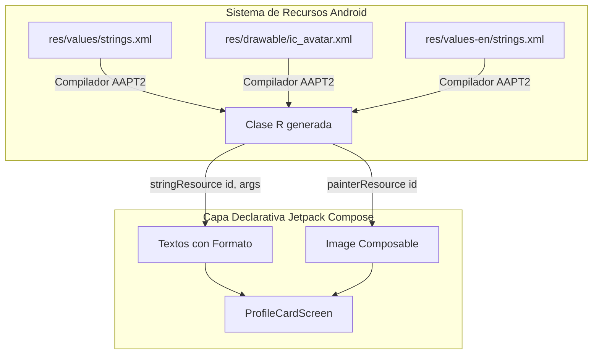
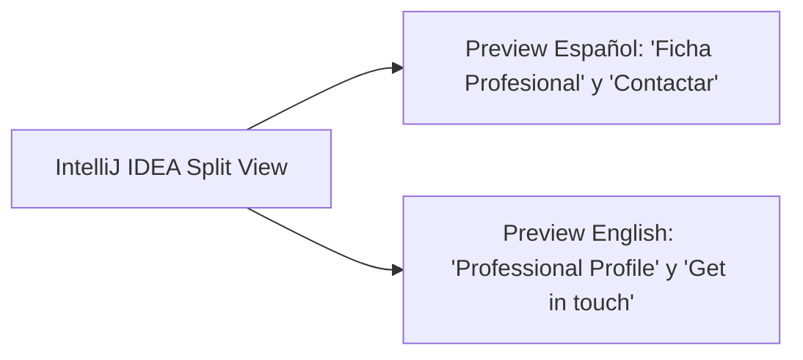

# **Codelab 6: Dominio de Recursos: Imágenes, Textos y Localización (Ficha de Perfil)**

En este codelab aprenderás a gestionar los recursos esenciales de una aplicación Android dentro del paradigma declarativo de Jetpack Compose: **imágenes en mapas de bits (PNG/WebP), vectores gráficos escalables (`VectorDrawable`), cadenas con formato posicional y localización multi-idioma**.

Comprenderás el funcionamiento del sistema de recursos de Android (`res/`), cómo el compilador `AAPT2` genera la clase `R`, cómo evitar los tres errores más comunes que bloquean a los desarrolladores noveles y cómo diseñar interfaces accesibles con el parámetro `contentDescription`.

---

## 1. ¿Qué vas a construir?

Construirás una **Ficha de Perfil Profesional (*Developer Profile Card*)** con diseño moderno en Material 3:



Al finalizar este codelab, serás capaz de:

- Explicar las restricciones de nomenclatura en `res/` y solucionar errores de compilación de `AAPT2`.
- Evitar la trampa del `import android.R` frente a tu paquete de recursos (`com.dam.pmdmlab03.R`).
- Importar y renderizar tanto mapas de bits como gráficos vectoriales SVG con **Vector Asset Studio**.
- Formatear textos con marcadores dinámicos (`%1$s`, `%2$d`) mediante `stringResource()`.
- Implementar soporte multi-idioma (Español / Inglés) con `values-en/` y verificarlo en tiempo de diseño con `@Preview(locale = "...")`.
- Recortar y estilizar imágenes con modificadores de forma (`.clip(CircleShape)`), bordes y modos de ajuste `ContentScale`.

---

## 2. Las 3 Reglas de Oro de los Recursos en Android

Antes de escribir la primera línea de Compose, todo desarrollador Android debe interiorizar estas tres reglas críticas para evitar horas de frustración con el compilador:

### Regla 1: Nomenclatura Estricta en `res/drawable/`

A diferencia del explorador de archivos de tu sistema operativo (Windows, macOS o Linux), Android exige que los nombres de los recursos sean identificadores válidos en Java/Kotlin:

- **Caracteres permitidos:** Únicamente letras minúsculas (`a-z`), dígitos (`0-9`) y guiones bajos (`_`).
- ❌ **Prohibido:** Mayúsculas (`MiFoto.png`), espacios (`foto perfil.png`) o guiones medios (`avatar-dev.png`).
- ⚠️ **Consecuencia:** Si incluyes un archivo con mayúsculas o espacios, `AAPT2` fallará con un error genérico durante la fase `:app:mergeDebugResources`, impidiendo la compilación de todo el proyecto.

### Regla 2: La Trampa de `import android.R`

Cuando escribas `R.drawable.mi_imagen`, IntelliJ IDEA intentará autocompletar la clase `R`. Si seleccionas por error `android.R`, estarás importando los recursos internos del sistema operativo de Google:

- ❌ `import android.R`: Solo contiene recursos del sistema (iconos genéricos del sistema antiguo). Tus drawables propios no existirán ahí.
- ✅ `import com.dam.pmdmlab03.R`: Importa la clase `R` generada para tu módulo y tu paquete de aplicación.

### Regla 3: Prohibido escribir textos literales (*Hardcoded Strings*)

Escribir `Text("Guardar cambios")` directamente en un componible es un antipatrón en desarrollo móvil:

1. Impide traducir la aplicación a otros idiomas sin duplicar código fuente.
2. Dificulta el mantenimiento y la consistencia en aplicaciones grandes.
3. El linter de Android mostrará un aviso de advertencia (*Warning*). La norma en Compose es recurrir siempre a `stringResource(R.string.guardar_cambios)`.

---

## 3. Paso 1: Importación de Assets Gráficos y Vectores XML

En Android existen dos formas fundamentales de representar imágenes:

1. **Mapas de bits (*Raster Bitmaps* - PNG, WebP, JPG):** Matrices de píxeles fijas. Si se escalan en pantallas de alta densidad (xxhdpi), pueden pixelarse o consumir demasiada memoria RAM.
2. **Gráficos Vectoriales (*Vector Drawables* - XML):** Instrucciones matemáticas de trazado (`<path android:pathData="...">`). Se renderizan nítidos en cualquier densidad de pantalla ocupando una fracción mínima del tamaño del APK.

### Uso de Vector Asset Studio en IntelliJ IDEA

Para importar un icono SVG o un icono oficial de Material Design:

1. En el árbol de proyecto, haz clic derecho sobre la carpeta **`app/src/main/res/drawable`**.

2. Selecciona **New** → **Vector Asset**.

3. Puedes elegir entre:

    - **Clip Art:** Catálogo integrado de más de 2.000 iconos vectoriales oficiales de Material.
    - **Local file (SVG, PSD):** Permite cargar cualquier archivo SVG diseñado en Figma, Illustrator o Inkscape.

4. Asigna un nombre en minúsculas (ej. `ic_badge_check.xml`) y pulsa **Finish**.

!!! warning "¿No aparece *Vector Asset* o está en gris?"
    Consulta el [Anexo A: solución de problemas con los recursos](../../00-android/anexos/a-iconos-app-recursos.md#4-solucion-de-problemas).

Para este codelab, crearemos tres vectores en `app/src/main/res/drawable/`:

??? example "Ver archivo XML: res/drawable/ic_profile_avatar.xml"

    ```xml
    <vector xmlns:android="http://schemas.android.com/apk/res/android"
        android:width="128dp"
        android:height="128dp"
        android:viewportWidth="24"
        android:viewportHeight="24">
        <path
            android:fillColor="#3B5BDB"
            android:pathData="M12,2C6.48,2 2,6.48 2,12s4.48,10 10,10 10,-4.48 10,-10S17.52,2 12,2zM12,6c1.93,0 3.5,1.57 3.5,3.5S13.93,13 12,13s-3.5,-1.57 -3.5,-3.5S10.07,6 12,6zM12,20c-2.03,0 -4.43,-0.82 -6.14,-2.88C7.55,15.8 9.68,15 12,15s4.45,0.8 6.14,2.12C16.43,19.18 14.03,20 12,20z"/>
    </vector>
    ```

??? example "Ver archivo XML: res/drawable/ic_code_banner.xml"

    ```xml
    <vector xmlns:android="http://schemas.android.com/apk/res/android"
        android:width="360dp"
        android:height="140dp"
        android:viewportWidth="360"
        android:viewportHeight="140">
        <path
            android:fillColor="#1A1B1E"
            android:pathData="M0,0h360v140h-360z"/>
        <path
            android:fillColor="#25262B"
            android:pathData="M0,0 L180,140 L0,140 Z"/>
        <path
            android:fillColor="#3B5BDB"
            android:pathData="M220,0 L360,0 L360,100 Z"/>
        <path
            android:fillColor="#0CA678"
            android:pathData="M300,80 L360,80 L360,140 L260,140 Z"/>
    </vector>
    ```

??? example "Ver archivo XML: res/drawable/ic_badge_check.xml"

    ```xml
    <vector xmlns:android="http://schemas.android.com/apk/res/android"
        android:width="24dp"
        android:height="24dp"
        android:viewportWidth="24"
        android:viewportHeight="24">
        <path
            android:fillColor="#0CA678"
            android:pathData="M12,2L3,5v6c0,5.55 3.84,10.74 9,12 5.16,-1.26 9,-6.45 9,-12V5l-9,-3zM10,17l-4,-4 1.41,-1.41L10,14.17l6.59,-6.59L18,9l-8,8z"/>
    </vector>
    ```

---

## 4. Paso 2: Cadenas de Texto con Formato e Internacionalización

### Parámetros de Formato Posicional

En ocasiones un texto requiere intercalar valores dinámicos calculados en Kotlin (como el número de proyectos o el nombre del usuario). Para ello se utilizan especificadores de formato según la convención de `Formatter`:

- `%1$s`: Primer argumento, de tipo String (cadena de texto).
- `%2$d`: Segundo argumento, de tipo Entero (número decimal).

Edita tu archivo `app/src/main/res/values/strings.xml`:

```xml
<resources>
    <string name="app_name">PMDM Lab UT03</string>

    <string name="perfil_titulo">Ficha Profesional</string>
    <string name="perfil_subtitulo">Recursos, Imágenes y Localización en Compose</string>
    <string name="perfil_nombre">Alejandro Morales</string>
    <string name="perfil_cargo">Desarrollador Android &amp; Multiplataforma</string>
    <string name="perfil_biografia">Especialista en interfaces declarativas con Jetpack Compose y arquitecturas limpias reactivas en Kotlin.</string>

    <!-- Parámetros posicionales: %1$d (años), %2$s (tecnología) -->
    <string name="perfil_experiencia">Experiencia: %1$d años en %2$s</string>
    <string name="perfil_proyectos">Proyectos completados: %1$d</string>

    <string name="perfil_boton_contacto">Contactar</string>
    <string name="perfil_boton_compartir">Compartir</string>
    <string name="cd_banner_cabecera">Banner abstracto de código y tecnología</string>
    <string name="cd_avatar_usuario">Foto de perfil de %1$s</string>
    <string name="cd_insignia_verificado">Insignia de desarrollador verificado</string>
</resources>
```

### Soporte Multi-idioma con el Calificador `values-en`

Android selecciona automáticamente los recursos según el idioma configurado en el teléfono del usuario:

1. Crea el directorio `app/src/main/res/values-en/`.
2. Crea dentro el archivo `strings.xml` con las traducciones en inglés:

```xml
<resources>
    <string name="perfil_titulo">Professional Profile</string>
    <string name="perfil_subtitulo">Resources, Images and Localization in Compose</string>
    <string name="perfil_nombre">Alejandro Morales</string>
    <string name="perfil_cargo">Android &amp; Cross-Platform Engineer</string>
    <string name="perfil_biografia">Specialist in declarative UIs with Jetpack Compose and reactive clean architectures in Kotlin.</string>
    <string name="perfil_experiencia">Experience: %1$d years in %2$s</string>
    <string name="perfil_proyectos">Completed projects: %1$d</string>
    <string name="perfil_boton_contacto">Get in touch</string>
    <string name="perfil_boton_compartir">Share</string>
    <string name="cd_banner_cabecera">Abstract tech and code header banner</string>
    <string name="cd_avatar_usuario">%1$s\'s profile avatar</string>
    <string name="cd_insignia_verificado">Verified engineer badge</string>
</resources>
```

---

## 5. Paso 3: El Componible `Image` y Modificadores Visuales

Para pintar un recurso gráfico en Jetpack Compose utilizamos la función `Image`:

```kotlin
Image(
    painter = painterResource(id = R.drawable.ic_profile_avatar),
    contentDescription = stringResource(id = R.string.cd_avatar_usuario, nombre),
    contentScale = ContentScale.Crop,
    modifier = Modifier
        .size(96.dp)
        .clip(CircleShape)
        .border(3.dp, MaterialTheme.colorScheme.surface, CircleShape)
)
```

### Conceptos Clave de `Image`:

- **`painterResource(id)`:** Carga de forma eficiente tanto archivos XML vectoriales como bitmaps PNG/WebP.
- **`contentDescription` (Accesibilidad Obligatoria):** Texto descriptivo que el lector de pantalla **TalkBack** lee en voz alta para personas con discapacidad visual.
    - Si la imagen aporta información (ej. foto de perfil), pasa una cadena traducida de `strings.xml`.
    - Si la imagen es puramente decorativa (un fondo ornamental), pasa explícitamente `contentDescription = null` para que TalkBack la ignore.
- **`contentScale`:** Controla cómo se ajusta la imagen dentro de su caja de dibujo:
    - `ContentScale.Crop`: Rellena todo el espacio recortando los bordes excedentes sin deformar la relación de aspecto (ideal para banners y avatares).
    - `ContentScale.Fit`: Muestra la imagen completa dentro del espacio, dejando posibles márgenes vacíos.
- **`Modifier.clip(CircleShape)`:** Aplica una máscara geométrica para transformar cualquier imagen cuadrada en un avatar circular perfecto.

---

## 6. Paso 4: Implementación Completa de `ProfileCardScreen.kt`

Abre o crea el archivo en `app/src/main/java/com/dam/pmdmlab03/codelabs/codelab04_recursos/ProfileCardScreen.kt`:

??? example "Ver código completo: ProfileCardScreen.kt"

    ```kotlin
    package com.dam.pmdmlab03.codelabs.codelab04_recursos

    import androidx.compose.foundation.Image
    import androidx.compose.foundation.border
    import androidx.compose.foundation.layout.Arrangement
    import androidx.compose.foundation.layout.Box
    import androidx.compose.foundation.layout.Column
    import androidx.compose.foundation.layout.Row
    import androidx.compose.foundation.layout.Spacer
    import androidx.compose.foundation.layout.fillMaxSize
    import androidx.compose.foundation.layout.fillMaxWidth
    import androidx.compose.foundation.layout.height
    import androidx.compose.foundation.layout.offset
    import androidx.compose.foundation.layout.padding
    import androidx.compose.foundation.layout.size
    import androidx.compose.foundation.shape.CircleShape
    import androidx.compose.material.icons.Icons
    import androidx.compose.material.icons.filled.Email
    import androidx.compose.material.icons.filled.Share
    import androidx.compose.material3.Button
    import androidx.compose.material3.CardDefaults
    import androidx.compose.material3.ElevatedCard
    import androidx.compose.material3.HorizontalDivider
    import androidx.compose.material3.Icon
    import androidx.compose.material3.MaterialTheme
    import androidx.compose.material3.OutlinedButton
    import androidx.compose.material3.Surface
    import androidx.compose.material3.Text
    import androidx.compose.runtime.Composable
    import androidx.compose.ui.Alignment
    import androidx.compose.ui.Modifier
    import androidx.compose.ui.draw.clip
    import androidx.compose.ui.layout.ContentScale
    import androidx.compose.ui.res.painterResource
    import androidx.compose.ui.res.stringResource
    import androidx.compose.ui.text.font.FontWeight
    import androidx.compose.ui.text.style.TextAlign
    import androidx.compose.ui.tooling.preview.Preview
    import androidx.compose.ui.unit.dp
    import com.dam.pmdmlab03.R
    import com.dam.pmdmlab03.ui.theme.PMDMLab03Theme

    @Composable
    fun ProfileCardScreen(modifier: Modifier = Modifier) {
        Surface(
            modifier = modifier.fillMaxSize(),
            color = MaterialTheme.colorScheme.background
        ) {
            Column(
                modifier = Modifier
                    .fillMaxSize()
                    .padding(16.dp),
                horizontalAlignment = Alignment.CenterHorizontally
            ) {
                Text(
                    text = stringResource(id = R.string.perfil_titulo),
                    style = MaterialTheme.typography.titleLarge,
                    color = MaterialTheme.colorScheme.primary
                )

                Text(
                    text = stringResource(id = R.string.perfil_subtitulo),
                    style = MaterialTheme.typography.bodyMedium,
                    color = MaterialTheme.colorScheme.onSurfaceVariant,
                    modifier = Modifier.padding(top = 2.dp, bottom = 12.dp)
                )

                HorizontalDivider()

                Spacer(modifier = Modifier.height(16.dp))

                ProfileCardContent()
            }
        }
    }

    @Composable
    fun ProfileCardContent(modifier: Modifier = Modifier) {
        val nombre = stringResource(id = R.string.perfil_nombre)

        ElevatedCard(
            modifier = modifier.fillMaxWidth(),
            shape = MaterialTheme.shapes.large,
            colors = CardDefaults.elevatedCardColors(
                containerColor = MaterialTheme.colorScheme.surfaceVariant
            )
        ) {
            Column(modifier = Modifier.fillMaxWidth()) {
                // 1. Imagen de Cabecera (Banner) con ContentScale.Crop
                Box(
                    modifier = Modifier
                        .fillMaxWidth()
                        .height(130.dp)
                ) {
                    Image(
                        painter = painterResource(id = R.drawable.ic_code_banner),
                        contentDescription = stringResource(id = R.string.cd_banner_cabecera),
                        contentScale = ContentScale.Crop,
                        modifier = Modifier.fillMaxSize()
                    )

                    // 2. Avatar Circular superpuesto sobre el banner con clip y border
                    Box(
                        modifier = Modifier
                            .align(Alignment.BottomCenter)
                            .offset(y = 48.dp)
                    ) {
                        Image(
                            painter = painterResource(id = R.drawable.ic_profile_avatar),
                            contentDescription = stringResource(id = R.string.cd_avatar_usuario, nombre),
                            contentScale = ContentScale.Crop,
                            modifier = Modifier
                                .size(96.dp)
                                .clip(CircleShape)
                                .border(3.dp, MaterialTheme.colorScheme.surface, CircleShape)
                        )

                        // 3. Insignia de Verificación
                        Image(
                            painter = painterResource(id = R.drawable.ic_badge_check),
                            contentDescription = stringResource(id = R.string.cd_insignia_verificado),
                            modifier = Modifier
                                .size(26.dp)
                                .align(Alignment.BottomEnd)
                        )
                    }
                }

                Spacer(modifier = Modifier.height(56.dp))

                // 4. Bloque Textual con Formato y Localización
                Column(
                    modifier = Modifier
                        .fillMaxWidth()
                        .padding(horizontal = 20.dp, vertical = 8.dp),
                    horizontalAlignment = Alignment.CenterHorizontally,
                    verticalArrangement = Arrangement.spacedBy(6.dp)
                ) {
                    Text(
                        text = nombre,
                        style = MaterialTheme.typography.headlineSmall.copy(fontWeight = FontWeight.Bold),
                        color = MaterialTheme.colorScheme.onSurfaceVariant
                    )

                    Text(
                        text = stringResource(id = R.string.perfil_cargo),
                        style = MaterialTheme.typography.bodyMedium.copy(fontWeight = FontWeight.SemiBold),
                        color = MaterialTheme.colorScheme.primary
                    )

                    Text(
                        text = stringResource(id = R.string.perfil_biografia),
                        style = MaterialTheme.typography.bodySmall,
                        color = MaterialTheme.colorScheme.onSurfaceVariant,
                        textAlign = TextAlign.Center,
                        modifier = Modifier.padding(top = 4.dp, bottom = 8.dp)
                    )

                    HorizontalDivider(color = MaterialTheme.colorScheme.outlineVariant)

                    // 5. Argumentos de Formato (%1$d y %2$s)
                    Row(
                        modifier = Modifier
                            .fillMaxWidth()
                            .padding(vertical = 8.dp),
                        horizontalArrangement = Arrangement.SpaceAround
                    ) {
                        Text(
                            text = stringResource(id = R.string.perfil_experiencia, 4, "Kotlin"),
                            style = MaterialTheme.typography.labelLarge,
                            color = MaterialTheme.colorScheme.primary
                        )

                        Text(
                            text = stringResource(id = R.string.perfil_proyectos, 16),
                            style = MaterialTheme.typography.labelLarge,
                            color = MaterialTheme.colorScheme.secondary
                        )
                    }

                    // 6. Botonera de Acción
                    Row(
                        modifier = Modifier
                            .fillMaxWidth()
                            .padding(top = 8.dp, bottom = 12.dp),
                        horizontalArrangement = Arrangement.spacedBy(12.dp)
                    ) {
                        Button(
                            onClick = {},
                            modifier = Modifier.weight(1f)
                        ) {
                            Icon(Icons.Filled.Email, contentDescription = null, modifier = Modifier.size(18.dp))
                            Spacer(Modifier.size(8.dp))
                            Text(stringResource(id = R.string.perfil_boton_contacto))
                        }

                        OutlinedButton(
                            onClick = {},
                            modifier = Modifier.weight(1f)
                        ) {
                            Icon(Icons.Filled.Share, contentDescription = null, modifier = Modifier.size(18.dp))
                            Spacer(Modifier.size(8.dp))
                            Text(stringResource(id = R.string.perfil_boton_compartir))
                        }
                    }
                }
            }
        }
    }

    // ==========================================
    // PREVIEWS EN IDIOMAS SIMULTÁNEOS (i18n)
    // ==========================================

    @Preview(name = "Perfil en Español", locale = "es", showBackground = true)
    @Composable
    private fun ProfileCardPreviewEs() {
        PMDMLab03Theme {
            ProfileCardScreen()
        }
    }

    @Preview(name = "Perfil en English", locale = "en", showBackground = true)
    @Composable
    private fun ProfileCardPreviewEn() {
        PMDMLab03Theme {
            ProfileCardScreen()
        }
    }
    ```

---

## 7. Verificación en Tiempo de Diseño (Split View)

Abre el archivo `ProfileCardScreen.kt` en IntelliJ IDEA y examina el panel **Split View**:



- [x] **Comprobación de Previews multi-idioma:** Puedes verificar visualmente que todas las traducciones encajan en la tarjeta sin solaparse y sin necesidad de ejecutar un emulador físico.
- [x] **Comprobación de escala y recorte:** La cabecera se ajusta con `ContentScale.Crop` y el avatar circular se recorta limpiamente sobre el banner con su borde de contraste.
- [x] **Comprobación de parámetros de formato:** Las leyendas *"Experiencia: 4 años en Kotlin"* y *"Proyectos completados: 16"* se componen de forma atómica.

---

## 8. Reto de Consolidación

Gestiona textos con plurales en Android:

1. Añade a `res/values/strings.xml` un recurso de plurales:
   ```xml
   <plurals name="certificaciones_obtenidas">
       <item quantity="one">%1$d certificación técnica</item>
       <item quantity="other">%1$d certificaciones técnicas</item>
   </plurals>
   ```
2. Tradúcelo en `res/values-en/strings.xml`.
3. Incorpóralo a la tarjeta consumiéndolo mediante la función oficial de Compose `pluralStringResource(R.plurals.certificaciones_obtenidas, count, count)`.
