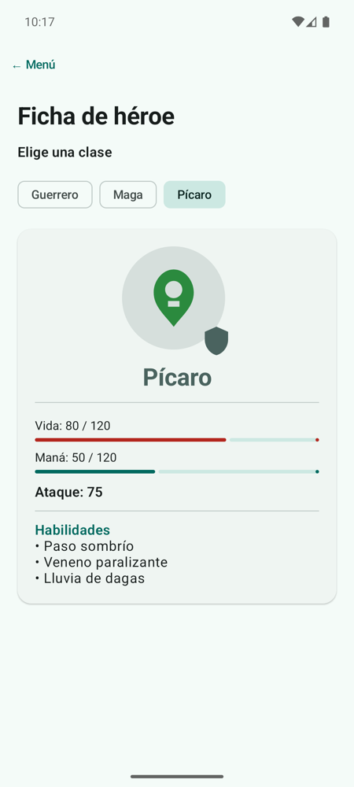
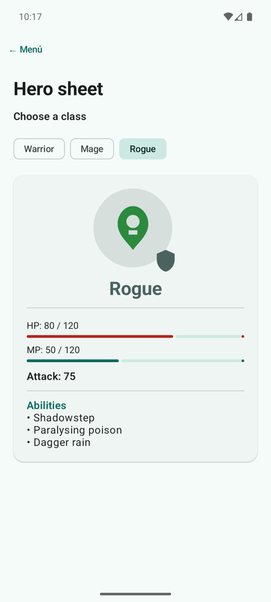

# **Codelab 3.07: Ficha de Héroe, Recursos e Idiomas**

Una app profesional no escribe sus textos ni sus imágenes en el código: los guarda como **recursos**, para poder traducirla o cambiar una imagen sin tocar Kotlin. En este codelab construirás la **ficha de un héroe de rol** que cambia de imagen, de color y de habilidades según la clase elegida. Todos sus textos estarán en `strings.xml`, con una **traducción al inglés** que el móvil elige solo.

!!! info "Punto de partida: tag `c3.07-inicio`"
    Sigue en el repositorio del laboratorio, [pmdm2627-lab-ut3](https://github.com/jssdocente/pmdm2627-lab-ut3). Si terminaste el [Codelab 3.06](./06-quiz-viewmodel.md), continúa en tu rama. Si no, parte del tag:

    ```bash
    git checkout c3.07-inicio
    git switch -c mi-lab-3.07
    ```

    `c3.07-inicio` es `c3.06-fin`. Repasa antes el [Codelab 2.04](../../02/codelabs/04-dado-interactivo.md), donde usaste por primera vez `painterResource` y `strings.xml`.

---

## 1. ¿Qué vas a construir?

Tres `FilterChip` para elegir la clase: guerrero, maga o pícaro. La ficha cambia la ilustración con un fundido, tiñe el escudo con el color de la clase, muestra la vida, el maná y el ataque con barras, y lista las habilidades. Con el móvil en inglés, todos los textos cambian de idioma.

<div style="display: flex; flex-direction: row; justify-content: center; align-items: flex-start; gap: 1.5rem; flex-wrap: wrap; margin: 1.8rem 0;" markdown="1">

<figure style="margin: 0; text-align: center; max-width: 260px;" markdown="1">

{ style="border-radius: 8px; box-shadow: 0 4px 10px rgba(0,0,0,0.15); width: 100%; max-width: 250px;" }

<figcaption style="font-size: 0.85rem; margin-top: 0.5rem; color: var(--md-default-fg-color--light);"><strong>Figura 1:</strong> El pícaro con el móvil en español.</figcaption>
</figure>

<figure style="margin: 0; text-align: center; max-width: 260px;" markdown="1">

{ style="border-radius: 8px; box-shadow: 0 4px 10px rgba(0,0,0,0.15); width: 100%; max-width: 250px;" }

<figcaption style="font-size: 0.85rem; margin-top: 0.5rem; color: var(--md-default-fg-color--light);"><strong>Figura 2:</strong> La misma ficha con el móvil en inglés.</figcaption>
</figure>

</div>

Al terminar, serás capaz de:

- Guardar textos con huecos (`%1$d`) y listas de textos (`string-array`) en `strings.xml`.
- Traducir la app con una carpeta `values-en`.
- Guardar en un `enum` los **identificadores** de los recursos (`@StringRes`, `@DrawableRes`, `@ArrayRes`).
- Superponer imágenes con `Box`, recortarlas con `clip` y teñirlas con `ColorFilter.tint`.
- Animar el cambio de imagen con `Crossfade`.

---

## 2. De la Carpeta `res` a la Pantalla

Cada recurso tiene un identificador en la clase `R`, que se genera al compilar. En Compose se carga con una función distinta según su tipo:

<figure class="arq-fig">
--8<-- "docs/temas/03/codelabs/images/c3.07-recursos.svg"
<figcaption>El código solo conoce el identificador; el móvil elige el archivo según su idioma.</figcaption>
</figure>

| Recurso | Archivo | Se usa con |
| :--- | :--- | :--- |
| Imagen | `res/drawable/ic_hero_mage.xml` | `painterResource(R.drawable.ic_hero_mage)` |
| Texto | `<string name="heroe_titulo">` | `stringResource(R.string.heroe_titulo)` |
| Texto con huecos | `<string name="heroe_vida">Vida: %1$d / %2$d</string>` | `stringResource(R.string.heroe_vida, 60, 120)` |
| Lista de textos | `<string-array name="habilidades_mago">` | `stringArrayResource(R.array.habilidades_mago)` |

La teoría completa está en [2.3.2 Imágenes, iconos y recursos](../../02/2.3.2-imagenes-iconos-recursos.md) y, para traducir y empaquetar recursos, en el [Anexo A](../../00-android/anexos/a-iconos-app-recursos.md).

---

## 3. Paso 1: Las Imágenes

Copia en `res/drawable` las tres ilustraciones (`ic_hero_warrior.xml`, `ic_hero_mage.xml` e `ic_hero_rogue.xml`) y el escudo (`ic_shield.xml`). Son vectores XML, como las caras del dado de la UT2: puedes copiarlos del tag `c3.07-fin`.

Las ilustraciones tienen sus propios colores. El escudo es una sola forma negra: lo **teñiremos** desde el código con el color de cada clase.

---

## 4. Paso 2: Los Textos en `strings.xml`

Añade los textos de la ficha a `res/values/strings.xml`:

```xml
<resources>
    <string name="app_name">Lab UT3</string>

    <!-- Codelab 3.07: ficha de héroe -->
    <string name="heroe_titulo">Ficha de héroe</string>
    <string name="heroe_elige_clase">Elige una clase</string>
    <string name="heroe_clase_guerrero">Guerrero</string>
    <string name="heroe_clase_mago">Maga</string>
    <string name="heroe_clase_picaro">Pícaro</string>
    <string name="heroe_vida">Vida: %1$d / %2$d</string>
    <string name="heroe_mana">Maná: %1$d / %2$d</string>
    <string name="heroe_ataque">Ataque: %1$d</string>
    <string name="heroe_habilidades">Habilidades</string>
    <string name="heroe_descripcion_imagen">Ilustración de la clase %1$s</string>
    <string name="heroe_descripcion_escudo">Escudo de la clase</string>

    <string-array name="habilidades_guerrero">
        <item>Golpe sísmico</item>
        <item>Grito de guerra</item>
        <item>Muro de escudos</item>
    </string-array>
    <string-array name="habilidades_mago">
        <item>Lanza de escarcha</item>
        <item>Teletransporte</item>
        <item>Tormenta de fuego</item>
    </string-array>
    <string-array name="habilidades_picaro">
        <item>Paso sombrío</item>
        <item>Veneno paralizante</item>
        <item>Lluvia de dagas</item>
    </string-array>
</resources>
```

- **`%1$d` y `%2$d`** son huecos para números: el `1` y el `2` indican el orden de los argumentos. Para un texto se usa `%1$s`.
- **`<string-array>`** guarda una lista de textos con un solo nombre.
- Las descripciones de las imágenes (`heroe_descripcion_…`) también son textos: los lectores de pantalla deben leerlas en el idioma del usuario.

---

## 5. Paso 3: La Traducción al Inglés

Crea la carpeta `res/values-en` y, dentro, otro `strings.xml` **con los mismos nombres** y los textos en inglés:

??? example "Ver código: `res/values-en/strings.xml`"

    ```xml
    <resources>
        <!-- Codelab 3.07: hero sheet (English) -->
        <string name="heroe_titulo">Hero sheet</string>
        <string name="heroe_elige_clase">Choose a class</string>
        <string name="heroe_clase_guerrero">Warrior</string>
        <string name="heroe_clase_mago">Mage</string>
        <string name="heroe_clase_picaro">Rogue</string>
        <string name="heroe_vida">HP: %1$d / %2$d</string>
        <string name="heroe_mana">MP: %1$d / %2$d</string>
        <string name="heroe_ataque">Attack: %1$d</string>
        <string name="heroe_habilidades">Abilities</string>
        <string name="heroe_descripcion_imagen">Illustration of the %1$s class</string>
        <string name="heroe_descripcion_escudo">Class shield</string>

        <string-array name="habilidades_guerrero">
            <item>Seismic slam</item>
            <item>Battle cry</item>
            <item>Shield wall</item>
        </string-array>
        <string-array name="habilidades_mago">
            <item>Frost spear</item>
            <item>Blink</item>
            <item>Firestorm</item>
        </string-array>
        <string-array name="habilidades_picaro">
            <item>Shadowstep</item>
            <item>Paralysing poison</item>
            <item>Dagger rain</item>
        </string-array>
    </resources>
    ```

No hay que tocar Kotlin. Cuando el móvil está en inglés, Android busca cada texto primero en `values-en`; si no lo encuentra, usa el de `values`, que es el idioma por defecto. Por eso `app_name` solo está en `values`.

!!! tip "Cambiar el idioma solo de esta app"
    En Android 13 o superior: *Ajustes › Sistema › Idiomas › Idiomas de las aplicaciones*, elige *Lab UT3* y luego *English*. Así no cambias el idioma de todo el emulador. Las `@Preview` también admiten un idioma: `@Preview(locale = "en")`.

---

## 6. Paso 4: Las Clases de Héroe

Crea el paquete `codelabs/codelab07_heroe` y, dentro, `HeroeScreen.kt`. Cada clase guarda los **identificadores** de sus recursos y sus estadísticas:

```kotlin
// El valor más alto que puede tener una estadística en el juego
const val ESTADISTICA_MAXIMA = 120

// Cada clase guarda los IDs de sus recursos (textos, imagen y lista de habilidades)
// y sus estadísticas. Los textos no van aquí: dependen del idioma del móvil.
enum class ClaseHeroe(
    @param:StringRes val nombre: Int,
    @param:DrawableRes val imagen: Int,
    @param:ArrayRes val habilidades: Int,
    val vidaMax: Int,
    val manaMax: Int,
    val ataque: Int
) {
    GUERRERO(R.string.heroe_clase_guerrero, R.drawable.ic_hero_warrior, R.array.habilidades_guerrero, 120, 20, 85),
    MAGO(R.string.heroe_clase_mago, R.drawable.ic_hero_mage, R.array.habilidades_mago, 60, 110, 95),
    PICARO(R.string.heroe_clase_picaro, R.drawable.ic_hero_rogue, R.array.habilidades_picaro, 80, 50, 75)
}
```

El `enum` no guarda el texto «Maga», sino el número `R.string.heroe_clase_mago`. El texto concreto se resuelve al pintar, con `stringResource`, en el idioma que tenga el móvil en ese momento.

Las anotaciones `@StringRes`, `@DrawableRes` y `@ArrayRes` no cambian nada al ejecutar, pero el IDE te avisa si pasas un recurso del tipo equivocado. El prefijo `@param:` indica que la anotación se aplica al parámetro del constructor.

---

## 7. Paso 5: La Ficha

`FichaHeroe` pinta una clase. Lo más interesante es la cabecera, hecha con capas:

```kotlin
// Box apila capas: el círculo con la ilustración y, encima, el escudo
Box(modifier = Modifier.size(128.dp)) {
    Box(
        modifier = Modifier
            .size(120.dp)
            .clip(CircleShape)
            .background(colorClase.copy(alpha = 0.15f)),
        contentAlignment = Alignment.Center
    ) {
        // Crossfade funde la imagen anterior con la nueva al cambiar de clase
        Crossfade(targetState = clase.imagen, label = "imagenHeroe") { imagen ->
            Image(
                painter = painterResource(imagen),
                contentDescription = stringResource(R.string.heroe_descripcion_imagen, nombre),
                modifier = Modifier.size(80.dp)
            )
        }
    }
    // El mismo escudo para todas las clases, teñido con su color
    Image(
        painter = painterResource(R.drawable.ic_shield),
        contentDescription = stringResource(R.string.heroe_descripcion_escudo),
        colorFilter = ColorFilter.tint(colorClase),
        modifier = Modifier
            .size(36.dp)
            .align(Alignment.BottomEnd)
    )
}
```

1. El **`Box` exterior** apila sus hijos uno encima de otro, y `align(Alignment.BottomEnd)` coloca el escudo en la esquina.

2. El **`Box` interior** se recorta en círculo con `clip(CircleShape)` y se pinta con el color de la clase, al 15 % de opacidad. El escudo va **fuera** de este `Box`: si estuviera dentro, el recorte lo cortaría.

3. **`Crossfade`** funde la imagen anterior con la nueva cada vez que cambia `clase.imagen`.

4. **`ColorFilter.tint(colorClase)`** pinta el escudo entero de un color. El color sale del tema (`tertiary`, `primary` o `secondary`), así que se adapta al modo oscuro.

Las estadísticas usan los textos con huecos:

```kotlin
stringResource(R.string.heroe_vida, clase.vidaMax, ESTADISTICA_MAXIMA)   // "Vida: 60 / 120"
```

??? example "Ver código completo: `HeroeScreen.kt`"

    ```kotlin
    package com.pmdm.lab.ut3.codelabs.codelab07_heroe

    import androidx.annotation.ArrayRes
    import androidx.annotation.DrawableRes
    import androidx.annotation.StringRes
    import androidx.compose.animation.Crossfade
    import androidx.compose.foundation.Image
    import androidx.compose.foundation.background
    import androidx.compose.foundation.layout.Arrangement
    import androidx.compose.foundation.layout.Box
    import androidx.compose.foundation.layout.Column
    import androidx.compose.foundation.layout.Row
    import androidx.compose.foundation.layout.fillMaxSize
    import androidx.compose.foundation.layout.fillMaxWidth
    import androidx.compose.foundation.layout.padding
    import androidx.compose.foundation.layout.size
    import androidx.compose.foundation.rememberScrollState
    import androidx.compose.foundation.shape.CircleShape
    import androidx.compose.foundation.verticalScroll
    import androidx.compose.material3.ElevatedCard
    import androidx.compose.material3.FilterChip
    import androidx.compose.material3.HorizontalDivider
    import androidx.compose.material3.LinearProgressIndicator
    import androidx.compose.material3.MaterialTheme
    import androidx.compose.material3.Text
    import androidx.compose.runtime.Composable
    import androidx.compose.runtime.getValue
    import androidx.compose.runtime.mutableStateOf
    import androidx.compose.runtime.saveable.rememberSaveable
    import androidx.compose.runtime.setValue
    import androidx.compose.ui.Alignment
    import androidx.compose.ui.Modifier
    import androidx.compose.ui.draw.clip
    import androidx.compose.ui.graphics.Color
    import androidx.compose.ui.graphics.ColorFilter
    import androidx.compose.ui.res.painterResource
    import androidx.compose.ui.res.stringArrayResource
    import androidx.compose.ui.res.stringResource
    import androidx.compose.ui.tooling.preview.Preview
    import androidx.compose.ui.unit.dp
    import com.pmdm.lab.ut3.R
    import com.pmdm.lab.ut3.ui.theme.LabUt3Theme

    // El valor más alto que puede tener una estadística en el juego
    const val ESTADISTICA_MAXIMA = 120

    // Cada clase guarda los IDs de sus recursos (textos, imagen y lista de habilidades)
    // y sus estadísticas. Los textos no van aquí: dependen del idioma del móvil.
    enum class ClaseHeroe(
        @param:StringRes val nombre: Int,
        @param:DrawableRes val imagen: Int,
        @param:ArrayRes val habilidades: Int,
        val vidaMax: Int,
        val manaMax: Int,
        val ataque: Int
    ) {
        GUERRERO(R.string.heroe_clase_guerrero, R.drawable.ic_hero_warrior, R.array.habilidades_guerrero, 120, 20, 85),
        MAGO(R.string.heroe_clase_mago, R.drawable.ic_hero_mage, R.array.habilidades_mago, 60, 110, 95),
        PICARO(R.string.heroe_clase_picaro, R.drawable.ic_hero_rogue, R.array.habilidades_picaro, 80, 50, 75)
    }

    @Composable
    fun HeroeScreen(modifier: Modifier = Modifier) {
        var clase by rememberSaveable { mutableStateOf(ClaseHeroe.GUERRERO) }

        Column(
            modifier = modifier
                .fillMaxSize()
                .verticalScroll(rememberScrollState())
                .padding(20.dp),
            verticalArrangement = Arrangement.spacedBy(16.dp)
        ) {
            Text(
                text = stringResource(R.string.heroe_titulo),
                style = MaterialTheme.typography.headlineMedium
            )
            Text(
                text = stringResource(R.string.heroe_elige_clase),
                style = MaterialTheme.typography.titleMedium
            )
            Row(horizontalArrangement = Arrangement.spacedBy(8.dp)) {
                ClaseHeroe.entries.forEach { opcion ->
                    FilterChip(
                        selected = opcion == clase,
                        onClick = { clase = opcion },
                        label = { Text(stringResource(opcion.nombre)) }
                    )
                }
            }
            FichaHeroe(clase = clase)
        }
    }

    @Composable
    fun FichaHeroe(clase: ClaseHeroe, modifier: Modifier = Modifier) {
        // El color de cada clase sale del tema: funciona en claro y en oscuro
        val colorClase = when (clase) {
            ClaseHeroe.GUERRERO -> MaterialTheme.colorScheme.tertiary
            ClaseHeroe.MAGO -> MaterialTheme.colorScheme.primary
            ClaseHeroe.PICARO -> MaterialTheme.colorScheme.secondary
        }
        val nombre = stringResource(clase.nombre)
        val habilidades = stringArrayResource(clase.habilidades)

        ElevatedCard(modifier = modifier.fillMaxWidth()) {
            Column(
                modifier = Modifier
                    .fillMaxWidth()
                    .padding(20.dp),
                horizontalAlignment = Alignment.CenterHorizontally
            ) {
                // Box apila capas: el círculo con la ilustración y, encima, el escudo
                Box(modifier = Modifier.size(128.dp)) {
                    Box(
                        modifier = Modifier
                            .size(120.dp)
                            .clip(CircleShape)
                            .background(colorClase.copy(alpha = 0.15f)),
                        contentAlignment = Alignment.Center
                    ) {
                        // Crossfade funde la imagen anterior con la nueva al cambiar de clase
                        Crossfade(targetState = clase.imagen, label = "imagenHeroe") { imagen ->
                            Image(
                                painter = painterResource(imagen),
                                contentDescription = stringResource(R.string.heroe_descripcion_imagen, nombre),
                                modifier = Modifier.size(80.dp)
                            )
                        }
                    }
                    // El mismo escudo para todas las clases, teñido con su color
                    Image(
                        painter = painterResource(R.drawable.ic_shield),
                        contentDescription = stringResource(R.string.heroe_descripcion_escudo),
                        colorFilter = ColorFilter.tint(colorClase),
                        modifier = Modifier
                            .size(36.dp)
                            .align(Alignment.BottomEnd)
                    )
                }

                Text(
                    text = nombre,
                    style = MaterialTheme.typography.headlineMedium,
                    color = colorClase,
                    modifier = Modifier.padding(top = 8.dp)
                )

                HorizontalDivider(modifier = Modifier.padding(vertical = 12.dp))

                // Textos con huecos: %1$d y %2$d se rellenan con los argumentos
                Estadistica(
                    texto = stringResource(R.string.heroe_vida, clase.vidaMax, ESTADISTICA_MAXIMA),
                    valor = clase.vidaMax.toFloat() / ESTADISTICA_MAXIMA,
                    color = MaterialTheme.colorScheme.error
                )
                Estadistica(
                    texto = stringResource(R.string.heroe_mana, clase.manaMax, ESTADISTICA_MAXIMA),
                    valor = clase.manaMax.toFloat() / ESTADISTICA_MAXIMA,
                    color = MaterialTheme.colorScheme.primary
                )
                Text(
                    text = stringResource(R.string.heroe_ataque, clase.ataque),
                    style = MaterialTheme.typography.titleMedium,
                    modifier = Modifier
                        .fillMaxWidth()
                        .padding(top = 8.dp)
                )

                HorizontalDivider(modifier = Modifier.padding(vertical = 12.dp))

                Column(modifier = Modifier.fillMaxWidth()) {
                    Text(
                        text = stringResource(R.string.heroe_habilidades),
                        style = MaterialTheme.typography.titleMedium,
                        color = MaterialTheme.colorScheme.primary
                    )
                    habilidades.forEach { habilidad ->
                        Text(text = "• $habilidad", style = MaterialTheme.typography.bodyLarge)
                    }
                }
            }
        }
    }

    @Composable
    private fun Estadistica(texto: String, valor: Float, color: Color) {
        Column(modifier = Modifier.padding(vertical = 4.dp)) {
            Text(text = texto, style = MaterialTheme.typography.bodyMedium)
            LinearProgressIndicator(
                progress = { valor },
                color = color,
                modifier = Modifier
                    .fillMaxWidth()
                    .padding(top = 4.dp)
            )
        }
    }

    @Preview(name = "Guerrero", showBackground = true)
    @Composable
    private fun FichaGuerreroPreview() {
        LabUt3Theme { FichaHeroe(clase = ClaseHeroe.GUERRERO) }
    }

    @Preview(name = "Maga en inglés", showBackground = true, locale = "en")
    @Composable
    private fun FichaMagoInglesPreview() {
        LabUt3Theme { FichaHeroe(clase = ClaseHeroe.MAGO) }
    }
    ```

`HeroeScreen` guarda la clase elegida con `rememberSaveable` y muestra los tres `FilterChip`. Una de las dos `@Preview` usa `locale = "en"` para ver la ficha en inglés sin cambiar el emulador.

Añade la pantalla al menú (`HEROE` en `PantallaLab` y su rama en el `when`).

---

## 8. Experimenta

1. Cambia el idioma de la app a inglés y abre la ficha. Después borra una línea de `values-en/strings.xml`: ¿qué se ve en su lugar?

2. Quita `ColorFilter.tint(colorClase)` del escudo. ¿De qué color se ve?

3. Mueve el escudo dentro del `Box` recortado y observa la esquina.

4. Añade un recurso de plurales y úsalo con `pluralStringResource` para mostrar «1 habilidad» o «3 habilidades»:

    ```xml
    <plurals name="heroe_num_habilidades">
        <item quantity="one">%1$d habilidad</item>
        <item quantity="other">%1$d habilidades</item>
    </plurals>
    ```

!!! success "Solución: tag `c3.07-fin`"
    Compara tu código con el tag [`c3.07-fin`](https://github.com/jssdocente/pmdm2627-lab-ut3/tree/c3.07-fin) (`git diff c3.07-fin`). Con este codelab termina la parte guiada del laboratorio: sigue con los [retos de la UT3](../3.6-laboratorio-retos.md#4-retos-autonomos).

---

## 9. Resumen y Checklist

- [ ] Ningún texto de la ficha está escrito en el código: todos salen de `strings.xml`.
- [ ] `values-en/strings.xml` tiene los mismos nombres traducidos, y la ficha cambia de idioma con el móvil.
- [ ] `ClaseHeroe` guarda identificadores de recursos anotados con `@StringRes`, `@DrawableRes` y `@ArrayRes`.
- [ ] El escudo se tiñe con `ColorFilter.tint` y queda fuera del recorte circular.
- [ ] La ilustración cambia con `Crossfade` y las habilidades salen de un `string-array`.
