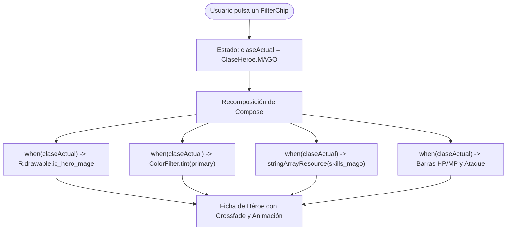

# **Codelab 7: Assets Dinámicos, Tintes y Efectos Multimedia (Ficha de Héroe RPG)**

En este codelab aprenderás a utilizar el sistema de recursos de Android para interfaces dinámicas y lúdicas orientadas al desarrollo de videojuegos con Jetpack Compose y la preparación de interfaces para el motor Unity: **conmutación reactiva de imágenes según el estado, tintado semántico con `ColorFilter`, superposición multicapa con `Box` y colecciones de cadenas con `<string-array>`**.

Aprenderás a abandonar el enfoque imperativo antiguo (`imageView.setImageResource(...)`) para abrazar la resolución declarativa de drawables en tiempo de recomposición.

---

## 1. ¿Qué vas a construir?

Construirás una **Ficha de Personaje RPG interactiva (*RPG Hero Card*)** que permite al usuario alternar entre tres clases legendarias: **Guerrero**, **Mago** y **Pícaro**:



Al finalizar este codelab, serás capaz de:

- Resolver dinámicamente identificadores de recursos `R.drawable` en función de variables de estado.
- Crear animaciones suaves de transición entre imágenes mediante `Crossfade`.
- Aplicar tintados cromáticos en tiempo de ejecución con `ColorFilter.tint()` sin duplicar archivos PNG.
- Cargar y recorrer colecciones de cadenas de texto declaradas en XML mediante `stringArrayResource()`.
- Diseñar barras de estadísticas visuales mediante `LinearProgressIndicator` estilizados.

---

## 2. Paso 1: El Modelo Mental de los Assets Dinámicos en Compose

En el desarrollo tradicional con XML y Java, cuando una variable cambiaba, el programador tenía que buscar la vista y mutar su propiedad imperativamente:

```kotlin
// ❌ ENFOQUE IMPERATIVO ANTIGUO (Views / XML)
val imagen = findViewById<ImageView>(R.id.imgHeroe)
if (esMago) {
    imagen.setImageResource(R.drawable.mago)
}
```

En **Jetpack Compose**, la interfaz gráfica es una función pura del estado. No "buscamos" ninguna imagen para modificarla; simplemente declaramos qué recurso corresponde a cada estado y dejamos que Compose lo dibuje durante la **recomposición**:

```kotlin
// ✅ ENFOQUE DECLARATIVO DE COMPOSE
val imagenRes = when (claseSeleccionada) {
    ClaseHeroe.GUERRERO -> R.drawable.ic_hero_warrior
    ClaseHeroe.MAGO -> R.drawable.ic_hero_mage
    ClaseHeroe.PICARO -> R.drawable.ic_hero_rogue
}

Image(
    painter = painterResource(id = imagenRes),
    contentDescription = stringResource(id = R.string.cd_ilustracion_heroe, nombreClase)
)
```

---

## 3. Paso 2: Colecciones de Texto en XML con `<string-array>`

Cuando una entidad cuenta con una lista finita de opciones, descripciones o habilidades que deben ser traducibles, definirlas en el código Kotlin en duro es una mala práctica.

Android permite declarar matrices de cadenas en `app/src/main/res/values/strings.xml`:

```xml
<!-- Arrays de habilidades en Español -->
<string-array name="skills_guerrero">
    <item>Golpe Sísmico Terrestre</item>
    <item>Grito de Guerra Provocador</item>
    <item>Muro Defensivo Impenetrable</item>
</string-array>

<string-array name="skills_mago">
    <item>Lanza de Escarcha Cristalina</item>
    <item>Teletransportación Arcana</item>
    <item>Tormenta de Fuego Astral</item>
</string-array>

<string-array name="skills_picaro">
    <item>Paso Sombrío Silencioso</item>
    <item>Veneno Paralizante Rápido</item>
    <item>Lluvia de Dagas Críticas</item>
</string-array>
```

Y su correspondiente versión traducida en `app/src/main/res/values-en/strings.xml`:

```xml
<!-- English translations -->
<string-array name="skills_guerrero">
    <item>Earthquake Ground Slam</item>
    <item>Taunting Battle Cry</item>
    <item>Impenetrable Fortress Wall</item>
</string-array>

<string-array name="skills_mago">
    <item>Crystalline Frost Spear</item>
    <item>Arcane Blink Teleport</item>
    <item>Astral Fire Tempest</item>
</string-array>

<string-array name="skills_picaro">
    <item>Silent Shadowstep</item>
    <item>Quick Paralysis Poison</item>
    <item>Critical Dagger Barrage</item>
</string-array>
```

### Consumo en Compose con `stringArrayResource`:

```kotlin
val arrayId = when (clase) {
    ClaseHeroe.GUERRERO -> R.array.skills_guerrero
    ClaseHeroe.MAGO -> R.array.skills_mago
    ClaseHeroe.PICARO -> R.array.skills_picaro
}

// Devuelve un Array<String> nativo de Kotlin
val habilidades = stringArrayResource(id = arrayId)

habilidades.forEach { habilidad ->
    Text("• $habilidad")
}
```

---

## 4. Paso 3: Superposición Multicapa y Tintes con `ColorFilter`

En interfaces de videojuegos es habitual reutilizar un mismo asset vectorial monocromático (por ejemplo, un escudo defensivo `ic_shield.xml`) aplicándole diferentes auras o tintes según la rareza o clase del jugador.

### El Filtro de Color `ColorFilter.tint`:

```kotlin
Image(
    painter = painterResource(id = R.drawable.ic_shield),
    contentDescription = stringResource(id = R.string.cd_escudo_defensa),
    colorFilter = ColorFilter.tint(colorTinte), // Modifica los píxeles no transparentes
    modifier = Modifier.size(24.dp)
)
```

!!! tip "Ahorro Masivo de Espacio en el APK"
    Sin `ColorFilter`, tendrías que guardar tres archivos independientes: `ic_shield_red.png`, `ic_shield_blue.png` y `ic_shield_green.png`. Con un único vector y `ColorFilter.tint()` ahorras peso en el paquete y puedes adaptar el color dinámicamente a la paleta de Material 3.

---

## 5. Paso 4: Implementación Completa de `HeroCardScreen.kt`

Abre o crea el archivo en `app/src/main/java/com/dam/pmdmlab03/codelabs/codelab05_heroe/HeroCardScreen.kt`:

??? example "Ver código completo: HeroCardScreen.kt"

    ```kotlin
    package com.dam.pmdmlab03.codelabs.codelab05_heroe

    import androidx.compose.animation.Crossfade
    import androidx.compose.foundation.Image
    import androidx.compose.foundation.background
    import androidx.compose.foundation.layout.Arrangement
    import androidx.compose.foundation.layout.Box
    import androidx.compose.foundation.layout.Column
    import androidx.compose.foundation.layout.Row
    import androidx.compose.foundation.layout.Spacer
    import androidx.compose.foundation.layout.fillMaxSize
    import androidx.compose.foundation.layout.fillMaxWidth
    import androidx.compose.foundation.layout.height
    import androidx.compose.foundation.layout.padding
    import androidx.compose.foundation.layout.size
    import androidx.compose.foundation.shape.CircleShape
    import androidx.compose.material3.CardDefaults
    import androidx.compose.material3.ElevatedCard
    import androidx.compose.material3.FilterChip
    import androidx.compose.material3.FilterChipDefaults
    import androidx.compose.material3.HorizontalDivider
    import androidx.compose.material3.LinearProgressIndicator
    import androidx.compose.material3.MaterialTheme
    import androidx.compose.material3.Surface
    import androidx.compose.material3.Text
    import androidx.compose.runtime.Composable
    import androidx.compose.runtime.getValue
    import androidx.compose.runtime.mutableStateOf
    import androidx.compose.runtime.remember
    import androidx.compose.runtime.setValue
    import androidx.compose.ui.Alignment
    import androidx.compose.ui.Modifier
    import androidx.compose.ui.draw.clip
    import androidx.compose.ui.graphics.ColorFilter
    import androidx.compose.ui.res.painterResource
    import androidx.compose.ui.res.stringArrayResource
    import androidx.compose.ui.res.stringResource
    import androidx.compose.ui.text.font.FontWeight
    import androidx.compose.ui.tooling.preview.Preview
    import androidx.compose.ui.unit.dp
    import com.dam.pmdmlab03.R
    import com.dam.pmdmlab03.ui.theme.PMDMLab03Theme

    enum class ClaseHeroe(val nombreRes: Int) {
        GUERRERO(R.string.heroe_clase_guerrero),
        MAGO(R.string.heroe_clase_mago),
        PICARO(R.string.heroe_clase_picaro)
    }

    @Composable
    fun HeroCardScreen(modifier: Modifier = Modifier) {
        var claseActual by remember { mutableStateOf(ClaseHeroe.GUERRERO) }

        Surface(
            modifier = modifier.fillMaxSize(),
            color = MaterialTheme.colorScheme.background
        ) {
            Column(
                modifier = Modifier
                    .fillMaxSize()
                    .padding(16.dp),
                horizontalAlignment = Alignment.CenterHorizontally
            ) {
                Text(
                    text = stringResource(id = R.string.heroe_titulo),
                    style = MaterialTheme.typography.titleLarge,
                    color = MaterialTheme.colorScheme.primary
                )

                Text(
                    text = stringResource(id = R.string.heroe_subtitulo),
                    style = MaterialTheme.typography.bodyMedium,
                    color = MaterialTheme.colorScheme.onSurfaceVariant,
                    modifier = Modifier.padding(top = 2.dp, bottom = 12.dp)
                )

                HorizontalDivider()

                Spacer(modifier = Modifier.height(12.dp))

                // Selector interactivo de clase (FilterChip)
                Row(
                    modifier = Modifier.fillMaxWidth(),
                    horizontalArrangement = Arrangement.SpaceEvenly
                ) {
                    ClaseHeroe.entries.forEach { clase ->
                        FilterChip(
                            selected = claseActual == clase,
                            onClick = { claseActual = clase },
                            label = { Text(stringResource(id = clase.nombreRes)) },
                            colors = FilterChipDefaults.filterChipColors(
                                selectedContainerColor = MaterialTheme.colorScheme.primaryContainer,
                                selectedLabelColor = MaterialTheme.colorScheme.onPrimaryContainer
                            )
                        )
                    }
                }

                Spacer(modifier = Modifier.height(16.dp))

                // Ficha de estadísticas y habilidades reactiva
                HeroCardContent(clase = claseActual)
            }
        }
    }

    @Composable
    fun HeroCardContent(
        clase: ClaseHeroe,
        modifier: Modifier = Modifier
    ) {
        // 1. Selección reactiva del Asset de Imagen según el estado
        val imagenRes = when (clase) {
            ClaseHeroe.GUERRERO -> R.drawable.ic_hero_warrior
            ClaseHeroe.MAGO -> R.drawable.ic_hero_mage
            ClaseHeroe.PICARO -> R.drawable.ic_hero_rogue
        }

        // 2. Selección reactiva del Array de Recursos XML
        val arraySkillsRes = when (clase) {
            ClaseHeroe.GUERRERO -> R.array.skills_guerrero
            ClaseHeroe.MAGO -> R.array.skills_mago
            ClaseHeroe.PICARO -> R.array.skills_picaro
        }
        val habilidades = stringArrayResource(id = arraySkillsRes)

        // 3. Tinte de Color semántico según la clase
        val colorTinte = when (clase) {
            ClaseHeroe.GUERRERO -> MaterialTheme.colorScheme.error
            ClaseHeroe.MAGO -> MaterialTheme.colorScheme.primary
            ClaseHeroe.PICARO -> MaterialTheme.colorScheme.tertiary
        }

        // 4. Valores de estadísticas según clase
        val (vidaActual, vidaMax, manaActual, manaMax, ataque) = when (clase) {
            ClaseHeroe.GUERRERO -> listOf(100, 100, 20, 20, 85)
            ClaseHeroe.MAGO -> listOf(50, 50, 100, 100, 95)
            ClaseHeroe.PICARO -> listOf(70, 70, 45, 45, 75)
        }

        val nombreClase = stringResource(id = clase.nombreRes)

        ElevatedCard(
            modifier = modifier.fillMaxWidth(),
            shape = MaterialTheme.shapes.medium,
            colors = CardDefaults.elevatedCardColors(
                containerColor = MaterialTheme.colorScheme.surfaceVariant
            )
        ) {
            Column(
                modifier = Modifier
                    .fillMaxWidth()
                    .padding(20.dp),
                horizontalAlignment = Alignment.CenterHorizontally
            ) {
                // Cabecera multicapa con Box: Ilustración + Aura tintada con ColorFilter
                Box(
                    modifier = Modifier
                        .size(110.dp)
                        .clip(CircleShape)
                        .background(colorTinte.copy(alpha = 0.15f)),
                    contentAlignment = Alignment.Center
                ) {
                    Crossfade(targetState = imagenRes, label = "HeroImageTransition") { targetRes ->
                        Image(
                            painter = painterResource(id = targetRes),
                            contentDescription = stringResource(id = R.string.cd_ilustracion_heroe, nombreClase),
                            modifier = Modifier.size(72.dp)
                        )
                    }

                    // Escudo de clase con tinte semántico ColorFilter.tint
                    Image(
                        painter = painterResource(id = R.drawable.ic_shield),
                        contentDescription = stringResource(id = R.string.cd_escudo_defensa),
                        colorFilter = ColorFilter.tint(colorTinte),
                        modifier = Modifier
                            .size(24.dp)
                            .align(Alignment.BottomEnd)
                    )
                }

                Spacer(modifier = Modifier.height(12.dp))

                Text(
                    text = nombreClase,
                    style = MaterialTheme.typography.headlineMedium.copy(fontWeight = FontWeight.Bold),
                    color = colorTinte
                )

                HorizontalDivider(modifier = Modifier.padding(vertical = 12.dp))

                // Barras de Estadísticas con Strings con formato
                Column(
                    modifier = Modifier.fillMaxWidth(),
                    verticalArrangement = Arrangement.spacedBy(8.dp)
                ) {
                    // Vida (HP)
                    Row(
                        modifier = Modifier.fillMaxWidth(),
                        horizontalArrangement = Arrangement.SpaceBetween
                    ) {
                        Text(stringResource(id = R.string.heroe_stats_vida, vidaActual, vidaMax), style = MaterialTheme.typography.bodyMedium)
                        Text("$vidaActual%", fontWeight = FontWeight.Bold)
                    }
                    LinearProgressIndicator(
                        progress = { vidaActual.toFloat() / vidaMax.toFloat() },
                        modifier = Modifier.fillMaxWidth().height(8.dp),
                        color = MaterialTheme.colorScheme.error
                    )

                    // Maná (MP)
                    Row(
                        modifier = Modifier.fillMaxWidth(),
                        horizontalArrangement = Arrangement.SpaceBetween
                    ) {
                        Text(stringResource(id = R.string.heroe_stats_mana, manaActual, manaMax), style = MaterialTheme.typography.bodyMedium)
                        Text("$manaActual%", fontWeight = FontWeight.Bold)
                    }
                    LinearProgressIndicator(
                        progress = { manaActual.toFloat() / manaMax.toFloat() },
                        modifier = Modifier.fillMaxWidth().height(8.dp),
                        color = MaterialTheme.colorScheme.primary
                    )

                    // Fuerza / Ataque
                    Text(
                        text = stringResource(id = R.string.heroe_stats_fuerza, ataque),
                        style = MaterialTheme.typography.labelLarge,
                        color = MaterialTheme.colorScheme.secondary,
                        modifier = Modifier.padding(top = 4.dp)
                    )
                }

                HorizontalDivider(modifier = Modifier.padding(vertical = 12.dp))

                // Lista de Habilidades obtenidas de stringArrayResource
                Column(
                    modifier = Modifier.fillMaxWidth(),
                    verticalArrangement = Arrangement.spacedBy(6.dp)
                ) {
                    Text(
                        text = stringResource(id = R.string.heroe_seccion_habilidades),
                        style = MaterialTheme.typography.titleSmall,
                        color = MaterialTheme.colorScheme.primary
                    )

                    habilidades.forEachIndexed { index, skill ->
                        Text(
                            text = "• ${index + 1}: $skill",
                            style = MaterialTheme.typography.bodyMedium,
                            color = MaterialTheme.colorScheme.onSurfaceVariant
                        )
                    }
                }
            }
        }
    }

    // ==========================================
    // PREVIEWS TEMÁTICAS POR CLASE DE HÉROE
    // ==========================================

    @Preview(name = "Héroe Guerrero", showBackground = true)
    @Composable
    private fun HeroCardWarriorPreview() {
        PMDMLab03Theme {
            HeroCardContent(clase = ClaseHeroe.GUERRERO)
        }
    }

    @Preview(name = "Héroe Mago", showBackground = true)
    @Composable
    private fun HeroCardMagePreview() {
        PMDMLab03Theme {
            HeroCardContent(clase = ClaseHeroe.MAGO)
        }
    }
    ```

---

## 6. Checklist de Aprendizaje

- [x] **Reactividad en drawables:** Al pulsar en "Mago", Compose vuelve a ejecutar la función recomponiendo la imagen de forma instantánea sin necesidad de código imperativo.
- [x] **Transición suave con Crossfade:** El cambio visual entre los avatares de guerrero, mago y pícaro se suaviza automáticamente gracias a `Crossfade`.
- [x] **Tintes dinámicos:** El escudo de clase cambia de rojo a azul o verde según la clase sin necesidad de almacenar tres imágenes en el disco.
- [x] **Colecciones XML funcionales:** Las listas de habilidades se pueblan automáticamente desde los `<string-array>` del archivo `strings.xml`.

---

## 7. Reto de Consolidación

Añade un sistema de subida de nivel (*Level Up!*):

1. Añade un botón "Subir de Nivel" en la parte inferior de la tarjeta.
2. Cada pulsación incrementa una variable de estado `nivelHeroe` (de 1 a 10).
3. Muestra una leyenda con formato: *"Héroe de Rango: Nivel %1$d"* y escala proporcionalmente los puntos de Ataque y Vida máxima.
