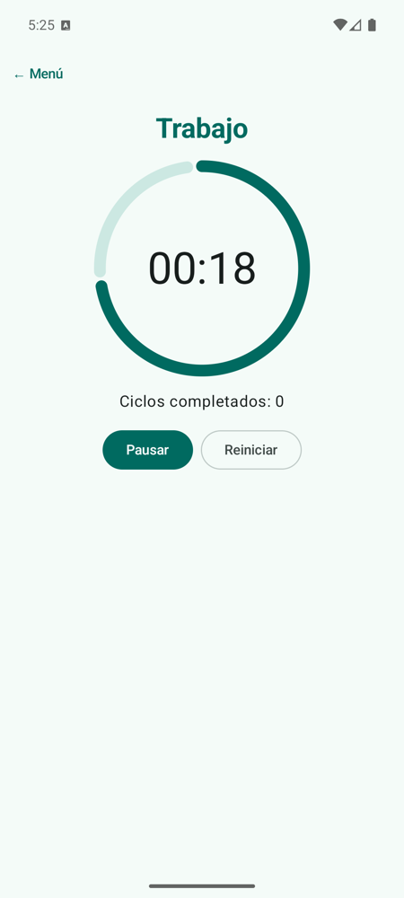
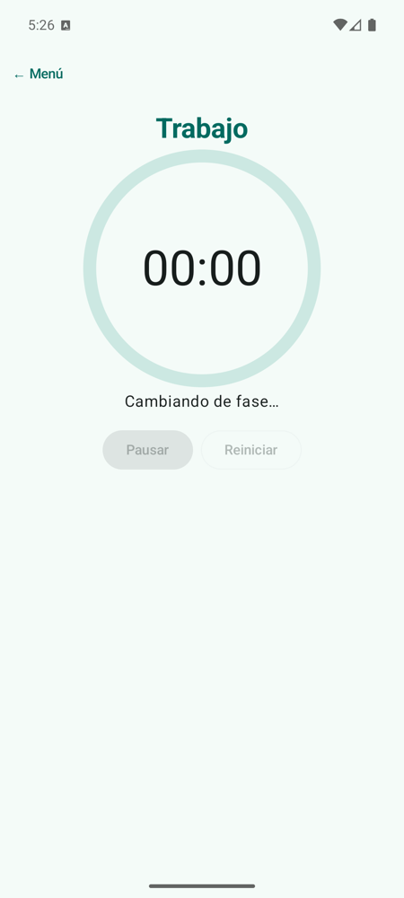

# **Codelab 3.08: Temporizador Pomodoro**

Hasta ahora, todo cambiaba porque alguien pulsaba algo. En este codelab construirás un **temporizador Pomodoro**, que alterna fases de trabajo y descanso y cambia **solo, con el tiempo**. Por el camino usarás corrutinas dentro del ViewModel, aprenderás a pararlas con un **`Job`**, harás una **espera que bloquea los botones**, detendrás el tiempo al salir de la app y animarás un anillo que **sigue al estado**.

!!! info "Punto de partida: tag `c3.08-inicio`"
    Sigue en el repositorio del laboratorio, [pmdm2627-lab-ut3](https://github.com/jssdocente/pmdm2627-lab-ut3). Si terminaste el [Codelab 3.07](./07-ficha-heroe-recursos.md), continúa en tu rama. Si no, parte del tag:

    ```bash
    git checkout c3.08-inicio
    git switch -c mi-lab-3.08
    ```

    `c3.08-inicio` es el laboratorio con los siete codelabs y las pantallas de partida de los [retos](../3.6-laboratorio-retos.md#4-retos-autonomos) en el menú. Repasa antes el [Codelab 3.06](./06-quiz-viewmodel.md): este parte de la misma arquitectura.

---

## 1. ¿Qué vas a construir?

Un anillo con la cuenta atrás. **Iniciar** arranca el tiempo y **Pausar** lo detiene. Al llegar a cero, los botones se bloquean dos segundos y empieza la fase siguiente, con otro color. Si sales de la app el tiempo se detiene, y continúa al volver.

<div style="display: flex; flex-direction: row; justify-content: center; align-items: flex-start; gap: 1.5rem; flex-wrap: wrap; margin: 1.8rem 0;" markdown="1">

<figure style="margin: 0; text-align: center; max-width: 220px;" markdown="1">

{ style="border-radius: 8px; box-shadow: 0 4px 10px rgba(0,0,0,0.15); width: 100%; max-width: 210px;" }

<figcaption style="font-size: 0.85rem; margin-top: 0.5rem; color: var(--md-default-fg-color--light);"><strong>Figura 1:</strong> En marcha.</figcaption>
</figure>

<figure style="margin: 0; text-align: center; max-width: 220px;" markdown="1">

{ style="border-radius: 8px; box-shadow: 0 4px 10px rgba(0,0,0,0.15); width: 100%; max-width: 210px;" }

<figcaption style="font-size: 0.85rem; margin-top: 0.5rem; color: var(--md-default-fg-color--light);"><strong>Figura 2:</strong> Cambiando de fase, con los botones bloqueados.</figcaption>
</figure>

</div>

<figure class="arq-fig">
--8<-- "docs/temas/03/codelabs/images/c3.08-fases.svg"
<figcaption>Los estados del temporizador. La corrutina cuenta; el <code>UiState</code> dice en qué punto está.</figcaption>
</figure>

Al terminar, serás capaz de:

- Lanzar una tarea repetitiva con `viewModelScope.launch` y `delay`.
- Guardar el `Job` para pararla y evitar que se lance dos veces.
- Bloquear la interfaz durante una espera con un campo del `UiState`.
- Detener lo que no debe seguir en segundo plano con `LifecycleResumeEffect`.
- Animar con `animateFloatAsState`, `animateColorAsState` y `graphicsLayer`, sin guardar nada en la animación.
- Probar código con tiempo usando tiempo virtual.

La teoría está en [3C.1 §5](../c-arquitectura/3c.1-capa-ui-viewmodel.md#5-tareas-con-tiempo-en-el-viewmodel) y [3A.4](../a-diseno/3a.4-animaciones.md).

---

## 2. Paso 1: El Estado

Crea el paquete `codelabs/codelab08_pomodoro/` y, dentro, `PomodoroUiState.kt`. Todo lo que pinta la pantalla está aquí:

```kotlin
enum class FasePomodoro(val titulo: String) {
    TRABAJO("Trabajo"),
    DESCANSO("Descanso");

    fun siguiente(): FasePomodoro = if (this == TRABAJO) DESCANSO else TRABAJO
}

data class PomodoroUiState(
    val fase: FasePomodoro = FasePomodoro.TRABAJO,
    val segundosRestantes: Int = 0,
    val segundosDeLaFase: Int = 0,
    val enMarcha: Boolean = false,
    // La espera al cambiar de fase: mientras dura, los botones están bloqueados
    val cambiandoDeFase: Boolean = false,
    val ciclosCompletados: Int = 0
) {
    // Valores derivados: se calculan, no se guardan
    val progreso: Float
        get() = if (segundosDeLaFase == 0) 0f else segundosRestantes.toFloat() / segundosDeLaFase

    val tiempoTexto: String
        get() = "%02d:%02d".format(segundosRestantes / 60, segundosRestantes % 60)
}
```

Fíjate en lo que **no** está: el `Job`. No es un dato que se pinte, sino una herramienta del ViewModel.

---

## 3. Paso 2: El ViewModel y su `Job`

Crea `PomodoroViewModel.kt`. Las duraciones llegan por el constructor: usamos segundos para no esperar 25 minutos, y los tests pueden elegir las suyas.

```kotlin
class PomodoroViewModel(
    private val segundosTrabajo: Int = 25,
    private val segundosDescanso: Int = 5,
    private val esperaCambioMs: Long = 2_000
) : ViewModel() {

    private val _uiState = MutableStateFlow(estadoInicial())
    val uiState: StateFlow<PomodoroUiState> = _uiState.asStateFlow()

    // La corrutina que cuenta. Guardarla es lo que permite pararla
    private var temporizador: Job? = null

    fun onIniciar() {
        val estado = _uiState.value
        if (estado.enMarcha || estado.cambiandoDeFase) return // regla: no se lanza dos veces

        _uiState.update { it.copy(enMarcha = true) }
        arrancar()
    }

    fun onPausar() {
        if (_uiState.value.cambiandoDeFase) return

        temporizador?.cancel()
        _uiState.update { it.copy(enMarcha = false) }
    }

    fun onReiniciar() {
        if (_uiState.value.cambiandoDeFase) return

        temporizador?.cancel()
        _uiState.value = estadoInicial()
    }

    private fun estadoInicial() = PomodoroUiState(
        fase = FasePomodoro.TRABAJO,
        segundosRestantes = segundosTrabajo,
        segundosDeLaFase = segundosTrabajo
    )
}
```

Ahora, la corrutina. Añade dentro de la clase:

```kotlin
private fun arrancar() {
    temporizador?.cancel() // nunca dos corrutinas contando a la vez
    temporizador = viewModelScope.launch {
        while (true) {
            if (_uiState.value.segundosRestantes > 0) {
                delay(1_000) // suspende sin bloquear el hilo principal
                _uiState.update { it.copy(segundosRestantes = it.segundosRestantes - 1) }
            } else {
                cambiarDeFase()
            }
        }
    }
}
```

- `delay` **suspende** la corrutina y deja libre el hilo principal. Con `Thread.sleep`, la app se congelaría.
- `delay` es también donde la corrutina **comprueba si la han cancelado**: por eso `cancel()` termina el `while (true)`.
- `viewModelScope` cancela la corrutina cuando se destruye el ViewModel.

---

## 4. Paso 3: La Espera con Bloqueo

Al llegar a cero, se muestra un aviso y se bloquean los botones durante dos segundos:

```kotlin
private suspend fun cambiarDeFase() {
    // El bloqueo se activa ANTES de esperar y se quita al terminar la espera
    _uiState.update { it.copy(cambiandoDeFase = true) }
    delay(esperaCambioMs)
    _uiState.update { estado ->
        val fase = estado.fase.siguiente()
        estado.copy(
            fase = fase,
            segundosRestantes = duracion(fase),
            segundosDeLaFase = duracion(fase),
            cambiandoDeFase = false,
            // Un ciclo se completa al terminar el descanso
            ciclosCompletados = estado.ciclosCompletados +
                if (estado.fase == FasePomodoro.DESCANSO) 1 else 0
        )
    }
}

private fun duracion(fase: FasePomodoro): Int = when (fase) {
    FasePomodoro.TRABAJO -> segundosTrabajo
    FasePomodoro.DESCANSO -> segundosDescanso
}
```

`cambiarDeFase` es una función `suspend`: puede llamar a `delay` y se ejecuta dentro de la corrutina del temporizador. El bloqueo tiene dos partes: el campo `cambiandoDeFase`, que la pantalla usará para desactivar los botones, y el `if` del principio de cada evento, que es la regla de verdad.

---

## 5. Paso 4: La Pantalla y las Animaciones

Crea `PomodoroScreen.kt` con las dos partes de siempre. La pantalla **sin estado** no sabe nada de corrutinas: recibe el `uiState` y calcula tres valores animados a partir de él.

```kotlin
@Composable
fun PomodoroContent(
    uiState: PomodoroUiState,
    onIniciar: () -> Unit,
    onPausar: () -> Unit,
    onReiniciar: () -> Unit,
    modifier: Modifier = Modifier
) {
    // El anillo avanza suave entre segundo y segundo
    val progresoAnimado by animateFloatAsState(
        targetValue = uiState.progreso,
        animationSpec = tween(durationMillis = 1_000, easing = LinearEasing),
        label = "progreso"
    )
    val colorFase by animateColorAsState(
        targetValue = if (uiState.fase == FasePomodoro.TRABAJO) MaterialTheme.colorScheme.primary
        else MaterialTheme.colorScheme.tertiary,
        label = "colorFase"
    )
    // Durante el cambio de fase, el anillo crece un poco y vuelve
    val escala by animateFloatAsState(
        targetValue = if (uiState.cambiandoDeFase) 1.1f else 1f,
        animationSpec = spring(dampingRatio = Spring.DampingRatioMediumBouncy),
        label = "escala"
    )

    Column(
        modifier = modifier
            .fillMaxWidth()
            .verticalScroll(rememberScrollState()) // en horizontal no cabe entero
            .padding(16.dp),
        horizontalAlignment = Alignment.CenterHorizontally,
        verticalArrangement = Arrangement.spacedBy(16.dp)
    ) {
        Text(
            text = uiState.fase.titulo,
            style = MaterialTheme.typography.headlineMedium,
            color = colorFase
        )
        Box(
            contentAlignment = Alignment.Center,
            modifier = Modifier
                .size(220.dp)
                .graphicsLayer {
                    scaleX = escala
                    scaleY = escala
                }
        ) {
            CircularProgressIndicator(
                progress = { progresoAnimado },
                color = colorFase,
                strokeWidth = 12.dp,
                modifier = Modifier.size(220.dp)
            )
            Text(text = uiState.tiempoTexto, style = MaterialTheme.typography.displayMedium)
        }
        Text(
            text = if (uiState.cambiandoDeFase) "Cambiando de fase…"
            else "Ciclos completados: ${uiState.ciclosCompletados}",
            style = MaterialTheme.typography.bodyLarge
        )
        Row(horizontalArrangement = Arrangement.spacedBy(8.dp)) {
            Button(
                onClick = if (uiState.enMarcha) onPausar else onIniciar,
                // Bloqueo: sale del estado, no de una variable de la pantalla
                enabled = !uiState.cambiandoDeFase
            ) {
                Text(if (uiState.enMarcha) "Pausar" else "Iniciar")
            }
            OutlinedButton(onClick = onReiniciar, enabled = !uiState.cambiandoDeFase) {
                Text("Reiniciar")
            }
        }
    }
}
```

!!! warning "La animación no es el estado"
    Ninguna animación decide nada ni guarda nada. La cuenta atrás está en `segundosRestantes`: quita las tres animaciones y el temporizador funciona igual, solo que a saltos.

Añade la pantalla **con estado** y regístrala en el menú:

```kotlin
@Composable
fun PomodoroScreen(
    modifier: Modifier = Modifier,
    viewModel: PomodoroViewModel = viewModel()
) {
    val uiState by viewModel.uiState.collectAsStateWithLifecycle()

    PomodoroContent(
        uiState = uiState,
        onIniciar = viewModel::onIniciar,
        onPausar = viewModel::onPausar,
        onReiniciar = viewModel::onReiniciar,
        modifier = modifier
    )
}
```

En `LabApp.kt`, añade la entrada a `PantallaLab` y su rama al `when`:

```kotlin
POMODORO("3.08 · Temporizador Pomodoro", "Job, delay, bloqueo, ciclo de vida y animaciones"),
```

```kotlin
PantallaLab.POMODORO -> PantallaConVolver({ pantalla = PantallaLab.MENU }, modifier) {
    PomodoroScreen()
}
```

Ejecuta y comprueba la cuenta atrás, la pausa y el cambio de fase. **Gira el móvil**: el tiempo sigue, porque vive en el ViewModel.

---

## 6. Paso 5: Parar al Salir de la App

Inicia el temporizador, pulsa el botón de inicio del móvil, espera diez segundos y vuelve. **Ha seguido contando**: el ViewModel sigue vivo aunque la app no se vea.

Añade dos eventos al ViewModel. Salir de la app **cancela la corrutina, pero no cambia `enMarcha`**, para saber al volver si hay que continuar:

```kotlin
fun onSalirDeLaApp() {
    temporizador?.cancel()
}

fun onVolverALaApp() {
    if (_uiState.value.enMarcha) arrancar()
}
```

Y avisa desde `PomodoroScreen`, antes de llamar a `PomodoroContent`:

```kotlin
// Se ejecuta al volver a primer plano; onPauseOrDispose, al salir de él
LifecycleResumeEffect(Unit) {
    viewModel.onVolverALaApp()
    onPauseOrDispose { viewModel.onSalirDeLaApp() }
}
```

Repite la prueba: el tiempo se detiene y continúa. Pausa, sal y vuelve: sigue en pausa. → [3C.1 §5.3](../c-arquitectura/3c.1-capa-ui-viewmodel.md#53-parar-al-salir-de-la-app-lifecycleresumeeffect)

---

## 7. Paso 6: Tests con Tiempo Virtual

Añade la dependencia al catálogo y a `app/build.gradle.kts`:

```toml
[versions]
coroutinesTest = "1.10.2"

[libraries]
kotlinx-coroutines-test = { group = "org.jetbrains.kotlinx", name = "kotlinx-coroutines-test", version.ref = "coroutinesTest" }
```

```kotlin
testImplementation(libs.kotlinx.coroutines.test)
```

`viewModelScope` usa el hilo principal, que en un test no existe. Copia la regla `MainDispatcherRule` de [3C.4 §4.1](../c-arquitectura/3c.4-testing.md#41-el-problema-del-hilo-principal) en `app/src/test/java/com/pmdm/lab/ut3/codelabs/codelab08_pomodoro/`, y crea `PomodoroViewModelTest.kt` en la misma carpeta:

```kotlin
class PomodoroViewModelTest {

    @get:Rule
    val mainDispatcherRule = MainDispatcherRule()

    private val viewModel = PomodoroViewModel(segundosTrabajo = 3, segundosDescanso = 2, esperaCambioMs = 1_000)
    private val estado get() = viewModel.uiState.value

    // advanceTimeBy no ejecuta lo programado justo en ese instante: runCurrent sí
    private fun TestScope.avanzar(ms: Long) {
        advanceTimeBy(ms)
        runCurrent()
    }

    @Test
    fun `iniciar dos veces no lanza dos temporizadores`() = runTest {
        viewModel.onIniciar()
        viewModel.onIniciar()

        avanzar(1_000)

        assertEquals(2, estado.segundosRestantes)
        viewModel.onPausar()
    }

    @Test
    fun `al llegar a cero bloquea durante la espera y pasa a la siguiente fase`() = runTest {
        viewModel.onIniciar()

        avanzar(3_000)
        assertTrue(estado.cambiandoDeFase)

        // Durante la espera, pausar no hace nada
        viewModel.onPausar()
        assertTrue(estado.enMarcha)

        avanzar(1_000)
        assertFalse(estado.cambiandoDeFase)
        assertEquals(FasePomodoro.DESCANSO, estado.fase)
        viewModel.onPausar()
    }

    @Test
    fun `al salir de la app se para y al volver continua`() = runTest {
        viewModel.onIniciar()
        avanzar(1_000)

        viewModel.onSalirDeLaApp()
        avanzar(10_000)
        assertEquals(2, estado.segundosRestantes)

        viewModel.onVolverALaApp()
        avanzar(1_000)
        assertEquals(1, estado.segundosRestantes)
        viewModel.onPausar()
    }
}
```

Diez segundos de `delay` tardan milisegundos. Ejecuta `./gradlew test`.

!!! danger "Para siempre el temporizador"
    El temporizador es un bucle infinito. Por eso cada test termina con `onPausar()` y ninguno usa `advanceUntilIdle()`: siempre habría otro `delay` pendiente y el test se quedaría colgado.

---

## 8. Experimenta

1. Comenta `temporizador?.cancel()` en `arrancar()` y quita de `onIniciar` la comprobación de `enMarcha`. Pulsa varias veces: ¿qué le pasa al tiempo? ¿Por qué ya no puedes pararlo?

2. Cambia `delay(1_000)` por `Thread.sleep(1_000)` y prueba a pulsar *Pausar*. Vuelve a dejarlo como estaba.

3. Quita `enMarcha` de `onVolverALaApp`, de forma que siempre arranque. Pausa, sal de la app y vuelve: ¿qué test falla, si escribes el de «no arranca si estaba pausado»?

4. Haz que el texto del tiempo parpadee con `alpha` durante el cambio de fase, usando otro `animateFloatAsState` y `graphicsLayer`.

!!! success "Solución: tag `c3.08-fin`"
    Compara tu código con el tag [`c3.08-fin`](https://github.com/jssdocente/pmdm2627-lab-ut3/tree/c3.08-fin) (`git diff c3.08-fin`). El proyecto de la solución tiene más tests de los que hay aquí. Con este codelab termina la parte guiada: los [retos autónomos](../3.6-laboratorio-retos.md#4-retos-autonomos) ponen en práctica lo aprendido.

---

## 9. Resumen y Checklist

- [ ] `PomodoroUiState` contiene todo lo que se pinta; el `Job` no está en él.
- [ ] El temporizador usa `viewModelScope.launch` y `delay`, nunca `Thread.sleep`.
- [ ] Antes de lanzar otra corrutina se cancela la anterior, y pulsar dos veces no acelera el tiempo.
- [ ] Durante el cambio de fase, los botones están desactivados por el estado y los eventos se ignoran.
- [ ] Salir de la app cancela la corrutina sin cambiar `enMarcha`, y volver continúa solo si estaba en marcha.
- [ ] El tiempo sobrevive al giro del móvil.
- [ ] Las animaciones se calculan a partir del `uiState` y no guardan nada.
- [ ] Los tests avanzan el tiempo con `advanceTimeBy` y `runCurrent`, y paran siempre el temporizador.
