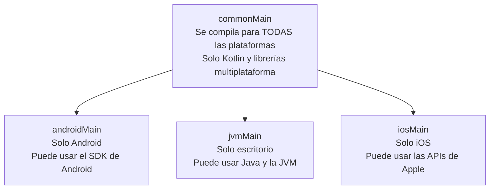
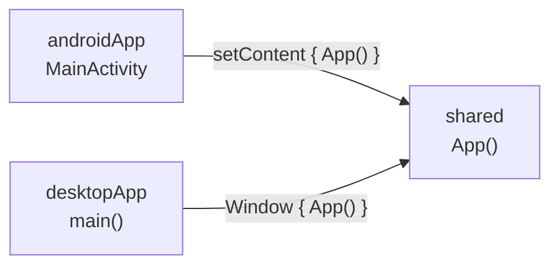

# **3D.1 Anatomía de un proyecto Kotlin Multiplatform**

En [UT1](../../01/index.md#4-kotlin-multiplatform-kmp-la-revolucion-multiplataforma) vimos de forma conceptual qué es **Kotlin Multiplatform (KMP)**: escribir la lógica una sola vez en Kotlin y compilarla para Android, iOS, escritorio o web. En esta subunidad vamos a **llevarlo a la práctica** con la app de juegos que hemos construido en 3B y 3C.

El objetivo de la subunidad 3D es que esa app funcione **en Android y en escritorio** (Windows, macOS o Linux) compartiendo casi todo el código:

- **3D.1** (este apartado): crear un proyecto KMP y entender cómo está organizado.
- **[3D.2](./3d.2-compartir-logica.md)**: llevar el dominio, los datos, los ViewModel y Koin al código común.
- **[3D.3](./3d.3-compose-multiplatform.md)**: compartir también la interfaz con Compose Multiplatform y empaquetar la app de escritorio.

!!! info "¿Por qué escritorio y no iOS?"
    Compilar para iOS exige un Mac con Xcode, que no todo el mundo tiene. El escritorio funciona en cualquier ordenador y, como se basa en la JVM, es el segundo destino más sencillo. Además, es el que propone el proyecto intermodular como «requisito deseable». Todo lo que aprendamos sirve igual para iOS: solo cambia el punto de entrada.

---

## 1. Recordatorio: KMP y Compose Multiplatform

- **Kotlin Multiplatform (KMP)** permite compartir **código Kotlin**: modelos, casos de uso, repositorios, ViewModel… Cada plataforma puede tener su propia interfaz.
- **Compose Multiplatform (CMP)** es la versión multiplataforma de Jetpack Compose, mantenida por JetBrains. Permite compartir **también la interfaz**: los mismos composables se dibujan en Android, iOS, escritorio y web.

En el curso usaremos **las dos**: lógica e interfaz compartidas. Es lo que ofrece el asistente por defecto cuando eliges «compartir la interfaz».

---

## 2. Requisitos

- **IntelliJ IDEA 2026.1.2 o posterior** (o Android Studio) con los plugins **Kotlin Multiplatform** y **Android** actualizados. Las versiones anteriores no son compatibles con el Android Gradle Plugin 9, que usan los proyectos nuevos.
- **JDK 17 o superior** configurado en el IDE (ver [configuración del JDK](../../00-android/00-ide-intellij/index.md#7-configuracion-del-jdk-y-la-matriz-de-compatibilidad)).
- El **Android SDK** y un emulador, como en los proyectos anteriores.
- Solo para iOS (opcional): un Mac con **Xcode**.

---

## 3. Crear el proyecto

Hay dos formas equivalentes:

- **Desde el IDE:** **File → New → Project → Kotlin Multiplatform**.
- **Desde la web:** en [kmp.new](https://kmp.new) eliges las opciones, descargas un ZIP y lo abres con el IDE.

En el asistente:

1. **Nombre del proyecto** y **paquete**: por ejemplo, `MisJuegos` y `com.dam.misjuegos`.

2. **Plataformas:** marca **Android** y **Desktop**. Marca **iOS** solo si trabajas en un Mac; en Windows o Linux no se podría compilar. Deja **Web** y **Server** sin marcar.

3. **Interfaz:** elige compartir la interfaz con **Compose Multiplatform**.

4. Pulsa **Create** (o **Download** en la web) y espera a que termine la primera **sincronización de Gradle**. La primera vez descarga muchas dependencias y puede tardar varios minutos.

---

## 4. La estructura del proyecto

Esta es la estructura que genera el asistente con Android y escritorio:

```text
MisJuegos/
├── settings.gradle.kts            ← lista de módulos del proyecto
├── build.gradle.kts               ← configuración común (casi vacía)
├── gradle/
│   └── libs.versions.toml         ← catálogo de versiones, como en Android
│
├── shared/                        ← 📦 CÓDIGO COMPARTIDO (biblioteca KMP)
│   ├── build.gradle.kts
│   └── src/
│       ├── commonMain/
│       │   ├── kotlin/…/App.kt    ← interfaz, ViewModel, dominio, datos…
│       │   └── composeResources/  ← imágenes y textos compartidos (3D.3)
│       ├── androidMain/kotlin/    ← código solo para Android
│       └── jvmMain/kotlin/        ← código solo para escritorio
│
├── androidApp/                    ← 🤖 APP ANDROID (punto de entrada)
│   ├── build.gradle.kts
│   └── src/main/
│       ├── AndroidManifest.xml
│       ├── kotlin/…/MainActivity.kt
│       └── res/                   ← icono de la app, nombre…
│
└── desktopApp/                    ← 🖥️ APP DE ESCRITORIO (punto de entrada)
    ├── build.gradle.kts
    └── src/main/kotlin/…/main.kt
```

La idea es que **cada módulo tiene una única responsabilidad**:

| Módulo | Qué es | Qué contiene |
|---|---|---|
| `shared` | Una **biblioteca** Kotlin Multiplatform | Todo el código común: interfaz, ViewModel, dominio, datos |
| `androidApp` | La **aplicación Android** | El `MainActivity`, el manifiesto, el icono. Casi no tiene código |
| `desktopApp` | La **aplicación de escritorio** | La función `main()` que abre la ventana y la configuración para empaquetarla |
| `iosApp` *(si eliges iOS)* | Un proyecto de **Xcode** | El punto de entrada de la app de iOS |

!!! warning "Tutoriales con `composeApp`"
    En muchos tutoriales y proyectos anteriores a 2026 verás un único módulo `composeApp` que contenía a la vez el código compartido y las apps de cada plataforma. JetBrains cambió la estructura en 2026, en parte porque el **Android Gradle Plugin 9** ya no permite que la app Android y el código multiplataforma estén en el mismo módulo. Si sigues un tutorial antiguo, ten en cuenta que su `composeApp` equivale ahora a `shared` más los módulos `…App`.

---

## 5. Los *source sets*: qué código va dónde

Dentro de `shared/src` el código se reparte en **conjuntos de código fuente** (*source sets*). Cada uno se compila para unas plataformas concretas:



La regla es la misma que la del dominio en [3C.2](../c-arquitectura/3c.2-clean-architecture.md#2-la-idea-tres-capas-y-una-regla):

> **En `commonMain` no puede haber nada específico de una plataforma**: ni `import android.…`, ni `java.io.File`, ni APIs de Apple.

Por eso, una arquitectura bien separada en capas facilita tanto pasar a KMP: el dominio ya era Kotlin puro.

| Pieza de la app | Source set |
|---|---|
| Modelos, casos de uso, interfaces de repositorio | `commonMain` |
| Repositorios en memoria, ViewModel, módulos de Koin | `commonMain` |
| Pantallas Compose | `commonMain` (con Compose Multiplatform) |
| Algo que solo existe en una plataforma (vibración, nombre del dispositivo…) | `androidMain` / `jvmMain`, con `expect`/`actual` o una interfaz (3D.2) |

---

## 6. Los ficheros de Gradle

### 6.1. `settings.gradle.kts`: los módulos

```kotlin
rootProject.name = "MisJuegos"
enableFeaturePreview("TYPESAFE_PROJECT_ACCESSORS")

// … repositorios …

include(":shared")
include(":androidApp")
include(":desktopApp")
```

`TYPESAFE_PROJECT_ACCESSORS` permite referirse a los módulos desde otros con `projects.shared` en lugar de con una cadena de texto.

### 6.2. `shared/build.gradle.kts`: la biblioteca común

Es el fichero más importante. Indica **para qué plataformas se compila** y **qué librerías usa cada source set**:

```kotlin
plugins {
    alias(libs.plugins.kotlinMultiplatform)
    alias(libs.plugins.androidMultiplatformLibrary)   // biblioteca Android para KMP (AGP 9)
    alias(libs.plugins.composeMultiplatform)
    alias(libs.plugins.composeCompiler)
}

kotlin {
    // Plataformas de destino (targets)
    androidLibrary {
        namespace = "com.dam.misjuegos.shared"
        compileSdk = libs.versions.android.compileSdk.get().toInt()
        minSdk = libs.versions.android.minSdk.get().toInt()
        androidResources { enable = true }
    }
    jvm()                  // escritorio

    // Librerías de cada source set
    sourceSets {
        commonMain.dependencies {
            implementation(libs.compose.runtime)
            implementation(libs.compose.foundation)
            implementation(libs.compose.material3)
            implementation(libs.compose.ui)
            implementation(libs.compose.components.resources)
            implementation(libs.compose.uiToolingPreview)
        }
        androidMain.dependencies {
            implementation(libs.androidx.activity.compose)
        }
        jvmMain.dependencies {
            // librerías solo para escritorio, si hicieran falta
        }
    }
}
```

- Cada **target** (`androidLibrary { … }`, `jvm()`, `iosArm64()`…) es una plataforma para la que se compila `shared`.
- Las dependencias se declaran **por source set**: lo que pongas en `commonMain.dependencies` tiene que ser una librería **multiplataforma**.

### 6.3. `androidApp/build.gradle.kts`: la app Android

Es un módulo de aplicación Android normal, como los de UT2 y UT3, que **depende de `shared`**:

```kotlin
plugins {
    alias(libs.plugins.androidApplication)
    alias(libs.plugins.composeCompiler)
}

dependencies {
    implementation(projects.shared)
    implementation(libs.androidx.activity.compose)
}

android {
    namespace = "com.dam.misjuegos"
    compileSdk = libs.versions.android.compileSdk.get().toInt()
    defaultConfig {
        applicationId = "com.dam.misjuegos"
        minSdk = libs.versions.android.minSdk.get().toInt()
        targetSdk = libs.versions.android.targetSdk.get().toInt()
        versionCode = 1
        versionName = "1.0"
    }
}
```

Con AGP 9 ya no hace falta aplicar el plugin `kotlin-android`: el soporte de Kotlin viene incluido.

### 6.4. `desktopApp/build.gradle.kts`: la app de escritorio

```kotlin
plugins {
    alias(libs.plugins.kotlinJvm)
    alias(libs.plugins.composeMultiplatform)
    alias(libs.plugins.composeCompiler)
}

dependencies {
    implementation(projects.shared)
    implementation(compose.desktop.currentOs)          // Compose para el sistema operativo actual
    implementation(libs.kotlinx.coroutines.swing)      // hilo principal en escritorio
}

compose.desktop {
    application {
        mainClass = "com.dam.misjuegos.MainKt"
        nativeDistributions {
            targetFormats(TargetFormat.Dmg, TargetFormat.Msi, TargetFormat.Deb)
            packageName = "MisJuegos"
            packageVersion = "1.0.0"
        }
    }
}
```

El bloque `nativeDistributions` sirve para generar instaladores (`.msi` para Windows, `.dmg` para macOS, `.deb` para Linux). Lo usaremos en 3D.3.

`kotlinx-coroutines-swing` proporciona el `Dispatchers.Main` de escritorio, que necesitan `viewModelScope` y Compose.

---

## 7. Un composable, varios puntos de entrada

La interfaz de la app empieza en un composable común, `App()`, que está en `shared/src/commonMain`:

```kotlin
// shared/src/commonMain/kotlin/com/dam/misjuegos/App.kt
@Composable
fun App() {
    MaterialTheme {
        // Aquí irá la navegación de la app (3D.3)
        Text("¡Hola desde código compartido!")
    }
}
```

Cada plataforma solo tiene que **abrir una ventana y dibujar `App()`**:

=== "Android: androidApp/…/MainActivity.kt"

    ```kotlin
    class MainActivity : ComponentActivity() {
        override fun onCreate(savedInstanceState: Bundle?) {
            super.onCreate(savedInstanceState)
            enableEdgeToEdge()
            setContent {
                App()
            }
        }
    }
    ```

=== "Escritorio: desktopApp/…/main.kt"

    ```kotlin
    fun main() = application {
        Window(
            onCloseRequest = ::exitApplication,
            title = "Mis juegos"
        ) {
            App()
        }
    }
    ```



Todo lo que hagas a partir de `App()` (pantallas, navegación, ViewModel) se comparte automáticamente entre las dos apps.

---

## 8. Ejecutar la app

Al sincronizar, el IDE crea una **configuración de ejecución** para cada app. Elígela en el desplegable de la barra superior y pulsa ▶:

- **androidApp:** se instala y abre en el emulador o móvil, como cualquier app Android.
- **desktopApp:** se abre una ventana en tu ordenador.

También desde la terminal:

```bash
./gradlew :desktopApp:run
```

```bash
./gradlew :androidApp:installDebug
```

### Compose Hot Reload

La configuración de escritorio usa por defecto **Compose Hot Reload**: con la app abierta, cambia un texto o un color en un composable y **guarda**. El cambio aparece en la ventana en uno o dos segundos, **sin reiniciar la app y sin perder el estado** (por ejemplo, la pantalla en la que estabas). Es una forma muy rápida de diseñar la interfaz: diseña en escritorio y comprueba después en Android.

---

## 9. Librerías multiplataforma

En `commonMain` solo pueden usarse librerías **multiplataforma**. Muchas de las que ya conoces tienen versión para KMP, a veces con otro nombre de grupo:

| En Android (UT2–3C) | En `commonMain` (KMP) | Notas |
|---|---|---|
| `androidx.compose.*` | `org.jetbrains.compose.*` | Compose Multiplatform. Mismos paquetes en el código (`androidx.compose.material3…`) |
| `androidx.lifecycle` (ViewModel) | `org.jetbrains.androidx.lifecycle` | Versión multiplataforma publicada por JetBrains |
| `navigation3-ui` | `org.jetbrains.androidx.navigation3:navigation3-ui` | Versión multiplataforma estable desde la 1.2.0 (3D.3) |
| `koin-android` + `koin-compose-viewmodel` | `koin-core` + `koin-compose-viewmodel` | `koin-android` solo en el módulo `androidApp` |
| `R.drawable…`, `R.string…` | `Res.drawable…`, `Res.string…` | Recursos de Compose Multiplatform (3D.3) |
| Retrofit *(UT4)* | Ktor | Cliente HTTP multiplataforma |
| Room *(UT4)* | Room KMP | La misma librería, con soporte multiplataforma |
| `kotlinx-coroutines`, `kotlinx-serialization` | Las mismas | Ya eran multiplataforma |

!!! tip "¿Cómo sé si una librería es multiplataforma?"
    Consulta su documentación o búscala en [klibs.io](https://klibs.io), el buscador oficial de librerías Kotlin Multiplatform, que indica para qué plataformas está disponible.

---

## 10. Código específico de cada plataforma: `expect` y `actual`

A veces el código común necesita algo que cada plataforma hace a su manera. En UT1 vimos el mecanismo `expect`/`actual`: en `commonMain` se **declara** lo que se espera y cada plataforma lo **implementa**.

=== "commonMain"

    ```kotlin
    // shared/src/commonMain/kotlin/com/dam/misjuegos/Plataforma.kt
    expect fun nombrePlataforma(): String
    ```

=== "androidMain"

    ```kotlin
    // shared/src/androidMain/kotlin/com/dam/misjuegos/Plataforma.android.kt
    actual fun nombrePlataforma(): String = "Android ${android.os.Build.VERSION.RELEASE}"
    ```

=== "jvmMain"

    ```kotlin
    // shared/src/jvmMain/kotlin/com/dam/misjuegos/Plataforma.jvm.kt
    actual fun nombrePlataforma(): String = "Escritorio (${System.getProperty("os.name")})"
    ```

Si falta el `actual` de alguna plataforma, el proyecto **no compila**: el compilador garantiza que todas las plataformas cubren lo que el código común espera. En [3D.2](./3d.2-compartir-logica.md#6-lo-que-cada-plataforma-hace-a-su-manera) veremos cuándo conviene usar `expect`/`actual` y cuándo es mejor una interfaz inyectada con Koin.

---

## 11. Errores frecuentes

!!! warning "No aparece la opción Kotlin Multiplatform al crear el proyecto"
    Falta el plugin **Kotlin Multiplatform** o la versión del IDE es antigua. Actualiza IntelliJ IDEA a 2026.1.2 o posterior e instala el plugin desde **Settings → Plugins**. Alternativa: genera el proyecto en [kmp.new](https://kmp.new).

!!! warning "La sincronización de Gradle falla con un error de versión de Java"
    El Android Gradle Plugin 9 necesita JDK 17 o superior. Revisa el JDK del proyecto en **Settings → Build, Execution, Deployment → Build Tools → Gradle → Gradle JVM**.

!!! warning "`Unresolved reference` al usar una clase de Android en `commonMain`"
    Las APIs de Android solo existen en `androidMain`. Mueve ese código allí o usa `expect`/`actual`.

!!! warning "He añadido una librería en `commonMain` y falla la compilación de escritorio"
    La librería no es multiplataforma (o has usado su versión solo Android). Busca su versión KMP o declárala solo en `androidMain.dependencies`.

!!! warning "En Windows o Linux falla la compilación por el target de iOS"
    Los targets de iOS solo se compilan en un Mac. Si creaste el proyecto con iOS, quítalos de `shared/build.gradle.kts` o vuelve a generarlo sin iOS.

!!! warning "El tutorial dice `androidTarget()` y mi proyecto usa `androidLibrary { }`"
    `androidTarget()` es la forma anterior a AGP 9. En los proyectos nuevos, el target de Android de la biblioteca compartida se configura con `androidLibrary { … }`.

---

## 12. Retos

### 🟢 Básico: primer proyecto KMP

Crea un proyecto KMP con Android y escritorio, ejecuta las dos apps y cambia el texto de `App()` por un saludo propio con la app de escritorio abierta. Comprueba que Compose Hot Reload aplica el cambio sin reiniciar.

??? success "Solución"

    1. Crea el proyecto con el asistente (apartado 3) marcando **Android** y **Desktop**, y compartiendo la interfaz.

    2. Espera a que termine la sincronización de Gradle.

    3. Ejecuta **desktopApp** desde el desplegable de configuraciones y pulsa ▶.

    4. Con la ventana abierta, edita `shared/src/commonMain/kotlin/…/App.kt`:

        ```kotlin
        @Composable
        fun App() {
            MaterialTheme {
                Text("¡Hola, soy Ana y esto es Kotlin Multiplatform!")
            }
        }
        ```

    5. Guarda (`Ctrl+S` / `Cmd+S`): el texto cambia en la ventana sin reiniciarla.

    6. Ejecuta **androidApp**: el emulador muestra el mismo texto, porque ambas apps dibujan el mismo `App()`.

    Claves de la solución:

    - Solo has escrito código en `shared`; los módulos `androidApp` y `desktopApp` no se tocan.
    - Compose Hot Reload funciona en la app de escritorio. Por eso es cómodo diseñar allí y comprobar después en Android.

### 🟡 Intermedio: ¿dónde me estoy ejecutando?

Implementa `expect fun nombrePlataforma(): String` como en el apartado 10 y muestra en `App()` el texto «Ejecutándose en: …». Comprueba que cada app muestra su plataforma.

??? success "Solución"

    ```kotlin
    // commonMain
    expect fun nombrePlataforma(): String

    @Composable
    fun App() {
        MaterialTheme {
            Column(
                modifier = Modifier.fillMaxSize().safeDrawingPadding().padding(24.dp),
                verticalArrangement = Arrangement.spacedBy(8.dp)
            ) {
                Text("Mis juegos", style = MaterialTheme.typography.headlineMedium)
                Text("Ejecutándose en: ${nombrePlataforma()}")
            }
        }
    }

    // androidMain
    actual fun nombrePlataforma(): String = "Android ${android.os.Build.VERSION.RELEASE}"

    // jvmMain
    actual fun nombrePlataforma(): String = "Escritorio (${System.getProperty("os.name")})"
    ```

    Claves de la solución:

    - `App()` está en `commonMain` y llama a `nombrePlataforma()` sin saber cómo se implementa.
    - `android.os.Build` solo se puede usar en `androidMain`, y `System.getProperty` (de la JVM) en `jvmMain`.
    - Prueba a borrar el `actual` de `jvmMain`: el proyecto deja de compilar y el error indica qué plataforma falta.
    - `Column`, `Text`, `MaterialTheme` y `safeDrawingPadding` son los mismos que en Android: con Compose Multiplatform no hay que aprender una API nueva.

### 🔴 Avanzado: Koin en las dos apps

Añade Koin al proyecto: un módulo en `commonMain` con un `single` que proporcione un `Saludo` (una clase sencilla con una función `texto(): String`), una función `initKoin()` común, y arráncalo desde los dos puntos de entrada. Muestra el saludo en `App()` obtenido con `koinInject()`.

??? success "Solución"

    ```toml
    # gradle/libs.versions.toml
    [versions]
    koin = "4.2.2"

    [libraries]
    koin-core = { module = "io.insert-koin:koin-core", version.ref = "koin" }
    koin-compose = { module = "io.insert-koin:koin-compose", version.ref = "koin" }
    koin-android = { module = "io.insert-koin:koin-android", version.ref = "koin" }
    ```

    ```kotlin
    // shared/build.gradle.kts
    commonMain.dependencies {
        // …
        implementation(libs.koin.core)
        implementation(libs.koin.compose)
    }

    // androidApp/build.gradle.kts
    dependencies {
        implementation(projects.shared)
        implementation(libs.koin.android)
    }
    ```

    ```kotlin
    // shared/src/commonMain/kotlin/com/dam/misjuegos/di/Koin.kt
    class Saludo {
        fun texto() = "¡Hola desde Koin en ${nombrePlataforma()}!"
    }

    val appModule = module {
        single { Saludo() }
    }

    fun initKoin(config: KoinAppDeclaration = {}) {
        startKoin {
            config()             // configuración específica de cada plataforma
            modules(appModule)
        }
    }

    // shared/src/commonMain/kotlin/com/dam/misjuegos/App.kt
    @Composable
    fun App() {
        val saludo = koinInject<Saludo>()
        MaterialTheme {
            Text(saludo.texto(), modifier = Modifier.safeDrawingPadding().padding(24.dp))
        }
    }
    ```

    ```kotlin
    // androidApp: una clase Application (registrada en el manifiesto con android:name)
    class MisJuegosApp : Application() {
        override fun onCreate() {
            super.onCreate()
            initKoin {
                androidContext(this@MisJuegosApp)
            }
        }
    }

    // desktopApp: main.kt
    fun main() {
        initKoin()
        application {
            Window(onCloseRequest = ::exitApplication, title = "Mis juegos") {
                App()
            }
        }
    }
    ```

    Claves de la solución:

    - Los **módulos de Koin** y la función `initKoin` están en `commonMain`: se escriben una vez para todas las plataformas.
    - El parámetro `config` permite que Android añada `androidContext(…)`, que solo existe en `koin-android`. Por eso esa librería se añade **solo** al módulo `androidApp`.
    - Koin se arranca en el sitio adecuado de cada plataforma: en la clase `Application` en Android y al principio de `main()` en escritorio, antes de abrir la ventana.
    - `koinInject()` (de `koin-compose`) obtiene cualquier dependencia desde un composable. Para ViewModel seguiremos usando `koinViewModel()`, como en 3C.3.

---

## 13. Para saber más

- **En este curso:**

    - [UT1: Kotlin Multiplatform (introducción conceptual)](../../01/index.md#4-kotlin-multiplatform-kmp-la-revolucion-multiplataforma)
    - [Manual: Ecosistema multiplataforma (KMP y CMP)](../../00-android/02-arquitectura/04-ecosistema-kmp-multiplataforma.md)

- **Documentación oficial:**

    - [Primeros pasos con Kotlin Multiplatform](https://kotlinlang.org/docs/multiplatform/get-started.html)
    - [Nueva estructura por defecto de los proyectos KMP (blog de JetBrains, 2026)](https://blog.jetbrains.com/kotlin/2026/05/new-kmp-default-structure/)
    - [Migrar un proyecto KMP a AGP 9](https://kotlinlang.org/docs/multiplatform/multiplatform-project-agp-9-migration.html)
    - [Plantilla oficial con la estructura nueva (KMP-App-Template)](https://github.com/Kotlin/KMP-App-Template)
    - [Kotlin Multiplatform en Android Developers](https://developer.android.com/kotlin/multiplatform?hl=es-419)
