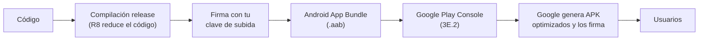

# **3E.1 Preparar el lanzamiento**

Hasta ahora hemos ejecutado siempre la app desde el IDE, en su versión de **depuración** (*debug*). Esa versión está pensada para desarrollar: se compila rápido, permite depurar y se firma automáticamente con una clave de pruebas. Pero **no sirve para publicar**: Google Play rechaza las apps firmadas con la clave de depuración.

En este apartado preparamos la versión de **lanzamiento** (*release*) de la app: la que se sube a la tienda y descargan los usuarios.

Al terminar sabrás:

- Qué son los **tipos de compilación** (*build types*) `debug` y `release`.
- Gestionar la **versión** de la app (`versionCode` y `versionName`).
- **Firmar** la app con tu propia clave sin subir contraseñas al repositorio.
- Reducir y proteger el código con **R8**.
- Generar un **Android App Bundle (AAB)** y probarlo antes de subirlo.

!!! info "¿`app` o `androidApp`?"
    En los ejemplos usamos el módulo `androidApp` de un proyecto Kotlin Multiplatform (3D). Si tu proyecto es solo Android, el módulo se llama `app`: los bloques de configuración son los mismos y en los comandos solo cambia el nombre (`:app:bundleRelease`).

---

## 1. Del código a la tienda: el proceso completo



En este apartado nos ocupamos de los cuatro primeros pasos. La subida a la tienda y la publicación se tratan en [3E.2 Publicar en Google Play](./3e.2-publicar-google-play.md).

---

## 2. Tipos de compilación: `debug` y `release`

Todo proyecto Android tiene, como mínimo, dos **tipos de compilación**:

| | `debug` | `release` |
|---|---|---|
| Para qué | Desarrollar y probar | Publicar |
| Firma | Automática, con una clave de depuración | Con **tu** clave |
| Depurable | Sí | No |
| Optimización (R8) | No | Sí, si la activas |
| Velocidad de compilación | Rápida | Más lenta |

Se configuran en el bloque `buildTypes` del `build.gradle.kts` del módulo de la app:

```kotlin
// androidApp/build.gradle.kts
android {
    // …
    buildTypes {
        getByName("debug") {
            applicationIdSuffix = ".debug"     // permite tener instaladas a la vez la versión debug y la release
            versionNameSuffix = "-debug"
        }
        getByName("release") {
            isMinifyEnabled = true             // R8: reduce y ofusca el código (apartado 5)
            isShrinkResources = true           // elimina recursos que no se usan
            proguardFiles(
                getDefaultProguardFile("proguard-android-optimize.txt"),
                "proguard-rules.pro"
            )
        }
    }
}
```

Para cambiar de tipo de compilación en el IDE, abre la ventana **Build Variants** (**View → Tool Windows → Build Variants**) y elige `debug` o `release` para el módulo de la app.

!!! tip "`applicationIdSuffix`: dos versiones en el mismo móvil"
    Con `applicationIdSuffix = ".debug"`, la versión de depuración se instala con el identificador `com.dam.misjuegos.debug` y la de lanzamiento con `com.dam.misjuegos`. Para Android son dos apps distintas, así que puedes tener ambas instaladas y comparar su comportamiento.

---

## 3. Identidad y versión de la app

En el bloque `defaultConfig` se define la identidad de la app:

```kotlin
android {
    namespace = "com.dam.misjuegos"
    compileSdk = 37

    defaultConfig {
        applicationId = "com.dam.misjuegos"   // identificador único en Google Play
        minSdk = 24
        targetSdk = 36                         // Google Play exige como mínimo 36 desde agosto de 2026
        versionCode = 1                        // número interno: debe aumentar en cada subida
        versionName = "1.0.0"                  // versión que ve el usuario
    }
}
```

### `applicationId`: elígelo con cuidado

El `applicationId` identifica tu app en Google Play y en el móvil de cada usuario. **Una vez publicada, no se puede cambiar nunca**: si lo cambias, Google Play la considera otra app distinta, sin sus usuarios ni sus valoraciones. Usa un dominio que controles al revés (`es.iesalbarregas.misjuegos`) o, en clase, `com.dam.<tunombre>.<app>`.

### `versionCode` y `versionName`

| Propiedad | Tipo | Quién lo ve | Regla |
|---|---|---|---|
| `versionCode` | Número entero | Solo Google Play y el sistema | Debe ser **mayor** que el de la versión anterior en cada subida |
| `versionName` | Texto | El usuario, en la ficha de la tienda y en los ajustes | Libre, aunque se recomienda `MAYOR.MENOR.PARCHE` |

Una convención muy extendida para `versionName` es el **versionado semántico**:

- Sube el **PARCHE** (`1.0.0` → `1.0.1`) si solo corriges errores.
- Sube el **MENOR** (`1.0.1` → `1.1.0`) si añades funciones.
- Sube el **MAYOR** (`1.1.0` → `2.0.0`) si hay cambios importantes que rompen lo anterior.

El `versionCode`, en cambio, simplemente se incrementa en uno en cada versión que subes: `1`, `2`, `3`…

### `targetSdk`: el requisito de Google Play

`targetSdk` indica con qué versión de Android has probado la app y qué comportamientos del sistema acepta (recuerda los cambios de edge-to-edge y pantallas grandes de [3B.2](../b-navegacion/3b.2-diseno-adaptativo.md#1-por-que-ya-no-es-opcional)). Google Play exige que esté actualizado: desde el **31 de agosto de 2026**, las apps nuevas y las actualizaciones deben tener **`targetSdk` 36 (Android 16)** o superior. Este requisito sube cada año, así que consulta la [página oficial](https://developer.android.com/google/play/requirements/target-sdk?hl=es-419) antes de publicar.

---

## 4. Firmar la app

### 4.1. Por qué hay que firmar

Toda app Android está **firmada digitalmente**. La firma garantiza dos cosas:

- Que la app la ha publicado quien dice haberla publicado.
- Que las actualizaciones vienen del **mismo autor**: Android solo instala una actualización si está firmada con la misma clave que la versión instalada.

La clave se guarda en un fichero llamado **almacén de claves** (*keystore*, con extensión `.jks`), protegido con contraseña.

### 4.2. Play App Signing: dos claves

Google Play utiliza un sistema llamado **Play App Signing** con dos claves distintas:

| Clave | Quién la guarda | Para qué |
|---|---|---|
| **Clave de firma de la app** (*app signing key*) | Google, en sus servidores | Firmar los APK que se instalan en los móviles de los usuarios |
| **Clave de subida** (*upload key*) | Tú, en tu keystore | Firmar el AAB que subes a Play Console, para que Google sepa que eres tú |

La ventaja es la seguridad: si pierdes tu clave de subida o te la roban, puedes **pedir a Google que la sustituya** desde Play Console. La clave que firma la app de los usuarios nunca sale de los servidores de Google.

### 4.3. Crear la clave de subida

**Desde el IDE (recomendado):**

1. Menú **Build → Generate Signed App Bundle or APK**.

2. Elige **Android App Bundle** y el módulo de la app. Pulsa **Next**.

3. Debajo de **Key store path**, pulsa **Create new**.

4. Rellena los datos:

    - **Key store path**: dónde guardar el fichero, **fuera de la carpeta del proyecto** (por ejemplo, `~/claves/misjuegos-upload.jks`).
    - **Password**: la contraseña del almacén.
    - **Alias**: el nombre de la clave, por ejemplo `upload`.
    - **Password** de la clave y **Validity**: al menos 25 años.
    - **Certificate**: tu nombre y, opcionalmente, organización y país.

5. Pulsa **OK** y continúa el asistente para generar el AAB firmado.

**Desde la terminal**, con la herramienta `keytool` del JDK:

```bash
keytool -genkeypair -v -keystore ~/claves/misjuegos-upload.jks -keyalg RSA -keysize 2048 -validity 10000 -alias upload
```

!!! danger "Guarda la clave y sus contraseñas en un lugar seguro"
    - **No subas el fichero `.jks` ni las contraseñas a Git** (y menos a un repositorio público).
    - Haz una **copia de seguridad** del `.jks` y apunta las contraseñas en un gestor de contraseñas.
    - Si pierdes la clave de subida, puedes pedir su sustitución a Google, pero el proceso tarda días. Sin Play App Signing, perder la clave significaba no poder actualizar nunca más la app.

### 4.4. Firmar desde Gradle sin exponer las contraseñas

El asistente del IDE sirve para firmar a mano. Para que `./gradlew bundleRelease` genere directamente el AAB firmado, se configura la firma en Gradle, leyendo las contraseñas de un fichero que **no se sube al repositorio**:

=== "keystore.properties (en la raíz, fuera de Git)"

    ```properties
    storeFile=/Users/ana/claves/misjuegos-upload.jks
    storePassword=contraseña-del-almacen
    keyAlias=upload
    keyPassword=contraseña-de-la-clave
    ```

=== ".gitignore"

    ```gitignore
    keystore.properties
    *.jks
    *.keystore
    ```

=== "androidApp/build.gradle.kts"

    ```kotlin
    import java.util.Properties

    // Lee keystore.properties si existe (en otros ordenadores, la release saldrá sin firmar)
    val keystoreProperties = Properties().apply {
        val fichero = rootProject.file("keystore.properties")
        if (fichero.exists()) fichero.inputStream().use { load(it) }
    }

    android {
        signingConfigs {
            create("release") {
                if (keystoreProperties.isNotEmpty()) {
                    storeFile = file(keystoreProperties.getProperty("storeFile"))
                    storePassword = keystoreProperties.getProperty("storePassword")
                    keyAlias = keystoreProperties.getProperty("keyAlias")
                    keyPassword = keystoreProperties.getProperty("keyPassword")
                }
            }
        }

        buildTypes {
            getByName("release") {
                signingConfig = signingConfigs.getByName("release")
                // … R8 como en el apartado 2 …
            }
        }
    }
    ```

Así, el `build.gradle.kts` puede estar en el repositorio sin ningún secreto: cada persona con permiso para publicar tiene su propio `keystore.properties` en su ordenador. En un servidor de integración continua, los mismos valores se leerían de variables de entorno.

---

## 5. Reducir y proteger el código con R8

Al activar `isMinifyEnabled = true` en la versión `release`, Android ejecuta **R8**, una herramienta que:

- **Reduce** (*shrinking*): elimina las clases y funciones que no se usan, incluidas las de las librerías.
- **Ofusca** (*obfuscation*): renombra clases y funciones con nombres cortos (`a`, `b`, `c`…), lo que dificulta entender el código si alguien descompila la app.
- **Optimiza**: simplifica el código para que ocupe menos y sea más rápido.

Con `isShrinkResources = true`, además, elimina los **recursos** (imágenes, textos…) que no se usan. El resultado es una app más pequeña, que se descarga e instala más rápido.

### Reglas de R8

R8 decide qué eliminar analizando qué código se usa. El problema son las clases que se usan **de forma indirecta**, por su nombre, mediante reflexión: R8 no ve que se usan, las elimina o las renombra, y la app falla en tiempo de ejecución. Para evitarlo, se añaden **reglas** en el fichero `proguard-rules.pro`:

```proguard
# Conserva la clase y todos sus miembros tal cual
-keep class com.dam.misjuegos.datos.remoto.JuegoDto { *; }
```

Las librerías modernas que usamos en el curso (Kotlin Serialization, Koin, Navigation 3, Room, Ktor…) **incluyen ya sus propias reglas**, así que en la mayoría de proyectos no hace falta escribir ninguna.

!!! warning "Prueba siempre la versión release"
    Que la versión `debug` funcione no garantiza que la `release` también lo haga: R8 solo actúa en `release`. Antes de publicar, instala y prueba la versión de lanzamiento en un dispositivo real o en el emulador (apartado 7). Si falla, el error suele mencionar una clase que «no se encuentra»: es una pista de que falta una regla de R8.

!!! tip "Leer errores de la versión ofuscada"
    Como R8 renombra las clases, los errores de la versión `release` muestran nombres como `a.b.c`. Al compilar, R8 genera el fichero `mapping.txt` (en `build/outputs/mapping/release/`) que permite traducirlos a los nombres originales. Guárdalo con cada versión que publiques: Play Console también permite subirlo para que sus informes de errores salgan legibles.

---

## 6. Generar el Android App Bundle (AAB)

Google Play exige publicar las apps nuevas en formato **Android App Bundle** (`.aab`), no en APK.

| | APK | AAB |
|---|---|---|
| Qué es | La app lista para instalar | Un paquete con **todo** el código y los recursos de la app |
| Quién lo instala | El usuario, directamente | Nadie: Google Play lo usa para **generar APK a medida** de cada dispositivo |
| Tamaño de la descarga | Incluye recursos para todas las densidades e idiomas | Cada usuario descarga solo lo que necesita su móvil |
| Para qué se usa | Instalar en tus dispositivos de prueba o distribuir fuera de Play | Publicar en Google Play |

Para generarlo:

```bash
./gradlew :androidApp:bundleRelease
```

El fichero aparece en `androidApp/build/outputs/bundle/release/androidApp-release.aab`. Si quieres un APK de la versión release (por ejemplo, para instalarlo directamente en un móvil), usa:

```bash
./gradlew :androidApp:assembleRelease
```

El APK aparece en `androidApp/build/outputs/apk/release/`.

!!! note "Librerías con código nativo"
    Si tu app incluye librerías con código nativo (C/C++, mediante el NDK), Google Play exige además que sean compatibles con dispositivos de **páginas de memoria de 16 KB**. Con las librerías del curso, que son Kotlin puro, no tienes que hacer nada.

---

## 7. Probar la versión de lanzamiento

Antes de subir nada a la tienda, comprueba la versión `release` en un dispositivo:

1. En **Build Variants**, cambia el módulo de la app a `release` y ejecútala con ▶. El IDE la firmará con la configuración del apartado 4.4.

2. Recorre todas las pantallas y funciones: lo que funciona en `debug` puede fallar en `release` por R8.

3. Si quieres probar **exactamente el AAB** que vas a subir, usa `bundletool`, la herramienta de Google que genera los APK a partir del AAB igual que hará Google Play:

    ```bash
    bundletool build-apks --bundle=androidApp-release.aab --output=misjuegos.apks --connected-device
    ```

    ```bash
    bundletool install-apks --apks=misjuegos.apks
    ```

### Lista de comprobación antes de publicar

- [ ] El `applicationId` es el definitivo.
- [ ] `versionCode` y `versionName` están actualizados.
- [ ] `targetSdk` cumple el requisito actual de Google Play.
- [ ] El icono de la app es el definitivo ([Anexo A](../../00-android/anexos/a-iconos-app-recursos.md#5-lista-de-comprobacion-antes-de-publicar)) y el nombre de la app está en `strings.xml`.
- [ ] La versión `release` se ha probado en un dispositivo y funciona con R8 activado.
- [ ] La app solo pide los **permisos** que necesita.
- [ ] No quedan mensajes de depuración con datos sensibles ni pantallas de pruebas.
- [ ] El keystore y sus contraseñas están guardados en un lugar seguro, fuera del repositorio.

---

## 8. Errores frecuentes

!!! warning "Play Console rechaza el AAB: «firmado en modo de depuración»"
    Has subido la versión `debug`, o la `release` no tiene configurada la firma. Genera el AAB con `bundleRelease` y comprueba el `signingConfig` del tipo `release`.

!!! warning "«El código de versión ya se ha usado»"
    Cada subida necesita un `versionCode` mayor que todos los anteriores, incluso si la subida anterior no llegó a publicarse. Increméntalo.

!!! warning "La app release se cierra al abrir y la debug funciona"
    Casi siempre es R8: ha eliminado o renombrado algo que se usaba por reflexión. Busca en Logcat el nombre de la clase y añade una regla `-keep`, o comprueba que usas versiones actuales de las librerías, que ya traen sus reglas.

!!! warning "He subido el keystore o las contraseñas a GitHub"
    Considera la clave comprometida: crea una clave de subida nueva, solicita la sustitución en Play Console, añade los ficheros al `.gitignore` y elimínalos del historial del repositorio.

!!! warning "No puedo instalar la versión release encima de la debug"
    Están firmadas con claves distintas y Android no permite sustituir una por otra. Desinstala la versión debug o usa `applicationIdSuffix` (apartado 2) para que convivan.

---

## 9. Retos

### 🟢 Básico: tipos de compilación y versión

Configura tu proyecto para que:

- La versión `debug` tenga el identificador `….debug` y el nombre de versión termine en `-debug`.
- La app tenga `versionCode = 1` y `versionName = "1.0.0"`.

Instala las dos variantes en el emulador y comprueba en **Ajustes → Aplicaciones** que aparecen como dos apps distintas, cada una con su versión.

??? success "Solución"

    ```kotlin
    // androidApp/build.gradle.kts
    android {
        defaultConfig {
            applicationId = "com.dam.misjuegos"
            versionCode = 1
            versionName = "1.0.0"
            // …
        }
        buildTypes {
            getByName("debug") {
                applicationIdSuffix = ".debug"
                versionNameSuffix = "-debug"
            }
            getByName("release") {
                // de momento sin firma propia: el IDE avisará al instalarla
            }
        }
    }
    ```

    Para instalar las dos, cambia la variante en **Build Variants** y ejecuta cada una. Si la versión `release` aún no tiene firma, puedes darle provisionalmente la de depuración añadiendo `signingConfig = signingConfigs.getByName("debug")` (solo para probar: nunca para publicar).

    Claves de la solución:

    - Con identificadores distintos, Android trata cada variante como una app independiente: no se sustituyen al instalarlas.
    - En los ajustes del sistema verás «1.0.0-debug» en una y «1.0.0» en la otra.
    - Para diferenciarlas también en el lanzador, se puede dar a la versión debug otro nombre con un `strings.xml` en `src/debug/res/values/` (cada tipo de compilación puede tener sus propios recursos).

### 🟡 Intermedio: firma desde Gradle sin secretos en Git

Crea una clave de subida, configura la firma de la versión `release` leyendo los datos de `keystore.properties` y genera el AAB firmado con `./gradlew :androidApp:bundleRelease`. Comprueba con `git status` que ni el keystore ni `keystore.properties` aparecen como ficheros para subir.

??? success "Solución"

    1. Crea la clave fuera del proyecto:

        ```bash
        keytool -genkeypair -v -keystore ~/claves/misjuegos-upload.jks -keyalg RSA -keysize 2048 -validity 10000 -alias upload
        ```

    2. Crea `keystore.properties` en la raíz del proyecto con la ruta y las contraseñas, y añade al `.gitignore`:

        ```gitignore
        keystore.properties
        *.jks
        ```

    3. Configura `signingConfigs` y asígnalo a `release` como en el apartado 4.4.

    4. Genera el AAB:

        ```bash
        ./gradlew :androidApp:bundleRelease
        ```

    5. Comprueba el resultado:

        ```bash
        git status
        ```

    Claves de la solución:

    - El keystore está **fuera** de la carpeta del proyecto, así que es imposible subirlo por error; el `.gitignore` es una segunda protección.
    - El `build.gradle.kts` no contiene ninguna contraseña y se puede compartir.
    - Al leer `keystore.properties` solo si existe, el proyecto sigue compilando en los ordenadores de los compañeros, aunque allí la `release` no se firme.
    - El AAB firmado está en `androidApp/build/outputs/bundle/release/`, listo para Play Console (3E.2).

### 🔴 Avanzado: R8 y prueba del AAB

Activa R8 y la eliminación de recursos en la versión `release`. Genera el AAB antes y después de activarlos y compara su tamaño. Después, instala el AAB en el emulador con `bundletool` y recorre la app comprobando que todo funciona.

??? success "Solución"

    ```kotlin
    getByName("release") {
        signingConfig = signingConfigs.getByName("release")
        isMinifyEnabled = true
        isShrinkResources = true
        proguardFiles(
            getDefaultProguardFile("proguard-android-optimize.txt"),
            "proguard-rules.pro"
        )
    }
    ```

    ```bash
    ./gradlew :androidApp:bundleRelease
    ```

    ```bash
    bundletool build-apks --bundle=androidApp/build/outputs/bundle/release/androidApp-release.aab --output=misjuegos.apks --connected-device
    ```

    ```bash
    bundletool install-apks --apks=misjuegos.apks
    ```

    Claves de la solución:

    - Lo habitual es que el tamaño se reduzca de forma notable, sobre todo porque R8 elimina el código de las librerías que la app no usa.
    - `bundletool --connected-device` genera solo los APK que necesita el dispositivo conectado (su densidad, su idioma, su arquitectura): es lo mismo que recibirá un usuario desde Google Play.
    - Para que `bundletool` firme los APK con tu clave de subida en lugar de la de depuración, añade las opciones `--ks`, `--ks-key-alias` y las contraseñas correspondientes.
    - Si algo falla solo en esta versión, revisa Logcat: el `mapping.txt` generado te permitirá traducir los nombres ofuscados de los errores.

---

## 10. Para saber más

- **Documentación oficial de Google:**

    - [Prepara tu app para el lanzamiento](https://developer.android.com/studio/publish/preparing?hl=es-419)
    - [Firma tu app](https://developer.android.com/studio/publish/app-signing?hl=es-419)
    - [Configura variantes de compilación](https://developer.android.com/build/build-variants?hl=es-419)
    - [Reduce, ofusca y optimiza tu app con R8](https://developer.android.com/build/shrink-code?hl=es-419)
    - [Android App Bundle](https://developer.android.com/guide/app-bundle?hl=es-419)
    - [bundletool](https://developer.android.com/tools/bundletool?hl=es-419)
    - [Requisitos de nivel de API objetivo de Google Play](https://developer.android.com/google/play/requirements/target-sdk?hl=es-419)
