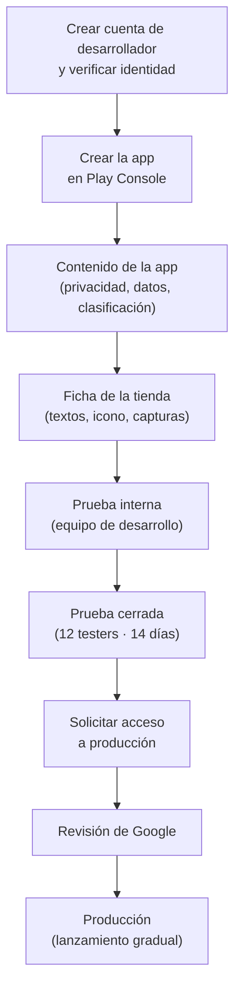
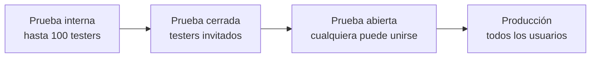
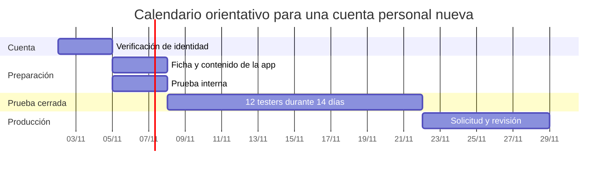
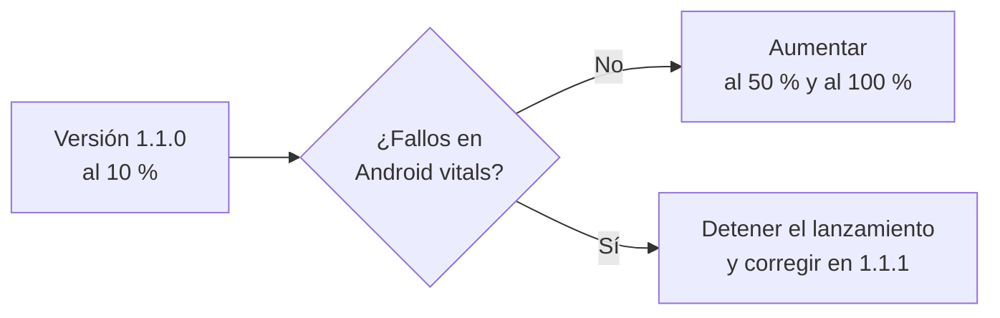

# **3E.2 Publicar en Google Play**

En [3E.1](./3e.1-preparar-lanzamiento.md) generamos un **Android App Bundle (AAB)** firmado con nuestra clave de subida. Ahora toca llevarlo a la tienda. Publicar no consiste solo en subir un fichero: hay que dar de alta la app en **Google Play Console**, describirla, declarar qué datos recoge, probarla con usuarios reales y, por último, pasar la revisión de Google.

Al terminar sabrás:

- Qué es **Play Console** y qué cuenta de desarrollador necesitas.
- Rellenar la **ficha de la tienda** y las declaraciones obligatorias: **seguridad de los datos**, **política de privacidad** y **clasificación de contenido**.
- Usar las **pistas de prueba** (interna, cerrada y abierta) antes de llegar a producción.
- Cumplir el requisito de **12 testers durante 14 días** de las cuentas personales nuevas.
- Publicar **actualizaciones** de forma segura con lanzamientos graduales.

!!! warning "Las capturas y los menús cambian"
    Google rediseña Play Console con frecuencia y los nombres exactos de los menús pueden variar. Lo importante es entender **qué** se pide y **por qué**; la ubicación concreta de cada opción la encontrarás siempre en la [ayuda oficial de Play Console](https://support.google.com/googleplay/android-developer/?hl=es).

---

## 1. Visión general: de la cuenta a la app publicada



Los pasos C y D pueden hacerse en paralelo con las pruebas: Play Console muestra en su **Panel** una lista de tareas pendientes y no deja publicar en producción hasta completarlas todas.

---

## 2. La cuenta de desarrollador

Para publicar en Google Play se necesita una **cuenta de desarrollador de Google Play**, asociada a una cuenta de Google.

| | Cuenta personal | Cuenta de organización |
|---|---|---|
| **Para quién** | Particulares, estudiantes, desarrolladores independientes | Empresas, asociaciones, centros educativos |
| **Coste** | Pago único de 25 USD | Pago único de 25 USD |
| **Verificación** | Documento de identidad y datos de contacto | Número D-U-N-S de la organización, además de los datos de contacto |
| **Pruebas antes de producción** | Obligatorias si la cuenta se creó después del 13 de noviembre de 2023 (apartado 6) | No se exige el requisito de 12 testers |

!!! tip "Consejos al crear la cuenta"
    - Usa una cuenta de Google **dedicada** a publicar (no la personal del día a día) y activa la verificación en dos pasos.
    - El nombre de desarrollador es público: aparecerá bajo el nombre de la app en la tienda.
    - La verificación de identidad puede tardar varios días. Si piensas publicar en una fecha concreta, crea la cuenta con antelación.
    - El número D-U-N-S es gratuito, pero obtenerlo puede tardar semanas.

!!! info "Verificación de desarrolladores fuera de Google Play"
    Desde el **30 de septiembre de 2026**, Google exige que todos los desarrolladores verifiquen su identidad y registren sus apps para que puedan instalarse en dispositivos Android certificados, **también las que se distribuyen fuera de Play** (descarga directa de APK, otras tiendas). Empezó por algunos países del sudeste asiático y está previsto extenderlo a todo el mundo en 2027.

    Para estudiantes y aficionados existe una cuenta de **distribución limitada**, gratuita y sin documento de identidad, que permite instalar apps en un máximo de 20 dispositivos: suficiente para enseñar tus proyectos. Las cuentas de Play Console ya pasan por su propia verificación de identidad (apartado 2). Consulta los detalles actualizados en la [página oficial de verificación](https://support.google.com/android-developer-console/answer/16561738?hl=es).

---

## 3. Crear la app en Play Console

Desde **Inicio → Crear app** se pide:

1. **Nombre de la app.** Es el que verán los usuarios, con un máximo de 30 caracteres. Puede cambiarse más adelante.

2. **Idioma predeterminado.** Por ejemplo, español (España). Después puedes añadir traducciones de la ficha.

3. **App o juego**, y si será **gratuita o de pago**.

    !!! danger "Gratis es para siempre"
        Una app publicada como gratuita **no puede pasar a ser de pago**. Sí puede ofrecer compras integradas o suscripciones. En cambio, una app de pago sí puede pasar a ser gratuita.

4. **Declaraciones**: aceptar las políticas del programa para desarrolladores y las leyes de exportación de EE. UU.

Una vez creada, la app aparece en Play Console con su propio **Panel**, que guía el resto del proceso.

!!! note "El `applicationId` se fija con la primera subida"
    Play Console no te pide el identificador de la app al crearla: lo lee del primer AAB que subas. A partir de ese momento queda asociado para siempre a esta ficha. Por eso en 3E.1 insistimos en elegir bien el `applicationId` antes de publicar.

---

## 4. Contenido de la app: las declaraciones obligatorias

En la sección **Política → Contenido de la app** hay que responder una serie de cuestionarios. Son obligatorios incluso para una app sencilla que no recoge ningún dato.

### 4.1. Política de privacidad

Todas las apps deben enlazar una **política de privacidad** pública: una página web que explique qué datos recoge la app, para qué los usa, con quién los comparte y cómo puede el usuario pedir que se borren.

- Debe estar en una **URL pública y accesible** (no un PDF en Google Drive con permisos restringidos ni una página que exija iniciar sesión).
- Debe ser coherente con lo que declares en el formulario de seguridad de los datos y con lo que haga realmente la app.
- Para un proyecto de clase basta con una página sencilla. Por ejemplo, puedes publicarla en GitHub Pages, igual que estos apuntes.

!!! warning "Las librerías también recogen datos"
    Aunque tu código no envíe nada a internet, las librerías que incluyes pueden hacerlo. Firebase Analytics, Crashlytics o un SDK de anuncios recogen identificadores y datos de uso. Revisa la documentación de cada SDK: Google suele publicar qué datos recoge cada uno para ayudarte a rellenar el formulario.

### 4.2. Seguridad de los datos

El formulario de **seguridad de los datos** (*Data safety*) genera la sección «Seguridad de los datos» que los usuarios ven en la ficha de la app. Pregunta, para cada tipo de dato (ubicación, información personal, fotos, contactos, identificadores del dispositivo, etc.):

- Si la app lo **recoge** (lo envía fuera del dispositivo) o lo **comparte** con terceros.
- Si es **obligatorio u opcional** y **para qué** se usa (funcionalidad, analítica, publicidad…).
- Si los datos viajan **cifrados** y si el usuario puede **solicitar que se borren**.

| Situación de la app | Qué se declara |
|---|---|
| Datos en memoria o en Room, sin conexión | No recoge ni comparte datos |
| Inicio de sesión con Firebase Authentication | Recoge correo electrónico e identificador de usuario, para la funcionalidad de la app |
| Uso de Crashlytics | Recoge registros de fallos e identificadores del dispositivo, para diagnóstico |
| Consulta a una API pública sin enviar datos del usuario | Normalmente no recoge datos personales |

!!! info "Datos que se quedan en el dispositivo"
    Lo que se guarda solo en el dispositivo (DataStore, Room) y nunca sale de él **no se considera recogido**. La app de UT3, con datos en memoria, no recoge datos; cuando en UT4 y siguientes añadamos Firebase o una API propia, habrá que actualizar este formulario.

### 4.3. Clasificación de contenido

Un cuestionario de la **IARC** (*International Age Rating Coalition*) pregunta si la app contiene violencia, lenguaje malsonante, contenido sexual, apuestas, interacción entre usuarios, compras, etc. A partir de las respuestas se asigna automáticamente la clasificación por edades de cada región (PEGI en Europa, ESRB en EE. UU.…).

Hay que responder con sinceridad: una clasificación incorrecta puede provocar la retirada de la app.

### 4.4. Otras declaraciones

| Declaración | Qué se indica |
|---|---|
| **Público objetivo** | Franjas de edad a las que va dirigida la app. Si incluye menores de 13 años, se aplica la política de familias, más estricta. |
| **Acceso a la app** | Si alguna parte exige iniciar sesión, hay que facilitar a Google credenciales de prueba para que pueda revisarla. |
| **Anuncios** | Si la app muestra publicidad. |
| **ID de publicidad** | Si la app (o una librería) usa el identificador de publicidad de Android. |
| **Permisos sensibles** | Justificar el uso de permisos como la ubicación en segundo plano, los SMS o el acceso a todos los ficheros. |

---

## 5. La ficha de la tienda

La **ficha principal de Play Store** es el escaparate de la app: lo que el usuario ve antes de instalarla.

| Elemento | Requisitos | Consejo |
|---|---|---|
| **Nombre** | Máximo 30 caracteres | Claro y sin palabras clave añadidas como «gratis» o «el mejor» |
| **Descripción breve** | Máximo 80 caracteres | Qué hace la app, en una frase |
| **Descripción completa** | Máximo 4000 caracteres | Funciones principales en párrafos cortos o listas |
| **Icono** | PNG de 512 × 512 px, 32 bits, máximo 1 MB | Es el mismo diseño que el icono adaptativo del [Anexo A](../../00-android/anexos/a-iconos-app-recursos.md), en alta resolución |
| **Gráfico de funciones** | JPG o PNG de 1024 × 500 px | Imagen de cabecera; evita texto pequeño |
| **Capturas de pantalla** | Al menos 2 por tipo de dispositivo y hasta 8 | Muestra las pantallas reales más útiles |
| **Categoría y etiquetas** | Una categoría y varias etiquetas | Ayudan a que la app aparezca en búsquedas |
| **Datos de contacto** | Correo electrónico obligatorio | Usa uno que revises de verdad |

!!! tip "Capturas para cada tipo de pantalla"
    Si tu app es adaptativa (3B.2), sube también capturas de **tablet** y, si procede, de **Chromebook**. Google Play destaca en pantallas grandes las apps que ofrecen una buena experiencia en ellas. Las vistas previas `@PreviewScreenSizes` son un buen punto de partida para preparar esas capturas.

!!! danger "Lo que no puede aparecer en la ficha"
    Las políticas de Play prohíben, entre otras cosas, usar marcas, logotipos o personajes de terceros sin permiso, imitar otra app conocida, hacer afirmaciones engañosas («n.º 1», «la más descargada») o incluir rankings y precios en el icono o en las capturas. Es una de las causas más frecuentes de rechazo.

---

## 6. Pistas de prueba: probar antes de publicar

Play Console organiza los lanzamientos en **pistas** (*tracks*). Cada pista tiene su propia versión de la app y su propio grupo de usuarios.



| Pista | Quién la recibe | Revisión de Google | Uso típico |
|---|---|---|---|
| **Prueba interna** | Hasta 100 testers, por correo electrónico | Disponible en minutos | El equipo de desarrollo comprueba cada compilación |
| **Prueba cerrada** | Listas de correos o grupos de Google invitados | Sí | Beta privada; requisito para cuentas personales nuevas |
| **Prueba abierta** | Cualquiera que se apunte desde la ficha | Sí | Beta pública con muchos usuarios |
| **Producción** | Todos los usuarios de Google Play | Sí | Versión final |

Los testers se unen mediante un **enlace de inscripción** que se genera en cada pista. Después instalan la app desde Google Play como cualquier otra, y la tienda les muestra que tienen una versión de prueba.

!!! tip "Compartir una versión al instante"
    Además de las pistas, Play Console ofrece **Compartir apps internamente**: subes un AAB y obtienes un enlace que instala esa compilación concreta, sin revisión y sin cambiar la versión de ninguna pista. Es útil para enseñar un cambio puntual a un compañero o al profesor.

### 6.1. El requisito de 12 testers durante 14 días

Las **cuentas personales creadas después del 13 de noviembre de 2023** tienen la publicación en producción bloqueada hasta cumplir este requisito:

1. Publicar la app en una **prueba cerrada**. La prueba interna **no cuenta**.

2. Conseguir que **al menos 12 testers** estén inscritos en esa prueba cerrada.

3. Mantenerlos inscritos durante **14 días consecutivos**. Si un tester se da de baja y vuelve a apuntarse, su cuenta empieza de nuevo.

4. Desde el **Panel**, pulsar **Solicitar acceso a producción** y responder tres bloques de preguntas: sobre la prueba cerrada, sobre la app y sobre si está lista para producción.

5. Esperar la respuesta de Google, que suele llegar en unos 7 días. Si consideran que la app necesita más pruebas, pedirán seguir con la prueba cerrada.

!!! info "Aprovecha la prueba de verdad"
    Google no solo cuenta testers: en la solicitud pregunta cómo se reclutaron, qué opinaron y qué cambios hiciste a partir de sus comentarios. Una buena práctica es publicar **varias versiones** durante esos 14 días, corrigiendo lo que reporten los testers, y anotar los cambios en las notas de cada versión. En clase, los compañeros pueden ser testers unos de otros.



Como ves, entre crear la cuenta y publicar pueden pasar **cuatro semanas**. Tenlo en cuenta si quieres presentar tu proyecto final publicado en la tienda.

---

## 7. Crear un lanzamiento

El proceso es el mismo para cualquier pista:

1. Entra en la pista (por ejemplo, **Pruebas → Prueba interna**) y pulsa **Crear nueva versión**.

2. **Firma de la app.** La primera vez, Play Console te pide confirmar **Play App Signing**. Con la opción recomendada, Google genera y guarda la **clave de firma de la app**, y la clave con la que firmaste el AAB queda registrada como tu **clave de subida** (3E.1, apartado 4).

3. **Sube el AAB** generado con `./gradlew :androidApp:bundleRelease`. Play Console comprueba que:

    - Está firmado con la clave de subida registrada.
    - Su `versionCode` es **mayor** que el de cualquier versión subida antes.
    - Cumple el `targetSdk` mínimo exigido.

4. **Nombre de la versión.** Se rellena con el `versionName`; es solo para ti y no lo ven los usuarios.

5. **Notas de la versión.** Lo que verán los usuarios en «Novedades», en cada idioma:

    ```xml
    <es-ES>
    - Nueva pantalla de favoritos.
    - Diseño adaptado a tablets y plegables.
    - Corrección de errores.
    </es-ES>
    ```

6. **Revisar la versión.** Play Console muestra advertencias (por ejemplo, que falta el fichero de desofuscación) y errores que impiden continuar.

7. **Guardar y publicar.** En las pistas con revisión, la versión pasa a **En revisión**. La revisión suele tardar entre unas horas y unos días; en apps nuevas puede tardar más.

!!! tip "Sube el `mapping.txt`"
    Si activaste R8, Play Console te avisará de que falta el **archivo de desofuscación**. Al subir el `mapping.txt` (o dejar que el plugin de Gradle lo incluya en el AAB, como ocurre por defecto), los informes de fallos de **Android vitals** mostrarán los nombres reales de las clases y los métodos.

---

## 8. Después de publicar

### 8.1. Informe previo al lanzamiento

Cuando subes una versión a una pista de prueba, Google la instala automáticamente en **dispositivos físicos reales** de su laboratorio, la recorre de forma automática y genera un **informe previo al lanzamiento** con:

- Fallos y ANR (la app deja de responder).
- Problemas de **accesibilidad**: contraste bajo, botones demasiado pequeños, elementos sin descripción.
- Problemas de rendimiento y avisos de seguridad.
- Capturas de cada pantalla visitada en distintos dispositivos.

Los avisos de accesibilidad están muy relacionados con lo que vimos en 3C.4: un `contentDescription` que falta en un icono aparecerá aquí.

### 8.2. Android vitals y reseñas

Con la app en producción, la sección **Calidad** muestra:

- **Android vitals:** porcentaje de usuarios afectados por fallos y ANR. Si supera los umbrales de Google, la app pierde visibilidad en la tienda.
- **Valoraciones y reseñas:** puedes responder públicamente a los usuarios.

### 8.3. Publicar una actualización

Cada actualización repite el proceso del apartado 7 con un detalle importante: hay que **incrementar el `versionCode`**.

```kotlin title="androidApp/build.gradle.kts"
defaultConfig {
    versionCode = 2          // siempre mayor que el anterior
    versionName = "1.1.0"    // versionado semántico (3E.1)
}
```

En producción conviene usar un **lanzamiento gradual** (*staged rollout*): la nueva versión llega primero a un porcentaje de usuarios (por ejemplo, el 10 %), y lo vas aumentando si Android vitals no muestra problemas.



!!! warning "No se puede volver atrás"
    Google Play **no permite bajar de versión**: los usuarios que ya actualizaron se quedan con la versión nueva. Si una versión tiene un error grave, detén el lanzamiento y publica cuanto antes una versión corregida con un `versionCode` mayor. Por eso el lanzamiento gradual es tan importante.

---

## 9. Otras vías de distribución

Google Play es la tienda principal en Android, pero no la única. Y con Kotlin Multiplatform (3D) la misma app puede llegar a otras plataformas.

| Destino | Qué se necesita | Comentario |
|---|---|---|
| **Otras tiendas Android** (Samsung Galaxy Store, Huawei AppGallery, F-Droid…) | Cuenta en cada tienda; F-Droid exige código abierto | Algunas usan APK en lugar de AAB |
| **App Store (iOS)** | Programa de desarrolladores de Apple (99 USD al año), un Mac con Xcode y el destino iOS en el proyecto KMP | Proceso parecido: App Store Connect, TestFlight para pruebas y revisión de Apple |
| **Escritorio** | Los instaladores generados en 3D.3 (`.msi`, `.dmg`, `.deb`) | Se pueden distribuir desde una web o publicar en Microsoft Store o Mac App Store |

---

## 10. Errores y rechazos frecuentes

| Mensaje o situación | Causa | Solución |
|---|---|---|
| «El código de versión ya se ha utilizado» | Has subido un AAB con el mismo `versionCode` | Incrementa `versionCode` y vuelve a generar el AAB |
| «Has subido un APK o Android App Bundle firmado con una clave incorrecta» | El AAB no está firmado con la clave de subida registrada | Firma con la clave correcta; si la perdiste, solicita un restablecimiento de la clave de subida |
| «Tu app debe orientarse al nivel de API 36 o superior» | `targetSdk` demasiado bajo | Sube `targetSdk` (3E.1, apartado 3) |
| No aparece la opción de publicar en producción | Cuenta personal nueva sin completar la prueba cerrada | Cumple el requisito de 12 testers durante 14 días (apartado 6.1) |
| Rechazo por **política de privacidad** | URL inaccesible o que no menciona los datos que recoge la app | Publica una página pública coherente con el formulario de seguridad de los datos |
| Rechazo por **metadatos** | Marcas de terceros, palabras clave repetidas o afirmaciones engañosas en la ficha | Revisa textos e imágenes (apartado 5) |
| Rechazo por **acceso a la app** | Google no pudo entrar en las pantallas protegidas | Facilita credenciales de prueba válidas en «Acceso a la app» |
| Los testers no ven la app en Play | No han aceptado la invitación desde el enlace de inscripción, o usan otra cuenta de Google | Envía el enlace de inscripción y comprueba que usan la cuenta invitada |

---

## 11. Retos

Estos retos no requieren pagar una cuenta de desarrollador: preparan todo lo necesario para que la publicación, cuando llegue, sea un trámite.

### Reto 1 (básico): Ficha de la tienda

Redacta la ficha de la tienda de la app de catálogo de juegos de esta unidad en un fichero `docs/ficha-play.md` dentro del proyecto:

- Nombre (máximo 30 caracteres), descripción breve (máximo 80) y descripción completa (entre 3 y 5 párrafos cortos).
- Categoría y tres etiquetas.
- Lista de las capturas que harías, indicando qué pantalla y qué tipo de dispositivo (móvil y tablet).

??? success "Solución"
    ```markdown title="docs/ficha-play.md"
    # Ficha de Google Play

    ## Nombre (24/30)
    MisJuegos: tu biblioteca

    ## Descripción breve (74/80)
    Organiza tu colección de videojuegos y marca tus favoritos en un instante.

    ## Descripción completa
    MisJuegos te ayuda a tener tu colección de videojuegos siempre a mano.

    - Consulta tu catálogo por plataforma.
    - Marca tus juegos favoritos con un toque.
    - En tablets y plegables, la lista y el detalle se ven a la vez.

    Sin anuncios y sin registro: tus datos se quedan en tu dispositivo.

    ## Categoría y etiquetas
    - Categoría: Entretenimiento
    - Etiquetas: colección, videojuegos, organizador

    ## Capturas
    1. Móvil: catálogo con varios juegos.
    2. Móvil: detalle de un juego marcado como favorito.
    3. Móvil: pantalla de favoritos.
    4. Tablet: vista lista-detalle (3B.2).
    5. Tablet: modo oscuro.
    ```

    Claves de la solución:

    - Cuenta los caracteres: Play Console no deja guardar un texto más largo que el límite.
    - La descripción breve dice **qué hace** la app, sin superlativos.
    - Las capturas de tablet aprovechan el trabajo de diseño adaptativo de 3B.2.
    - La frase «tus datos se quedan en tu dispositivo» debe ser cierta y coherente con el formulario de seguridad de los datos.

### Reto 2 (intermedio): Política de privacidad y seguridad de los datos

Supón que la app evoluciona y ahora usa **Firebase Authentication** con correo y contraseña, y **Crashlytics** para registrar fallos.

1. Escribe una política de privacidad breve en `docs/privacidad.md` que cubra: qué datos se recogen, para qué, con quién se comparten, cuánto tiempo se guardan y cómo pedir su eliminación.

2. Prepara una tabla con las respuestas que darías en el formulario de seguridad de los datos.

??? success "Solución"
    ```markdown title="docs/privacidad.md"
    # Política de privacidad de MisJuegos

    Última actualización: 30 de octubre de 2026

    ## Qué datos recogemos
    - Tu correo electrónico, para crear tu cuenta e iniciar sesión.
    - Informes de fallos (modelo de dispositivo, versión de Android y
      un identificador anónimo de instalación), para corregir errores.

    ## Con quién los compartimos
    Usamos los servicios de Google Firebase (Authentication y Crashlytics),
    que tratan estos datos en nuestro nombre. No vendemos tus datos ni los
    usamos para publicidad.

    ## Cuánto tiempo los guardamos
    Mientras tu cuenta esté activa. Los informes de fallos se eliminan
    automáticamente pasados 90 días.

    ## Cómo eliminar tus datos
    Escribe a privacidad@ejemplo.com desde el correo de tu cuenta y
    eliminaremos tu cuenta y sus datos en un plazo máximo de 30 días.
    ```

    | Tipo de dato | ¿Recoge? | ¿Comparte? | Obligatorio | Finalidad |
    |---|---|---|---|---|
    | Dirección de correo electrónico | Sí | No | Sí | Funcionalidad de la app, gestión de la cuenta |
    | ID de usuario | Sí | No | Sí | Funcionalidad de la app, gestión de la cuenta |
    | Registros de fallos | Sí | No | Sí | Analítica (diagnóstico) |
    | Otros datos de diagnóstico | Sí | No | Sí | Analítica (diagnóstico) |

    Claves de la solución:

    - Los datos que trata Firebase **en tu nombre** (como proveedor de servicios) no cuentan como «compartidos» con terceros en el formulario.
    - Hay que indicar que los datos viajan cifrados (Firebase usa HTTPS) y que el usuario puede solicitar su eliminación.
    - Si la app permite crear cuentas, Google Play exige además ofrecer una forma de **eliminar la cuenta**, tanto desde la app como desde una URL pública.
    - La política y el formulario deben decir lo mismo: cualquier contradicción es motivo de rechazo.

### Reto 3 (avanzado): Plan de pruebas cerradas

Organiza con tus compañeros una prueba cerrada simulada que cumpla el requisito de las cuentas personales nuevas. Escribe en `docs/plan-pruebas.md`:

- Cómo reclutarás a los 12 testers y cómo les enviarás el enlace.
- Un calendario de 14 días con al menos tres versiones (`versionCode` y `versionName` de cada una) y sus notas de versión.
- Cómo recogerás los comentarios y qué responderías en la solicitud de acceso a producción.

??? success "Solución"
    ```markdown title="docs/plan-pruebas.md"
    # Plan de prueba cerrada

    ## Testers
    - 14 compañeros de clase (dos de margen por si alguno se da de baja),
      añadidos a un grupo de Google: misjuegos-testers@googlegroups.com.
    - El grupo se asocia a la pista de prueba cerrada y se comparte el
      enlace de inscripción en el aula virtual.

    ## Calendario
    | Día | versionCode | versionName | Notas de la versión |
    |---|---|---|---|
    | 1  | 3 | 1.0.0-beta1 | Primera versión de prueba |
    | 6  | 4 | 1.0.0-beta2 | Corrige el cierre al girar la pantalla en el detalle |
    | 11 | 5 | 1.0.0-beta3 | Mejora el contraste del modo oscuro y añade descripciones a los iconos |

    ## Comentarios
    - Formulario con tres preguntas: qué ha fallado, qué mejorarías y
      en qué dispositivo lo has probado.
    - Revisión del informe previo al lanzamiento de cada versión.

    ## Respuestas para la solicitud de acceso a producción
    - Reclutamiento: compañeros del ciclo, mediante un grupo de Google.
    - Comentarios recibidos: un cierre inesperado al girar la pantalla y
      poco contraste en el modo oscuro.
    - Cambios realizados: dos versiones con las correcciones (beta2 y beta3).
    - Preparación: sin fallos en Android vitals en la última semana.
    ```

    Claves de la solución:

    - El `versionCode` empieza en 3 porque las versiones 1 y 2 se usaron en la prueba interna: debe crecer siempre, en todas las pistas.
    - Reclutar más de 12 testers da margen: si uno se da de baja, su cuenta de 14 días empieza de nuevo.
    - Un grupo de Google facilita gestionar los testers: basta con añadir o quitar personas del grupo.
    - Las respuestas de la solicitud se apoyan en hechos concretos (fallos encontrados y corregidos), que es justo lo que Google quiere comprobar.

---

## 12. Para saber más

- **Ayuda oficial de Play Console:**

    - [Crear y configurar una app](https://support.google.com/googleplay/android-developer/answer/9859152?hl=es)
    - [Requisitos de prueba para cuentas personales nuevas](https://support.google.com/googleplay/android-developer/answer/14151465?hl=es)
    - [Configurar pruebas abiertas, cerradas o internas](https://support.google.com/googleplay/android-developer/answer/9845334?hl=es)
    - [Formulario de seguridad de los datos](https://support.google.com/googleplay/android-developer/answer/10787469?hl=es)
    - [Lanzamientos graduales](https://support.google.com/googleplay/android-developer/answer/6346149?hl=es)
    - [Políticas del programa para desarrolladores](https://play.google/developer-content-policy/)

- **Documentación para desarrolladores:**

    - [Subir tu app a Play Console](https://developer.android.com/studio/publish/upload-bundle?hl=es-419)
    - [Verificación de desarrolladores de Android](https://support.google.com/android-developer-console/answer/16561738?hl=es)
