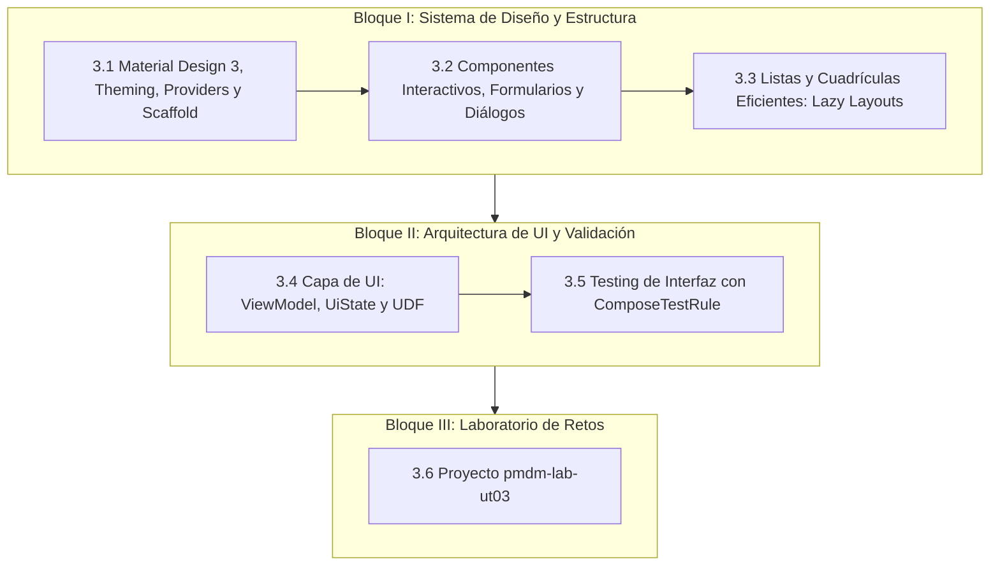

# **UT3. Interfaz de Usuario con Jetpack Compose**

En esta unidad nos adentramos en el diseño y desarrollo de interfaces de usuario modernas, accesibles y profesionales para la plataforma Android. Tras asentar en la unidad anterior los fundamentos del ciclo de vida y la sintaxis declarativa, abordamos aquí el estándar de diseño de la industria: **Material Design 3 (Material You)**.

A lo largo del tema aprenderemos a estructurar pantallas completas con **`Scaffold`**, a implementar navegación mediante menús laterales (**Drawer**), a presentar grandes volúmenes de datos con **Listas perezosas (`LazyColumn` y `LazyVerticalGrid`)**, y a conectar la interfaz con la lógica de presentación mediante **`ViewModel`** y **`StateFlow`**.

Todo el trabajo práctico se articulará en torno al proyecto de prácticas: **`pmdm-lab-ut03`**, donde combinaremos codelabs de componentes guiados con la creación de interfaces gráficas para los juegos desarrollados previamente en Kotlin (El Ahorcado, Wordle y Memory Match).

---

## 🧭 Hoja de Ruta de la Unidad

---

## 📚 Contenidos del Tema

1. **[3.1 Material Design 3, Theming, Providers y Scaffold](./3.1-material-design-3-scaffold.md):**  
   Filosofía de Material You, esquemas de color (`lightColorScheme` / `darkColorScheme`), inyección de datos globales con `CompositionLocalProvider` (Modo Oscuro global), estructura de pantalla con `Scaffold` y el menú hamburguesa con `ModalNavigationDrawer`.

2. **[3.2 Componentes Interactivos, Formularios y Diálogos](./3.2-componentes-interactivos.md):**  
   Catálogo de botones M3, campos de texto `OutlinedTextField` con validación reactiva, conmutadores (`Switch`), selectores (`Checkbox`, `Slider`), menús desplegables (`DropdownMenu`) y modales (`AlertDialog`, `ModalBottomSheet`).

3. **[3.3 Listas y Cuadrículas Eficientes: Lazy Layouts](./3.3-listas-cuadriculas-lazy.md):**  
   Rendimiento en Compose: `LazyColumn`, `LazyRow` y `LazyVerticalGrid`. Claves únicas (`key`) para optimizar recomposiciones y tarjetas de catálogo interactivas (`ElevatedCard`).

4. **[3.4 Capa de Interfaz (UI): ViewModel, UiState y UDF](./3.4-capa-ui-viewmodel.md):**  
   Arquitectura oficial recomendada por Google: supervivencia ante rotaciones con `ViewModel`, modelado inmutable de pantalla con `data class UiState`, consumo asíncrono seguro con `StateFlow` y el patrón *Unidirectional Data Flow* (UDF).

5. **[3.5 Testing Automatizado de UI en Compose](./3.5-testing-ui-compose.md):**  
   Configuración de pruebas de interfaz con `createComposeRule()`, búsqueda de nodos por texto o semántica, simulación de pulsaciones y aserciones visuales.

6. **[3.6 Laboratorio de Retos de la UT03 (`pmdm-lab-ut03`)](./3.6-laboratorio-retos.md):**  
   Proyecto modular de prácticas con menú Drawer. Codelabs formativos M3 y el desarrollo de interfaces completas para El Ahorcado, Wordle y Memory Match con ViewModel.

---

## 🛠️ Recursos de Referencia y Showroom

Para facilitar el estudio y la experimentación, este tema se apoya en tres recursos complementarios:

- **Showroom Local de Componentes (`Material3_example`):**

      Dentro del repositorio dispones del proyecto de referencia [`.others_courses/Material3_example`](../../.others_courses/Material3_example), una aplicación interactiva que contiene ejemplos aislados y listos para ejecutar de cada componente de Material 3 (`Scaffold`, `AppBars`, `Drawer`, `Dialogs`, `Menus`, etc.). Cada apartado del tema incluye referencias y códigos directos a este proyecto.

- **Manual de Referencia de Compose:**

      Puedes consultar los capítulos detallados en la sección de referencia:

      - [Funciones Componibles y Modificadores](../00-android/00-compose/21-composable-functions.md)
      - [Gestión del Estado en Compose](../00-android/00-compose/22-state-management.md)
      - [Listas y Cuadrículas Perezosas](../00-android/00-compose/23-listas-cuadriculas.md)
      - [Material Design 3 y Theming](../00-android/00-compose/25-material-design.md)
      - [Contexto, CompositionLocal y Efectos Secundarios](../00-android/00-compose/27-compositionlocal-contexto-efectos.md)

- **Documentación Oficial de Google:**

      - [Guía de Material Design 3 en Compose](https://developer.android.com/develop/ui/compose/designsystems/material3?hl=es-419)
      - [Arquitectura de la Capa de UI (Android Developers)](https://developer.android.com/topic/architecture/ui-layer?hl=es-419)