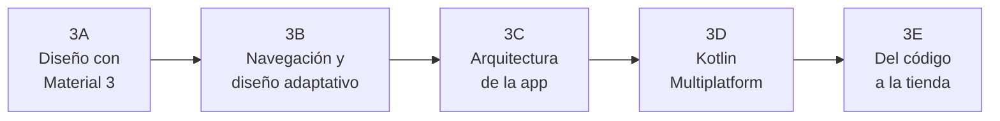

# **UT3. Interfaz de Usuario con Jetpack Compose**

En UT2 aprendimos los fundamentos: funciones `@Composable`, maquetación con `Column`, `Row` y `Box`, modificadores, imágenes y estado básico. En esta unidad damos el salto a una **aplicación móvil completa y moderna**, tal como se desarrolla hoy en la industria.

La unidad está organizada en **cinco subunidades** que siguen la vida de una app: primero se diseña la interfaz, después se conecta en varias pantallas que se adaptan a cualquier dispositivo, se organiza el código con una arquitectura profesional, se comparte con otras plataformas gracias a Kotlin Multiplatform y, por último, se prepara para publicarla en la tienda.

!!! info "Datos en memoria, de momento"
    En esta unidad la app trabaja con datos **en memoria** (repositorios *fake*). Así podemos centrarnos en la interfaz y la arquitectura sin depender todavía de bases de datos ni de internet. En **UT4** sustituiremos esa fuente de datos por DataStore, Room y una API REST sin tocar el resto de la app: esa es precisamente la ventaja de la arquitectura que construiremos en 3C.

---

## 🧭 Hoja de ruta de la unidad

---

## 📚 Contenidos

### 3A · Diseño de interfaces con Material 3

Cómo construir pantallas atractivas y coherentes con el sistema de diseño de Google.

- **[3A.1 Material Design 3, Theming, Providers y Scaffold](./a-diseno/3a.1-material-design-3-scaffold.md):** esquemas de color claro y oscuro, tipografía, `CompositionLocalProvider`, estructura de pantalla con `Scaffold`, barras superiores, `Snackbar` y menú lateral.
- **[3A.2 Componentes interactivos, formularios y diálogos](./a-diseno/3a.2-componentes-interactivos.md):** botones, campos de texto con validación, `Switch`, `Checkbox`, `Slider`, menús desplegables y diálogos.
- **[3A.3 Listas y cuadrículas eficientes](./a-diseno/3a.3-listas-cuadriculas.md):** `LazyColumn`, `LazyRow`, `LazyVerticalGrid` y claves (`key`).
- **3A.4 Animaciones y microinteracciones** *(en preparación)*: `animate*AsState`, `AnimatedVisibility`, `AnimatedContent`, *pull-to-refresh*, deslizar para borrar y cargas tipo *shimmer*.

### 3B · Navegación y diseño adaptativo

Una app real tiene varias pantallas y debe funcionar igual de bien en un móvil, una tablet o un plegable.

- **[3B.1 Navegación con Navigation 3](./b-navegacion/3b.1-navigation3.md):** la pila de navegación como estado, destinos tipados con `@Serializable`, `NavDisplay`, paso de argumentos, ViewModel por pantalla, devolver resultados y barra de navegación inferior.
- **[3B.2 Diseño adaptativo y edge-to-edge](./b-navegacion/3b.2-diseno-adaptativo.md):** dibujar bajo las barras del sistema, clases de tamaño de ventana, `NavigationSuiteScaffold` y diseños lista-detalle, y por qué Android 16 y 17 los hacen obligatorios en pantallas grandes.

### 3C · Arquitectura de la app

Cómo organizar el código para que sea mantenible, testeable y fácil de ampliar.

- **[3C.1 Capa de UI: ViewModel, UiState y UDF](./c-arquitectura/3c.1-capa-ui-viewmodel.md):** el ViewModel como contenedor del estado, `UiState` inmutable, `StateFlow` y flujo unidireccional de datos.
- **[3C.2 Clean Architecture paso a paso](./c-arquitectura/3c.2-clean-architecture.md):** capas de dominio y datos, casos de uso, repositorios y modelos.
- **[3C.3 Inyección de dependencias con Koin](./c-arquitectura/3c.3-inyeccion-dependencias-koin.md):** de crear los objetos a mano a dejar que Koin los proporcione, `koinViewModel()` e integración con Navigation 3.
- **[3C.4 Testing: dominio, ViewModel e interfaz](./c-arquitectura/3c.4-testing.md):** tests de casos de uso con repositorios *fake*, tests de ViewModel con corrutinas y Turbine, y tests de pantallas Compose con el árbol semántico.

### 3D · Kotlin Multiplatform en la práctica

Llevamos a tierra lo que vimos de forma conceptual en UT1: compartir el dominio, los ViewModel y la interfaz de Compose entre Android y escritorio.

- **[3D.1 Anatomía de un proyecto KMP](./d-kmp/3d.1-anatomia-proyecto-kmp.md):** crear el proyecto, módulos `shared`, `androidApp` y `desktopApp`, *source sets*, Gradle, puntos de entrada, Compose Hot Reload y `expect`/`actual`.
- **[3D.2 Compartir la lógica en `commonMain`](./d-kmp/3d.2-compartir-logica.md):** dominio, datos, ViewModel y Koin en el código común, código específico de cada plataforma (`expect`/`actual` frente a interfaces inyectadas) y tests en `commonTest`.
- **[3D.3 Compose Multiplatform y app de escritorio](./d-kmp/3d.3-compose-multiplatform.md):** pantallas en el código común, recursos con `Res`, Navigation 3 multiplataforma, ventanas redimensionables y empaquetado de instaladores.

### 3E · Del código a la tienda *(en preparación)*

- **3E.1** Preparar el lanzamiento: versiones, tipos de compilación, firma, R8 y Android App Bundle.
- **3E.2** Publicar en Google Play: Play Console, ficha de la app, pistas de prueba y requisitos para cuentas nuevas.

### Laboratorio de prácticas

- **[Laboratorio de retos de la UT3 (`pmdm-lab-ut03`)](./3.6-laboratorio-retos.md):** proyecto de prácticas con menú lateral, codelabs guiados de Material 3 y las interfaces completas de El Ahorcado, Wordle y Memory Match con ViewModel.

---

## 🛠️ Recursos de referencia

- **Showroom local de componentes (`Material3_example`):**

    Dentro del repositorio dispones del proyecto de referencia [`.others_courses/Material3_example`](../../.others_courses/Material3_example), una aplicación con ejemplos aislados y listos para ejecutar de cada componente de Material 3 (`Scaffold`, `AppBars`, `Drawer`, `Dialogs`, `Menus`…).

- **Manual de referencia de Compose:**

    - [Funciones componibles y modificadores](../00-android/00-compose/21-composable-functions.md)
    - [Gestión del estado en Compose](../00-android/00-compose/22-state-management.md)
    - [Listas y cuadrículas perezosas](../00-android/00-compose/23-listas-cuadriculas.md)
    - [Material Design 3 y theming](../00-android/00-compose/25-material-design.md)
    - [Contexto, CompositionLocal y efectos secundarios](../00-android/00-compose/27-compositionlocal-contexto-efectos.md)

- **Manual de referencia de arquitectura:** [Arquitectura en Android y KMP](../00-android/02-arquitectura/index.md).

- **Documentación oficial de Google:**

    - [Material Design 3 en Compose](https://developer.android.com/develop/ui/compose/designsystems/material3?hl=es-419)
    - [Capa de UI (Android Developers)](https://developer.android.com/topic/architecture/ui-layer?hl=es-419)
    - [Navigation 3](https://developer.android.com/guide/navigation/navigation-3?hl=es-419)
