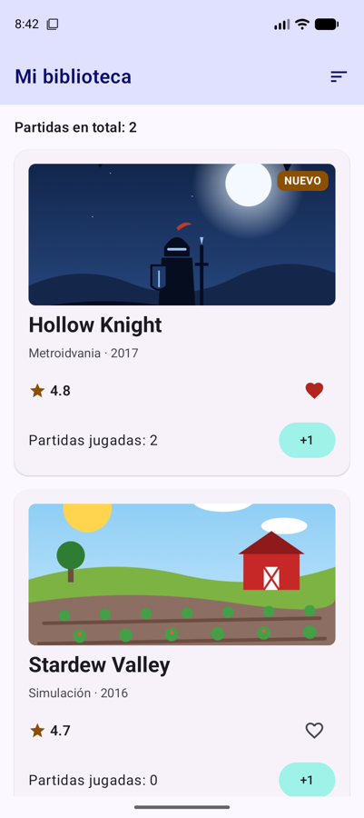
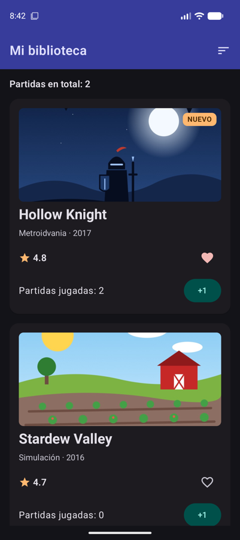
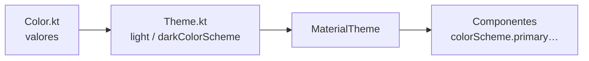
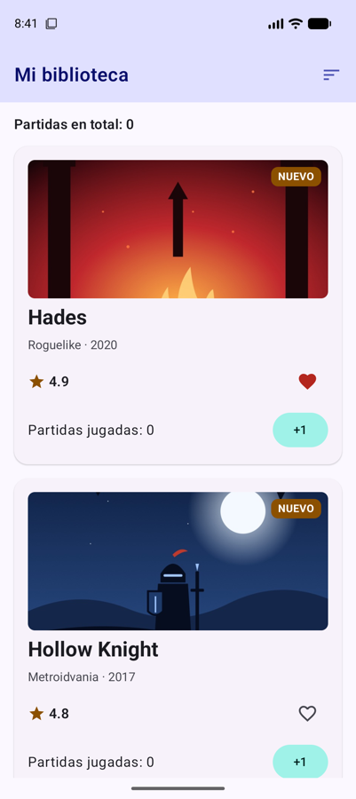
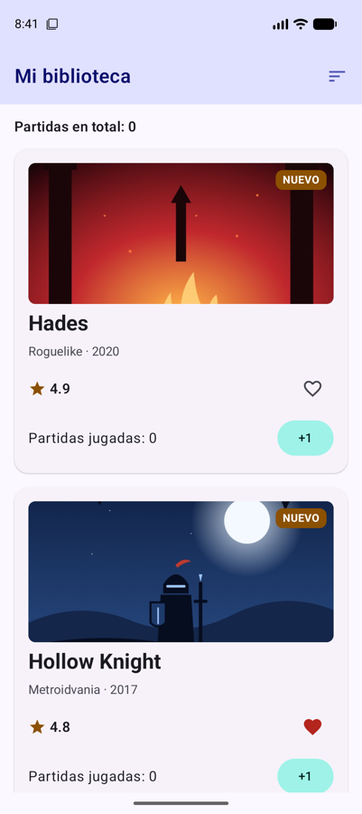

# **Sesión 3.01 · Tema de Material 3, Scaffold y listas**

Empezamos la UT3 dando a FichaJuego el aspecto de una app real: **colores, tipografía y formas propios**, una **barra superior** con `Scaffold` y el catálogo completo en una **lista eficiente** con `LazyColumn`.

!!! abstract "Ficha de la sesión"

    - **Duración:** 2 h.
    - **Apuntes de referencia:** [3A.1 Material Design 3, theming y Scaffold](../a-diseno/3a.1-material-design-3-scaffold.md) y [3A.3 Listas y cuadrículas](../a-diseno/3a.3-listas-cuadriculas.md).
    - **Proyecto de clase:** FichaJuego, de `s3.01-inicio` a `s3.01-fin` (ver [Guía de clases](./index.md#el-proyecto-de-clase-continua-fichajuego)).
    - **Necesitas:** el proyecto con la [sesión 2.03](../../02/sesiones/s03-imagenes-iconos-recursos.md) terminada (o el tag `s3.01-inicio`) y un emulador.

<figure style="text-align: center;">
  <div style="display: flex; gap: 16px; justify-content: center; flex-wrap: wrap;">
    
    
  </div>
  <figcaption>Lo que tendrás al terminar la clase, en claro y en oscuro.</figcaption>
</figure>

---

## 🎯 Objetivos

Al terminar la clase sabrás:

- Definir un **tema propio** de Material 3 con roles de color para el modo claro y el oscuro.
- Ajustar la **tipografía** y las **formas** del tema, y usarlas con `MaterialTheme`.
- Estructurar una pantalla con **`Scaffold`** y **`TopAppBar`**, respetando `innerPadding`.
- Mostrar una colección con **`LazyColumn`**, `items` e `item`.
- Explicar con un ejemplo **para qué sirve `key`** en una lista.

---

## ✅ Antes de empezar

1. Sitúate en el punto de partida: `git checkout s3.01-inicio` (es el mismo código que `s2.03-fin`) o descarga su `.zip`.

2. Descarga las cuatro portadas nuevas en `res/drawable/` (clic derecho → *Guardar enlace como…*):

    - [img_portada_celeste.jpg](https://github.com/jssdocente/pmdm2627-fichajuego/raw/s3.01-fin/app/src/main/res/drawable/img_portada_celeste.jpg)
    - [img_portada_hades.jpg](https://github.com/jssdocente/pmdm2627-fichajuego/raw/s3.01-fin/app/src/main/res/drawable/img_portada_hades.jpg)
    - [img_portada_outerwilds.jpg](https://github.com/jssdocente/pmdm2627-fichajuego/raw/s3.01-fin/app/src/main/res/drawable/img_portada_outerwilds.jpg)
    - [img_portada_bloques.jpg](https://github.com/jssdocente/pmdm2627-fichajuego/raw/s3.01-fin/app/src/main/res/drawable/img_portada_bloques.jpg)

3. Ejecuta la app: deben verse las dos fichas con portada.

---

## ⏱️ Agenda

| # | Min | Bloque | Apuntes |
| :---: | :---: | :--- | :--- |
| 0 | 5 | Arranque | — |
| 1 | 20 | El tema: roles de color en claro y oscuro | [3A.1 §1.1-1.4](../a-diseno/3a.1-material-design-3-scaffold.md#11-la-anatomia-de-un-tema-en-compose) |
| 2 | 10 | Tipografía y formas | [3A.1 §1.5-1.6](../a-diseno/3a.1-material-design-3-scaffold.md#15-personalizacion-de-tipografia-typekt) |
| 3 | 20 | `Scaffold` y `TopAppBar` | [3A.1 §3-4](../a-diseno/3a.1-material-design-3-scaffold.md#3-estructura-de-pantalla-el-contenedor-scaffold) |
| 4 | 20 | De `Column` a `LazyColumn` | [3A.3 §1-2 y §5](../a-diseno/3a.3-listas-cuadriculas.md#1-el-problema-del-rendimiento-column-con-scroll-vs-lazylayout) |
| 5 | 20 | `key`: el experimento de ordenar | [3A.3 §3](../a-diseno/3a.3-listas-cuadriculas.md#3-la-clave-del-rendimiento-asignacion-de-key) |
| 6 ⏩ | 10 | Una barra que se recoge al hacer scroll | [3A.1 §4](../a-diseno/3a.1-material-design-3-scaffold.md#4-barras-de-aplicacion-superiores-topappbar) |
| 7 ⏩ | 10 | Reto exprés: la biblioteca en cuadrícula | [3A.3 §4](../a-diseno/3a.3-listas-cuadriculas.md#4-cuadriculas-adaptativas-con-lazyverticalgrid) |
| 8 | 5 | Comprobación rápida y cierre | — |
| | **120** | | |

---

## 0 · Arranque (5 min)

Hasta ahora la app usaba el tema que trae la plantilla, con colores morados genéricos y **color dinámico**, que cambia según el fondo de pantalla del móvil. Hoy le damos identidad propia y la convertimos en una biblioteca con todos los juegos.

---

## 1 · El tema: roles de color (20 min)

- Material 3 no trabaja con «azul» o «rojo», sino con **roles**: `primary`, `secondary`, `tertiary`, `surface`, `error`… y sus **contenedores** (`primaryContainer`…). → [3A.1 §1.2](../a-diseno/3a.1-material-design-3-scaffold.md#12-esquemas-de-color-colorscheme-y-roles-semanticos)
- Cada fondo tiene su **on-color** para lo que va encima: sobre `primary`, texto `onPrimary`. Así el contraste está garantizado en claro y en oscuro.
- `Color.kt` guarda los valores, y `Theme.kt` los asigna a dos esquemas, `lightColorScheme` y `darkColorScheme`. → [3A.1 §1.3](../a-diseno/3a.1-material-design-3-scaffold.md#13-personalizacion-de-paletas-en-colorkt-y-themekt)
- El **color dinámico** (Android 12+) sustituye tu paleta por una sacada del fondo de pantalla. Para una marca propia, se desactiva. → [3A.1 §1.4](../a-diseno/3a.1-material-design-3-scaffold.md#14-color-dinamico-material-you-en-android-12)



!!! example "Manos a la obra"

    1. En `Color.kt`, sustituye los morados de la plantilla por la paleta de la clase: índigo como primario, verde azulado como secundario y ámbar como terciario, con sus contenedores y sus on-colors, en versión clara y oscura. La tienes en `s3.01-fin`.

    2. En `Theme.kt`, completa `LightColorScheme` y `DarkColorScheme` con todos los roles.

    3. Cambia el valor por defecto a `dynamicColor: Boolean = false`.

    4. Busca en la ficha cualquier color fijo y comprueba que todo sale de `MaterialTheme.colorScheme`. La insignia «NUEVO» y la estrella usan `tertiary`, que ahora es ámbar.

    5. Mira las previews en claro y en oscuro: ningún texto debe perderse sobre su fondo.

!!! tip "Crear tu propia paleta"
    No hace falta calcular los tonos a mano: [Material Theme Builder](https://m3.material.io/theme-builder) genera todos los roles a partir de un único **color semilla** y exporta `Color.kt` y `Theme.kt`. → [3A.1 §1.7](../a-diseno/3a.1-material-design-3-scaffold.md#17-material-theme-builder-y-recursos-oficiales). Te servirá para tu proyecto.

---

## 2 · Tipografía y formas (10 min)

- `Type.kt` define la **escala tipográfica**: `headlineSmall`, `titleLarge`, `bodyLarge`, `labelMedium`… Solo hace falta definir los estilos que cambias; el resto conserva los valores por defecto. → [3A.1 §1.5](../a-diseno/3a.1-material-design-3-scaffold.md#15-personalizacion-de-tipografia-typekt)
- `Shapes` define tres radios de esquina (`small`, `medium` y `large`). Los componentes de Material los usan solos (una `Card` usa `medium`), y tú los lees con `MaterialTheme.shapes`. → [3A.1 §1.6](../a-diseno/3a.1-material-design-3-scaffold.md#16-personalizacion-de-formas-shapeskt)

!!! example "Manos a la obra"

    1. En `Type.kt`, pon `headlineSmall` en negrita. Después quita el `fontWeight = FontWeight.Bold` que tenía el título de la ficha: ahora lo decide el tema.

    2. Crea `ui/theme/Shape.kt` con `small = 8.dp`, `medium = 16.dp` y `large = 24.dp`, y pásalo a `MaterialTheme(shapes = Shapes, …)`.

    3. Sustituye los `RoundedCornerShape(…)` de la portada y de la insignia por `MaterialTheme.shapes.small`.

---

## 3 · `Scaffold` y `TopAppBar` (20 min)

- **`Scaffold`** es el esqueleto de una pantalla de Material, con huecos (*slots*) para `topBar`, `bottomBar`, `floatingActionButton` y `snackbarHost`. → [3A.1 §3](../a-diseno/3a.1-material-design-3-scaffold.md#3-estructura-de-pantalla-el-contenedor-scaffold)
- Su contenido recibe **`innerPadding`**: el espacio que ocupan las barras. Si no lo aplicas, la barra tapa el contenido. → [3A.1 §3.1](../a-diseno/3a.1-material-design-3-scaffold.md#31-parametros-fundamentales-del-scaffold)
- **`TopAppBar`** tiene `title`, `navigationIcon`, `actions` y `colors`. → [3A.1 §4](../a-diseno/3a.1-material-design-3-scaffold.md#4-barras-de-aplicacion-superiores-topappbar)
- Cada pantalla tiene su propia barra, así que el `Scaffold` **se mueve de `MainActivity` a `BibliotecaScreen`**.

!!! example "Manos a la obra"

    1. En `MainActivity`, deja dentro de `FichaJuegoTheme` solo la llamada a `BibliotecaScreen()`.

    2. En `BibliotecaScreen`, envuelve el contenido en un `Scaffold` con una `TopAppBar` titulada «Mi biblioteca» (añade el texto a `strings.xml` y a `values-en`).

    3. Colorea la barra con `TopAppBarDefaults.topAppBarColors(containerColor = colorScheme.primaryContainer, titleContentColor = colorScheme.onPrimaryContainer)`.

    4. `TopAppBar` es experimental: añade `@OptIn(ExperimentalMaterial3Api::class)` a la función.

    5. Quita el `Modifier.padding(innerPadding)` del contenido y observa qué pasa. Después vuelve a ponerlo.

---

## 4 · De `Column` a `LazyColumn` (20 min)

- Una `Column` con `verticalScroll` **compone todos sus elementos de golpe**, aunque no se vean. Con 6 juegos da igual; con 500, la app va a tirones. → [3A.3 §1](../a-diseno/3a.3-listas-cuadriculas.md#1-el-problema-del-rendimiento-column-con-scroll-vs-lazylayout)
- **`LazyColumn`** solo compone lo que cabe en pantalla y va reciclando al hacer scroll. → [3A.3 §2](../a-diseno/3a.3-listas-cuadriculas.md#2-listas-verticales-con-lazycolumn)
- Dentro no se escriben composables sueltos, sino **`item { }`** (uno) e **`items(lista) { }`** (uno por elemento). → [3A.3 §2.1](../a-diseno/3a.3-listas-cuadriculas.md#21-anatomia-de-lazylistscope)
- La separación va con `verticalArrangement` y el margen exterior con **`contentPadding`**, que no recorta el contenido al hacer scroll.

!!! example "Manos a la obra"

    1. En `model/Juego.kt`, añade a `Juego` un campo `id: Int` y crea `val catalogo = listOf(…)` con los seis juegos. Las portadas nuevas son `img_portada_celeste`, `_hades`, `_outerwilds` y `_bloques`. Deja `juegoEjemplo = catalogo[0]` y `otroJuego = catalogo[1]` para las previews.

    2. Ahora hay seis juegos, así que dos variables de partidas ya no sirven. Cámbialas por un mapa id → partidas:

        ```kotlin
        var partidas by rememberSaveable { mutableStateOf(mapOf<Int, Int>()) }
        // sumar una partida al juego con ese id:
        partidas = partidas + (juego.id to (partidas[juego.id] ?: 0) + 1)
        ```

    3. Sustituye la `Column` con scroll por una `LazyColumn` con `contentPadding = PaddingValues(16.dp)`. Pon el total en un `item { }` y las fichas en `items(catalogo) { juego -> … }`.

    4. Convierte la ficha en una **`ElevatedCard`**: ya no necesita `clip` ni `background`, porque la tarjeta toma color, sombra y forma del tema. → [3A.3 §5](../a-diseno/3a.3-listas-cuadriculas.md#5-diseno-de-tarjetas-de-coleccion-elevatedcard)

---

## 5 · `key`: el experimento de ordenar (20 min)

Si no le dices otra cosa, `LazyColumn` identifica cada fila **por su posición**: la 0, la 1, la 2… Lo que una fila guarda dentro (como el favorito de `FichaJuegoScreen`) se queda **en esa posición**, aunque cambie el juego que se pinta en ella. → [3A.3 §3](../a-diseno/3a.3-listas-cuadriculas.md#3-la-clave-del-rendimiento-asignacion-de-key)

!!! example "Manos a la obra: provoca el fallo"

    1. Añade a la `TopAppBar` una acción para ordenar: un `IconToggleButton` con el icono `ic_sort` de Material Symbols que active y desactive `ordenarPorNota` (otro `rememberSaveable`).

    2. Muestra la lista ordenada cuando toque:

        ```kotlin
        val juegos = if (ordenarPorNota) catalogo.sortedByDescending { it.nota } else catalogo
        ```

    3. Marca como favorito **Hollow Knight** (el primero), suma un par de partidas y pulsa ordenar. Hades pasa arriba… ¡con el corazón de Hollow Knight! Las partidas, en cambio, están bien. ¿Por qué?

    4. Arréglalo: `items(items = juegos, key = { juego -> juego.id }) { … }`. Repite el experimento.

<figure style="text-align: center;">
  <div style="display: flex; gap: 16px; justify-content: center; flex-wrap: wrap;">
    
    
  </div>
  <figcaption>Sin <code>key</code> (izquierda), el favorito se queda en la primera fila. Con <code>key</code> (derecha), viaja con su juego.</figcaption>
</figure>

- **Las partidas iban bien** porque las guarda `BibliotecaScreen` en un mapa **por id**. **El favorito iba mal** porque lo guarda cada fila, y la fila se identificaba por su posición.
- Con `key = { it.id }`, Compose sabe qué fila es cada juego. Conserva su estado, la mueve en lugar de rehacerla y puede animar los cambios.
- La clave debe ser **única y estable**: el id del juego, nunca su posición ni su título, que podría repetirse o cambiar.

---

## 6 ⏩ · Una barra que se recoge al hacer scroll (10 min)

Con un *scroll behavior*, la barra desaparece al bajar y vuelve al subir, dejando más espacio a la lista.

```kotlin
val scrollBehavior = TopAppBarDefaults.enterAlwaysScrollBehavior()
Scaffold(
    modifier = modifier.nestedScroll(scrollBehavior.nestedScrollConnection),
    topBar = { TopAppBar(/* … */, scrollBehavior = scrollBehavior) }
) { /* … */ }
```

Prueba también a cambiar `TopAppBar` por `MediumTopAppBar` o `LargeTopAppBar` con `exitUntilCollapsedScrollBehavior()`: el título grande se encoge al hacer scroll. → [3A.1 §4](../a-diseno/3a.1-material-design-3-scaffold.md#4-barras-de-aplicacion-superiores-topappbar)

---

## 7 ⏩ · Reto exprés: la biblioteca en cuadrícula (10 min)

Cambia la `LazyColumn` por una `LazyVerticalGrid(columns = GridCells.Adaptive(minSize = 320.dp))` y abre la preview con `device = Devices.PIXEL_TABLET`: en tablet salen dos o tres columnas, y en el móvil, una. → [3A.3 §4](../a-diseno/3a.3-listas-cuadriculas.md#4-cuadriculas-adaptativas-con-lazyverticalgrid)

??? success "Pista"
    En una cuadrícula, el total ocupa una celda. Para que ocupe toda la fila, usa `item(span = { GridItemSpan(maxLineSpan) }) { … }`. La `key` de `items` funciona igual que en la lista.

??? success "Solución"

    En `BibliotecaScreen`, la `LazyColumn` pasa a ser una `LazyVerticalGrid`. Cambian los `import` (ahora del paquete `androidx.compose.foundation.lazy.grid`), pero `items` se usa igual:

    ```kotlin
    LazyVerticalGrid(
        // Tantas columnas como quepan, cada una de al menos 320 dp
        columns = GridCells.Adaptive(minSize = 320.dp),
        modifier = Modifier
            .fillMaxSize()
            .padding(innerPadding),
        contentPadding = PaddingValues(16.dp),
        verticalArrangement = Arrangement.spacedBy(16.dp),
        horizontalArrangement = Arrangement.spacedBy(16.dp)
    ) {
        // El total ocupa la fila entera, no una sola celda
        item(span = { GridItemSpan(maxLineSpan) }) {
            Text(
                text = stringResource(R.string.partidas_total, partidas.values.sum()),
                style = MaterialTheme.typography.titleMedium
            )
        }
        items(items = juegos, key = { juego -> juego.id }) { juego ->
            // … la misma FichaJuegoScreen que en la lista
        }
    }
    ```

    Y una segunda preview con tamaño de tablet:

    ```kotlin
    @Preview(showBackground = true, device = Devices.PIXEL_TABLET)
    @Composable
    private fun BibliotecaScreenTabletPreview() {
        FichaJuegoTheme {
            BibliotecaScreen()
        }
    }
    ```

    Con `horizontalArrangement` las columnas también quedan separadas entre sí, no solo las filas.

---

## 🧪 Comprobación rápida

1. Tu texto es blanco fijo y en modo claro no se lee sobre `surface`. ¿Qué deberías usar?

    ??? success "Respuesta"
        El on-color de su fondo, `MaterialTheme.colorScheme.onSurface`, que cambia solo entre claro y oscuro.

2. ¿Qué pasa si no aplicas `innerPadding` en el contenido de un `Scaffold`?

    ??? success "Respuesta"
        El contenido se dibuja debajo de la barra superior y de las barras del sistema, y la primera parte queda tapada.

3. ¿Qué diferencia hay entre `item { }` e `items(lista) { }`?

    ??? success "Respuesta"
        `item` añade un único elemento, como una cabecera o el total. `items` añade uno por cada elemento de la lista.

4. ¿Por qué sin `key` el favorito «saltaba» de juego al ordenar, y las partidas no?

    ??? success "Respuesta"
        El favorito lo guarda cada fila, y sin `key` la fila se identifica por su posición. Las partidas las guarda el padre en un mapa por id. Con `key = { it.id }`, cada fila queda ligada a su juego.

---

## 🏠 Para casa

- Termina los bloques 6 y 7 si no dio tiempo en clase.
- Codelabs del laboratorio: [Codelab 3.01 · Tema de Material 3](../codelabs/01-tema-material3.md) y [Codelab 3.02 · Catálogo con `LazyColumn`](../codelabs/02-catalogo-lazycolumn.md).
- Elige ya la **temática de tu proyecto «Mi colección»** y prueba Material Theme Builder con un color semilla que encaje con ella.
- Si faltaste a clase: `git checkout s3.01-fin` y repasa `ui/theme/`, `BibliotecaScreen.kt` y `model/Juego.kt`.

---

## ➡️ Próxima sesión

**3.02 · Componentes interactivos:** añadiremos a FichaJuego un formulario con campo de texto validado y un diálogo de confirmación. Lectura previa: [3A.2 Componentes interactivos](../a-diseno/3a.2-componentes-interactivos.md).
