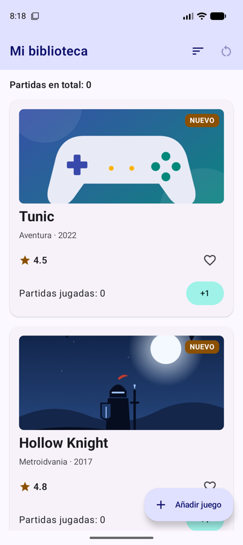
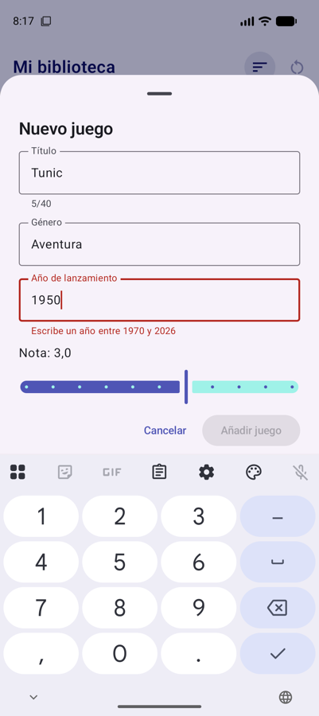
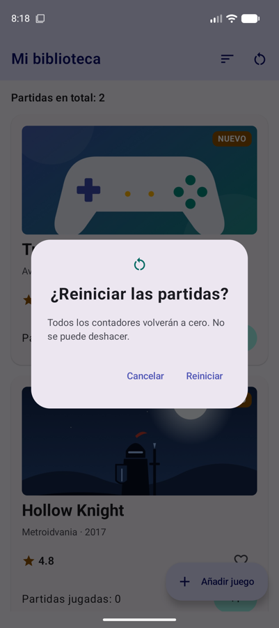

# **Sesión 3.02 · Componentes interactivos**

Hoy la biblioteca deja de ser de solo lectura: un **botón flotante** abre una **hoja inferior** con un formulario **validado** para añadir juegos, y un **diálogo** pide confirmación antes de reiniciar las partidas.

!!! abstract "Ficha de la sesión"

    - **Duración:** 2 h.
    - **Apuntes de referencia:** [3A.2 Componentes interactivos, formularios y diálogos](../a-diseno/3a.2-componentes-interactivos.md).
    - **Proyecto de clase:** FichaJuego, de `s3.02-inicio` a `s3.02-fin` (ver [Guía de clases](./index.md#el-proyecto-de-clase-continua-fichajuego)).
    - **Necesitas:** el proyecto con la [sesión 3.01](./s01-tema-scaffold-listas.md) terminada (o el tag `s3.02-inicio`) y un emulador.

<figure style="text-align: center;">
  <div style="display: flex; gap: 16px; justify-content: center; flex-wrap: wrap;">
    
    
    
  </div>
  <figcaption>Lo que tendrás al terminar la clase: el juego añadido, el formulario validando el año y el diálogo de confirmación.</figcaption>
</figure>

---

## 🎯 Objetivos

Al terminar la clase sabrás:

- Elegir el **botón adecuado** según la importancia de la acción, y añadir un **FAB** al `Scaffold`.
- Construir un formulario con **`OutlinedTextField`**, con el teclado adecuado para cada dato.
- **Validar** lo que escribe el usuario y mostrar el error con `isError` y `supportingText`.
- Mostrar una **hoja inferior** (`ModalBottomSheet`) y un **diálogo** (`AlertDialog`) controlados por un estado.

---

## ✅ Antes de empezar

1. Sitúate en el punto de partida: `git checkout s3.02-inicio` (es el mismo código que `s3.01-fin`).

2. Descarga en `res/drawable/` la portada para los juegos nuevos y los dos iconos de hoy (clic derecho → *Guardar enlace como…*):

    - [img_portada_generica.jpg](https://github.com/jssdocente/pmdm2627-fichajuego/raw/s3.02-fin/app/src/main/res/drawable/img_portada_generica.jpg)
    - [ic_add.xml](https://github.com/jssdocente/pmdm2627-fichajuego/raw/s3.02-fin/app/src/main/res/drawable/ic_add.xml)
    - [ic_restart.xml](https://github.com/jssdocente/pmdm2627-fichajuego/raw/s3.02-fin/app/src/main/res/drawable/ic_restart.xml)

3. Ejecuta la app: debe verse la biblioteca con los seis juegos.

---

## ⏱️ Agenda

| # | Min | Bloque | Apuntes |
| :---: | :---: | :--- | :--- |
| 0 | 5 | Arranque | — |
| 1 | 10 | La jerarquía de botones y el FAB | [3A.2 §1](../a-diseno/3a.2-componentes-interactivos.md#1-la-jerarquia-de-botones-en-material-3) |
| 2 | 20 | Una hoja inferior con el formulario | [3A.2 §2 y §5.2](../a-diseno/3a.2-componentes-interactivos.md#2-formularios-y-entradas-de-texto-outlinedtextfield) |
| 3 | 15 | Validación reactiva | [3A.2 §2.1](../a-diseno/3a.2-componentes-interactivos.md#21-anatomia-y-validacion-reactiva) |
| 4 | 10 | La nota con un `Slider` | [3A.2 §3.3](../a-diseno/3a.2-componentes-interactivos.md#33-deslizadores-continuos-y-por-pasos-slider) |
| 5 | 10 | Guardar el juego en la lista | — |
| 6 | 15 | `AlertDialog`: reiniciar las partidas | [3A.2 §5.1](../a-diseno/3a.2-componentes-interactivos.md#51-dialogo-de-alerta-alertdialog) |
| 7 ⏩ | 10 | Un botón para borrar el texto | [3A.2 §2.1](../a-diseno/3a.2-componentes-interactivos.md#21-anatomia-y-validacion-reactiva) |
| 8 ⏩ | 20 | Reto: el género con un menú desplegable | [3A.2 §4.2](../a-diseno/3a.2-componentes-interactivos.md#42-menus-expuestos-para-formularios-exposeddropdownmenubox) |
| 9 | 5 | Comprobación rápida y cierre | — |
| | **120** | | |

---

## 0 · Arranque (5 min)

Hasta ahora el usuario solo podía mirar el catálogo, marcar favoritos y sumar partidas. Hoy podrá **escribir datos**, y en cuanto un usuario escribe, puede equivocarse. Por eso la clave de la sesión no es el campo de texto, sino **validar lo que llega** y no dejar guardar hasta que sea correcto.

---

## 1 · La jerarquía de botones y el FAB (10 min)

- Material 3 tiene cinco botones, de más a menos énfasis: `Button`, `FilledTonalButton`, `ElevatedButton`, `OutlinedButton` y `TextButton`. → [3A.2 §1](../a-diseno/3a.2-componentes-interactivos.md#1-la-jerarquia-de-botones-en-material-3)
- Regla práctica: **una sola acción principal** por pantalla o diálogo (`Button`); el resto, con menos énfasis. En los diálogos se usan `TextButton`.
- La acción más importante de una pantalla va en un **botón flotante** (FAB), en el hueco `floatingActionButton` del `Scaffold`. → [3A.1 §3.1](../a-diseno/3a.1-material-design-3-scaffold.md#31-parametros-fundamentales-del-scaffold)

!!! example "Manos a la obra"

    1. Fíjate en la ficha: el `+1` es un `FilledTonalButton`. ¿Por qué no un `Button`? (Pista: hay seis en pantalla).

    2. Añade al `Scaffold` de `BibliotecaScreen` un `ExtendedFloatingActionButton` con el icono `ic_add` y el texto «Añadir juego» (en `strings.xml` y `values-en`). De momento, su `onClick` puede estar vacío.

    3. Baja hasta el final de la lista: el FAB tapa el `+1` de la última ficha. Arréglalo dejando más margen abajo en la lista: `contentPadding = PaddingValues(start = 16.dp, top = 16.dp, end = 16.dp, bottom = 88.dp)`.

---

## 2 · Una hoja inferior con el formulario (20 min)

- Una **hoja inferior** (`ModalBottomSheet`) sube desde abajo sin salir de la pantalla. Es ideal para un formulario corto. → [3A.2 §5.2](../a-diseno/3a.2-componentes-interactivos.md#52-hojas-deslizantes-inferiores-modalbottomsheet)
- Como cualquier elemento de Compose, **se muestra mientras su estado lo diga**: `if (mostrarFormulario) ModalBottomSheet(…)`. Cerrarla es poner el estado a `false`.
- `OutlinedTextField` recibe el texto (`value`) y avisa de cada cambio (`onValueChange`): es **state hoisting**, igual que la ficha de la UT2. → [3A.2 §2](../a-diseno/3a.2-componentes-interactivos.md#2-formularios-y-entradas-de-texto-outlinedtextfield)
- Lo que se va escribiendo no le interesa a nadie más hasta que se pulsa «Añadir», así que el estado de los campos vive **dentro del formulario**.

!!! example "Manos a la obra"

    1. En `BibliotecaScreen`, crea `var mostrarFormulario by rememberSaveable { mutableStateOf(false) }` y ponlo a `true` en el `onClick` del FAB.

    2. Crea `ui/biblioteca/FormularioNuevoJuego.kt` con esta firma:

        ```kotlin
        @Composable
        fun FormularioNuevoJuego(
            onGuardar: (titulo: String, genero: String, anio: Int, nota: Double) -> Unit,
            onCancelar: () -> Unit,
            modifier: Modifier = Modifier
        )
        ```

    3. Dentro, una `Column` con el título «Nuevo juego» y dos `OutlinedTextField` (título y género), cada uno con su `rememberSaveable`, `label`, `singleLine = true` y `fillMaxWidth()`. Termina con una fila con un `TextButton` «Cancelar» y un `Button` «Añadir juego».

    4. En `BibliotecaScreen`, **fuera del `Scaffold`**, muestra la hoja cuando toque:

        ```kotlin
        if (mostrarFormulario) {
            ModalBottomSheet(
                onDismissRequest = { mostrarFormulario = false },
                sheetState = rememberModalBottomSheetState(skipPartiallyExpanded = true)
            ) {
                FormularioNuevoJuego(onGuardar = { _, _, _, _ -> }, onCancelar = { mostrarFormulario = false })
            }
        }
        ```

    5. Añade a los campos `keyboardOptions = KeyboardOptions(capitalization = KeyboardCapitalization.Words, imeAction = ImeAction.Next)`: el teclado empieza en mayúscula y la tecla de abajo salta al campo siguiente.

!!! warning "La barra del sistema y el teclado tapan el formulario"
    La hoja llega hasta el borde inferior, así que los botones quedan debajo de la barra de gestos, y al abrir el teclado no cabe todo. Pasa al formulario `Modifier.navigationBarsPadding().imePadding()` y, dentro, añade a la `Column` un `verticalScroll(rememberScrollState())`.

---

## 3 · Validación reactiva (15 min)

- La validación **no es un estado más**: se calcula a partir de los campos en cada recomposición. Cada vez que cambia una letra, se recalcula sola.
- `isError = true` pinta el campo en rojo, y `supportingText` muestra debajo un mensaje de ayuda o el error. → [3A.2 §2.1](../a-diseno/3a.2-componentes-interactivos.md#21-anatomia-y-validacion-reactiva)
- No marques en rojo un campo **vacío que el usuario aún no ha tocado**: muestra el error solo cuando ya hay algo escrito y está mal.
- El botón «Añadir» solo se activa con `enabled = formularioValido`.

!!! example "Manos a la obra"

    1. Añade el campo «Año de lanzamiento» con `KeyboardOptions(keyboardType = KeyboardType.Number, imeAction = ImeAction.Done)`. Guárdalo como texto (`anioTexto`): mientras se escribe, puede no ser un número.

    2. Calcula la validación justo después de los estados:

        ```kotlin
        val anioActual = Year.now().value
        val anio = anioTexto.toIntOrNull()
        val anioValido = anio != null && anio in 1970..anioActual
        val mostrarErrorAnio = anioTexto.isNotEmpty() && !anioValido
        val formularioValido = titulo.isNotBlank() && genero.isNotBlank() && anioValido
        ```

    3. Usa `isError = mostrarErrorAnio`, y en `supportingText` muestra «Escribe un año entre 1970 y …» si hay error o «Por ejemplo, 2019» si no lo hay. Usa `stringResource` con `%1$d` y `%2$d`.

    4. Limita el título a 40 caracteres ignorando las pulsaciones de más: `onValueChange = { if (it.length <= 40) titulo = it }`. Muestra el contador `5/40` en su `supportingText`.

    5. Pon `enabled = formularioValido` en el botón «Añadir juego» y prueba: con el año 1950 el campo se pone rojo y el botón se desactiva.

---

## 4 · La nota con un `Slider` (10 min)

- Para un número dentro de un rango cerrado, un deslizador es más cómodo que el teclado y **no admite valores incorrectos**. → [3A.2 §3.3](../a-diseno/3a.2-componentes-interactivos.md#33-deslizadores-continuos-y-por-pasos-slider)
- `steps` es el número de **puntos intermedios**: de 0 a 5 de medio en medio hay 9.

!!! example "Manos a la obra"

    1. Añade el estado `var nota by rememberSaveable { mutableFloatStateOf(3f) }`.

    2. Encima de los botones, pon un texto «Nota: 3,0» (`%1$.1f` en `strings.xml`) y un `Slider(value = nota, onValueChange = { nota = it }, valueRange = 0f..5f, steps = 9)`.

    3. Al guardar, redondea al medio punto: `(nota * 2).roundToInt() / 2.0`. Un `Float` puede valer 4,4999999.

---

## 5 · Guardar el juego en la lista (10 min)

Hasta ahora la lista era la constante `catalogo`. Para poder añadir juegos, tiene que ser **estado**, y como siempre, se sustituye por una lista nueva en lugar de modificarla.

!!! example "Manos a la obra"

    1. En el formulario, completa el `onClick` de «Añadir juego»: `onGuardar(titulo.trim(), genero.trim(), anio!!, notaRedondeada)`. El `!!` es seguro, porque el botón solo se activa si el año es válido.

    2. En `BibliotecaScreen`, convierte el catálogo en estado y ordena `juegos` en lugar de `catalogo`:

        ```kotlin
        var juegos by remember { mutableStateOf(catalogo) }
        val juegosVisibles = if (ordenarPorNota) juegos.sortedByDescending { it.nota } else juegos
        ```

    3. En `onGuardar`, crea el `Juego` con el siguiente id libre (`(juegos.maxOfOrNull { it.id } ?: 0) + 1`), la portada `R.drawable.img_portada_generica` y `esNovedad = true`. Ponlo el primero, `juegos = listOf(nuevo) + juegos`, y cierra la hoja.

    4. Añade un juego, márcalo como favorito y ordena por nota: gracias a la `key` de la sesión anterior, el favorito viaja con él.

!!! warning "Gira el móvil…"
    …y el juego que añadiste desaparece. Usamos `remember` porque `rememberSaveable` solo sabe guardar tipos sencillos (números, textos, mapas de números…), no una lista de `Juego`. → [Uso de rememberSaveable](../../00-android/00-compose/22-state-management.md#uso-de-remembersaveable). Lo resolveremos de forma limpia con un **ViewModel** en esta misma unidad.

---

## 6 · `AlertDialog`: reiniciar las partidas (15 min)

- Un **diálogo** interrumpe al usuario para confirmar una acción que **no se puede deshacer**. → [3A.2 §5.1](../a-diseno/3a.2-componentes-interactivos.md#51-dialogo-de-alerta-alertdialog)
- Funciona igual que la hoja: existe mientras su estado sea `true`. `onDismissRequest` se llama si el usuario toca fuera o pulsa atrás.
- El diálogo **no decide nada**: solo avisa con `onConfirmar` y `onCancelar`, y quien lo muestra hace el cambio.

!!! example "Manos a la obra"

    1. Añade a la `TopAppBar`, después de ordenar, un `IconButton` con el icono `ic_restart` y la descripción «Reiniciar partidas». Ponle `enabled = partidas.isNotEmpty()`: sin partidas no hay nada que reiniciar.

    2. Al pulsarlo, pon a `true` un nuevo estado `confirmarReinicio`.

    3. Crea, en el mismo fichero, un composable privado `DialogoReiniciarPartidas(onConfirmar, onCancelar)` con un `AlertDialog`: icono, título «¿Reiniciar las partidas?», un texto que avise de que no se puede deshacer y dos `TextButton`, «Reiniciar» (`confirmButton`) y «Cancelar» (`dismissButton`).

    4. Muéstralo con `if (confirmarReinicio)`. Al confirmar, `partidas = emptyMap()`; en los dos casos, `confirmarReinicio = false`.

    5. Prueba los tres caminos: «Cancelar», tocar fuera del diálogo y «Reiniciar».

---

## 7 ⏩ · Un botón para borrar el texto (10 min)

Añade al campo del título un `trailingIcon` que solo aparezca cuando hay texto: un `IconButton` con un icono de cerrar (búscalo como *close* en Material Symbols) que deje `titulo = ""`. Recuerda darle una `contentDescription`, como «Borrar texto». → [3A.2 §2.1](../a-diseno/3a.2-componentes-interactivos.md#21-anatomia-y-validacion-reactiva)

??? success "Solución"

    Descarga el icono *close* de Material Symbols como `res/drawable/ic_close.xml` y añade el texto `borrar_texto` («Borrar texto» / «Clear text») a los dos `strings.xml`. Después, en el campo del título de `FormularioNuevoJuego`:

    ```kotlin
    OutlinedTextField(
        value = titulo,
        onValueChange = { if (it.length <= MAX_TITULO) titulo = it },
        label = { Text(stringResource(R.string.campo_titulo)) },
        // Solo aparece si hay algo que borrar
        trailingIcon = {
            if (titulo.isNotEmpty()) {
                IconButton(onClick = { titulo = "" }) {
                    Icon(
                        painter = painterResource(R.drawable.ic_close),
                        contentDescription = stringResource(R.string.borrar_texto)
                    )
                }
            }
        },
        // … supportingText, singleLine, keyboardOptions y modifier como estaban
    )
    ```

    Como el botón solo cambia el estado (`titulo = ""`), el contador de caracteres y la validación se actualizan solos.

---

## 8 ⏩ · Reto: el género con un menú desplegable (20 min)

Escribir el género a mano provoca que haya «Plataformas», «plataformas» y «Plataforma». Sustituye ese campo por un **`ExposedDropdownMenuBox`** que ofrezca los géneros del catálogo, sin repetir y ordenados. → [3A.2 §4.2](../a-diseno/3a.2-componentes-interactivos.md#42-menus-expuestos-para-formularios-exposeddropdownmenubox)

??? success "Pista"
    La lista de opciones sale del catálogo: `catalogo.map { it.genero }.distinct().sorted()`. El campo ancla lleva `readOnly = true` (para que no salga el teclado) y `Modifier.menuAnchor(…)`, y cada `DropdownMenuItem` asigna el género y cierra el menú.

??? success "Solución"

    En `FormularioNuevoJuego.kt`, un composable privado para el selector:

    ```kotlin
    @OptIn(ExperimentalMaterial3Api::class)
    @Composable
    private fun SelectorGenero(
        genero: String,
        onGeneroElegido: (String) -> Unit,
        modifier: Modifier = Modifier
    ) {
        // Sin repetir y en orden alfabético
        val generos = catalogo.map { it.genero }.distinct().sorted()
        var expandido by remember { mutableStateOf(false) }

        ExposedDropdownMenuBox(
            expanded = expandido,
            onExpandedChange = { expandido = it },
            modifier = modifier
        ) {
            OutlinedTextField(
                value = genero,
                onValueChange = {},
                readOnly = true, // sin teclado: solo se elige de la lista
                label = { Text(stringResource(R.string.campo_genero)) },
                trailingIcon = { ExposedDropdownMenuDefaults.TrailingIcon(expanded = expandido) },
                singleLine = true,
                modifier = Modifier
                    .menuAnchor(ExposedDropdownMenuAnchorType.PrimaryNotEditable)
                    .fillMaxWidth()
            )
            ExposedDropdownMenu(
                expanded = expandido,
                onDismissRequest = { expandido = false }
            ) {
                generos.forEach { opcion ->
                    DropdownMenuItem(
                        text = { Text(opcion) },
                        onClick = {
                            onGeneroElegido(opcion)
                            expandido = false
                        }
                    )
                }
            }
        }
    }
    ```

    Y en el formulario, el `OutlinedTextField` del género se sustituye por:

    ```kotlin
    SelectorGenero(genero = genero, onGeneroElegido = { genero = it })
    ```

    El estado `genero` sigue en el formulario, así que la validación (`genero.isNotBlank()`) no cambia. El estado `expandido` vive en el selector porque a nadie más le interesa.

---

## 🧪 Comprobación rápida

1. En un diálogo con «Eliminar» y «Cancelar», ¿qué tipo de botón usarías para cada uno?

    ??? success "Respuesta"
        `TextButton` para los dos: es lo que recomienda Material 3 en los diálogos. Si una acción destaca, es la de confirmar.

2. ¿Por qué `formularioValido` es un `val` calculado y no otro `mutableStateOf`?

    ??? success "Respuesta"
        Porque depende por completo de los campos. Al recomponerse tras cada cambio, se recalcula solo. Si fuera otro estado, habría que acordarse de actualizarlo y podría quedar desincronizado.

3. ¿Por qué el año se guarda como `String` y no como `Int`?

    ??? success "Respuesta"
        Porque mientras se escribe el texto puede estar vacío o a medias, y el usuario debe poder borrarlo. Se convierte con `toIntOrNull()` solo para validar y al guardar.

4. ¿Cómo se cierra un `AlertDialog` o una `ModalBottomSheet` en Compose?

    ??? success "Respuesta"
        Poniendo a `false` el estado que lo muestra (`if (confirmarReinicio) …`). No hay un método `dismiss()`: si el estado dice que no está, deja de componerse.

---

## 🏠 Para casa

- Termina los bloques 7 y 8 si no dio tiempo en clase.
- Codelabs del laboratorio: [Codelab 3.03 · Lista de tareas con `Scaffold`](../codelabs/03-tareas-scaffold.md) y [Codelab 3.04 · Calculadora de propinas](../codelabs/04-propinas-formulario.md).
- Si faltaste a clase: `git checkout s3.02-fin` y repasa `FormularioNuevoJuego.kt` y `BibliotecaScreen.kt`.

---

## ➡️ Próxima sesión

**3.03 · Navigation 3 (I):** la biblioteca tendrá una segunda pantalla con el detalle de cada juego y aprenderemos a movernos entre ellas pasando argumentos. Lectura previa: [3B.1 Navigation 3](../b-navegacion/3b.1-navigation3.md).
