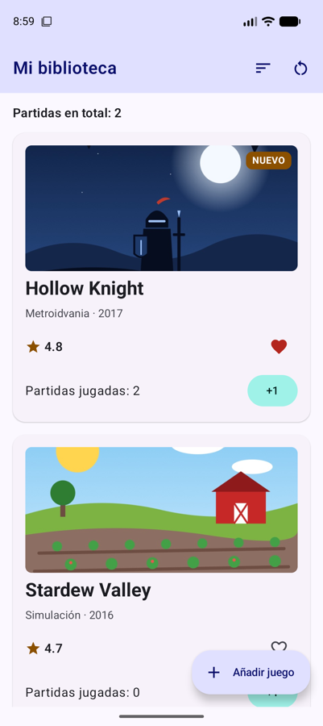
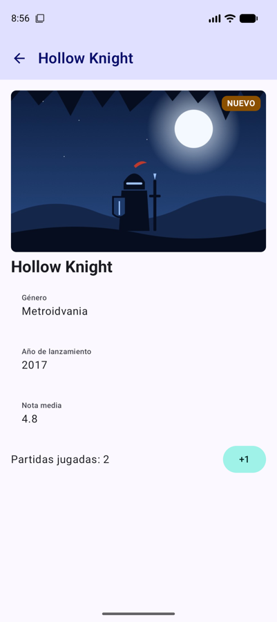
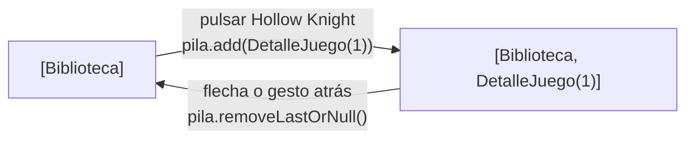
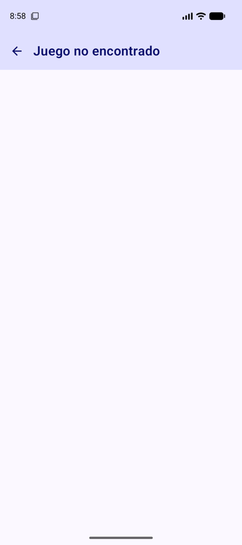
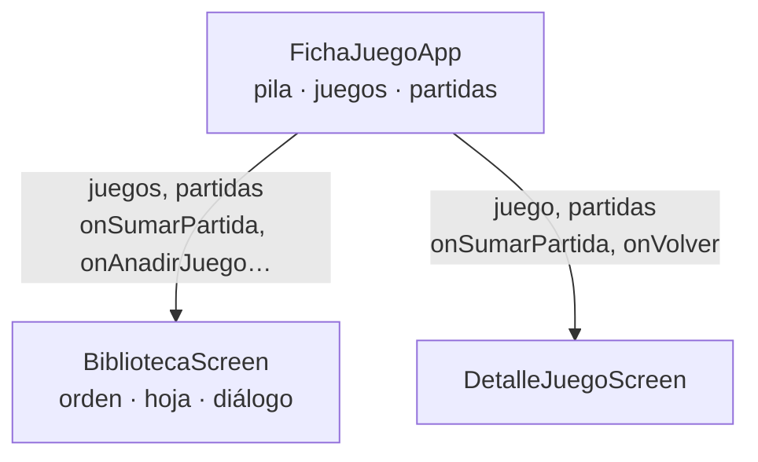

# **Sesión 3.03 · Navigation 3 (I)**

FichaJuego pasa a tener **dos pantallas**: al pulsar una ficha se abre el **detalle del juego**, y con la flecha o el gesto atrás se vuelve a la biblioteca. Lo conseguiremos con **Navigation 3**, donde la navegación es una lista que controlas tú.

!!! abstract "Ficha de la sesión"

    - **Duración:** 2 h.
    - **Apuntes de referencia:** [3B.1 Navegación con Navigation 3](../b-navegacion/3b.1-navigation3.md), apartados 1 a 7.
    - **Proyecto de clase:** FichaJuego, de `s3.03-inicio` a `s3.03-fin` (ver [Guía de clases](./index.md#el-proyecto-de-clase-continua-fichajuego)).
    - **Necesitas:** el proyecto con la [sesión 3.02](./s02-componentes-interactivos.md) terminada (o el tag `s3.03-inicio`), un emulador y conexión a internet para descargar las librerías.

<figure style="text-align: center;">
  <div style="display: flex; gap: 16px; justify-content: center; flex-wrap: wrap;">
    
    
  </div>
  <figcaption>Lo que tendrás al terminar la clase: al pulsar una ficha de la biblioteca (izquierda) se abre su detalle (derecha).</figcaption>
</figure>

---

## 🎯 Objetivos

Al terminar la clase sabrás:

- Explicar la navegación como una **pila de pantallas** que cambia con operaciones de lista.
- Definir **destinos tipados** con `NavKey` y `@Serializable`, con y sin argumentos.
- Mostrar la pantalla actual con **`NavDisplay`** y `entryProvider`, y volver atrás.
- Decidir **dónde vive el estado** cuando lo comparten varias pantallas.

---

## ✅ Antes de empezar

1. Sitúate en el punto de partida: `git checkout s3.03-inicio` (es el mismo código que `s3.02-fin`).

2. Descarga en `res/drawable/` el icono de volver: [ic_arrow_back.xml](https://github.com/jssdocente/pmdm2627-fichajuego/raw/s3.03-fin/app/src/main/res/drawable/ic_arrow_back.xml) (clic derecho → *Guardar enlace como…*).

3. Ejecuta la app y comprueba que añadir un juego y reiniciar las partidas siguen funcionando.

---

## ⏱️ Agenda

| # | Min | Bloque | Apuntes |
| :---: | :---: | :--- | :--- |
| 0 | 5 | Arranque | — |
| 1 | 10 | La idea: una pila de pantallas | [3B.1 §1](../b-navegacion/3b.1-navigation3.md#1-la-idea-una-pila-de-pantallas) |
| 2 | 10 | Configurar el proyecto | [3B.1 §2](../b-navegacion/3b.1-navigation3.md#2-configurar-el-proyecto) |
| 3 | 10 | Los destinos: claves tipadas | [3B.1 §3](../b-navegacion/3b.1-navigation3.md#3-paso-1-definir-los-destinos) |
| 4 | 20 | La pila y `NavDisplay` | [3B.1 §4-5](../b-navegacion/3b.1-navigation3.md#4-paso-2-crear-la-pila) |
| 5 | 20 | La pantalla de detalle y volver atrás | [3B.1 §5-6](../b-navegacion/3b.1-navigation3.md#5-paso-3-mostrar-la-pantalla-actual-con-navdisplay) |
| 6 | 20 | El juego que desaparece: subir el estado | — |
| 7 ⏩ | 10 | Operaciones con la pila: «Siguiente juego» | [3B.1 §7](../b-navegacion/3b.1-navigation3.md#7-operaciones-habituales-con-la-pila) |
| 8 ⏩ | 10 | Reto: una pantalla «Acerca de» | [3B.1 §14](../b-navegacion/3b.1-navigation3.md#14-retos) |
| 9 | 5 | Comprobación rápida y cierre | — |
| | **120** | | |

---

## 0 · Arranque (5 min)

Hasta ahora todo pasaba en una pantalla: lo más que hacíamos era abrir una hoja o un diálogo encima. Una app real tiene muchas pantallas, y el usuario espera moverse entre ellas y **volver atrás** con la flecha o con el gesto del sistema. Hoy añadimos la segunda pantalla de FichaJuego.

---

## 1 · La idea: una pila de pantallas (10 min)

- La navegación es una **pila**: una lista de pantallas en la que solo se ve la última. → [3B.1 §1](../b-navegacion/3b.1-navigation3.md#1-la-idea-una-pila-de-pantallas)
- **Ir** a una pantalla es `pila.add(destino)`. **Volver** es `pila.removeLastOrNull()`.
- Es el `UI = f(estado)` de siempre, aplicado a la navegación: **pantalla visible = f(pila)**.



!!! warning "Navigation 2 no es Navigation 3"
    Muchos tutoriales usan `NavHost`, `NavController` y `navController.navigate("ruta")`. Eso es Navigation 2. En el curso usamos Navigation 3: sus paquetes empiezan por `androidx.navigation3`. Si el IDE te propone importar `NavHost`, no lo aceptes.

---

## 2 · Configurar el proyecto (10 min)

- Hoy necesitamos dos librerías de Navigation 3 (`navigation3-runtime` y `navigation3-ui`) y la de **serialización** de Kotlin, que sirve para guardar la pila al girar el móvil. → [3B.1 §2](../b-navegacion/3b.1-navigation3.md#2-configurar-el-proyecto)
- La librería de ViewModel para Navigation 3 que aparece en los apuntes **no la necesitas todavía**.

!!! example "Manos a la obra"

    1. En `gradle/libs.versions.toml`, añade las versiones `nav3Core` y `kotlinxSerializationCore`, las tres librerías y el plugin `jetbrains-kotlin-serialization`, copiándolos de los apuntes.

    2. En el `build.gradle.kts` **raíz**, declara el plugin sin aplicarlo: `alias(libs.plugins.jetbrains.kotlin.serialization) apply false`.

    3. En `app/build.gradle.kts`, aplica el plugin y añade las tres dependencias.

    4. Sincroniza Gradle (*Sync Now*) y compila. Si falla la sincronización, revisa que los nombres del catálogo coinciden: `libs.androidx.navigation3.runtime` sale de `androidx-navigation3-runtime`.

---

## 3 · Los destinos: claves tipadas (10 min)

- Cada pantalla se identifica con una **clave**: implementa `NavKey` y lleva `@Serializable`. → [3B.1 §3](../b-navegacion/3b.1-navigation3.md#3-paso-1-definir-los-destinos)
- Pantalla sin argumentos: `data object`. Pantalla con argumentos: `data class`, y **sus propiedades son los argumentos**.
- Pasa **el id, no el `Juego` entero**: la pantalla ya buscará el juego. Así la clave es pequeña, se puede guardar y nunca queda desactualizada.

!!! example "Manos a la obra"

    1. Crea el paquete `navegacion` y, dentro, el fichero `Destinos.kt`:

        ```kotlin
        @Serializable
        data object Biblioteca : NavKey

        @Serializable
        data class DetalleJuego(val juegoId: Int) : NavKey
        ```

    2. Comprueba que los imports son `androidx.navigation3.runtime.NavKey` y `kotlinx.serialization.Serializable`.

---

## 4 · La pila y `NavDisplay` (20 min)

- `rememberNavBackStack(Biblioteca)` crea la pila con la pantalla inicial y **la guarda al girar el móvil**. Por eso las claves tienen que ser serializables. → [3B.1 §4](../b-navegacion/3b.1-navigation3.md#4-paso-2-crear-la-pila)
- `NavDisplay` muestra la pantalla del último elemento. Con `entryProvider` le dices qué composable corresponde a cada tipo de clave: `entry<Biblioteca> { … }`. → [3B.1 §5](../b-navegacion/3b.1-navigation3.md#5-paso-3-mostrar-la-pantalla-actual-con-navdisplay)
- **Las pantallas no conocen la pila.** Reciben lambdas (`onJuegoClick`), y solo el composable de navegación toca la pila.

!!! example "Manos a la obra"

    1. Haz que la ficha se pueda pulsar: añade a `FichaJuego` un parámetro `onClick: () -> Unit` y pásaselo a la tarjeta, `ElevatedCard(onClick = onClick, …)`. Pásalo también a través de `FichaJuegoScreen` y de sus previews.

    2. Añade a `BibliotecaScreen` el parámetro `onJuegoClick: (juegoId: Int) -> Unit`, y en la lista usa `onClick = { onJuegoClick(juego.id) }`.

    3. Crea `navegacion/FichaJuegoApp.kt`:

        ```kotlin
        @Composable
        fun FichaJuegoApp() {
            val pila = rememberNavBackStack(Biblioteca)
            NavDisplay(
                backStack = pila,
                onBack = { pila.removeLastOrNull() },
                entryProvider = entryProvider {
                    entry<Biblioteca> {
                        BibliotecaScreen(onJuegoClick = { id -> pila.add(DetalleJuego(juegoId = id)) })
                    }
                }
            )
        }
        ```

    4. En `MainActivity`, sustituye `BibliotecaScreen()` por `FichaJuegoApp()`.

    5. Ejecuta y pulsa una ficha: la app se cierra con un error. Busca en Logcat la línea que lo explica antes de pasar al bloque siguiente.

---

## 5 · La pantalla de detalle y volver atrás (20 min)

- El error del bloque anterior es el más típico: **cada tipo de clave necesita su `entry`**. Hemos añadido `DetalleJuego` a la pila, pero `NavDisplay` no sabe qué pantalla mostrar para ella. → [3B.1 §13](../b-navegacion/3b.1-navigation3.md#13-errores-frecuentes)
- `entry<DetalleJuego> { clave -> … }` recibe la clave, y de ella salen los argumentos: `clave.juegoId`.
- `onBack` se llama con el **botón o el gesto atrás** del sistema. La flecha de la barra debe hacer lo mismo. Con una sola pantalla en la pila, atrás cierra la app. → [3B.1 §6](../b-navegacion/3b.1-navigation3.md#6-volver-atras)

!!! example "Manos a la obra"

    1. Crea `ui/detalle/DetalleJuegoScreen.kt` con la firma `DetalleJuegoScreen(juego: Juego?, onVolver: () -> Unit, modifier: Modifier = Modifier)`. El juego es *nullable*, porque el id podría no existir.

    2. Dale un `Scaffold` con una `TopAppBar` cuyo título sea el del juego (o «Juego no encontrado») y cuyo `navigationIcon` sea un `IconButton` con `ic_arrow_back` que llame a `onVolver`.

    3. En el contenido, si hay juego: la `Portada` más grande (`modifier = Modifier.height(240.dp)`), el título y tres `ListItem` con el género, el año y la nota (`overlineContent` para la etiqueta y `headlineContent` para el valor).

    4. En `FichaJuegoApp`, añade la entrada:

        ```kotlin
        entry<DetalleJuego> { clave ->
            DetalleJuegoScreen(
                juego = catalogo.find { it.id == clave.juegoId },
                onVolver = { pila.removeLastOrNull() }
            )
        }
        ```

    5. Prueba los tres caminos: la flecha, el gesto o botón atrás del sistema y girar el móvil en el detalle (sigues en el detalle, porque la pila se guarda). Desde la biblioteca, atrás cierra la app.

---

## 6 · El juego que desaparece: subir el estado (20 min)

!!! example "Manos a la obra: provoca el fallo"

    1. Añade un juego con el formulario y púlsalo: el detalle dice «Juego no encontrado».

    2. Vuelve atrás: **el juego ha desaparecido** de la biblioteca. En cambio, el favorito y el orden siguen como estaban.

<figure style="text-align: center;">
  
  <figcaption>El detalle busca en <code>catalogo</code>, donde el juego nuevo no está.</figcaption>
</figure>

- **«No encontrado»:** el detalle busca en `catalogo`, pero el juego nuevo solo está en el estado `juegos` de `BibliotecaScreen`, y el detalle no lo ve.
- **Desaparece:** `NavDisplay` solo compone la pantalla de arriba. Al abrir el detalle, la biblioteca **sale de la composición**. `NavDisplay` guarda y restaura lo que está en `rememberSaveable` (el favorito y el orden), pero lo que estaba en `remember` se pierde.
- La solución es la de la UT2: **subir el estado al antepasado común** de quienes lo usan. Aquí es `FichaJuegoApp`, que además nunca sale de la composición.



!!! example "Manos a la obra: arréglalo"

    1. Mueve `juegos` y `partidas` de `BibliotecaScreen` a `FichaJuegoApp`. En la biblioteca deja solo el estado de la pantalla: `ordenarPorNota`, `mostrarFormulario` y `confirmarReinicio`.

    2. Cambia la firma de `BibliotecaScreen` para que reciba los datos y avise de los cambios: `juegos`, `partidas`, `onSumarPartida: (juegoId: Int) -> Unit`, `onReiniciarPartidas`, `onAnadirJuego` y `onJuegoClick`. La creación del `Juego` nuevo pasa a `FichaJuegoApp`.

    3. En el detalle, busca en el estado: `juegos.find { it.id == clave.juegoId }`.

    4. Ahora que las partidas están arriba, el detalle también puede mostrarlas: añade a `DetalleJuegoScreen` los parámetros `partidas` y `onSumarPartida`, y reutiliza `FilaPartidas`, la misma fila de la ficha.

    5. Repite el experimento. Suma partidas en el detalle y vuelve: el total de la biblioteca está al día, porque las dos pantallas leen el mismo estado.

!!! tip "Arregla también la preview de la biblioteca"
    `BibliotecaScreen` ya no tiene estado de datos, así que su preview debe pasarle valores de ejemplo, como `juegos = catalogo` y `partidas = mapOf(1 to 3)`, y lambdas vacías. Es la ventaja del *state hoisting*: puedes previsualizar cualquier situación.

---

## 7 ⏩ · Operaciones con la pila: «Siguiente juego» (10 min)

Añade al detalle un botón «Siguiente juego» que muestre el detalle del juego siguiente de la lista (y del primero al llegar al último). Atrás debe llevar **a la biblioteca**, no al juego anterior. → [3B.1 §7](../b-navegacion/3b.1-navigation3.md#7-operaciones-habituales-con-la-pila)

??? success "Pista"
    No añadas una pantalla más a la pila: **sustituye** la última, con `pila[pila.lastIndex] = DetalleJuego(siguienteId)`. El siguiente id lo calculas con `indexOfFirst` sobre `juegos` y el resto de dividir por `juegos.size`.

??? success "Solución"

    Añade el texto `siguiente_juego` a los `strings.xml`. `DetalleJuegoScreen` recibe un evento más, `onSiguiente: () -> Unit`, y pinta el botón al final de la columna, debajo de `FilaPartidas`:

    ```kotlin
    OutlinedButton(onClick = onSiguiente, modifier = Modifier.align(Alignment.End)) {
        Text(stringResource(R.string.siguiente_juego))
    }
    ```

    Quien toca la pila es `FichaJuegoApp`, en `entry<DetalleJuego>`:

    ```kotlin
    onSiguiente = {
        val posicion = juegos.indexOfFirst { it.id == clave.juegoId }
        // Del último se pasa al primero
        val siguiente = juegos[(posicion + 1) % juegos.size]
        // Sustituye la cima en lugar de apilar: atrás vuelve a la biblioteca
        pila[pila.lastIndex] = DetalleJuego(juegoId = siguiente.id)
    }
    ```

    Pruébalo: pulsa «Siguiente juego» varias veces y después atrás. Llegas directamente a la biblioteca, porque la pila nunca ha tenido más de dos entradas.

---

## 8 ⏩ · Reto: una pantalla «Acerca de» (10 min)

Añade una acción en la barra de la biblioteca que abra una pantalla «Acerca de» con el nombre de la app, tu nombre y una flecha para volver. Sigue los mismos pasos: clave `data object`, `entry` y lambda. → [3B.1 §14](../b-navegacion/3b.1-navigation3.md#14-retos)

??? success "Pista"
    Si pulsas dos veces seguidas la acción, ¿se apila dos veces la pantalla? Evítalo con `if (pila.lastOrNull() != AcercaDe) pila.add(AcercaDe)`.

??? success "Solución"

    1. Descarga el icono *info* de Material Symbols como `ic_info.xml` y añade los textos `acerca_de` («Acerca de») y `autor` («Hecha por %1$s») a los `strings.xml`.

    2. En `Destinos.kt`, la clave:

        ```kotlin
        @Serializable
        data object AcercaDe : NavKey
        ```

    3. La pantalla, en `ui/acercade/AcercaDeScreen.kt`:

        ```kotlin
        @OptIn(ExperimentalMaterial3Api::class)
        @Composable
        fun AcercaDeScreen(onVolver: () -> Unit, modifier: Modifier = Modifier) {
            Scaffold(
                modifier = modifier,
                topBar = {
                    TopAppBar(
                        title = { Text(stringResource(R.string.acerca_de)) },
                        navigationIcon = {
                            IconButton(onClick = onVolver) {
                                Icon(
                                    painter = painterResource(R.drawable.ic_arrow_back),
                                    contentDescription = stringResource(R.string.volver)
                                )
                            }
                        }
                    )
                }
            ) { innerPadding ->
                Column(
                    modifier = Modifier
                        .fillMaxSize()
                        .padding(innerPadding)
                        .padding(16.dp),
                    verticalArrangement = Arrangement.spacedBy(8.dp)
                ) {
                    Text(stringResource(R.string.app_name), style = MaterialTheme.typography.headlineSmall)
                    Text(stringResource(R.string.autor, "Tu nombre"))
                }
            }
        }
        ```

    4. `BibliotecaScreen` recibe `onAcercaDeClick: () -> Unit` y añade una acción más en `actions` de su `TopAppBar`:

        ```kotlin
        IconButton(onClick = onAcercaDeClick) {
            Icon(
                painter = painterResource(R.drawable.ic_info),
                contentDescription = stringResource(R.string.acerca_de)
            )
        }
        ```

    5. En `FichaJuegoApp`, la lambda de la biblioteca y la nueva entrada:

        ```kotlin
        onAcercaDeClick = { if (pila.lastOrNull() != AcercaDe) pila.add(AcercaDe) }
        ```

        ```kotlin
        entry<AcercaDe> {
            AcercaDeScreen(onVolver = { pila.removeLastOrNull() })
        }
        ```

---

## 🧪 Comprobación rápida

1. La pila es `[Biblioteca, DetalleJuego(4)]`. ¿Qué se ve? ¿Y qué pasa al pulsar atrás dos veces?

    ??? success "Respuesta"
        Se ve el detalle del juego 4. El primer atrás deja `[Biblioteca]` y se ve la biblioteca. El segundo cierra la app, porque solo quedaba una pantalla.

2. ¿Por qué la clave del detalle lleva `juegoId: Int` y no el `Juego` completo?

    ??? success "Respuesta"
        Porque la clave debe ser pequeña y serializable para guardarse con la pila, y un objeto copiado podría quedar desactualizado. La pantalla busca el juego por su id.

3. ¿Qué pasa si añades a la pila una clave que no tiene `entry` en el `entryProvider`?

    ??? success "Respuesta"
        La app se cierra con una excepción al navegar: `NavDisplay` no sabe qué pantalla mostrar para esa clave.

4. Al volver del detalle, el favorito seguía marcado pero el juego añadido había desaparecido. ¿Por qué?

    ??? success "Respuesta"
        Al navegar, la biblioteca sale de la composición. `NavDisplay` restaura su `rememberSaveable` (el favorito), pero su `remember` (la lista de juegos) se pierde. Se soluciona subiendo `juegos` a `FichaJuegoApp`.

---

## 🏠 Para casa

- Termina los bloques 7 y 8 si no dio tiempo en clase.
- Codelab del laboratorio: [Codelab 3.05 · Navegar entre pantallas con Navigation 3](../codelabs/05-navegacion-navigation3.md).
- Lee el apartado de [errores frecuentes](../b-navegacion/3b.1-navigation3.md#13-errores-frecuentes) de los apuntes y localiza cuáles te han pasado hoy.
- Si faltaste a clase: `git checkout s3.03-fin` y repasa `navegacion/`, `DetalleJuegoScreen.kt` y la nueva firma de `BibliotecaScreen`.

---

## ➡️ Próxima sesión

**3.04 · Navigation 3 (II) y edge-to-edge:** una barra de navegación inferior con varias pestañas y cómo dibujar bajo las barras del sistema. Lectura previa: [3B.1 §10](../b-navegacion/3b.1-navigation3.md#10-barra-de-navegacion-inferior-con-una-pila-por-pestana) y [3B.2 §2](../b-navegacion/3b.2-diseno-adaptativo.md#2-edge-to-edge-aprovechar-toda-la-pantalla).
