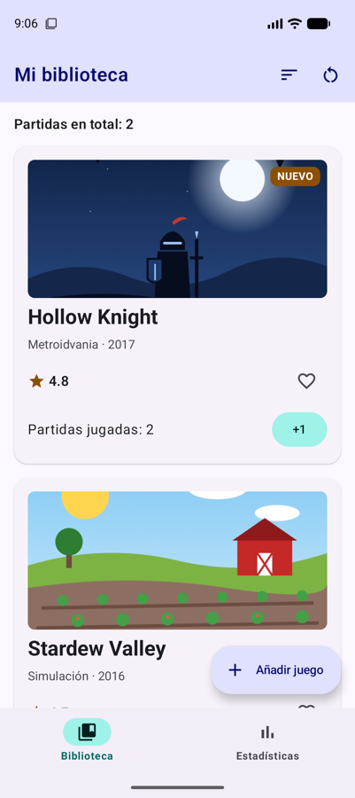
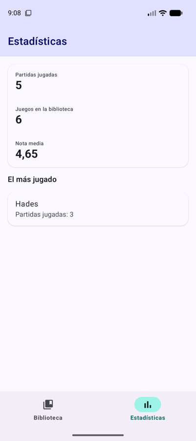
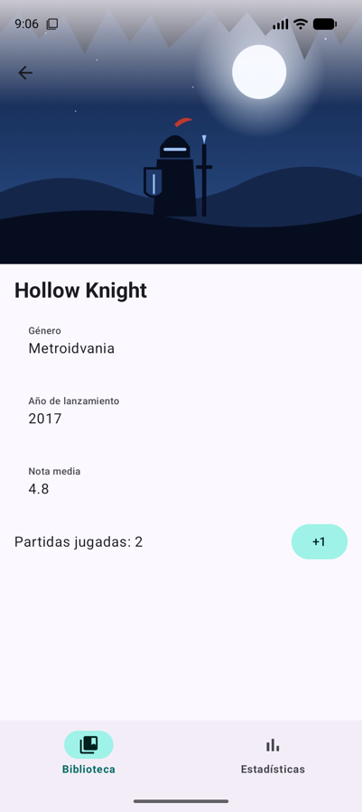
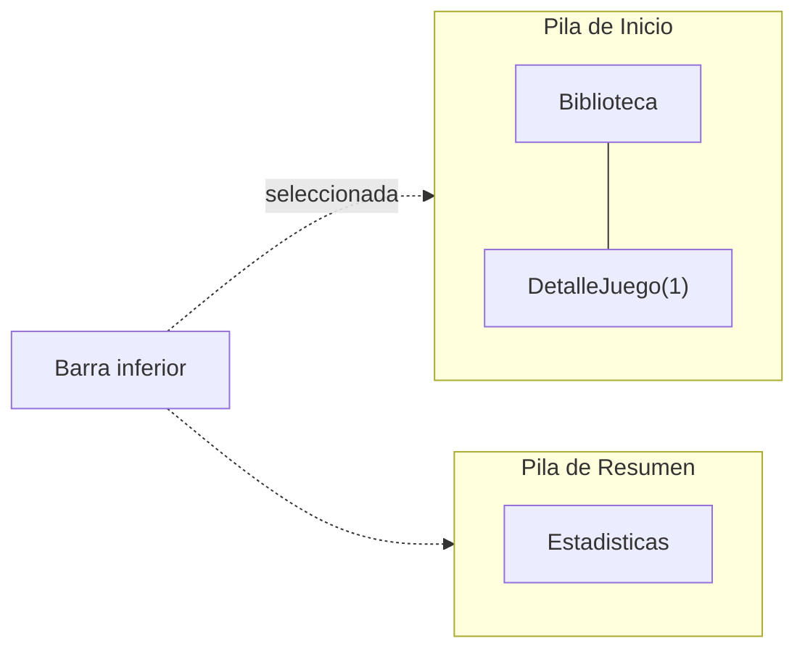
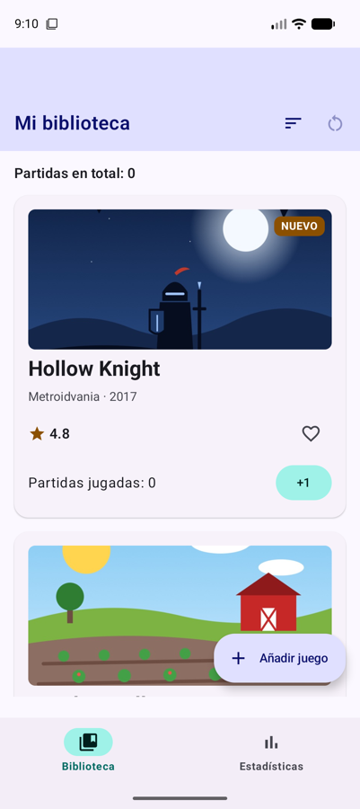

# **Sesión 3.04 · Navigation 3 (II) y edge-to-edge**

FichaJuego estrena una **barra de navegación inferior** con dos pestañas, Biblioteca y Estadísticas, y cada una **recuerda dónde estaba**. Después aprovechamos toda la pantalla: el detalle dibuja la portada **bajo la barra de estado**.

!!! abstract "Ficha de la sesión"

    - **Duración:** 2 h.
    - **Apuntes de referencia:** [3B.1 §6 y §10 Navigation 3](../b-navegacion/3b.1-navigation3.md#10-barra-de-navegacion-inferior-con-una-pila-por-pestana) y [3B.2 §2 Edge-to-edge](../b-navegacion/3b.2-diseno-adaptativo.md#2-edge-to-edge-aprovechar-toda-la-pantalla).
    - **Proyecto de clase:** FichaJuego, de `s3.04-inicio` a `s3.04-fin` (ver [Guía de clases](./index.md#el-proyecto-de-clase-continua-fichajuego)).
    - **Necesitas:** el proyecto con la [sesión 3.03](./s03-navigation3-i.md) terminada (o el tag `s3.04-inicio`) y un emulador.

<figure style="text-align: center;">
  <div style="display: flex; gap: 16px; justify-content: center; flex-wrap: wrap;">
    
    
    
  </div>
  <figcaption>Lo que tendrás al terminar la clase: la barra inferior con sus dos pestañas y el detalle edge-to-edge.</figcaption>
</figure>

---

## 🎯 Objetivos

Al terminar la clase sabrás:

- Añadir una **barra de navegación inferior** con `NavigationBar` y `NavigationBarItem`.
- Mantener **una pila por pestaña** y aplicar el patrón **«salir por inicio»** al volver atrás.
- Explicar qué son los **insets** y evitar el contenido tapado o los huecos dobles.
- Dibujar contenido **edge-to-edge**, apartando solo lo que no debe quedar tapado.

---

## ✅ Antes de empezar

1. Sitúate en el punto de partida: `git checkout s3.04-inicio` (es el mismo código que `s3.03-fin`).

2. Descarga en `res/drawable/` los iconos de las pestañas (clic derecho → *Guardar enlace como…*):

    - [ic_biblioteca.xml](https://github.com/jssdocente/pmdm2627-fichajuego/raw/s3.04-fin/app/src/main/res/drawable/ic_biblioteca.xml)
    - [ic_estadisticas.xml](https://github.com/jssdocente/pmdm2627-fichajuego/raw/s3.04-fin/app/src/main/res/drawable/ic_estadisticas.xml)

3. Ejecuta la app y comprueba que se abre el detalle al pulsar una ficha.

---

## ⏱️ Agenda

| # | Min | Bloque | Apuntes |
| :---: | :---: | :--- | :--- |
| 0 | 5 | Arranque | — |
| 1 | 5 | Volver atrás y el gesto predictivo | [3B.1 §6](../b-navegacion/3b.1-navigation3.md#6-volver-atras) |
| 2 | 15 | Una pantalla de estadísticas | — |
| 3 | 15 | La barra de navegación inferior | [3B.1 §10](../b-navegacion/3b.1-navigation3.md#10-barra-de-navegacion-inferior-con-una-pila-por-pestana) |
| 4 | 20 | Una pila por pestaña | [3B.1 §10](../b-navegacion/3b.1-navigation3.md#10-barra-de-navegacion-inferior-con-una-pila-por-pestana) |
| 5 | 15 | Insets: el contenido tapado y el doble hueco | [3B.2 §2.2-2.3](../b-navegacion/3b.2-diseno-adaptativo.md#22-insets-las-zonas-que-no-debes-tapar) |
| 6 | 15 | La portada bajo la barra de estado | [3B.2 §2.4](../b-navegacion/3b.2-diseno-adaptativo.md#24-sin-scaffold-modificadores-de-insets) |
| 7 ⏩ | 10 | Animaciones de transición | [3B.1 §11](../b-navegacion/3b.1-navigation3.md#11-animaciones-de-transicion) |
| 8 ⏩ | 15 | Reto: pulsar la pestaña activa vuelve a su raíz | [3B.1 §7](../b-navegacion/3b.1-navigation3.md#7-operaciones-habituales-con-la-pila) |
| 9 | 5 | Comprobación rápida y cierre | — |
| | **120** | | |

---

## 0 · Arranque (5 min)

En la sesión anterior la app tenía una sola pila: biblioteca → detalle. Muchas apps tienen además **secciones** fijas en una barra inferior, y el usuario espera saltar entre ellas sin perder lo que estaba viendo en cada una. Además, desde Android 15 las apps se dibujan de borde a borde, y hay que saber qué hacer con las barras del sistema.

---

## 1 · Volver atrás y el gesto predictivo (5 min)

- `NavDisplay` llama a `onBack` con el **botón o el gesto atrás**. Si en la pila solo queda una pantalla, deja pasar el gesto y el sistema **cierra la app**. → [3B.1 §6](../b-navegacion/3b.1-navigation3.md#6-volver-atras)
- Con `targetSdk` 36, el **gesto atrás predictivo** viene activado: al empezar a deslizar desde el borde se ve una vista previa de la pantalla a la que vas a volver.

!!! example "Manos a la obra"

    1. Abre un detalle y empieza a deslizar desde el borde izquierdo **sin soltar**: verás encogerse el detalle y asomar la biblioteca. Si sueltas a medio camino, se cancela.

    2. Haz lo mismo en la biblioteca: la vista previa es la pantalla de inicio del móvil, porque atrás cerrará la app.

---

## 2 · Una pantalla de estadísticas (15 min)

Para tener dos pestañas necesitamos una segunda sección. Será un **resumen calculado** a partir de los juegos y las partidas que ya están en `FichaJuegoApp`: no guarda ningún estado propio.

!!! example "Manos a la obra"

    1. En `Destinos.kt`, añade la clave `@Serializable data object Estadisticas : NavKey`.

    2. Crea `ui/estadisticas/EstadisticasScreen.kt` con la firma `EstadisticasScreen(juegos: List<Juego>, partidas: Map<Int, Int>, onJuegoClick: (juegoId: Int) -> Unit, modifier: Modifier = Modifier)`, con un `Scaffold` y una `TopAppBar` como las demás pantallas.

    3. Calcula los datos al principio de la función:

        ```kotlin
        val totalPartidas = partidas.values.sum()
        val notaMedia = juegos.map { it.nota }.average()
        val masJugado = juegos
            .filter { (partidas[it.id] ?: 0) > 0 }
            .maxByOrNull { partidas[it.id] ?: 0 }
        ```

    4. Muéstralos en una `ElevatedCard` con tres `ListItem` (partidas jugadas, juegos en la biblioteca y nota media). Debajo, el juego más jugado en otra tarjeta pulsable que llame a `onJuegoClick`, o el texto «Todavía no has jugado ninguna partida» si `masJugado` es `null`.

    5. Añade su `entry<Estadisticas>` en `FichaJuegoApp`, pasándole `juegos`, `partidas` y la misma navegación al detalle que usa la biblioteca.

---

## 3 · La barra de navegación inferior (15 min)

- La barra va en el hueco `bottomBar` de un `Scaffold` que envuelve al `NavDisplay`. Cada sección es un `NavigationBarItem` con `selected`, `onClick`, `icon` y `label`.
- Las pestañas se describen con un `enum`: cada una con su pantalla raíz, su texto y su icono. → [3B.1 §10](../b-navegacion/3b.1-navigation3.md#10-barra-de-navegacion-inferior-con-una-pila-por-pestana)

!!! example "Manos a la obra"

    1. En `Destinos.kt`, define las pestañas:

        ```kotlin
        enum class Pestana(val raiz: NavKey, @StringRes val etiqueta: Int, @DrawableRes val icono: Int) {
            Inicio(Biblioteca, R.string.pestana_biblioteca, R.drawable.ic_biblioteca),
            Resumen(Estadisticas, R.string.pestana_estadisticas, R.drawable.ic_estadisticas)
        }
        ```

    2. En `FichaJuegoApp`, guarda la pestaña elegida con `var seleccionada by rememberSaveable { mutableStateOf(Pestana.Inicio) }`.

    3. Envuelve el `NavDisplay` en un `Scaffold` con una `NavigationBar` en `bottomBar`. Recorre `Pestana.entries` creando un `NavigationBarItem` por pestaña. Aplica el padding al `NavDisplay` con `modifier = Modifier.padding(innerPadding)`.

    4. Primera versión, con una sola pila: al pulsar una pestaña, `seleccionada = pestana`, `pila.clear()` y `pila.add(pestana.raiz)`, en ese orden y en el mismo `onClick`.

    5. Prueba: abre el detalle de Hollow Knight, cambia a Estadísticas y vuelve a Biblioteca. **El detalle se ha perdido**, porque al cambiar de pestaña vaciamos la pila. Fíjate también en los huecos vacíos sobre la barra inferior y bajo la barra superior: los arreglaremos en el bloque 5.

---

## 4 · Una pila por pestaña (20 min)

- La solución es una **pila independiente por pestaña**, y `NavDisplay` muestra la de la seleccionada. Cambiar de pestaña ya no borra nada.
- **«Salir por inicio»:** la pila de Inicio siempre está debajo. Atrás desde la raíz de otra pestaña lleva a Inicio, y desde Inicio cierra la app.
- Con varias pilas, `NavDisplay` recibe la lista de **entradas ya decoradas** (`entries = …`) en lugar de `backStack` y `entryProvider`. Cada pila necesita **su propio decorador**, para que sus pantallas conserven su `rememberSaveable` aunque la pestaña no se vea.



!!! example "Manos a la obra"

    1. Sustituye la pila única por una pila por pestaña:

        ```kotlin
        val pilas = Pestana.entries.associateWith { rememberNavBackStack(it.raiz) }
        val pilaActual = pilas.getValue(seleccionada)
        ```

    2. Crea dos funciones locales: `navegar(destino)`, que hace `pilaActual.add(destino)`, y `volver()`, que quita el último de `pilaActual` si tiene más de uno o, si no, pone `seleccionada = Pestana.Inicio`. Usa `navegar` en los `onJuegoClick` y `::volver` en `onVolver` y en `onBack`.

    3. Saca el `entryProvider { … }` a una variable `proveedor` y decora cada pila con él:

        ```kotlin
        val entradasPorPestana = pilas.mapValues { (_, pila) ->
            rememberDecoratedNavEntries(
                backStack = pila,
                entryDecorators = listOf(rememberSaveableStateHolderNavEntryDecorator()),
                entryProvider = proveedor
            )
        }
        ```

    4. Muestra Inicio y, encima, la pestaña elegida si es otra: `entradasVisibles` es `entradasPorPestana.getValue(Pestana.Inicio)` más, si `seleccionada != Pestana.Inicio`, las de esa pestaña. Pásalas con `NavDisplay(entries = entradasVisibles, onBack = ::volver, …)`.

    5. En la barra, el `onClick` de cada pestaña ahora solo hace `seleccionada = pestana`.

    6. Repite la prueba del bloque 3: el detalle sigue ahí. Después abre el más jugado desde Estadísticas y pulsa atrás tres veces: detalle → Estadísticas → Biblioteca (con su detalle) → …

---

## 5 · Insets: el contenido tapado y el doble hueco (15 min)

- La app es **edge-to-edge** (`enableEdgeToEdge()` en `MainActivity`): se dibuja también bajo la barra de estado y la de navegación, que son transparentes. → [3B.2 §2](../b-navegacion/3b.2-diseno-adaptativo.md#2-edge-to-edge-aprovechar-toda-la-pantalla)
- Los **insets** dicen cuánto ocupa cada zona del sistema: `statusBars`, `navigationBars`, `ime` (el teclado)… → [3B.2 §2.2](../b-navegacion/3b.2-diseno-adaptativo.md#22-insets-las-zonas-que-no-debes-tapar)
- `Scaffold` los suma a su `innerPadding`. Con un `Scaffold` dentro de otro, **los dos** dejan el hueco de las barras: es el **doble hueco**. → [3B.2 §2.3](../b-navegacion/3b.2-diseno-adaptativo.md#23-con-scaffold-lo-habitual)

<figure style="text-align: center;">
  <div style="display: flex; gap: 16px; justify-content: center; flex-wrap: wrap;">
    
    
  </div>
  <figcaption>Sin <code>consumeWindowInsets</code> (izquierda), la barra superior deja dos veces el hueco de la barra de estado y el FAB flota demasiado alto. Con él (derecha), cada hueco se deja una sola vez.</figcaption>
</figure>

!!! example "Manos a la obra"

    1. Añade `consumeWindowInsets(innerPadding)` después del padding del `NavDisplay`:

        ```kotlin
        modifier = Modifier
            .padding(innerPadding)
            .consumeWindowInsets(innerPadding)
        ```

        `padding` solo aparta el contenido. `consumeWindowInsets` además avisa a los `Scaffold` de dentro de que esas zonas ya están cubiertas.

    2. Comprueba que el FAB queda justo sobre la barra inferior y que la `TopAppBar` ya no tiene un hueco encima.

!!! warning "Aplica cada inset en un solo sitio"
    El síntoma de aplicarlo dos veces es un hueco doble; el de no aplicarlo, contenido tapado por una barra. Si ves cualquiera de los dos, busca qué contenedores están aplicando los insets. → [3B.2 §8](../b-navegacion/3b.2-diseno-adaptativo.md#8-errores-frecuentes)

---

## 6 · La portada bajo la barra de estado (15 min)

- Edge-to-edge no significa apartarlo todo de las barras: una **imagen** puede ocupar también su zona. Lo que no debe quedar tapado es lo que se lee o se pulsa.
- Sin `Scaffold`, los insets se aplican con modificadores: `statusBarsPadding()`, `navigationBarsPadding()`, `safeDrawingPadding()`… → [3B.2 §2.4](../b-navegacion/3b.2-diseno-adaptativo.md#24-sin-scaffold-modificadores-de-insets)

!!! example "Manos a la obra"

    1. En `DetalleJuegoScreen`, quita el `Scaffold` y la `TopAppBar`. Deja una `Column` con `fillMaxSize()`, `background(MaterialTheme.colorScheme.background)` (sin `Scaffold` nadie pinta el fondo) y `verticalScroll`.

    2. Arriba, un `Box` con la portada a todo el ancho (`Image` con `ContentScale.Crop` y 300 dp de alto) y, encima, el `IconButton` de volver con `Modifier.statusBarsPadding()`: la imagen llega al borde, pero la flecha se aparta de la barra.

    3. Ejecuta: la portada **no llega arriba**. El `Scaffold` de la barra inferior también aparta su contenido de la barra de estado. Díselo con `contentWindowInsets = WindowInsets(0)`: solo debe dejar sitio a su `NavigationBar`, y cada pantalla gestiona la parte de arriba.

    4. Ahora la hora y la batería se dibujan sobre la portada y, si es oscura, no se leen. Añade entre la imagen y la flecha un velo degradado con el color de fondo:

        ```kotlin
        Box(
            Modifier.fillMaxWidth().height(120.dp).background(
                Brush.verticalGradient(listOf(MaterialTheme.colorScheme.background.copy(alpha = 0.8f), Color.Transparent))
            )
        )
        ```

    5. Prueba en modo oscuro: el velo se oscurece y los iconos del sistema pasan a claros, así que todo se sigue leyendo.

---

## 7 ⏩ · Animaciones de transición (10 min)

`NavDisplay` trae una animación predefinida, pero puedes cambiarla con `transitionSpec` (avanzar), `popTransitionSpec` (volver) y `predictivePopTransitionSpec` (gesto atrás). Prueba a que el detalle entre deslizándose desde la derecha. → [3B.1 §11](../b-navegacion/3b.1-navigation3.md#11-animaciones-de-transicion)

??? success "Solución"

    En `FichaJuegoApp`, los tres parámetros se añaden al `NavDisplay`, junto a `entries` y `onBack`:

    ```kotlin
    NavDisplay(
        entries = entradasVisibles,
        onBack = ::volver,
        transitionSpec = {
            // Avanzar: la nueva pantalla entra por la derecha
            slideInHorizontally { ancho -> ancho } togetherWith
                slideOutHorizontally { ancho -> -ancho / 3 }
        },
        popTransitionSpec = {
            // Volver: la anterior entra por la izquierda
            slideInHorizontally { ancho -> -ancho / 3 } togetherWith
                slideOutHorizontally { ancho -> ancho }
        },
        predictivePopTransitionSpec = {
            slideInHorizontally { ancho -> -ancho / 3 } togetherWith
                slideOutHorizontally { ancho -> ancho }
        },
        modifier = Modifier
            .padding(innerPadding)
            .consumeWindowInsets(innerPadding)
    )
    ```

    Los `import` vienen de `androidx.compose.animation`: `slideInHorizontally`, `slideOutHorizontally` y `togetherWith`.

---

## 8 ⏩ · Reto: pulsar la pestaña activa vuelve a su raíz (15 min)

En muchas apps, si estás en el detalle de la pestaña Biblioteca y vuelves a pulsar **Biblioteca** en la barra, regresas a la lista. Implementa ese comportamiento sin romper el resto. → [3B.1 §7](../b-navegacion/3b.1-navigation3.md#7-operaciones-habituales-con-la-pila)

??? success "Pista"
    En el `onClick` del `NavigationBarItem`: si `pestana == seleccionada`, vacía su pila hasta la raíz con `while (pila.size > 1) pila.removeLastOrNull()`. Si no, cambia de pestaña como hasta ahora.

??? success "Solución"

    Solo cambia el `onClick` de cada `NavigationBarItem` en `FichaJuegoApp`:

    ```kotlin
    onClick = {
        if (pestana == seleccionada) {
            // Ya estaba en ella: vuelve a su raíz
            val pila = pilas.getValue(pestana)
            while (pila.size > 1) pila.removeLastOrNull()
        } else {
            seleccionada = pestana
        }
    },
    ```

    Comprueba que no has roto lo anterior: abre un detalle en Biblioteca, cambia a Estadísticas y vuelve. El detalle sigue ahí, porque cambiar de pestaña no toca las pilas. Solo al pulsar otra vez Biblioteca vuelves a la lista.

---

## 🧪 Comprobación rápida

1. ¿Por qué cada pestaña tiene su propia pila en lugar de compartir una?

    ??? success "Respuesta"
        Para que cada pestaña recuerde dónde estaba. Con una pila compartida, cambiar de pestaña obliga a sustituir su contenido y se pierde, por ejemplo, el detalle abierto.

2. Estás en la raíz de Estadísticas y pulsas atrás. ¿Qué pasa? ¿Y si estás en la raíz de Biblioteca?

    ??? success "Respuesta"
        Desde Estadísticas se vuelve a la pestaña Biblioteca, con lo que tuviera abierto. Desde la raíz de Biblioteca se cierra la app: es el patrón «salir por inicio».

3. Ves una franja vacía entre la lista y la barra inferior. ¿Qué ha pasado?

    ??? success "Respuesta"
        El inset de la barra de navegación se ha aplicado dos veces, por ejemplo en dos `Scaffold` anidados. Se arregla con `consumeWindowInsets` en el exterior o aplicando el inset en un solo sitio.

4. En el detalle, ¿por qué la flecha lleva `statusBarsPadding()` y la imagen no?

    ??? success "Respuesta"
        La imagen puede quedar debajo de la barra de estado; la flecha no, porque hay que poder verla y pulsarla. Edge-to-edge consiste en apartar solo lo que no debe quedar tapado.

---

## 🏠 Para casa

- Termina los bloques 7 y 8 si no dio tiempo en clase.
- Lee los [errores frecuentes de edge-to-edge](../b-navegacion/3b.2-diseno-adaptativo.md#8-errores-frecuentes) y el reto básico de [3B.2](../b-navegacion/3b.2-diseno-adaptativo.md#9-retos), el formulario edge-to-edge.
- Decide si tu proyecto «Mi colección» necesita barra inferior: ¿qué secciones tendría?
- Si faltaste a clase: `git checkout s3.04-fin` y repasa `navegacion/FichaJuegoApp.kt`, `EstadisticasScreen.kt` y `DetalleJuegoScreen.kt`.

---

## ➡️ Próxima sesión

**3.05 · ViewModel y UiState (I):** sacamos los datos y la lógica de los composables a un ViewModel. Por fin, los juegos añadidos sobrevivirán al girar el móvil. Lectura previa: [3C.1 La capa de interfaz y el ViewModel](../c-arquitectura/3c.1-capa-ui-viewmodel.md).
