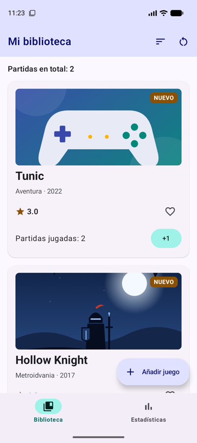
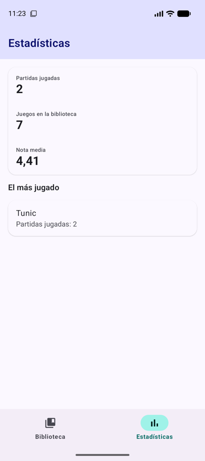
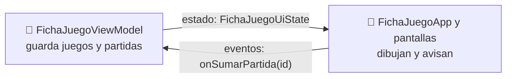
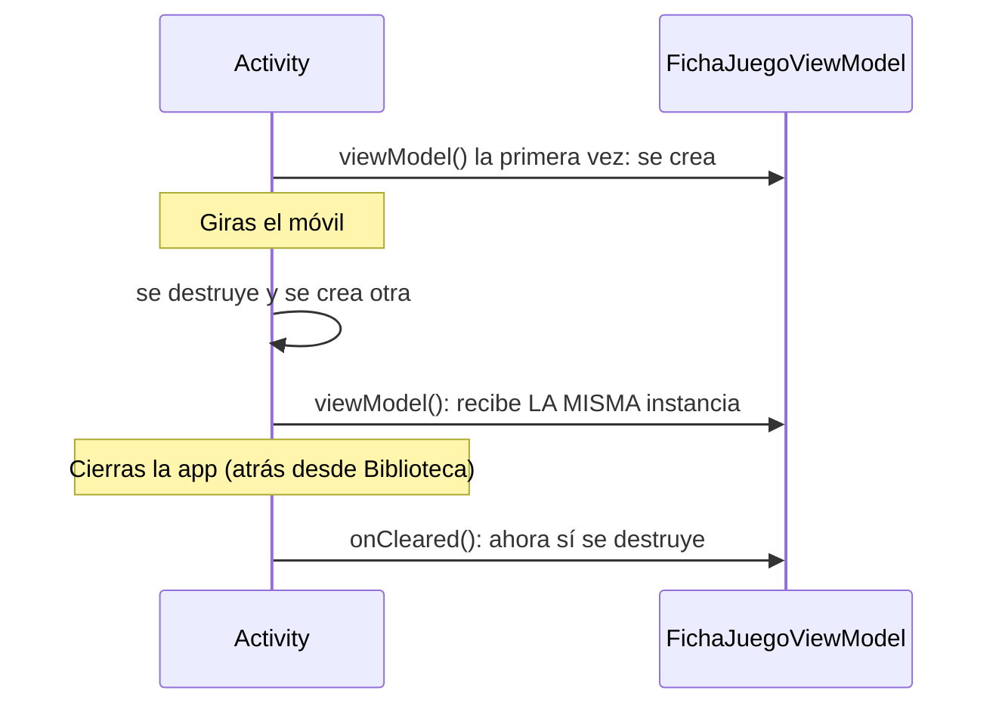

# **Sesión 3.05 · ViewModel y UiState (I)**

Desde la sesión 3.02 arrastramos un fallo: **los juegos añadidos desaparecen al girar el móvil**. Hoy lo arreglamos sacando los datos y la lógica de los composables a un **ViewModel**, y de paso ganamos algo que antes no teníamos: poder **probar la lógica con tests** sin abrir el emulador.

!!! abstract "Ficha de la sesión"

    - **Duración:** 2 h.
    - **Apuntes de referencia:** [3C.1 La capa de interfaz: ViewModel, UiState y UDF](../c-arquitectura/3c.1-capa-ui-viewmodel.md) y [3C.4 §1.3 Estructura de un test](../c-arquitectura/3c.4-testing.md#13-estructura-de-un-test-arrange-act-assert).
    - **Proyecto de clase:** FichaJuego, de `s3.05-inicio` a `s3.05-fin` (ver [Guía de clases](./index.md#el-proyecto-de-clase-continua-fichajuego)).
    - **Necesitas:** el proyecto con la [sesión 3.04](./s04-navigation3-ii-edge-to-edge.md) terminada (o el tag `s3.05-inicio`) y un emulador.

<figure style="text-align: center;">
  <div style="display: flex; gap: 16px; justify-content: center; flex-wrap: wrap;">
    
    
  </div>
  <figcaption>Lo que tendrás al terminar la clase: Tunic y sus partidas siguen ahí después de girar el móvil, y las estadísticas lo cuentan.</figcaption>
</figure>

---

## 🎯 Objetivos

Al terminar la clase sabrás:

- Explicar **por qué** un `ViewModel` sobrevive a los cambios de configuración y un `remember` no.
- Modelar el estado de la interfaz como una **`data class` inmutable** (`UiState`) con propiedades calculadas.
- Exponer el estado con **`StateFlow`** y cambiarlo solo desde **eventos** del ViewModel (flujo unidireccional, UDF).
- Conectar el ViewModel a Compose con `viewModel()` y `collectAsStateWithLifecycle()`.
- Escribir **tests unitarios** de un ViewModel.

---

## ✅ Antes de empezar

1. Sitúate en el punto de partida: `git checkout s3.05-inicio` (es el mismo código que `s3.04-fin`).

2. Ejecuta la app y comprueba que se abren el detalle y las dos pestañas.

---

## ⏱️ Agenda

| # | Min | Bloque | Apuntes |
| :---: | :---: | :--- | :--- |
| 0 | 5 | Arranque: el juego que desaparece al girar | — |
| 1 | 10 | Por qué un ViewModel | [3C.1 §1](../c-arquitectura/3c.1-capa-ui-viewmodel.md#1-el-rol-del-viewmodel-en-la-arquitectura-moderna) |
| 2 | 10 | Las dependencias | [3B.1 §8](../b-navegacion/3b.1-navigation3.md#8-un-viewmodel-para-cada-pantalla) |
| 3 | 15 | El `UiState` | [3C.1 §2](../c-arquitectura/3c.1-capa-ui-viewmodel.md#2-modelado-inmutable-del-estado-uistate) |
| 4 | 20 | El ViewModel: `StateFlow` y eventos | [3C.1 §3](../c-arquitectura/3c.1-capa-ui-viewmodel.md#3-reactividad-con-stateflow-y-el-patron-udf) |
| 5 | 15 | Conectar el ViewModel a la app | [3C.1 §4](../c-arquitectura/3c.1-capa-ui-viewmodel.md#4-consumo-del-viewmodel-en-compose) |
| 6 | 15 | Probar el ViewModel con tests | [3C.4 §1.3](../c-arquitectura/3c.4-testing.md#13-estructura-de-un-test-arrange-act-assert) |
| 7 ⏩ | 10 | Más tests | [3C.4 §4](../c-arquitectura/3c.4-testing.md#4-probar-los-viewmodel) |
| 8 ⏩ | 15 | Reto: eliminar un juego desde el detalle | — |
| 9 | 5 | Comprobación rápida y cierre | — |
| | **120** | | |

---

## 0 · Arranque: el juego que desaparece al girar (5 min)

!!! example "Manos a la obra"

    1. Añade un juego con el botón flotante y súmale un par de partidas.

    2. Gira el emulador. Las partidas siguen ahí (están en un `rememberSaveable`), pero **el juego añadido ha desaparecido**.

¿Por qué no usamos también `rememberSaveable` para la lista de juegos? Porque lo que guarda tiene que caber en el `Bundle` de la Activity, y una `List<Juego>` no se puede guardar ahí tal cual. → [Uso de rememberSaveable](../../00-android/00-compose/22-state-management.md#uso-de-remembersaveable)

Además, `FichaJuegoApp` ha acabado haciendo de todo: dibuja la barra, gestiona las pilas, guarda los datos y decide cómo se crea un juego nuevo. Hoy vamos a separar **los datos y la lógica** del dibujo.

---

## 1 · Por qué un ViewModel (10 min)

- Al girar el móvil, cambiar el idioma o el modo oscuro, Android **destruye la Activity y la vuelve a crear**. Todo lo que estaba en `remember` se pierde con ella.
- Un **`ViewModel`** vive fuera de la Activity: la nueva Activity recibe **la misma instancia** con todos sus datos. Solo se destruye cuando la pantalla se cierra de verdad (se llama a `onCleared()`). → [3C.1 §1.1](../c-arquitectura/3c.1-capa-ui-viewmodel.md#11-supervivencia-ante-cambios-de-configuracion)
- El reparto de tareas sigue el **flujo unidireccional (UDF)**: el **estado baja** del ViewModel a la pantalla, y los **eventos suben** de la pantalla al ViewModel.





---

## 2 · Las dependencias (10 min)

Necesitamos dos librerías de la familia `lifecycle`, con la **misma versión** que la que ya tiene el proyecto (`lifecycleRuntimeKtx`):

- `lifecycle-viewmodel-compose`: la función `viewModel()`.
- `lifecycle-runtime-compose`: la función `collectAsStateWithLifecycle()`.

!!! example "Manos a la obra"

    1. En `gradle/libs.versions.toml`, sección `[libraries]`:

        ```toml
        androidx-lifecycle-viewmodel-compose = { group = "androidx.lifecycle", name = "lifecycle-viewmodel-compose", version.ref = "lifecycleRuntimeKtx" }
        androidx-lifecycle-runtime-compose = { group = "androidx.lifecycle", name = "lifecycle-runtime-compose", version.ref = "lifecycleRuntimeKtx" }
        ```

    2. En `app/build.gradle.kts`, dentro de `dependencies`:

        ```kotlin
        implementation(libs.androidx.lifecycle.viewmodel.compose)
        implementation(libs.androidx.lifecycle.runtime.compose)
        ```

    3. Sincroniza Gradle (el icono del elefante) y comprueba que compila.

---

## 3 · El `UiState` (15 min)

- Todo lo que necesitan las pantallas se agrupa en **un único objeto inmutable**: una `data class` con `val`. Es la **única fuente de verdad**. → [3C.1 §2](../c-arquitectura/3c.1-capa-ui-viewmodel.md#2-modelado-inmutable-del-estado-uistate)
- Nadie lo modifica: para cambiar algo se crea **una copia** con `copy(...)`.
- Lo que se puede **calcular** a partir de los datos no se guarda aparte: se escribe como propiedad o función de la clase, y así nunca se desincroniza.

!!! example "Manos a la obra"

    1. Crea `ui/FichaJuegoUiState.kt`:

        ```kotlin
        data class FichaJuegoUiState(
            val juegos: List<Juego> = catalogo,
            val partidas: Map<Int, Int> = emptyMap()
        ) {
            val totalPartidas: Int
                get() = partidas.values.sum()

            fun partidasDe(juegoId: Int): Int = partidas[juegoId] ?: 0

            fun juego(juegoId: Int): Juego? = juegos.find { it.id == juegoId }
        }
        ```

    2. Fíjate en los valores por defecto: `FichaJuegoUiState()` es el estado con el que arranca la app.

!!! tip "¿Qué va en el UiState y qué no?"
    Van los datos que **comparten varias pantallas** o que hay que conservar: los juegos y las partidas. El estado puramente visual de una pantalla, como si la hoja inferior está abierta o la lista está ordenada por nota, puede seguir en un `rememberSaveable` dentro de esa pantalla.

---

## 4 · El ViewModel: `StateFlow` y eventos (20 min)

- El estado se guarda en un **`MutableStateFlow` privado** y se expone como **`StateFlow` de solo lectura**: la interfaz lo observa, pero no puede cambiarlo. → [3C.1 §3.1](../c-arquitectura/3c.1-capa-ui-viewmodel.md#31-implementacion-del-viewmodel)
- Cada cosa que puede hacer el usuario es una **función-evento** del ViewModel. Dentro, `update { … }` recibe el estado actual y devuelve el nuevo.

!!! example "Manos a la obra"

    1. Crea `ui/FichaJuegoViewModel.kt` con el estado:

        ```kotlin
        class FichaJuegoViewModel : ViewModel() {

            private val _uiState = MutableStateFlow(FichaJuegoUiState())
            val uiState: StateFlow<FichaJuegoUiState> = _uiState.asStateFlow()
        }
        ```

    2. Añade los dos eventos de las partidas:

        ```kotlin
        fun onSumarPartida(juegoId: Int) {
            _uiState.update { estado ->
                estado.copy(partidas = estado.partidas + (juegoId to estado.partidasDe(juegoId) + 1))
            }
        }

        fun onReiniciarPartidas() {
            _uiState.update { it.copy(partidas = emptyMap()) }
        }
        ```

    3. Añade `onAnadirJuego(titulo: String, genero: String, anio: Int, nota: Double)`. **Mueve** aquí el código que crea el `Juego` nuevo desde la lambda `onAnadirJuego` de `FichaJuegoApp`, cambiando `juegos` por `estado.juegos`, y termina con `estado.copy(juegos = listOf(nuevo) + estado.juegos)`.

    4. Observa los `import` del ViewModel: `androidx.lifecycle` y `kotlinx.coroutines.flow`, **ninguno de Compose**. Esto será importante en el bloque 6.

??? info "¿Por qué `update { }` y no `_uiState.value = …`?"
    Las dos funcionan aquí. `update` lee el estado actual y escribe el nuevo de forma atómica: si dos cambios llegaran a la vez desde hilos distintos, ninguno se perdería. Es la costumbre recomendada.

---

## 5 · Conectar el ViewModel a la app (15 min)

- `viewModel()` devuelve el ViewModel: lo crea la primera vez y, después, devuelve siempre el mismo.
- `collectAsStateWithLifecycle()` convierte el `StateFlow` en un estado de Compose: cada vez que el ViewModel emite un estado nuevo, se recompone. Además deja de escuchar cuando la app pasa a segundo plano. → [El ViewModel como State Holder](../../00-android/00-compose/22-state-management.md#2-consumo-seguro-en-compose-collectasstatewithlifecycle)

!!! example "Manos a la obra"

    1. En `FichaJuegoApp`, recibe el ViewModel como parámetro y lee su estado al principio:

        ```kotlin
        @Composable
        fun FichaJuegoApp(viewModel: FichaJuegoViewModel = viewModel()) {
            val estado by viewModel.uiState.collectAsStateWithLifecycle()
            // …
        ```

    2. Borra las variables `juegos` y `partidas` y la función `sumarPartida`.

    3. En las entradas, el estado baja desde `estado` y los eventos suben al ViewModel con **referencias a función**:

        ```kotlin
        BibliotecaScreen(
            juegos = estado.juegos,
            partidas = estado.partidas,
            onSumarPartida = viewModel::onSumarPartida,
            onReiniciarPartidas = viewModel::onReiniciarPartidas,
            onAnadirJuego = viewModel::onAnadirJuego,
            onJuegoClick = { id -> navegar(DetalleJuego(juegoId = id)) }
        )
        ```

    4. Haz lo mismo en `entry<Estadisticas>` y en `entry<DetalleJuego>`, donde ahora puedes usar `estado.juego(clave.juegoId)` y `estado.partidasDe(clave.juegoId)`.

    5. Repite la prueba del bloque 0: añade un juego, súmale partidas y gira. **Ya no desaparece.** Mira también la pestaña Estadísticas: lo cuenta como el más jugado.

Las pantallas no han cambiado: siguen recibiendo datos y lambdas, sin saber que existe un ViewModel. Por eso sus `@Preview` siguen funcionando.

!!! warning "Sobrevive al giro, no al cierre"
    El ViewModel vive en memoria. Si cierras la app con atrás desde Biblioteca, o el sistema la mata para liberar memoria, los juegos añadidos se pierden. Para guardarlos de verdad hace falta **persistencia**, con una base de datos Room, en la UT4.

---

## 6 · Probar el ViewModel con tests (15 min)

- Como el ViewModel no depende de Compose ni de la pantalla, se puede probar con un **test unitario local**: se ejecuta en el ordenador, en segundos, sin emulador. → [3C.4 §1.2](../c-arquitectura/3c.4-testing.md#12-tests-locales-y-tests-instrumentados)
- Cada test sigue el esquema **preparar, actuar, comprobar** (*Arrange, Act, Assert*): crear el ViewModel, llamar a un evento y comprobar `uiState.value`. → [3C.4 §1.3](../c-arquitectura/3c.4-testing.md#13-estructura-de-un-test-arrange-act-assert)

!!! example "Manos a la obra"

    1. Crea `app/src/test/java/com/pmdm/fichajuego/ui/FichaJuegoViewModelTest.kt` (carpeta `test`, no `androidTest`):

        ```kotlin
        class FichaJuegoViewModelTest {

            @Test
            fun `sumar partida incrementa solo el contador de ese juego`() {
                val viewModel = FichaJuegoViewModel()                // preparar

                viewModel.onSumarPartida(juegoId = 4)                // actuar
                viewModel.onSumarPartida(juegoId = 4)
                viewModel.onSumarPartida(juegoId = 1)

                val estado = viewModel.uiState.value                 // comprobar
                assertEquals(2, estado.partidasDe(4))
                assertEquals(1, estado.partidasDe(1))
                assertEquals(0, estado.partidasDe(2))
                assertEquals(3, estado.totalPartidas)
            }
        }
        ```

    2. Ejecútalo con el triángulo verde junto a la clase, o desde la terminal con `./gradlew test`.

    3. Escribe dos tests más: «reiniciar deja todas las partidas a cero» y «el juego añadido aparece el primero, con un id nuevo y marcado como novedad».

    4. Rompe el ViewModel a propósito (por ejemplo, suma `+ 2` en `onSumarPartida`) y vuelve a ejecutar: el test falla y te dice qué valor esperaba y cuál ha recibido. Deshaz el cambio.

!!! note "Los nombres con espacios"
    En los tests locales, Kotlin permite nombres de función entre comillas invertidas con espacios. Así el informe de resultados se lee como una lista de comportamientos de la app.

---

## 7 ⏩ · Más tests (10 min)

Añade estos dos tests a `FichaJuegoViewModelTest`:

- «al empezar muestra el catálogo y ninguna partida».
- «dos juegos añadidos seguidos tienen ids distintos».

Este ViewModel es fácil de probar porque todo es síncrono. Cuando use corrutinas con `viewModelScope`, los tests necesitarán una preparación extra. → [3C.4 §4.1](../c-arquitectura/3c.4-testing.md#41-el-problema-del-hilo-principal)

??? success "Solución"

    ```kotlin
    @Test
    fun `al empezar muestra el catalogo y ninguna partida`() {
        val viewModel = FichaJuegoViewModel()

        val estado = viewModel.uiState.value
        assertEquals(catalogo, estado.juegos)
        assertEquals(0, estado.totalPartidas)
    }

    @Test
    fun `dos juegos anadidos seguidos tienen ids distintos`() {
        val viewModel = FichaJuegoViewModel()

        viewModel.onAnadirJuego("Tunic", "Aventura", 2022, 4.5)
        viewModel.onAnadirJuego("Animal Well", "Metroidvania", 2024, 4.6)

        val ids = viewModel.uiState.value.juegos.map { it.id }
        assertEquals(ids.size, ids.distinct().size)
    }
    ```

    El segundo comprueba algo general (que no hay ids repetidos) en lugar de valores concretos, así que sigue siendo válido aunque cambie el catálogo.

---

## 8 ⏩ · Reto: eliminar un juego desde el detalle (15 min)

Añade un botón «Eliminar juego» al final del detalle. Al pulsarlo, el juego desaparece de la biblioteca, también sus partidas, y se vuelve a la pantalla anterior. Escribe primero el test del nuevo evento y después conecta el botón.

??? success "Pista"
    - En el ViewModel, `onEliminarJuego(juegoId: Int)` hace `estado.copy(juegos = estado.juegos.filterNot { it.id == juegoId }, partidas = estado.partidas - juegoId)`.
    - `DetalleJuegoScreen` recibe un nuevo parámetro `onEliminar: () -> Unit` y lo llama desde un `OutlinedButton`.
    - En `entry<DetalleJuego>`, `onEliminar = { volver(); viewModel.onEliminarJuego(clave.juegoId) }`. Volver primero evita que, durante la animación de salida, el detalle muestre «Juego no encontrado».

??? success "Solución"

    1. El test, en `FichaJuegoViewModelTest` (añade el `import` de `assertNull`):

        ```kotlin
        @Test
        fun `eliminar quita el juego y sus partidas`() {
            val viewModel = FichaJuegoViewModel()
            viewModel.onSumarPartida(juegoId = 4)
            viewModel.onSumarPartida(juegoId = 1)

            viewModel.onEliminarJuego(juegoId = 4)

            val estado = viewModel.uiState.value
            assertNull(estado.juego(4))
            assertEquals(catalogo.size - 1, estado.juegos.size)
            assertEquals(0, estado.partidasDe(4))
            assertEquals(1, estado.totalPartidas)
        }
        ```

    2. El evento, en `FichaJuegoViewModel`:

        ```kotlin
        fun onEliminarJuego(juegoId: Int) {
            _uiState.update { estado ->
                estado.copy(
                    juegos = estado.juegos.filterNot { it.id == juegoId },
                    partidas = estado.partidas - juegoId // sus partidas también desaparecen
                )
            }
        }
        ```

    3. El botón, al final de la columna de `DetalleJuegoScreen`, que recibe `onEliminar: () -> Unit`. Añade el texto `eliminar_juego` a los `strings.xml`:

        ```kotlin
        OutlinedButton(
            onClick = onEliminar,
            colors = ButtonDefaults.outlinedButtonColors(contentColor = MaterialTheme.colorScheme.error),
            modifier = Modifier.align(Alignment.End)
        ) {
            Text(stringResource(R.string.eliminar_juego))
        }
        ```

    4. En `entry<DetalleJuego>` de `FichaJuegoApp`:

        ```kotlin
        onEliminar = {
            // Primero salimos del detalle y después borramos
            volver()
            viewModel.onEliminarJuego(clave.juegoId)
        }
        ```

        Actualiza también las previews del detalle con `onEliminar = {}`.

---

## 🧪 Comprobación rápida

1. ¿Por qué los juegos añadidos se perdían al girar y ahora no?

    ??? success "Respuesta"
        Al girar se destruye la Activity y, con ella, lo que había en `remember`. El ViewModel no se destruye: la nueva Activity recibe la misma instancia, con la lista de juegos intacta.

2. ¿Por qué el ViewModel expone un `StateFlow` y guarda privado el `MutableStateFlow`?

    ??? success "Respuesta"
        Para que solo el ViewModel pueda cambiar el estado. La interfaz lo observa, y si quiere que cambie algo tiene que llamar a un evento: es el flujo unidireccional.

3. `totalPartidas` es una propiedad calculada del `UiState`. ¿Qué problema evita frente a guardarla como un campo más?

    ??? success "Respuesta"
        Que se desincronice: si fuera un campo, habría que acordarse de actualizarla en cada evento que toque las partidas. Calculada, siempre coincide con el mapa.

4. ¿Por qué podemos probar `FichaJuegoViewModel` con un test local, sin emulador?

    ??? success "Respuesta"
        Porque no depende de Compose ni de la pantalla: recibe eventos y produce estados, que se comprueban leyendo `uiState.value`.

---

## 🏠 Para casa

- Termina los bloques 7 y 8 si no dio tiempo en clase.
- Codelab del laboratorio: [Codelab 3.06 · Quiz con ViewModel y `StateFlow`](../codelabs/06-quiz-viewmodel.md).
- Lee [3C.1 §4.2](../c-arquitectura/3c.1-capa-ui-viewmodel.md#42-componente-de-presentacion-stateless-content): la separación entre la pantalla con estado y el contenido sin estado.
- Piensa en tu proyecto «Mi colección»: ¿qué datos irían en su `UiState` y qué eventos tendría su ViewModel?
- Si faltaste a clase: `git checkout s3.05-fin` y repasa `ui/FichaJuegoUiState.kt`, `ui/FichaJuegoViewModel.kt`, el test y `navegacion/FichaJuegoApp.kt`.

---

## ➡️ Próxima sesión

**3.06 · ViewModel y UiState (II):** un ViewModel para cada pantalla, asociado a su entrada de la pila, y los datos compartidos en un repositorio. Lectura previa: [3B.1 §8 Un ViewModel para cada pantalla](../b-navegacion/3b.1-navigation3.md#8-un-viewmodel-para-cada-pantalla).
