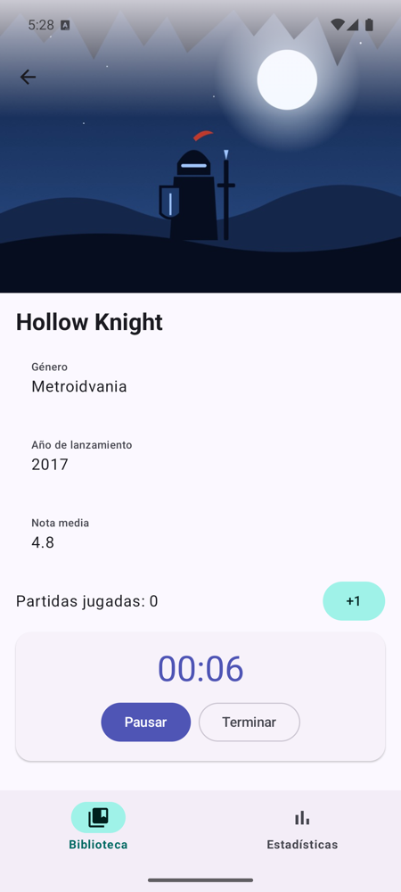
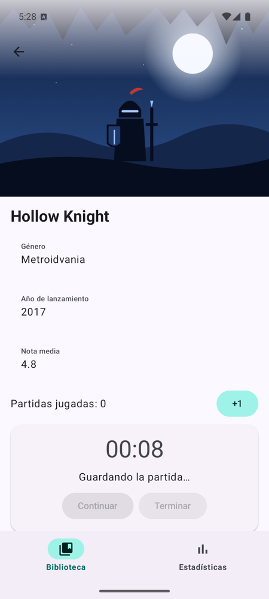

# **Sesión 3.06 · Tiempo y ciclo de vida**

FichaJuego estrena un **cronómetro de la sesión de juego**: cuenta el tiempo jugado, se puede pausar, se detiene solo al salir de la app y, al terminar, guarda la partida mientras bloquea los botones. Es la primera vez que algo ocurre **con el tiempo**, sin que nadie pulse nada.

!!! abstract "Ficha de la sesión"

    - **Duración:** 2 h.
    - **Apuntes de referencia:** [3C.1 §5 Tareas con tiempo en el ViewModel](../c-arquitectura/3c.1-capa-ui-viewmodel.md#5-tareas-con-tiempo-en-el-viewmodel) y [Corrutinas §4.2 y §6](../../00-android/00-kotlin/51-corrutinas.md#6-cancelacion-de-corrutinas).
    - **Proyecto de clase:** FichaJuego, de `s3.06-inicio` a `s3.06-fin` (ver [Guía de clases](./index.md#el-proyecto-de-clase-continua-fichajuego)).
    - **Necesitas:** el proyecto con la [sesión 3.05](./s05-viewmodel-uistate-i.md) terminada (o el tag `s3.06-inicio`) y un emulador.

<figure style="text-align: center;">
  <div style="display: flex; gap: 16px; justify-content: center; flex-wrap: wrap;">
    
    
  </div>
  <figcaption>Lo que tendrás al terminar la clase: el cronómetro en marcha y, al terminar, la espera con los botones bloqueados.</figcaption>
</figure>

---

## 🎯 Objetivos

Al terminar la clase sabrás:

- Lanzar una tarea repetitiva con `viewModelScope.launch` y `delay`, sin bloquear la interfaz.
- Guardar el **`Job`** para poder pararla y evitar que se lance dos veces.
- Hacer una **espera con bloqueo** usando un campo del `UiState`.
- Detener lo que no debe seguir funcionando en segundo plano con **`LifecycleResumeEffect`**.

---

## ✅ Antes de empezar

1. Sitúate en el punto de partida: `git checkout s3.06-inicio` (es el mismo código que `s3.05-fin`).

2. Ejecuta los tests con `./gradlew test` y comprueba que pasan los de `FichaJuegoViewModelTest`.

---

## ⏱️ Agenda

| # | Min | Bloque | Apuntes |
| :---: | :---: | :--- | :--- |
| 0 | 5 | Arranque: algo que pasa solo | — |
| 1 | 5 | `delay` frente a `Thread.sleep` | [Corrutinas §1](../../00-android/00-kotlin/51-corrutinas.md#1-la-analogia-del-camarero-por-que-bloquear-un-hilo-es-fatal) |
| 2 | 10 | El cronómetro en el `UiState` | [3C.1 §2](../c-arquitectura/3c.1-capa-ui-viewmodel.md#2-modelado-inmutable-del-estado-uistate) |
| 3 | 15 | La corrutina y su `Job` | [3C.1 §5.1](../c-arquitectura/3c.1-capa-ui-viewmodel.md#51-una-tarea-que-se-puede-parar-job) |
| 4 | 15 | La tarjeta del cronómetro | — |
| 5 | 15 | Una espera con bloqueo | [3C.1 §5.2](../c-arquitectura/3c.1-capa-ui-viewmodel.md#52-una-espera-con-bloqueo) |
| 6 | 15 | Parar al salir de la app | [3C.1 §5.3](../c-arquitectura/3c.1-capa-ui-viewmodel.md#53-parar-al-salir-de-la-app-lifecycleresumeeffect) |
| 7 ⏩ | 10 | Experimento: dos corrutinas a la vez | [3C.1 §5.5](../c-arquitectura/3c.1-capa-ui-viewmodel.md#55-errores-frecuentes) |
| 8 ⏩ | 20 | Probar el tiempo sin esperar | [3C.1 §5.4](../c-arquitectura/3c.1-capa-ui-viewmodel.md#54-probar-el-tiempo-sin-esperar) |
| 9 | 10 | Comprobación rápida, dudas y cierre | — |
| | **120** | | |

---

## 0 · Arranque: algo que pasa solo (5 min)

Hasta ahora, todo cambiaba porque alguien pulsaba algo: evento, nuevo estado, recomposición. Un cronómetro cambia **solo**, cada segundo. El flujo es el mismo, pero quien produce el evento es una **corrutina** dentro del ViewModel. La pantalla ni se entera: sigue pintando el estado que le llega.

---

## 1 · `delay` frente a `Thread.sleep` (5 min)

- `Thread.sleep(1000)` **bloquea el hilo**: en el hilo principal, la app deja de dibujar y de responder. `delay(1000)` **suspende la corrutina** y deja el hilo libre. → [Corrutinas §1](../../00-android/00-kotlin/51-corrutinas.md#1-la-analogia-del-camarero-por-que-bloquear-un-hilo-es-fatal)
- `viewModelScope` lanza corrutinas ligadas al ViewModel: se cancelan solas cuando este se destruye.

---

## 2 · El cronómetro en el `UiState` (10 min)

- Todo lo que se pinta va en el estado: el tiempo, si está en marcha, si se está guardando y de qué juego es la sesión.

!!! example "Manos a la obra"

    1. En `ui/FichaJuegoUiState.kt`, añade:

        ```kotlin
        data class Cronometro(
            val juegoId: Int? = null,      // a qué juego se está jugando
            val segundos: Int = 0,
            val enMarcha: Boolean = false,
            val guardando: Boolean = false // la espera al terminar
        )
        ```

    2. Añade el campo `val cronometro: Cronometro = Cronometro()` a `FichaJuegoUiState`.

    3. En `FichaJuegoViewModel`, crea una ayuda para cambiarlo sin repetir código:

        ```kotlin
        private fun actualizarCronometro(cambio: (Cronometro) -> Cronometro) {
            _uiState.update { it.copy(cronometro = cambio(it.cronometro)) }
        }
        ```

---

## 3 · La corrutina y su `Job` (15 min)

- `launch` devuelve un **`Job`**: el mando a distancia de la corrutina. Si lo guardas, puedes pararla con `cancel()`. → [3C.1 §5.1](../c-arquitectura/3c.1-capa-ui-viewmodel.md#51-una-tarea-que-se-puede-parar-job)
- El `Job` **no va en el `UiState`**: no es un dato que se pinte, sino una herramienta del ViewModel.

!!! example "Manos a la obra"

    1. En `FichaJuegoViewModel`, añade el `Job` y la función que cuenta:

        ```kotlin
        private var jobCronometro: Job? = null

        private fun arrancarCronometro() {
            jobCronometro?.cancel() // nunca dos corrutinas contando a la vez
            jobCronometro = viewModelScope.launch {
                while (true) {
                    delay(1_000)
                    actualizarCronometro { it.copy(segundos = it.segundos + 1) }
                }
            }
        }
        ```

    2. Añade los eventos, con sus reglas:

        ```kotlin
        fun onEmpezar(juegoId: Int) {
            val cronometro = _uiState.value.cronometro
            if (cronometro.guardando || cronometro.enMarcha) return
            if (cronometro.juegoId != null && cronometro.juegoId != juegoId) return

            actualizarCronometro { it.copy(juegoId = juegoId, enMarcha = true) }
            arrancarCronometro()
        }

        fun onPausar() {
            jobCronometro?.cancel()
            actualizarCronometro { it.copy(enMarcha = false) }
        }
        ```

---

## 4 · La tarjeta del cronómetro (15 min)

- Es un componente **sin estado**, como todos: recibe el `Cronometro` y avisa con lambdas. No sabe nada de corrutinas.
- También lleva una animación que sigue al estado, igual que el favorito de la [sesión 3.04](./s04-navigation3-ii-edge-to-edge.md#7-animaciones-que-siguen-al-estado-25-min).

!!! example "Manos a la obra"

    1. Añade los textos en `values/strings.xml` y `values-en/strings.xml`. Puedes copiarlos del [tag `s3.06-fin`](https://github.com/jssdocente/pmdm2627-fichajuego/blob/s3.06-fin/app/src/main/res/values/strings.xml).

    2. Crea `ui/detalle/TarjetaCronometro.kt` con la firma `TarjetaCronometro(cronometro, juegoId, onEmpezar, onPausar, onTerminar, modifier)`. Dentro, deriva lo que necesitas:

        ```kotlin
        val esteJuego = cronometro.juegoId == juegoId
        val otroJuegoEnCurso = cronometro.juegoId != null && !esteJuego
        val enMarcha = esteJuego && cronometro.enMarcha
        val guardando = esteJuego && cronometro.guardando
        val segundos = if (esteJuego) cronometro.segundos else 0
        ```

    3. Muestra una `ElevatedCard` con el tiempo y dos botones: el principal cambia entre *Empezar*, *Pausar* y *Continuar* según el estado, y el otro es *Terminar*. El tiempo, con `stringResource(R.string.crono_tiempo, segundos / 60, segundos % 60)` y su color con `animateColorAsState`.

    4. Añade a `DetalleJuegoScreen` los parámetros `cronometro`, `onEmpezar`, `onPausar` y `onTerminar`, y coloca la tarjeta debajo de `FilaPartidas`.

    5. Pásaselos desde `entry<DetalleJuego>` en `FichaJuegoApp`. Crea además `onTerminar` en el ViewModel, de momento vacío.

    6. Ejecuta, abre un juego y empieza a jugar. Abre otro detalle: el botón está bloqueado, porque la sesión es de otro juego. **Gira el móvil: el tiempo sigue**, porque vive en el ViewModel.

---

## 5 · Una espera con bloqueo (15 min)

- Al terminar, la partida tarda un momento en guardarse. Durante esa espera no se debe poder pulsar nada.
- El bloqueo es **un campo del estado**, no una variable de la pantalla, y se activa **antes** de esperar. → [3C.1 §5.2](../c-arquitectura/3c.1-capa-ui-viewmodel.md#52-una-espera-con-bloqueo)

!!! example "Manos a la obra"

    1. Completa el evento:

        ```kotlin
        fun onTerminar() {
            val cronometro = _uiState.value.cronometro
            val juegoId = cronometro.juegoId ?: return
            if (cronometro.guardando) return

            jobCronometro?.cancel()
            actualizarCronometro { it.copy(enMarcha = false, guardando = true) }
            viewModelScope.launch {
                delay(2_000)
                onSumarPartida(juegoId)
                actualizarCronometro { Cronometro() }
            }
        }
        ```

    2. En la tarjeta, añade `enabled = !guardando && !otroJuegoEnCurso` al botón principal y `enabled = esteJuego && !guardando` al de terminar. Muestra el texto «Guardando la partida…» si `guardando`.

    3. Ejecuta y pulsa *Terminar*: los botones se desactivan dos segundos y las partidas suben en uno.

!!! warning "La regla, en el ViewModel"
    Desactivar el botón es la parte visible. La regla de verdad es el `if (cronometro.guardando) return`: es lo que se puede probar con un test y lo que protege al ViewModel, llegue el evento de donde llegue.

---

## 6 · Parar al salir de la app (15 min)

!!! example "Compruébalo primero"
    Empieza a jugar, pulsa el botón de inicio del móvil, espera diez segundos y vuelve. **El tiempo ha seguido contando**: el ViewModel sigue vivo aunque la app no se vea.

- `LifecycleResumeEffect` ejecuta código al llegar a primer plano, y `onPauseOrDispose`, al salir de él. → [3C.1 §5.3](../c-arquitectura/3c.1-capa-ui-viewmodel.md#53-parar-al-salir-de-la-app-lifecycleresumeeffect)
- Salir de la app **cancela la corrutina, pero no cambia `enMarcha`**. Así, al volver, se sabe si hay que continuar o si el usuario lo había pausado.

<figure class="arq-fig">
--8<-- "docs/temas/03/c-arquitectura/images/3c1-cronometro.svg"
<figcaption>El <code>Job</code> es la herramienta y el <code>UiState</code>, lo que se recuerda.</figcaption>
</figure>

!!! example "Manos a la obra"

    1. Añade los dos eventos al ViewModel:

        ```kotlin
        fun onSalirDeLaApp() {
            jobCronometro?.cancel()
        }

        fun onVolverALaApp() {
            if (_uiState.value.cronometro.enMarcha) arrancarCronometro()
        }
        ```

    2. Al principio de `FichaJuegoApp`, añade el efecto:

        ```kotlin
        LifecycleResumeEffect(Unit) {
            viewModel.onVolverALaApp()
            onPauseOrDispose { viewModel.onSalirDeLaApp() }
        }
        ```

    3. Repite la prueba: ahora el tiempo se detiene y continúa al volver.

    4. Pausa, sal de la app y vuelve: sigue en pausa.

---

## 7 ⏩ · Experimento: dos corrutinas a la vez (10 min)

!!! example "Manos a la obra"

    1. En `arrancarCronometro`, comenta la línea `jobCronometro?.cancel()`.

    2. Quita también de `onEmpezar` la comprobación de `cronometro.enMarcha`, y haz que *Pausar* no aparezca (usa siempre `onEmpezar` en el botón).

    3. Pulsa varias veces: **el tiempo corre cada vez más deprisa**. Cada pulsación ha lanzado otra corrutina, y la anterior ya no se puede parar porque se ha perdido su `Job`.

    4. Deja el código como estaba.

---

## 8 ⏩ · Probar el tiempo sin esperar (20 min)

- En un test, `delay` no espera: con un dispatcher de pruebas, el tiempo es **virtual** y lo avanzas tú. → [3C.1 §5.4](../c-arquitectura/3c.1-capa-ui-viewmodel.md#54-probar-el-tiempo-sin-esperar)
- `viewModelScope` usa el hilo principal, que en un test no existe: la regla `MainDispatcherRule` lo sustituye. → [3C.4 §4.1](../c-arquitectura/3c.4-testing.md#41-el-problema-del-hilo-principal)

!!! example "Manos a la obra"

    1. Añade `kotlinx-coroutines-test` como `testImplementation`. → [3C.4 §2](../c-arquitectura/3c.4-testing.md#2-configurar-el-proyecto)

    2. Copia la regla `MainDispatcherRule` de los apuntes en `app/src/test/java/com/pmdm/fichajuego/ui/`.

    3. Crea `ui/CronometroTest.kt`:

        ```kotlin
        class CronometroTest {
            @get:Rule val mainDispatcherRule = MainDispatcherRule()
            private val viewModel = FichaJuegoViewModel()

            @Test
            fun `terminar bloquea durante la espera y despues suma la partida`() = runTest {
                viewModel.onEmpezar(juegoId = 1)
                viewModel.onTerminar()
                assertTrue(viewModel.uiState.value.cronometro.guardando)

                advanceTimeBy(2_000)
                runCurrent()
                assertEquals(1, viewModel.uiState.value.partidasDe(1))
            }
        }
        ```

    4. Añade un test que empiece dos veces, avance 3 000 ms y compruebe que `segundos` vale 3. **Termina con `viewModel.onPausar()`**.

!!! danger "Un temporizador es un bucle infinito"
    No uses `advanceUntilIdle()` con el cronómetro en marcha: siempre hay otro `delay` pendiente y el test se queda colgado.

---

## 🧪 Comprobación rápida

1. ¿Por qué el `Job` no va en el `UiState`?

    ??? success "Respuesta"
        Porque no es un dato que se pinte: es la herramienta del ViewModel para parar la corrutina. La pantalla no necesita saber que existe.

2. ¿Qué impide pulsar *Terminar* dos veces durante la espera?

    ??? success "Respuesta"
        Dos cosas: el botón está desactivado porque `guardando` es `true` y, sobre todo, la regla `if (cronometro.guardando) return` del ViewModel.

3. Pulsas el botón de inicio y vuelves. ¿Cómo sabe la app si tiene que seguir contando?

    ??? success "Respuesta"
        Salir solo cancela la corrutina y deja `enMarcha` como estaba. Al volver, `onVolverALaApp` lo comprueba y, si es `true`, lanza otra corrutina.

4. ¿Por qué el tiempo sobrevive al giro del móvil?

    ??? success "Respuesta"
        Porque vive en el `UiState` del ViewModel, que sobrevive a la recreación de la `Activity`. Si estuviera en un `remember` de la pantalla, se perdería.

---

## 🏠 Para casa

- Termina los bloques 7 y 8 si no dio tiempo en clase.
- Codelab del laboratorio: [Codelab 3.08 · Temporizador Pomodoro](../codelabs/08-temporizador-pomodoro.md), con las mismas técnicas y animaciones que siguen al estado.
- Lee [3C.1 §5](../c-arquitectura/3c.1-capa-ui-viewmodel.md#5-tareas-con-tiempo-en-el-viewmodel), en especial los errores frecuentes.
- Si faltaste a clase: `git checkout s3.06-fin` y repasa `ui/FichaJuegoViewModel.kt`, `ui/detalle/TarjetaCronometro.kt`, `navegacion/FichaJuegoApp.kt` y `ui/CronometroTest.kt`.

---

## ➡️ Próxima sesión

**3.07 · ViewModel y UiState (II):** un ViewModel para cada pantalla, asociado a su entrada de la pila, y los datos compartidos en un repositorio. Lectura previa: [3B.1 §8 Un ViewModel para cada pantalla](../b-navegacion/3b.1-navigation3.md#8-un-viewmodel-para-cada-pantalla).
