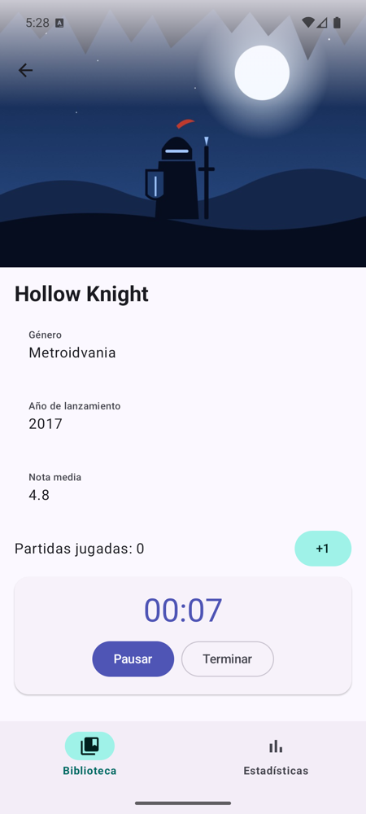
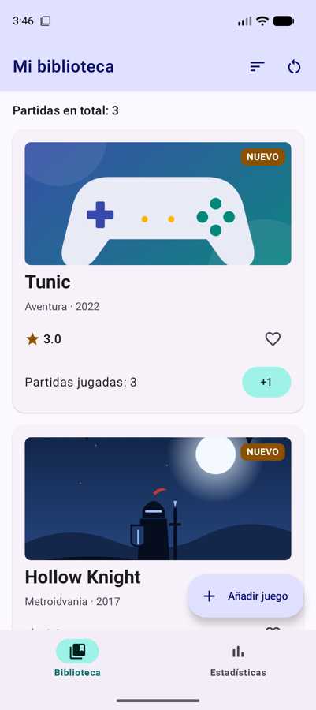
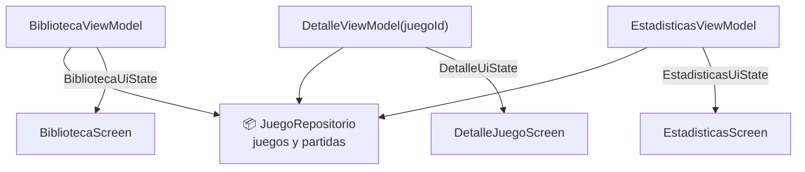

# **Sesión 3.07 · ViewModel y UiState (II)**

En la sesión anterior metimos todos los datos y toda la lógica en un único ViewModel. Funciona, pero con cada pantalla nueva ese ViewModel crecería sin parar. Hoy damos el paso que hacen las apps reales: **los datos van a un repositorio** compartido y **cada pantalla tiene su propio ViewModel**, que nace y muere con su entrada de la pila.

!!! abstract "Ficha de la sesión"

    - **Duración:** 2 h.
    - **Apuntes de referencia:** [3B.1 §8 Un ViewModel para cada pantalla](../b-navegacion/3b.1-navigation3.md#8-un-viewmodel-para-cada-pantalla) y [3C.2 §8-9 ViewModel que reciben sus dependencias](../c-arquitectura/3c.2-clean-architecture.md#8-paso-5-viewmodel-que-reciben-sus-dependencias).
    - **Proyecto de clase:** FichaJuego, de `s3.07-inicio` a `s3.07-fin` (ver [Guía de clases](./index.md#el-proyecto-de-clase-continua-fichajuego)).
    - **Necesitas:** el proyecto con la [sesión 3.06](./s06-tiempo-ciclo-vida.md) terminada (o el tag `s3.07-inicio`) y un emulador.

<figure style="text-align: center;">
  <div style="display: flex; gap: 16px; justify-content: center; flex-wrap: wrap;">
    
    
  </div>
  <figcaption>Lo que tendrás al terminar la clase: las partidas sumadas en el detalle aparecen al momento en la biblioteca, aunque cada pantalla tiene su propio ViewModel.</figcaption>
</figure>

---

## 🎯 Objetivos

Al terminar la clase sabrás:

- Separar los datos en un **repositorio**, la única fuente de verdad que comparten todas las pantallas.
- Crear **una sola instancia** del repositorio para toda la app en una clase `Application`.
- **Derivar** el estado de un ViewModel de los datos con `combine` y `stateIn`.
- Asociar un ViewModel a **su entrada de la pila** con el decorador de Navigation 3 y pasarle argumentos.
- Sacar los cálculos de una pantalla a su ViewModel.

---

## ✅ Antes de empezar

1. Sitúate en el punto de partida: `git checkout s3.07-inicio` (es el mismo código que `s3.06-fin`).

2. Ejecuta los tests con `./gradlew test` y comprueba que pasan los de `FichaJuegoViewModelTest` y `CronometroTest`.

---

## ⏱️ Agenda

| # | Min | Bloque | Apuntes |
| :---: | :---: | :--- | :--- |
| 0 | 5 | Arranque: un ViewModel para todo | — |
| 1 | 15 | El repositorio, la única fuente de verdad | [3C.2 §6](../c-arquitectura/3c.2-clean-architecture.md#6-paso-3-la-implementacion-en-memoria) |
| 2 | 10 | Una sola instancia para toda la app | [3C.2 §9](../c-arquitectura/3c.2-clean-architecture.md#9-paso-6-quien-crea-y-conecta-las-piezas) |
| 3 | 20 | El ViewModel de la biblioteca: estado derivado | [3C.2 §8.1](../c-arquitectura/3c.2-clean-architecture.md#81-el-catalogo) |
| 4 | 10 | Un ViewModel por entrada de la pila | [3B.1 §8](../b-navegacion/3b.1-navigation3.md#8-un-viewmodel-para-cada-pantalla) |
| 5 | 25 | El ViewModel del detalle, con argumento y cronómetro | [3C.2 §8.2](../c-arquitectura/3c.2-clean-architecture.md#82-el-detalle) |
| 6 | 15 | El ViewModel de las estadísticas | — |
| 7 ⏩ | 5 | Experimento: olvidar el decorador | [3B.1 §8](../b-navegacion/3b.1-navigation3.md#8-un-viewmodel-para-cada-pantalla) |
| 8 ⏩ | 10 | Test de un ViewModel con `stateIn` | [3C.4 §4](../c-arquitectura/3c.4-testing.md#4-probar-los-viewmodel) |
| 9 | 5 | Comprobación rápida y cierre | — |
| | **120** | | |

---

## 0 · Arranque: un ViewModel para todo (5 min)

Abre `FichaJuegoViewModel` y piensa qué pasaría al añadir más pantallas: búsqueda, favoritos, ajustes… Todas sus funciones irían a parar a esa misma clase. Además:

- **Estadísticas** sigue calculando la nota media y el más jugado **dentro del composable**, donde no se pueden probar con un test.
- El ViewModel vive mientras vive la Activity, aunque la pantalla que lo usa ya no esté en la pila.

La solución tiene dos piezas: los datos a un **repositorio** y un **ViewModel por pantalla** que solo prepara lo que su pantalla necesita.



---

## 1 · El repositorio, la única fuente de verdad (15 min)

- El **repositorio** guarda los datos y las operaciones que los cambian. No sabe nada de pantallas ni de Android.
- Expone los datos como `StateFlow`: así, cuando una pantalla cambia algo, **todas** las que lo observan se enteran. → [3C.2 §6](../c-arquitectura/3c.2-clean-architecture.md#6-paso-3-la-implementacion-en-memoria)

!!! example "Manos a la obra"

    1. Crea el paquete `data` y, dentro, `JuegoRepositorio.kt` con dos flujos:

        ```kotlin
        class JuegoRepositorio {

            private val _juegos = MutableStateFlow(catalogo)
            val juegos: StateFlow<List<Juego>> = _juegos.asStateFlow()

            private val _partidas = MutableStateFlow(emptyMap<Int, Int>())
            val partidas: StateFlow<Map<Int, Int>> = _partidas.asStateFlow()
        }
        ```

    2. Añade las tres operaciones. Son la lógica de los eventos de `FichaJuegoViewModel`, adaptada a los dos flujos:

        ```kotlin
        fun sumarPartida(juegoId: Int) {
            _partidas.update { it + (juegoId to (it[juegoId] ?: 0) + 1) }
        }

        fun reiniciarPartidas() {
            _partidas.value = emptyMap()
        }
        ```

        Y `anadirJuego(titulo, genero, anio, nota)`, que crea el `Juego` como antes y hace `_juegos.update { juegos -> listOf(nuevo) + juegos }`.

    3. Mueve el test: renombra `FichaJuegoViewModelTest` a `data/JuegoRepositorioTest` y cambia cada `FichaJuegoViewModel()` por `JuegoRepositorio()`. Las comprobaciones leen ahora `repositorio.juegos.value` y `repositorio.partidas.value`. Ejecútalo: la lógica es la misma, solo ha cambiado de sitio.

---

## 2 · Una sola instancia para toda la app (10 min)

- Si cada ViewModel creara su propio `JuegoRepositorio()`, cada pantalla tendría **sus propios datos**: sumarías una partida en el detalle y la biblioteca no se enteraría.
- Hace falta **una única instancia** que viva mientras viva la app. El sitio es una clase `Application` propia: Android la crea al arrancar, antes que cualquier Activity, y no se destruye al girar. → [3C.2 §9](../c-arquitectura/3c.2-clean-architecture.md#9-paso-6-quien-crea-y-conecta-las-piezas)

!!! example "Manos a la obra"

    1. Crea `FichaJuegoApplication.kt` junto a `MainActivity`:

        ```kotlin
        class FichaJuegoApplication : Application() {
            val repositorio = JuegoRepositorio()
        }
        ```

    2. Regístrala en `AndroidManifest.xml`, en la etiqueta `<application>`:

        ```xml
        <application
            android:name=".FichaJuegoApplication"
            android:allowBackup="true"
            ... >
        ```

    3. En `FichaJuegoApp`, quita el parámetro `viewModel` y obtén el repositorio al principio:

        ```kotlin
        val repositorio = (LocalContext.current.applicationContext as FichaJuegoApplication).repositorio
        ```

!!! warning "Si olvidas el manifest"
    Sin `android:name`, Android crea una `Application` normal y el `as FichaJuegoApplication` falla al arrancar con una `ClassCastException`. Si la app se cierra nada más abrirla, mira el Logcat.

Crear las piezas a mano funciona, pero cuando haya muchas será tedioso. Eso es lo que automatiza **Koin**. → [3C.3](../c-arquitectura/3c.3-inyeccion-dependencias-koin.md)

---

## 3 · El ViewModel de la biblioteca: estado derivado (20 min)

- El ViewModel **ya no guarda los datos**: recibe el repositorio por el constructor y **deriva** su estado de él.
- `combine(a, b) { … }` mezcla dos flujos: cada vez que cambia cualquiera, recalcula el estado.
- `stateIn(…)` convierte el resultado en el `StateFlow` que observa la pantalla. → [3C.2 §8.1](../c-arquitectura/3c.2-clean-architecture.md#81-el-catalogo)
- Los eventos ya no tocan el estado: **piden el cambio al repositorio**, y el estado se actualiza solo porque lo está observando.

!!! example "Manos a la obra"

    1. Crea `ui/biblioteca/BibliotecaViewModel.kt` con su estado y el ViewModel:

        ```kotlin
        data class BibliotecaUiState(
            val juegos: List<Juego> = emptyList(),
            val partidas: Map<Int, Int> = emptyMap()
        )

        class BibliotecaViewModel(
            private val repositorio: JuegoRepositorio
        ) : ViewModel() {

            val uiState: StateFlow<BibliotecaUiState> =
                combine(repositorio.juegos, repositorio.partidas) { juegos, partidas ->
                    BibliotecaUiState(juegos = juegos, partidas = partidas)
                }.stateIn(
                    scope = viewModelScope,
                    started = SharingStarted.WhileSubscribed(5_000),
                    initialValue = BibliotecaUiState(repositorio.juegos.value, repositorio.partidas.value)
                )

            fun onSumarPartida(juegoId: Int) = repositorio.sumarPartida(juegoId)

            fun onReiniciarPartidas() = repositorio.reiniciarPartidas()

            fun onAnadirJuego(titulo: String, genero: String, anio: Int, nota: Double) =
                repositorio.anadirJuego(titulo, genero, anio, nota)
        }
        ```

    2. Fíjate en los tres argumentos de `stateIn`:

        - `viewModelScope`: el flujo se cancela cuando se destruye el ViewModel.
        - `WhileSubscribed(5_000)`: deja de escuchar 5 segundos después de que la pantalla deje de observarlo, pero no durante una rotación, que dura menos.
        - `initialValue`: el estado mientras llega el primer valor. Usamos los datos actuales del repositorio para no pintar una lista vacía ni un instante.

    3. Borra `FichaJuegoViewModel.kt` y `FichaJuegoUiState.kt`. El proyecto dejará de compilar en `FichaJuegoApp`: lo arreglamos en los bloques siguientes. El cronómetro vuelve en el bloque 5; si lo necesitas, su código sigue en el tag `s3.06-fin`.

---

## 4 · Un ViewModel por entrada de la pila (10 min)

- Queremos que cada ViewModel **se cree al entrar** en su pantalla y **se destruya al sacarla** de la pila. Navigation 3 lo hace con un segundo **decorador de entrada**. → [3B.1 §8](../b-navegacion/3b.1-navigation3.md#8-un-viewmodel-para-cada-pantalla)
- `viewModel { … }` recibe una lambda que sabe **cómo crear** el ViewModel: la primera vez la ejecuta y, después, devuelve siempre el mismo.

!!! example "Manos a la obra"

    1. Añade la librería en `libs.versions.toml`, con la misma versión que el resto de `lifecycle`, y en `app/build.gradle.kts`:

        ```toml
        androidx-lifecycle-viewmodel-navigation3 = { group = "androidx.lifecycle", name = "lifecycle-viewmodel-navigation3", version.ref = "lifecycleRuntimeKtx" }
        ```

        ```kotlin
        implementation(libs.androidx.lifecycle.viewmodel.navigation3)
        ```

    2. En `FichaJuegoApp`, añade el decorador a la lista de cada pila, **después** del de `rememberSaveable`:

        ```kotlin
        entryDecorators = listOf(
            rememberSaveableStateHolderNavEntryDecorator(),
            rememberViewModelStoreNavEntryDecorator()
        ),
        ```

    3. En `entry<Biblioteca>`, crea su ViewModel y observa su estado. El resto de la llamada a `BibliotecaScreen` queda igual que en la sesión anterior:

        ```kotlin
        entry<Biblioteca> {
            val viewModel = viewModel { BibliotecaViewModel(repositorio) }
            val estado by viewModel.uiState.collectAsStateWithLifecycle()
            BibliotecaScreen(
                juegos = estado.juegos,
                partidas = estado.partidas,
                onSumarPartida = viewModel::onSumarPartida,
                // …
        ```

---

## 5 · El ViewModel del detalle, con argumento y cronómetro (25 min)

- El detalle necesita saber **qué juego** mostrar: el id llega en la clave de la pila y se pasa al **constructor** del ViewModel. → [3C.2 §8.2](../c-arquitectura/3c.2-clean-architecture.md#82-el-detalle)
- Gracias al decorador, cada `DetalleJuego` de la pila tiene **su propia instancia**.

!!! example "Manos a la obra"

    1. Crea `ui/detalle/DetalleViewModel.kt`:

        ```kotlin
        data class DetalleUiState(
            val juego: Juego? = null,
            val partidas: Int = 0,
            val cronometro: Cronometro = Cronometro()
        )

        class DetalleViewModel(
            private val juegoId: Int,
            private val repositorio: JuegoRepositorio
        ) : ViewModel() {

            // El cronómetro es de esta pantalla, no un dato compartido: no va en el repositorio
            private val _cronometro = MutableStateFlow(Cronometro())

            val uiState: StateFlow<DetalleUiState> =
                combine(repositorio.juegos, repositorio.partidas, _cronometro) { juegos, partidas, cronometro ->
                    DetalleUiState(
                        juego = juegos.find { it.id == juegoId },
                        partidas = partidas[juegoId] ?: 0,
                        cronometro = cronometro
                    )
                }.stateIn(
                    scope = viewModelScope,
                    started = SharingStarted.WhileSubscribed(5_000),
                    initialValue = DetalleUiState(
                        juego = repositorio.juegos.value.find { it.id == juegoId },
                        partidas = repositorio.partidas.value[juegoId] ?: 0
                    )
                )

            fun onSumarPartida() = repositorio.sumarPartida(juegoId)
        }
        ```

        El evento ya no necesita el id: el ViewModel sabe de qué juego es. Y el valor inicial vuelve a salir del repositorio: con `DetalleUiState()`, el primer instante se vería «Juego no encontrado».

    2. Mueve aquí el cronómetro de la [sesión 3.06](./s06-tiempo-ciclo-vida.md) (`Cronometro`, el `Job` y sus eventos), que ya no cabía en un ViewModel global. Cambia dos cosas: cada detalle tiene su propio cronómetro, así que `Cronometro` **ya no necesita `juegoId`**, y los cambios se hacen con `_cronometro.update { … }`. Quita también `juegoId` y `otroJuegoEnCurso` de `TarjetaCronometro`. El código completo está en el [tag `s3.07-fin`](https://github.com/jssdocente/pmdm2627-fichajuego/blob/s3.07-fin/app/src/main/java/com/pmdm/fichajuego/ui/detalle/DetalleViewModel.kt).

    3. En `entry<DetalleJuego>`, créalo con el id de la clave. El efecto del ciclo de vida se muda también aquí desde el principio de `FichaJuegoApp`:

        ```kotlin
        entry<DetalleJuego> { clave ->
            val viewModel = viewModel { DetalleViewModel(clave.juegoId, repositorio) }
            val estado by viewModel.uiState.collectAsStateWithLifecycle()
            LifecycleResumeEffect(viewModel) {
                viewModel.onVolverALaApp()
                onPauseOrDispose { viewModel.onSalirDeLaApp() }
            }
            DetalleJuegoScreen(
                juego = estado.juego,
                partidas = estado.partidas,
                cronometro = estado.cronometro,
                onSumarPartida = viewModel::onSumarPartida,
                onEmpezar = viewModel::onEmpezar,
                onPausar = viewModel::onPausar,
                onTerminar = viewModel::onTerminar,
                onVolver = ::volver
            )
        }
        ```

    4. Prueba: abre un juego, súmale tres partidas desde el detalle y vuelve. La biblioteca muestra las tres, aunque son ViewModels distintos: **los dos observan el mismo repositorio**.

    5. Abre Hollow Knight, vuelve y abre Stardew Valley: cada detalle muestra su juego.

    6. Empieza a jugar a uno y pulsa atrás: **el cronómetro se ha parado**. Al sacar la entrada de la pila se destruye su ViewModel y `viewModelScope` cancela la corrutina.

    7. Mueve `CronometroTest` a `ui/detalle/DetalleViewModelTest` ([tag `s3.07-fin`](https://github.com/jssdocente/pmdm2627-fichajuego/blob/s3.07-fin/app/src/test/java/com/pmdm/fichajuego/ui/detalle/DetalleViewModelTest.kt)). Como `uiState` usa `WhileSubscribed`, ahora el test necesita un suscriptor: lo verás en el bloque 8.

---

## 6 · El ViewModel de las estadísticas (15 min)

Los cálculos de `EstadisticasScreen` se mudan a su ViewModel. La pantalla se queda **solo pintando** un estado ya calculado.

!!! example "Manos a la obra"

    1. Crea `ui/estadisticas/EstadisticasViewModel.kt` con el estado ya calculado:

        ```kotlin
        data class EstadisticasUiState(
            val totalPartidas: Int = 0,
            val numeroJuegos: Int = 0,
            val notaMedia: Double = 0.0,
            val masJugado: Juego? = null,
            val partidasMasJugado: Int = 0
        )
        ```

    2. Escribe una función `calcularEstadisticas(juegos: List<Juego>, partidas: Map<Int, Int>): EstadisticasUiState` con los cálculos que hoy están al principio de `EstadisticasScreen`, y úsala en el ViewModel:

        ```kotlin
        class EstadisticasViewModel(repositorio: JuegoRepositorio) : ViewModel() {

            val uiState: StateFlow<EstadisticasUiState> =
                combine(repositorio.juegos, repositorio.partidas, ::calcularEstadisticas)
                    .stateIn(
                        scope = viewModelScope,
                        started = SharingStarted.WhileSubscribed(5_000),
                        initialValue = calcularEstadisticas(repositorio.juegos.value, repositorio.partidas.value)
                    )
        }
        ```

        `::calcularEstadisticas` es una referencia a función: `combine` la llama con los dos valores, igual que si fuera una lambda.

    3. Cambia la firma de la pantalla a `EstadisticasScreen(estado: EstadisticasUiState, onJuegoClick: (Int) -> Unit, modifier: Modifier = Modifier)`, borra sus cálculos y usa `estado.totalPartidas`, `estado.notaMedia`… Actualiza su `@Preview` con un `EstadisticasUiState` inventado.

    4. Crea el ViewModel en `entry<Estadisticas>` y comprueba que la pestaña muestra lo mismo que antes.

---

## 7 ⏩ · Experimento: olvidar el decorador (5 min)

!!! example "Manos a la obra"

    1. Comenta `rememberViewModelStoreNavEntryDecorator()` y ejecuta.

    2. Abre Hollow Knight, vuelve y abre Stardew Valley. **Sigue apareciendo Hollow Knight.**

    3. Vuelve a dejar el decorador.

Sin el decorador, los ViewModel se guardan en la Activity: `viewModel { }` encuentra el `DetalleViewModel` que ya existía y lo devuelve, sin ejecutar la lambda con el nuevo id. Es **el error clásico** de los apuntes. → [3B.1 §8](../b-navegacion/3b.1-navigation3.md#8-un-viewmodel-para-cada-pantalla)

---

## 8 ⏩ · Test de un ViewModel con `stateIn` (10 min)

Los ViewModel de hoy usan `viewModelScope`, que trabaja en el hilo principal de Android. En un test local no existe, así que hace falta algo de preparación. → [3C.4 §4.1](../c-arquitectura/3c.4-testing.md#41-el-problema-del-hilo-principal)

!!! example "Manos a la obra"

    1. Ya tienes `kotlinx-coroutines-test` y la regla `MainDispatcherRule` de la [sesión 3.06](./s06-tiempo-ciclo-vida.md).

    2. Escribe el test en `ui/EstadisticasViewModelTest.kt`:

        ```kotlin
        class EstadisticasViewModelTest {

            @get:Rule
            val mainDispatcherRule = MainDispatcherRule()

            @Test
            fun `el mas jugado se actualiza al sumar partidas`() = runTest {
                val repositorio = JuegoRepositorio()
                val viewModel = EstadisticasViewModel(repositorio)
                backgroundScope.launch(UnconfinedTestDispatcher(testScheduler)) { viewModel.uiState.collect {} }

                repositorio.sumarPartida(juegoId = 4)
                repositorio.sumarPartida(juegoId = 4)
                repositorio.sumarPartida(juegoId = 1)

                val estado = viewModel.uiState.value
                assertEquals(3, estado.totalPartidas)
                assertEquals("Hades", estado.masJugado?.titulo)
                assertEquals(2, estado.partidasMasJugado)
            }
        }
        ```

    3. Comenta la línea del `backgroundScope.launch` y vuelve a ejecutarlo: falla con `expected:<3> but was:<0>`. Con `WhileSubscribed`, si nadie observa el flujo, el estado se queda en el valor inicial. → [3C.4 §4.2](../c-arquitectura/3c.4-testing.md#42-activar-un-stateflow-creado-con-statein)

---

## 🧪 Comprobación rápida

1. ¿Por qué el repositorio se crea en `FichaJuegoApplication` y no dentro de cada ViewModel?

    ??? success "Respuesta"
        Para que haya una sola instancia. Si cada ViewModel creara la suya, cada pantalla tendría sus propios datos y los cambios de una no llegarían a las demás.

2. Sumas una partida en el detalle. ¿Cómo se entera la biblioteca, si tiene otro ViewModel?

    ??? success "Respuesta"
        El detalle pide el cambio al repositorio. El estado de la biblioteca se deriva de los flujos del repositorio con `combine`, así que se recalcula solo.

3. ¿Qué hace `rememberViewModelStoreNavEntryDecorator()` y qué pasa si lo olvidas?

    ??? success "Respuesta"
        Da a cada entrada de la pila su propio almacén de ViewModels, que se vacía al sacarla. Sin él, los ViewModel van a la Activity: no se destruyen al salir y todos los detalles comparten el mismo.

4. ¿Qué ganamos al sacar los cálculos de `EstadisticasScreen` a su ViewModel?

    ??? success "Respuesta"
        La pantalla solo pinta, así que su `@Preview` recibe un estado inventado sin calcular nada. Y los cálculos se pueden probar con un test, sin emulador.

---

## 🏠 Para casa

- Termina los bloques 7 y 8 si no dio tiempo en clase.
- Retos del laboratorio: [El Ahorcado y Wordle](../3.6-laboratorio-retos.md#4-retos-autonomos), dos juegos completos con `UiState` y ViewModel.
- Lee [3C.2](../c-arquitectura/3c.2-clean-architecture.md) hasta el §9: verás estas mismas piezas con un contrato de repositorio y casos de uso.
- Si faltaste a clase: `git checkout s3.07-fin` y repasa `data/JuegoRepositorio.kt`, `FichaJuegoApplication.kt`, los tres ViewModel y `navegacion/FichaJuegoApp.kt`.

---

## ➡️ Para seguir

FichaJuego ya tiene la estructura de una app real: pantallas que solo pintan, un ViewModel por pantalla y los datos en un repositorio. Para repasar la UT3, vuelve a los retos de [3B.1 §14](../b-navegacion/3b.1-navigation3.md#14-retos), en especial el avanzado, *detalle con ViewModel y favoritos*.
