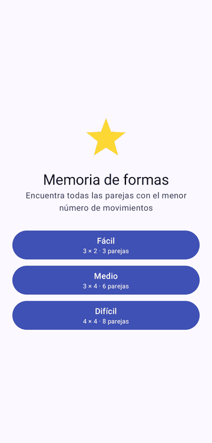
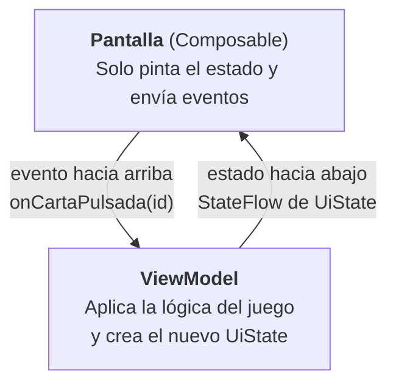

# **Guía del proyecto de la 1ª evaluación: juego de memoria por niveles**

Vas a programar en Android, con **Kotlin** y **Jetpack Compose**, un **juego de memoria**: un tablero de cartas boca abajo en el que hay que encontrar las parejas volteándolas de dos en dos. Esta página te dice **qué tiene que hacer tu proyecto**, qué es obligatorio, qué es opcional, cómo se entrega y cómo se evalúa.

!!! info "Lo esencial en cinco líneas"
    - **Empiezas descargando la [plantilla](#plantilla-readme)**, que ya trae el proyecto preparado y el README que tienes que rellenar.
    - El proyecto es **el mismo para toda la clase**. Lo único que eliges tú es la **temática de las cartas**.
    - Hay unos **mínimos obligatorios** (funcionalidad, estructura y dos investigaciones) y unas **mejoras opcionales** que suben la nota.
    - Se entrega **generando un `.zip`** con tu proyecto y un **README** que sigue la plantilla.
    - Después hay un **examen práctico sobre tu propio proyecto** y una **defensa escrita sobre tu propio código**: tienes que entender cada línea de lo que entregas.

| Parte | Peso | En una frase |
| :--- | :---: | :--- |
| Proyecto entregado | 40 % | Que cumpla los mínimos y esté bien construido |
| Examen práctico | 40 % | Modificar y ampliar **tu** proyecto |
| Defensa escrita | 20 % | Explicar **tu** código, señalando ficheros y funciones |

---

## 1. La plantilla del proyecto y el README {#plantilla-readme}

No tendrás que empezar de cero. Hay un **proyecto plantilla** con el paquete ya creado (`com.pm2627.p1ev.memory`), las dependencias necesarias y un **README normalizado**, con los apartados ya preparados para que los rellenes.

!!! info "Descarga la plantilla"
    [**pmdm2627_1eval_proyecto** en GitHub](https://github.com/jssdocente/pmdm2627_1eval_proyecto): clónala o descárgala con *Code → Download ZIP* y trabaja sobre tu copia.

    Dentro tienes una carpeta `ayuda/` con tres páginas:

    - [**README de ejemplo**](https://github.com/jssdocente/pmdm2627_1eval_proyecto/blob/main/ayuda/README-ejemplo.md): cómo se debe estructurar y rellenar el README. Está hecho para un proyecto **simulado** (otro juego), para que veas qué nivel de detalle se espera en cada apartado. No lo copies: tu README tiene que explicar **tu** proyecto.

    - [**Pistas**](https://github.com/jssdocente/pmdm2627_1eval_proyecto/blob/main/ayuda/pistas.md): la tabla de [claves del proyecto](#claves), para tenerla junto al código.

    - [**Preparar el entorno**](https://github.com/jssdocente/pmdm2627_1eval_proyecto/blob/main/ayuda/preparar-entorno.md): IDE, SDK, JDK y errores frecuentes al abrir y compilar.

El README no es un trámite: es donde **explicas tu proyecto**, y te servirá para prepararte el examen y la defensa. Sus apartados son estos:

1. **Datos del proyecto**: título y autoría.

2. **Temática y fuente de las imágenes**: qué temática has elegido y, para cada imagen, quién la ha hecho o de dónde sale y con qué licencia.

3. **Captura o GIF** de tu juego funcionando.

4. **Cómo compilar y ejecutar**, y cómo lanzar los tests.

5. **Organización y estructura del proyecto**. Es el apartado más importante, y tiene cuatro partes:

    - **Paquetes:** el árbol de paquetes de tu proyecto y para qué sirve cada uno.

    - **Ficheros importantes:** una tabla con qué hace cada fichero relevante (por ejemplo, dónde está el `UiState`, dónde está la lógica, dónde está la navegación).

    - **Cómo fluye un evento:** el recorrido completo desde que el usuario pulsa algo hasta que la pantalla se vuelve a dibujar, nombrando **tus** funciones.

    - **Decisiones de diseño:** qué has decidido y por qué.

6. **Mejoras opcionales** que incluyes, cada una con su API, su fichero y función, y el enlace a la documentación.

7. **Limitaciones conocidas**: lo que no funciona o lo que mejorarías.

!!! tip "Rellénalo mientras programas"
    Si lo escribes al terminar, se te olvidarán las decisiones. Si lo vas completando por el camino, el apartado de organización y estructura queda casi hecho, y será tu **mapa del proyecto**.

---

## 2. Qué vas a construir {#que-construir}

Un juego de parejas con varios niveles de dificultad y tres pantallas. El jugador elige un nivel, destapa cartas de dos en dos y gana cuando encuentra todas las parejas. Al ganar ve cuántos movimientos y cuánto tiempo ha tardado.



*Ejemplo de referencia: menú de niveles, volteo animado, un fallo que se vuelve a ocultar, parejas encontradas y pantalla de victoria. **Tu versión puede tener otro aspecto**: lo que se pide es el comportamiento, no que sea idéntica.*

### La temática es libre

Eliges tú qué hay en las cartas: animales, banderas, planetas, frutas, personajes que dibujes tú…

!!! warning "Imágenes: propias o con licencia libre"
    - Las imágenes van en `res/drawable` y deben ser **propias** o con **licencia libre**.
    - Indica **la fuente de cada una** en el README (autoría y licencia).
    - **No uses** portadas, logotipos, personajes ni nada con derechos de terceros.

Si no quieres depender de imágenes, también valen vectores dibujados por ti, símbolos o emojis, siempre que sean tuyos o de uso libre. Cómo se usan los recursos en Compose está en [2.3.2 · Imágenes, iconos y recursos](../02/2.3.2-imagenes-iconos-recursos.md).

---

## 3. Mínimos de funcionalidad {#minimos-funcionalidad}

Todo lo de esta sección es **obligatorio**. Sin ello, el proyecto no se considera completo.

### 3.1. El juego

| Requisito | Qué significa en la práctica |
| :--- | :--- |
| **Al menos 3 niveles** | De tamaño creciente, por ejemplo 3 × 2, 3 × 4 y 4 × 4. Cada nivel tiene su tablero y su número de parejas |
| **Contador de movimientos** | Cada vez que se voltean dos cartas, cuenta **un** movimiento (no uno por carta). Es visible durante la partida |
| **Contador de parejas** | Cuántas parejas llevas encontradas, también visible durante la partida |
| **Cartas barajadas** | Cada partida reparte las cartas en un orden distinto |
| **Retardo de fallo con tablero bloqueado** | Si las dos cartas no son pareja, se muestran un momento y vuelven a ocultarse. **Mientras tanto no se puede pulsar ninguna otra carta** |
| **Cartas ya descubiertas** | Pulsar una carta que ya está boca arriba o ya emparejada no hace nada ni rompe la partida |
| **Victoria** | Al encontrar la última pareja, el tiempo se detiene y se pasa a la pantalla de resultado |

Pistas para cada requisito, en [Cómo afrontarlo: las claves del proyecto](#claves).

### 3.2. Tiempo y ciclo de vida

- Hay un **temporizador** que cuenta los segundos de la partida y se ve en el tablero.

- Si el usuario pulsa el botón de inicio del móvil, **el tiempo se detiene**, y **continúa** al volver. Se hace con `LifecycleResumeEffect`.

- Al **girar el móvil**, la partida sigue igual: las mismas cartas, los mismos contadores y el mismo tiempo.

Pistas para resolverlo, en [Cómo afrontarlo: las claves del proyecto](#claves).

### 3.3. Tres pantallas con Navigation 3

| Pantalla | Qué hace |
| :--- | :--- |
| **Inicio** | Muestra los niveles y deja elegir uno |
| **Tablero** | Es la partida |
| **Resultado** | Pantalla de victoria con los **movimientos** y el **tiempo** |

Las tres se conectan con **Navigation 3**. Dos cosas que se comprueban:

- **A cada destino solo le pasas datos sencillos** (el nivel, un número de movimientos, los segundos), no objetos enteros del juego.

- Piensa **a dónde debe llevar el botón atrás en cada pantalla**: tiene que tener sentido para quien juega.

Cómo se hace, en [3B.1 · Navegación con Navigation 3](../03/b-navegacion/3b.1-navigation3.md): la [pila de pantallas](../03/b-navegacion/3b.1-navigation3.md#1-la-idea-una-pila-de-pantallas), los [destinos](../03/b-navegacion/3b.1-navigation3.md#3-paso-1-definir-los-destinos) y [un ViewModel para cada pantalla](../03/b-navegacion/3b.1-navigation3.md#8-un-viewmodel-para-cada-pantalla).

---

## 4. Mínimos de estructura y arquitectura {#minimos-estructura}

Importa tanto **cómo** está hecho como que funcione. Estos requisitos son obligatorios:

1. **Un `ViewModel` por partida**, con un **`UiState` inmutable** expuesto como **`StateFlow`**.

2. **La pantalla solo pinta el estado y envía eventos.** Ejemplo de evento: «se ha pulsado la carta 7». La pantalla no decide si dos cartas son pareja, ni si se ha ganado, ni cuántos movimientos lleva.

3. **La lógica del juego vive en el ViewModel.** Es lo que decide qué pasa cuando se pulsa una carta: si hay pareja, si se ha ganado, cuántos movimientos lleva, cuándo se bloquea el tablero. También se llaman «las reglas del juego». Todo lo que se pueda comprobar sin pantalla está ahí.

4. **El estado de cada carta está en el `UiState`**, no en un `remember` de la pantalla ni dentro de una animación.

5. **Tests unitarios del ViewModel** que comprueben, como mínimo: **emparejar** dos cartas, **fallar** y **ganar** la partida.

### El flujo de datos: los eventos suben, el estado baja

Este es el esquema que tiene que seguir tu proyecto. Es el **flujo de datos unidireccional** ([UDF](../glosario.md#udf)):



Si tu pantalla modifica una carta directamente, o el ViewModel no es quien decide, el flujo está roto. Está explicado en [3C.1 · Capa de interfaz: ViewModel, UiState y UDF](../03/c-arquitectura/3c.1-capa-ui-viewmodel.md): el [modelado inmutable del estado](../03/c-arquitectura/3c.1-capa-ui-viewmodel.md#2-modelado-inmutable-del-estado-uistate) y [`StateFlow` y UDF](../03/c-arquitectura/3c.1-capa-ui-viewmodel.md#3-reactividad-con-stateflow-y-el-patron-udf).

### Organización de paquetes recomendada

!!! note "Es un ejemplo"
    Los nombres de abajo son **orientativos**. El proyecto de partida ya trae su paquete creado: respeta el que te den y organiza lo que haya dentro con una estructura clara como esta.

```text
app/src/main/java/<tu.paquete>/
├── MainActivity.kt
├── model/                  ← lo que es el juego (cartas, niveles)
├── navegacion/             ← destinos y pila de Navigation 3
└── ui/
    ├── inicio/             ← pantalla de elección de nivel
    ├── tablero/            ← pantalla, ViewModel y UiState de la partida
    ├── resultado/          ← pantalla de victoria
    └── theme/              ← colores, tipografía y tema

app/src/test/java/<tu.paquete>/
└── ui/tablero/             ← tests del ViewModel
```

Lo importante no es copiar estos nombres, sino que **se pueda saber dónde está cada cosa**: el estado, la lógica, la navegación y la pantalla no pueden estar mezclados en un solo fichero.

### Tests del ViewModel

Un test comprueba una parte de la lógica: das un estado de partida, lanzas un evento y compruebas el estado resultante. Para que sean fáciles de escribir:

- Deja que el ViewModel **reciba como parámetro** lo que cuesta probar (cómo se barajan las cartas, cuánto dura el retardo de fallo).

- Usa `runTest` y el reloj virtual para no esperar tiempo real: [3C.1 · Probar el tiempo sin esperar](../03/c-arquitectura/3c.1-capa-ui-viewmodel.md#54-probar-el-tiempo-sin-esperar) y [3C.4 · Probar los ViewModel](../03/c-arquitectura/3c.4-testing.md#4-probar-los-viewmodel).

!!! warning "Un test con temporizador debe pararlo"
    Si un test arranca el temporizador (un bucle que no acaba) y no lo para al terminar, `runTest` se queda esperando y el test **se cuelga**. Para el temporizador siempre dentro de un `try … finally`.

---

## 5. Cómo afrontarlo: las claves del proyecto {#claves}

Antes de escribir código, conviene saber **qué decisiones** tendrás que tomar. Esta tabla no te da la solución: te dice **qué preguntarte** en cada parte y **dónde mirar**. Las respuestas, y su justificación, las tienes que poner tú.

| Clave | Preguntas que te tienes que hacer | Dónde mirar |
| :--- | :--- | :--- |
| **Qué es una carta** | ¿Qué datos necesita una carta para que el estado diga *todo* lo que se pinta? ¿Cómo sabes qué dos cartas son pareja? ¿Cuántos estados distintos puede tener una carta: dos o más? | [3C.1 · Estado inmutable](../03/c-arquitectura/3c.1-capa-ui-viewmodel.md#2-modelado-inmutable-del-estado-uistate), [`data class`](../00-android/00-kotlin/23-data-classes.md), [`enum class`](../00-android/00-kotlin/24-enum-classes.md) |
| **Dónde guardas el tablero** | ¿Qué estructura guarda todas las cartas de un nivel: una lista plana, una lista de filas…? ¿Cómo localizas la carta pulsada? Si la lista no se puede modificar, ¿cómo cambias **solo** esa carta y generas un tablero nuevo? | [Listas en Kotlin](../00-android/00-kotlin/42-listas.md#3-inmutabilidad-y-adicion-funcional-de-elementos), [`copy()`](../00-android/00-kotlin/23-data-classes.md#3-el-metodo-copy-y-la-inmutabilidad), [Inmutabilidad](../glosario.md#inmutabilidad) |
| **Niveles** | ¿El tamaño del tablero y el número de parejas son datos del nivel o están repartidos por el código? ¿Qué pasa si mañana hay que añadir un cuarto nivel? | [`enum class` con propiedades](../00-android/00-kotlin/24-enum-classes.md#2-enums-con-propiedades-y-metodos), glosario: [`enum class`](../glosario.md#enum-class) |
| **Repartir y barajar** | ¿Cómo consigues dos cartas iguales por pareja? ¿Cómo cambias el orden en cada partida? ¿Cómo harías que el orden sea **fijo en un test**? | Kotlin: [listas](../00-android/00-kotlin/42-listas.md#4-operaciones-funcionales-imprescindibles). Glosario: [`shuffled`](../glosario.md#shuffled) y [`Random` con semilla](../glosario.md#random-semilla). Oficial: [`shuffled`](https://kotlinlang.org/api/core/kotlin-stdlib/kotlin.collections/shuffled.html) |
| **Dibujar el tablero** | ¿Qué contenedor coloca las cartas en filas y columnas? ¿Cómo sabe Compose qué carta es cuál cuando el estado cambia? | [3A.3 · Tablero de cartas en cuadrícula](../03/a-diseno/3a.3-listas-cuadriculas.md#42-ejemplo-tablero-de-cartas-en-cuadricula), [`key`](../03/a-diseno/3a.3-listas-cuadriculas.md#3-la-clave-del-rendimiento-asignacion-de-key). Oficial: [listas y cuadrículas en Compose](https://developer.android.com/develop/ui/compose/lists) |
| **Imágenes de las cartas** | ¿Dónde se guardan las imágenes dentro del proyecto? ¿Cómo las pintas desde el código? ¿Qué datos de la carta bastan para saber qué imagen le toca? | [UT2 · Mostrar imágenes con `Image`](../02/2.3.2-imagenes-iconos-recursos.md#3-mostrar-imagenes-con-image), [Codelab 3.07 · Las imágenes](../03/codelabs/07-ficha-heroe-recursos.md#3-paso-1-las-imagenes), glosario: [`painterResource`](../glosario.md#painter-resource) |
| **Qué pasa al pulsar** | Piensa los casos uno a uno: ¿carta ya boca arriba?, ¿ya emparejada?, ¿es la primera del par?, ¿es la segunda?, ¿tablero bloqueado? ¿En qué orden los compruebas? | [3C.1 · Implementación del ViewModel](../03/c-arquitectura/3c.1-capa-ui-viewmodel.md#31-implementacion-del-viewmodel), glosario: [`when`](../glosario.md#when) |
| **Contar movimientos y parejas** | ¿En qué momento exacto cuenta un movimiento? ¿Guardas las parejas en un contador o se pueden calcular a partir de las cartas? | Es lógica tuya, y se comprueba en los tests |
| **Bloquear el tablero** | ¿Dónde vive el bloqueo? ¿Quién lo activa y quién lo desactiva? ¿Qué debe ignorar la lógica mientras está activo? | [3C.1 · Una espera con bloqueo](../03/c-arquitectura/3c.1-capa-ui-viewmodel.md#52-una-espera-con-bloqueo) |
| **Que el giro no rompa la partida** | ¿Dónde está el estado de la partida para que sobreviva al giro del móvil? ¿Qué pasaría con un `remember`? | [3C.1 · Supervivencia ante cambios de configuración](../03/c-arquitectura/3c.1-capa-ui-viewmodel.md#11-supervivencia-ante-cambios-de-configuracion), glosario: [Cambio de configuración](../glosario.md#cambio-de-configuracion) |
| **Tiempo, pausa y animación** | Son las dos investigaciones de la sección siguiente | [Volteo animado](#investigacion-volteo) y [Temporizador, retardo y pausa](#investigacion-temporizador) |
| **Navegación entre pantallas** | ¿Qué datos mínimos necesita cada destino? ¿A dónde debe llevar el botón atrás? | [3B.1 · Navigation 3](../03/b-navegacion/3b.1-navigation3.md), [Codelab 3.05](../03/codelabs/05-navegacion-navigation3.md) |
| **Probar la lógica** | ¿Qué estado de partida preparas, qué evento lanzas y qué estado esperas? ¿Qué parámetro del ViewModel te permite controlar el azar y el tiempo? | [3C.1 · Probar el tiempo sin esperar](../03/c-arquitectura/3c.1-capa-ui-viewmodel.md#54-probar-el-tiempo-sin-esperar), [3C.4 · Probar los ViewModel](../03/c-arquitectura/3c.4-testing.md#4-probar-los-viewmodel) |

!!! warning "Consulta la documentación ahora"
    En el examen y en la defensa **no tendrás internet**. Los enlaces a la documentación oficial son para que los uses **mientras programas**: lo que aprendas de ellos, tienes que poder explicarlo sin mirarlos.

### Un orden de trabajo que funciona

1. **Modelo y niveles:** cómo es una carta, cómo es un nivel y qué guarda el `UiState`.

2. **ViewModel con la lógica del juego, y sus tests,** antes de dibujar nada. Si la lógica funciona en un test, la pantalla es solo pintarlas.

3. **Tablero estático:** la cuadrícula con las cartas, sin animación.

4. **Navegación:** las tres pantallas conectadas, con el nivel y el resultado como datos.

5. **Tiempo y ciclo de vida,** y **al final la animación**: el giro es lo último, porque solo depende del estado que ya tienes.

Si algo falla, revisa en este orden: ¿es un problema de los **datos** (qué guarda el `UiState`), de la **lógica** (lo que decide el ViewModel cuando se pulsa una carta) o de la **pantalla** (cómo se pinta)? Empieza por los datos: si el estado es correcto, el fallo está en la lógica o en la pantalla.

---

## 6. Las dos investigaciones obligatorias {#investigaciones}

Estas dos partes no se ven del todo en clase. Tienes que **investigar** cómo resolverlas, con los apuntes y la documentación oficial.

### 6.1. Volteo animado {#investigacion-volteo}

Al pulsar una carta, debe **girar en 3D** para mostrar su cara. Investiga y usa:

- `animateFloatAsState` para animar el ángulo de giro.

- `Modifier.graphicsLayer { rotationY = …; cameraDistance = … }` para aplicar el giro.

**La regla de oro:** la animación **sigue al estado**. Que una carta esté boca arriba o no lo dice el `UiState`; la animación solo calcula cómo llegar a ese destino. Si tienes que preguntarle a una animación si la carta está visible, el diseño está al revés.

Cuando lo tengas, comprueba que el dibujo de la cara visible **se ve derecho**, no del revés ni en espejo, y que el giro **se ve limpio**.

Dónde mirar:

- Apuntes: [3A.4 · Animar un valor (`animate*AsState`)](../03/a-diseno/3a.4-animaciones.md#1-animar-un-valor-animateasstate) y [`graphicsLayer`](../03/a-diseno/3a.4-animaciones.md#2-transformar-el-dibujo-graphicslayer).

- Glosario: [`animate*AsState`](../glosario.md#animate-as-state), [`graphicsLayer`](../glosario.md#graphicslayer) y [`cameraDistance`](../glosario.md#camera-distance).

- Documentación oficial: [animaciones de valores en Compose](https://developer.android.com/develop/ui/compose/animation/value-based).

### 6.2. Temporizador, retardo de fallo y pausa {#investigacion-temporizador}

Tres piezas que se apoyan en corrutinas dentro del ViewModel:

- **Temporizador.** Una corrutina lanzada en `viewModelScope` y **guardada en un `Job`**, para poder pararla y para saber si ya hay una en marcha.

- **Retardo de fallo.** Cuando las dos cartas no son pareja, se muestran un momento y vuelven a ocultarse. Mientras tanto, el tablero está **bloqueado**. Es una espera dentro del ViewModel, no un `Thread.sleep`.

- **Pausa al salir de la app.** Con `LifecycleResumeEffect`, el tiempo se detiene al pulsar el botón de inicio y continúa al volver.

!!! tip "Cuidado con los temporizadores duplicados"
    Piensa qué pasa cada vez que la pantalla vuelve a primer plano: si arrancas una corrutina nueva sin comprobar nada, ¿cuántas hay contando a la vez?

Dónde mirar:

- Apuntes: [3C.1 §5.1 · Una tarea que se puede parar: `Job`](../03/c-arquitectura/3c.1-capa-ui-viewmodel.md#51-una-tarea-que-se-puede-parar-job), [§5.2 · Una espera con bloqueo](../03/c-arquitectura/3c.1-capa-ui-viewmodel.md#52-una-espera-con-bloqueo) y [§5.3 · Parar al salir de la app](../03/c-arquitectura/3c.1-capa-ui-viewmodel.md#53-parar-al-salir-de-la-app-lifecycleresumeeffect).

- Codelab: [3.08 · Temporizador Pomodoro](../03/codelabs/08-temporizador-pomodoro.md), con las mismas piezas en otro ejemplo.

- Glosario: [`Job`](../glosario.md#job), [`LifecycleResumeEffect`](../glosario.md#lifecycleresumeeffect), [Cambio de configuración](../glosario.md#cambio-de-configuracion) y [Corrutina](../glosario.md#corrutina).

- Documentación oficial: [corrutinas en Android](https://developer.android.com/kotlin/coroutines).

!!! warning "En el examen y en la defensa no tendrás internet"
    Consulta la documentación oficial **ahora**, mientras programas, pero no cuentes con ella más adelante. Tienes que **saber cómo funciona lo que has usado**: qué hace cada API, dónde la has puesto y por qué.

---

## 7. Mejoras opcionales {#mejoras}

Cuando los mínimos estén completos y funcionando, puedes añadir mejoras. **Suben la nota del proyecto**, pero no sustituyen a ningún mínimo.

| Mejora | Dificultad | Suma |
| :--- | :---: | :---: |
| Vibración al acertar o fallar (respuesta háptica) | ⭐ | +0,5 |
| Sonidos con `SoundPool` | ⭐⭐ | +1 |
| Niveles definidos en un fichero JSON, leído con `kotlinx.serialization` | ⭐⭐ | +1 |

La nota del proyecto **no puede pasar de 10**.

### Cómo documentar cada mejora

Una mejora solo cuenta si está **documentada en el README**. Para cada una indica:

- **Qué API usa.**

- **En qué fichero y función está.**

- **El enlace a la documentación** que has seguido.

Documentación de partida: [vibración y respuesta háptica](https://developer.android.com/develop/ui/views/haptics), [`SoundPool`](https://developer.android.com/reference/android/media/SoundPool) y [`kotlinx.serialization`](https://kotlinlang.org/docs/serialization.html). En el glosario tienes [respuesta háptica](../glosario.md#respuesta-haptica), [`SoundPool`](../glosario.md#soundpool) y [`kotlinx.serialization`](../glosario.md#kotlinx-serialization).

### Qué te preguntarán de una mejora {#preguntas-mejoras}

!!! danger "Las mejoras también hay que saber explicarlas"
    Las mejoras **forman parte de la defensa**. Si entregas una mejora, tienes que poder justificar tu código. Una mejora que no sabes explicar **no suma**, y además te deja en mal lugar ante el resto de la defensa.

Si presentas una mejora, prepárate para contestar, **sobre tu código**:

- **Qué API usa y qué hace** (qué clase o función de Android o de la biblioteca es la importante).

- **Dónde está** (fichero y función) y **cómo se enlaza con el resto**: quién la llama y cuándo.

- **Por qué la has puesto ahí** y no en otro sitio, por ejemplo por qué en el ViewModel o por qué en la pantalla.

- **Qué pasaría si la quitaras** o si fallara: ¿se rompe el juego o solo se pierde el extra?

- **Qué has tenido que investigar** y qué documentación has seguido.

Las mejoras **no sustituyen** a los mínimos: se pregunta por ellos igual.

---

## 8. Entrega {#entrega}

Para entregar tienes que **generar un fichero `.zip`** con tu proyecto, y enviarlo en la forma y el plazo que indique el profesor.

### Qué debe llevar el zip

- El proyecto Android completo y **que compile con la configuración del curso** (AGP 9.1.1 y `compileSdk 37`): `app/`, `gradle/`, `gradlew`, `gradlew.bat`, `build.gradle.kts`, `settings.gradle.kts` y `gradle.properties`.

- Las **imágenes del juego** y el resto de recursos (`res/drawable`, `strings.xml`…): sin ellos, el proyecto no se ve como lo has hecho.

- Los **tests** del ViewModel.

- El **`README.md`**, siguiendo la plantilla (ver siguiente apartado), con la captura o GIF que use.

### Qué no debe llevar

| No incluyas | Por qué |
| :--- | :--- |
| `build/` y `.gradle/` | Se generan al compilar, pesan mucho y no aportan nada |
| `.idea/` | Configuración de tu IDE |
| `local.properties` | Contiene la ruta de **tu** SDK |
| Claves, `.jks`, `.keystore` y tokens | Datos privados que nunca se comparten |

### Genera el zip con la tarea de la plantilla

No hace falta que elijas a mano qué entra y qué no. La plantilla del proyecto incluye una **tarea de Gradle, `crearZip`, que crea el zip por ti**, dejando fuera todo lo de la tabla anterior. **Úsala** en lugar de comprimir la carpeta a mano. Desde la raíz del proyecto:

```bash
./gradlew crearZip -Pnombre=apellido-nombre
```

En Windows se escribe `gradlew.bat crearZip -Pnombre=apellido-nombre`. El zip se crea en la carpeta `entrega/` del proyecto, con el nombre `memory-apellido-nombre.zip`. Es solo un ejemplo de nombre: usa el que te indique el profesor.

!!! tip "Antes de entregar: pruébalo como lo hará quien lo reciba"
    1. Descomprime tu propio zip en **otra carpeta**.

    2. Ábrelo desde cero en el IDE.

    3. Comprueba que compila y que los tests pasan:

        ```bash
        ./gradlew testDebugUnitTest assembleDebug
        ```

    Si no funciona así, no funcionará al corregirlo.

---

## 9. Cómo se evalúa {#evaluacion}

La nota final se reparte así: **proyecto 40 %, examen práctico 40 %, defensa escrita 20 %**.

### El proyecto entregado (40 %)

Se mira, en general, lo siguiente:

| Qué se mira | Qué se espera |
| :--- | :--- |
| **Juego completo** | Compila, tiene 3 niveles, contadores y victoria, y aguanta un uso normal: toques rápidos, cartas ya descubiertas, partida ganada |
| **Navegación** | Tres pantallas con Navigation 3, con los datos que hacen falta como argumentos y un comportamiento del botón atrás con sentido |
| **Arquitectura** | ViewModel, `UiState` inmutable y `StateFlow`; la pantalla solo pinta y envía eventos |
| **Volteo animado** | Giro 3D que sigue al estado y se ve limpio |
| **Temporizador, retardo y pausa** | Corrutina controlada con un `Job`, tablero bloqueado en el fallo, pausa al salir de la app y que sobreviva al giro del móvil |
| **Tests** | Del ViewModel, con los casos mínimos |
| **README** | Completo y que explique de verdad tu proyecto |

### El examen práctico (40 %)

Se hace **sobre tu propio proyecto**, en la versión que entregues. Te pedirán **modificarlo y ampliarlo**. Si lo has entendido, es trabajo sobre algo que conoces; si no, te perderás en tu propio código. Se hace **sin internet**, así que **no podrás consultar la documentación oficial**, y sin herramientas de IA. El material que sí se permite lo indicará el profesor.

### La defensa escrita (20 %)

Respondes por escrito sobre **tu código**, también **sin internet**. Una respuesta vale si **señala el fichero y la función concretos** de tu proyecto donde ocurre lo que explicas; una respuesta genérica, que valdría para cualquier proyecto, no puntúa. Para entrenar la forma de responder tienes [Explica tu código](practica-codigo.md#5-explica-tu-codigo) y el mapa del proyecto de la [guía de estudio](1eval-guia-estudio.md#5-la-defensa-escrita-explicar-tu-propio-codigo).

!!! warning "Entender tu proyecto no es opcional"
    Como el examen y la defensa son sobre tu código, un proyecto que no sabes explicar **no te ayuda**, aunque funcione. Si no entiendes una parte, revísala **antes** de entregar.

!!! info "Qué estudiar"
    Para repasar todo lo que sostiene el proyecto, con enlaces a los apuntes y codelabs, usa la [guía de estudio de la 1ª evaluación](1eval-guia-estudio.md#4-el-proyecto-android-los-conceptos-que-lo-sostienen).

---

## 10. Lista de comprobación final {#lista-comprobacion}

Marca cada casilla cuando lo hayas **comprobado de verdad**, no cuando creas que está.

### Juego y pantallas

- [ ] Hay al menos **3 niveles** de tamaño creciente.
- [ ] Las cartas se **barajan** en cada partida.
- [ ] El contador de **movimientos** cuenta una pareja de cartas volteada como un movimiento.
- [ ] El contador de **parejas** se ve durante la partida.
- [ ] Si las cartas **no son pareja**, se ocultan de nuevo y el tablero está **bloqueado** mientras tanto.
- [ ] Pulsar una carta ya descubierta no rompe nada.
- [ ] Hay **tres pantallas** con Navigation 3: Inicio, Tablero y Resultado.
- [ ] Resultado muestra **movimientos y tiempo**.
- [ ] El botón atrás lleva a un sitio con sentido en cada pantalla.

### Tiempo y ciclo de vida

- [ ] El tiempo **se detiene** al pulsar el botón de inicio y **continúa** al volver.
- [ ] El tiempo no corre más deprisa después de salir y volver a la app.
- [ ] El tiempo se **detiene al ganar**.
- [ ] Al **girar el móvil**, la partida sigue igual: cartas, contadores y tiempo.

### Arquitectura y tests

- [ ] Hay un **ViewModel por partida** con un `UiState` inmutable expuesto como `StateFlow`.
- [ ] La pantalla **solo pinta y envía eventos**. La lógica del juego está en el ViewModel.
- [ ] El estado de cada carta está en el `UiState`.
- [ ] Hay tests de **emparejar**, **fallar** y **ganar**, y **pasan**.
- [ ] Los tests que usan el temporizador lo **paran** al terminar.

### Investigaciones

- [ ] El volteo usa `animateFloatAsState` y `graphicsLayer` con `rotationY` y `cameraDistance`.
- [ ] La animación **sigue al estado**, no lo guarda, y la cara visible se ve **derecha**.
- [ ] El temporizador es una corrutina en `viewModelScope` guardada en un `Job`.
- [ ] La pausa usa `LifecycleResumeEffect`.

### Mejoras (solo si las incluyes)

- [ ] Cada mejora está **documentada en el README**: API, fichero y función, y enlace.
- [ ] **Sé explicar** cada mejora que entrego.

### Entrega

- [ ] Las imágenes son **propias o con licencia libre**, y la fuente está en el README.
- [ ] El README sigue la plantilla, incluye la captura o GIF y el apartado de **organización y estructura**.
- [ ] He generado el zip **con la tarea `crearZip` de la plantilla**: lleva las imágenes del juego y no lleva `build/`, `.gradle/`, `.idea/`, `local.properties` ni claves.
- [ ] He descomprimido mi zip en otra carpeta y **compila**, y los tests **pasan**.
- [ ] Puedo explicar **cualquier parte de mi código**, señalando fichero y función.
